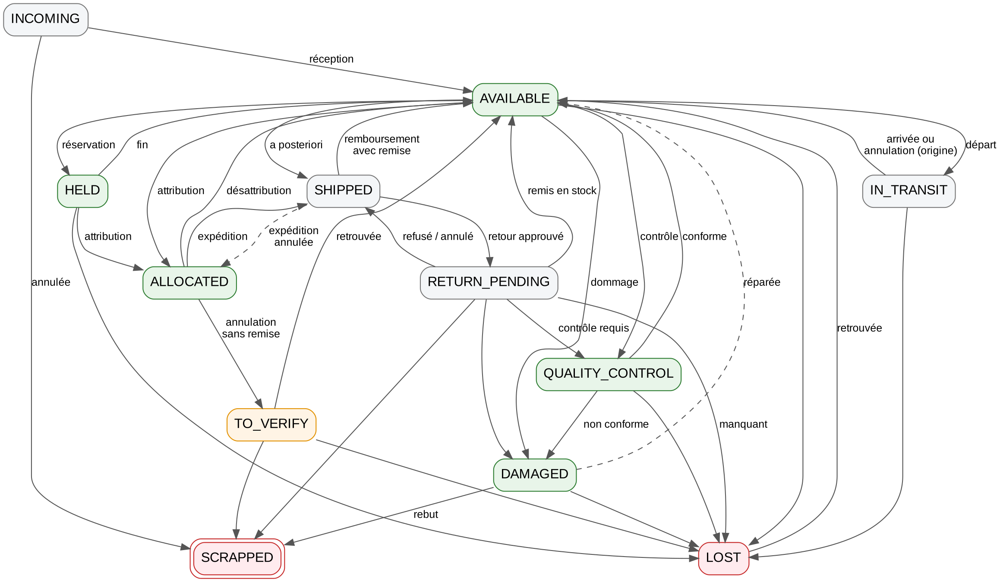
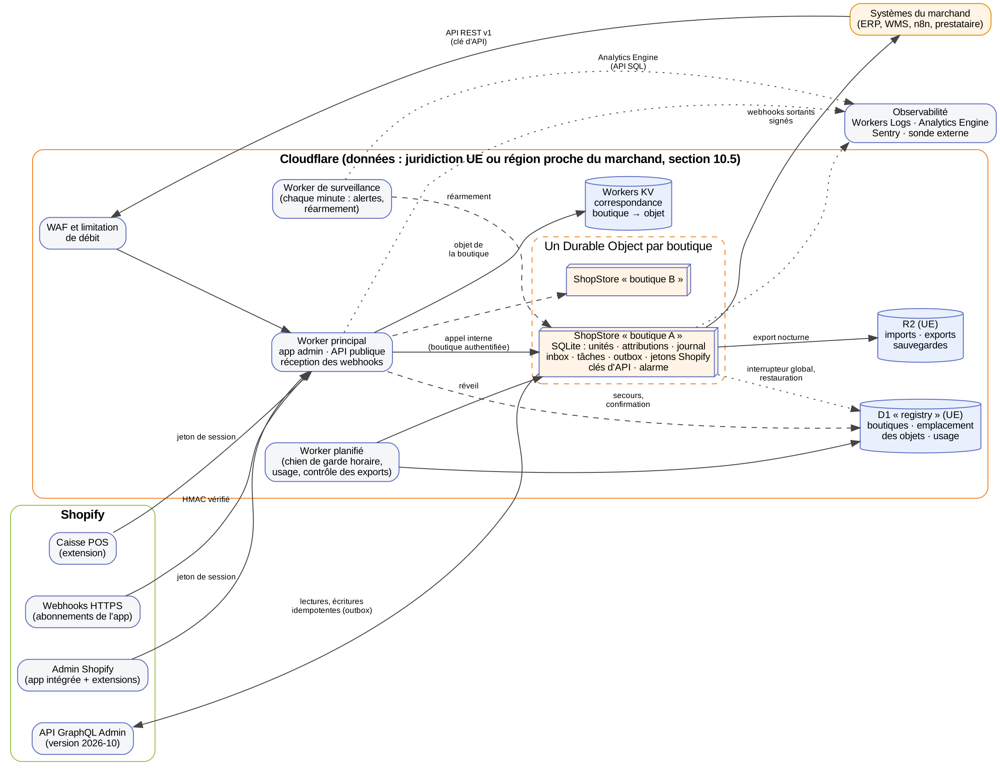
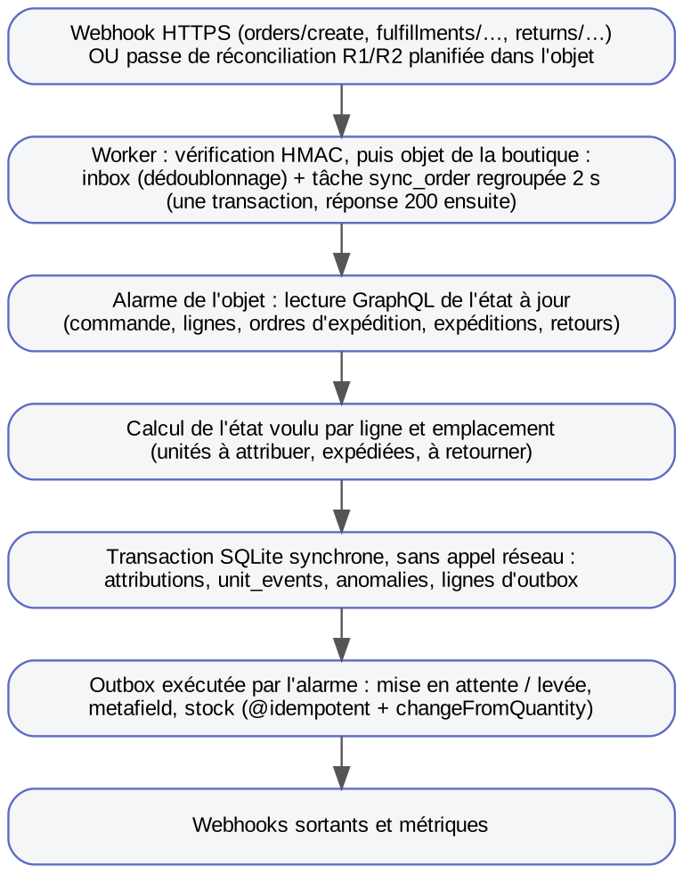

% Serialis — Spécification technique de réalisation
% App Shopify de gestion des stocks sérialisés
% Version 1.15 — 18 novembre 2026 — Thomas Cadalen (Cinfolog)

# 1. Objet du document

Ce document cadre la réalisation d'une app Shopify publique qui gère les stocks sérialisés : chaque unité physique vendue porte un identifiant propre (numéro de série, IMEI, numéro de cadre, référence interne) et l'app garantit qu'on sait, à tout moment, où est chaque unité, à quelle commande elle est rattachée et ce qui lui est arrivé.

« Serialis » est un nom de code provisoire. Le nom commercial reste à choisir (décision ouverte DO-1).

Le document sert de référence unique pour le développement, la recette et la mise en production. Il est écrit pour être exécuté : chaque exigence a un identifiant, chaque garantie a un test, chaque point non tranché est listé dans le registre des décisions ouvertes (section 21).

## 1.1 Contexte

Shopify suit le stock par variante et par emplacement, en quantités. Il ne sait pas quelle unité précise part dans quelle commande. Les marchands qui vendent des produits à numéro (électronique, vélos, montres, instruments, matériel professionnel ou médical, produits reconditionnés ou d'occasion) bricolent avec des tableurs, des notes de commande ou des apps peu robustes.

L'usage de l'app serialLogic par un marchand a mis en évidence des défauts précis, repris en section 22 et utilisés comme exigences négatives : l'app ne doit en reproduire aucun.

## 1.2 Concurrence observée (novembre 2026)

Les apps existantes (SerializeIt, Serializer, TrackJoy, serialLogic, la brique de numéros de série du logiciel d'entrepôt SKUSavvy) sont peu notées et vendues autour de 10 $ par mois. D'après leurs fiches sur l'App Store, elles saisissent ou attribuent un numéro à une commande, mais aucune ne combine : une API complète, le blocage de l'expédition tant qu'un numéro manque, la réconciliation automatique avec le stock Shopify, la gestion fine des modifications, retours et échanges, et la vente d'exemplaires uniques visibles sur la boutique. C'est l'espace visé.

# 2. Objectifs, non-objectifs et indicateurs

## 2.1 Objectifs

- O1 — Aucune commande expédiée sans numéro, sauf action humaine explicite et tracée.
- O2 — Aucune unité engagée dans deux commandes à la fois, garanti par la base de données.
- O3 — Écart entre unités et stock Shopify détecté en moins d'une heure, et corrigé automatiquement quand la cause est connue.
- O4 — Historique complet et non modifiable de chaque unité.
- O5 — Tout ce qui se fait dans l'interface se fait aussi par API, sauf la gestion des clés d'API elles-mêmes (création, révocation), réservée à l'interface pour qu'une clé volée ne puisse pas en créer d'autres.
- O6 — Utilisable par tout secteur : identifiants multiples, attributs personnalisables, plusieurs emplacements, caisse (POS).
- O7 — Conforme dès la publication aux exigences techniques et de conception Built for Shopify (performance, intégration, Polaris, App Bridge) ; demande du badge dès que l'app remplit les seuils d'usage et d'avis exigés par Shopify (installations actives, note), qui ne peuvent pas l'être le jour de la publication.

## 2.2 Non-objectifs (hors périmètre de la v1)

- Gestion d'entrepôt complète (emplacements de rayonnage, vagues de préparation, inventaires tournants). L'app s'intègre avec les logiciels d'entrepôt par API, elle ne les remplace pas.
- Gestion des lots et dates de péremption au sens pharmaceutique (traçabilité par lot sans numéro unitaire). Une unité peut porter une date de fin de garantie ou d'expiration, mais l'app ne gère pas des quantités par lot.
- Séparation des lignes de commande Shopify par unité. Une ligne de quantité 3 reste une ligne de quantité 3 dans Shopify ; ses 3 refs sont tenues par Serialis, par unité (F15). Séparer les lignes pendant le paiement n'est possible qu'avec une extension de checkout, réservée aux boutiques Shopify Plus : c'est une option à décider après la bêta (DO-11).
- Bons de commande fournisseurs.
- Marketplaces hors Shopify (Amazon, Mirakl…) : les commandes importées dans Shopify par un connecteur sont traitées comme les autres ; l'app ne parle pas directement aux marketplaces.
- Garantie et SAV complets (tickets, prises en charge). L'app expose les données d'unité (date de vente, fin de garantie) pour les outils de SAV.
- Production d'étiquettes physiques avancée : la v1 imprime des documents en PDF (bon de préparation, étiquettes avec la ref en clair), sans codes-barres ni pilote d'imprimante dédié. Aucune fonction de scan n'est prévue (ni lecteur, ni appareil photo) : une unité se désigne toujours par la saisie de sa ref ou par un choix dans une liste.

## 2.3 Indicateurs de réussite

| Indicateur | Cible | Mesure |
|---|---|---|
| Commandes suivies expédiées sans numéro | 0 hors action manuelle tracée | Requête sur `allocations` et `anomalies` |
| Délai d'attribution (web, mode automatique) | p95 inférieur à 30 s, p99 inférieur à 60 s | Métrique `allocation_latency_seconds` |
| Délai maximal de rattrapage d'une commande manquée | 15 min | Test de chaos T-CH-01 |
| Délai de détection d'un écart de stock | 60 min | Test de chaos T-CH-03 |
| Disponibilité de l'admin et de l'API | 99,9 % par mois | Sonde externe |
| Performance admin (P75) | LCP ≤ 2,5 s, CLS ≤ 0,1, INP ≤ 200 ms | Tableau de bord Web Vitals du Dev Dashboard |

# 3. Principes de conception

Ces principes priment sur toute autre considération ; en cas de doute pendant le développement, ils tranchent.

- P1 — **L'app est la source de vérité des unités, Shopify celle des commandes.** L'app ne déduit jamais une unité d'un texte de commande ; elle ne modifie jamais une commande, sauf la mise en attente d'expédition et le metafield de copie.
- P2 — **Synchronisation par état, pas par événement.** Un webhook ne transporte pas de vérité : il signale qu'un objet a changé. Le traitement relit l'objet à jour dans Shopify, calcule l'état attendu, compare avec la base et applique la différence. Rejouer un traitement ne change rien (idempotence) ; l'ordre d'arrivée des webhooks n'a pas d'importance.
- P3 — **Les invariants critiques sont dans la base.** Contraintes d'unicité, clés étrangères, contrôles et déclencheurs empêchent physiquement les états interdits, même en cas de bug applicatif.
- P4 — **Jamais de double mouvement de stock.** Pour chaque transition, une seule partie écrit le stock : Shopify (vente, expédition, remise en stock native) ou l'app (réception, contrôle qualité, transfert, rebut). C'est écrit dans la machine à états (section 7).
- P5 — **Écritures Shopify protégées.** Toute écriture de stock utilise la comparaison avant écriture (`changeFromQuantity`) et une clé d'idempotence déterministe.
- P6 — **Défaut sûr, réglable.** Par défaut, quand l'app ne sait pas, elle bloque l'expédition et ouvre une anomalie, plutôt que de laisser partir une commande incomplète ou de corriger le stock à l'aveugle. Chaque parti pris de ce type est un réglage (section 6.6) : le marchand peut choisir de ne pas bloquer, l'app détecte alors au lieu d'empêcher. Seuls les garde-fous de la section 6.6.3 ne se règlent pas.
- P7 — **Double filet.** Chaque flux a un chemin rapide (webhook) et un chemin de rattrapage (réconciliation périodique). Aucun flux ne dépend d'un webhook unique.
- P8 — **Minimisation des données.** Aucune donnée personnelle client (nom, e-mail, adresse, téléphone) n'est lue ni stockée ; celles que contiennent les webhooks de conformité sont lues le temps du traitement, sans être stockées.

# 4. Concepts

- **Boutique** : un magasin Shopify ayant installé l'app (un locataire).
- **Emplacement** : un emplacement de stock Shopify (entrepôt, magasin).
- **Article suivi** : une variante Shopify dont les unités sont suivies, avec un mode de suivi.
- **Unité** : un exemplaire physique d'un article suivi, avec au moins un identifiant.
- **Identifiant** : valeur typée (numéro de série, IMEI, numéro de cadre, référence interne, code fournisseur…). Une unité a un identifiant principal et peut en avoir d'autres.
- **Attribution** : le lien entre une unité et une ligne d'ordre d'expédition Shopify (`FulfillmentOrderLineItem`).
- **Ordre d'expédition** : objet Shopify `FulfillmentOrder`, qui regroupe les lignes d'une commande à expédier depuis un emplacement donné.
- **Mise en attente** : objet Shopify `FulfillmentHold` posé par l'app sur un ordre d'expédition pour empêcher l'expédition.
- **Anomalie** : écart détecté entre l'état attendu et l'état réel, avec gravité, cause probable et action proposée.

# 5. Modes de suivi

Le mode se choisit par article suivi.

## 5.1 Mode « interchangeable »

Plusieurs unités identiques partagent une variante Shopify (par exemple un modèle de vélo en taille M). Le client achète la variante ; l'app attribue une unité à la commande, automatiquement ou à la préparation.

- Stock Shopify de la variante à un emplacement = nombre d'unités physiquement présentes (voir invariants, section 8).
- Moment d'attribution réglable : **à la commande** (par défaut) ou **à la préparation** (le préparateur désigne l'unité au moment d'emballer, par saisie de la ref ou choix dans une liste).
- Règle de choix réglable : premier entré premier sorti (par défaut), première échéance (date de fin de garantie ou d'expiration la plus proche), ou manuelle.

## 5.2 Mode « exemplaire unique »

Chaque unité est une variante Shopify à part entière, avec un stock de 0 ou 1 : le client choisit son exemplaire (occasion, reconditionné, pièce unique). L'attribution est déduite de la variante achetée : il n'y a rien à choisir, donc rien qui puisse échouer.

- L'app peut créer elle-même les variantes (une valeur d'option par unité, nom d'option réglable, par défaut « Exemplaire ») ou rattacher des variantes existantes, y compris un produit à variante unique par exemplaire.
- Shopify accepte jusqu'à 2 048 variantes par produit et trois options. L'app alerte à 1 900 variantes et propose le passage à un produit par exemplaire, qui ne s'applique qu'aux nouveaux exemplaires (les variantes existantes restent sur leur produit jusqu'à leur nettoyage).
- Au-delà de 500 000 variantes dans une boutique, Shopify limite la création à 10 000 nouvelles variantes par jour (hors boutiques Plus) : l'app en tient compte dans ses imports (file étalée, avertissement préalable). La file est pilotée par l'erreur `VARIANT_THROTTLE_EXCEEDED` renvoyée par Shopify, et non par un seuil fixe, la documentation n'étant pas homogène sur les valeurs (certaines sources citent 50 000 variantes et 1 000 créations par jour) : l'avertissement préalable est donné dès 50 000 variantes.
- Article suivi en mode exemplaire unique : une ligne `tracked_items` au niveau du produit (`variant_gid` vide) ; chaque unité porte la variante qui la représente (`unique_variant_gid`).
- Les attributs d'unité (état, kilométrage, photos…) peuvent être copiés dans des metafields de variante pour l'affichage sur la boutique.
- Politique de stock imposée : suivi activé et vente hors stock refusée. Toute modification contraire dans Shopify ouvre une anomalie.
- Nettoyage après vente réglable : conserver la variante, la supprimer N jours après l'expédition s'il n'y a pas de retour ouvert, ou archiver le produit (produit par exemplaire). La dernière variante d'un produit ne pouvant pas être supprimée, le produit est alors archivé au lieu de supprimer sa variante. Si un exemplaire dont l'app a archivé le produit revient en stock (retour remis en stock, retrouvaille), l'app réactive le produit (`productUpdate`, `status` ACTIVE), ce qui le rend de nouveau vendable sur ses canaux (porte PV-22) ; l'archivage fait par l'app est noté sur l'unité pour ne jamais réactiver un produit archivé par le marchand.

# 6. Exigences fonctionnelles

Chaque exigence porte un identifiant repris dans les tests (section 18) et la traçabilité (section 22).

## 6.1 Catalogue et unités

- EF-01 — Activer le suivi sur une variante, choisir son mode, sa règle de choix, son moment d'attribution et les types d'identifiants exigés. Garde : le suivi de stock Shopify doit être activé sur la variante (l'app propose de l'activer). Désactiver le suivi n'est possible que si aucune unité n'est attribuée, en transit ou en retour attendu (l'app liste ces unités et attend leur expédition, leur réception ou leur traitement). Les unités en stock passent alors en UNTRACKED, sans aucune écriture : le stock Shopify ne change pas et le produit reste vendable. Elles restent consultables (historique) et l'article n'est plus synchronisé. Une réactivation du suivi sur la même variante rattache à l'article réactivé les unités de l'ancien article inactif et fait repasser l'article en phase d'initialisation : des exemplaires ont pu être vendus sans numéro pendant la désactivation, donc aucune unité UNTRACKED ne revient en stock automatiquement. Elles sont proposées « à confirmer » et ne reviennent en stock qu'une fois désignées (saisie de la ref ou choix dans une liste), dans la limite du déficit utilisable ; les autres restent UNTRACKED ou sont closes par sortie constatée. Une unité vendue avant la désactivation reste retrouvable (retour, rachat) avec son identifiant. Changer le mode (interchangeable ↔ exemplaire unique) d'un article qui a des unités passe par une conversion guidée, sans désactivation : simulation (variantes à créer ou à fusionner, commandes ouvertes concernées), arrêt de l'attribution automatique sur l'article, création d'un nouveau produit Shopify dédié à l'article converti (jamais le produit d'origine, qui peut garder d'autres variantes suivies dans l'autre mode), du nouvel article et de ses variantes (produit publié sur les canaux du produit d'origine, comme en 9.11), déplacement des unités avec leurs identifiants et leur historique, puis écritures ordonnées dans l'outbox : vers l'exemplaire unique, chaque nouvelle variante est créée avec un stock de 0 (vente hors stock refusée), puis, unité par unité, −1 sur l'ancienne variante avant +1 sur la nouvelle, pour qu'aucune unité ne soit jamais vendable deux fois ; même principe, retrait d'abord, pour revenir au mode interchangeable. Les unités attribuées à des commandes ouvertes restent sur leur variante d'origine jusqu'à leur expédition. Une anomalie suit la conversion jusqu'à ce que I1 soit vérifié sur les deux articles. L'ancien article reste actif jusqu'à l'expédition de ses unités attribuées, puis il est désactivé ; le nouveau produit étant distinct, le déclencheur d'exclusion des modes ne bloque pas la conversion, et les autres variantes du produit d'origine gardent leur suivi. Changer le moment d'attribution ou la règle de choix est possible à tout moment (réglages S-04 et S-05, avec les règles de changement de la section 6.6). Activation sur une variante qui a déjà du stock ou des commandes ouvertes : l'article passe en phase d'initialisation. Pendant cette phase, les unités sont créées par « enregistrement d'une unité déjà comptée » (section 7.2, sans écriture de stock), les écarts I1 et I3 sont affichés comme « unités à enregistrer » sans anomalie, le mode strict est inactif et les commandes ouvertes existantes ne sont mises en attente que si le marchand coche « appliquer aux commandes ouvertes ». Les quantités déjà expédiées avant `activated_at` (expéditions antérieures à l'activation) n'ont jamais à être couvertes par des unités : une commande expédiée la veille de l'activation, resynchronisée ensuite (mise à jour du transporteur, R1), n'ouvre aucune anomalie. Sinon, les lignes de cette variante dans les commandes ouvertes sont notées `preexisting` dans `order_line_tracking` (les autres lignes de la même commande gardent leur traitement) : elles ne sont ni attribuées ni mises en attente, mais quand elles partent, la ligne expédiée ouvre une anomalie « vente antérieure au suivi à désigner », l'écart I1 correspondant est marqué « expliqué », et le marchand désigne l'unité partie (AVAILABLE → SHIPPED, attribution a posteriori, sans écriture de stock puisque Shopify a déjà expédié). La phase se termine quand I1 est vérifié, ou sur décision explicite du marchand.
- EF-02 — Créer des unités, soit en ajoutant du stock (réception), soit en enregistrant une unité déjà comptée dans le stock Shopify (installation, reprise, résolution d'un écart « unités manquantes ») : saisie unitaire, saisie en série ou collage d'une liste de refs, import CSV avec rapport de validation avant écriture (simulation), API (unitaire et par lots de 1 000), génération automatique selon un motif (préfixe, compteur, suffixe, par boutique).
- EF-03 — Identifiants : plusieurs par unité, un principal ; unicité par boutique et par type (réglable : par boutique ou par produit) ; normalisation (espaces supprimés, majuscules optionnelles) ; validation optionnelle par type (contrôle de Luhn pour l'IMEI, expression régulière personnalisée).
- EF-04 — Attributs personnalisés par boutique : schéma déclaré (texte, nombre, date, booléen, liste, URL d'image), validé à l'écriture.
- EF-05 — Réception : une unité attendue passe en stock à un emplacement ; l'app incrémente le stock Shopify.
- EF-06 — Aucune suppression d'unité : une unité sort du stock par rebut ou perte, et reste consultable avec tout son historique.
- EF-07 — Recherche instantanée par n'importe quel identifiant, depuis l'app et depuis la barre d'action des pages commande et produit.
- EF-08 — Correction d'un identifiant (faute de frappe) : autorisée avec motif obligatoire, unicité revérifiée, ancienne valeur conservée dans l'historique et toujours trouvable par la recherche.
- EF-09 — Suppression d'une variante ou d'un produit suivi dans Shopify : les unités sont conservées ; celles en stock passent en anomalie « article supprimé » avec choix : rattacher à une autre variante (même produit physique, l'unité étant alors enregistrée comme déjà comptée si la nouvelle variante a un déficit, ou reçue sinon) ou sortir du stock par « sortie constatée », sans écriture.

## 6.2 Commandes

- EF-10 — Attribution automatique à la commande (mode interchangeable) depuis l'emplacement de l'ordre d'expédition.
- EF-11 — Mise en attente de l'ordre d'expédition dès la détection d'une ligne suivie sans unité ; levée quand toutes les lignes suivies de cet ordre sont attribuées. Réglage S-01 : le marchand peut choisir de ne pas bloquer (signalement seulement), par boutique, emplacement ou article.
- EF-12 — Attribution manuelle depuis le bloc de la page commande (admin), par saisie de la ref ou choix dans la liste des unités disponibles tant qu'aucune unité physique n'est en jeu (avant préparation), et depuis la caisse par saisie de la ref de l'unité en main (15.5).
- EF-13 — Pré-attribution d'unités à une commande provisoire (draft order), gardée dans l'app ; l'app pose au besoin la réservation native de la commande provisoire (F9), sans autre modification, et honore la pré-attribution à la création de la commande.
- EF-14 — Modification de commande (ajout, retrait, changement de quantité) : attributions recalculées.
- EF-15 — Annulation totale ou partielle : unités libérées selon la remise en stock choisie dans Shopify.
- EF-16 — Déplacement d'un ordre d'expédition vers un autre emplacement : attribution recalculée à la nouvelle origine.
- EF-17 — Expédition : unités passées à « expédiée » ; si une ligne suivie est expédiée sans unité, anomalie critique et attribution a posteriori possible.
- EF-18 — Copie des numéros dans un metafield de commande de l'espace de noms `serialis`, lisible par les autres outils qui ont accès aux commandes (factures, bons de préparation, n8n).
- EF-19 — Refs par unité sur les commandes : chaque unité d'une ligne suivie reçoit sa ref à la création de la commande (F1), sur tous les forfaits, pour toutes les commandes qui arrivent avec un ordre d'expédition ouvert (boutique en ligne, paiement accéléré, headless, admin, commandes provisoires, marketplaces). Les refs sont tenues et affichées par unité (bloc commande, metafield, impression), sans scinder les lignes de la commande Shopify (F15). Exceptions, listées en F15 : ventes en caisse remises sur place, attribution à la préparation (S-04), ordres programmés, ordres confiés à un prestataire logistique.

## 6.3 Retours, échanges, mouvements

- EF-20 — Retour : unités attendues en retour à l'approbation, puis traitées selon la disposition Shopify (remise en stock, contrôle requis, non remise en stock, manquant).
- EF-21 — Identification de l'unité retournée à la réception (saisie de sa ref, en entier ou par ses 4 derniers caractères, 15.5) quand la ligne en comptait plusieurs.
- EF-22 — Échange : les articles d'échange sont attribués comme une nouvelle ligne.
- EF-23 — Remboursement avec remise en stock hors processus de retour : même traitement qu'un retour remis en stock.
- EF-24 — Contrôle qualité, endommagé, rebut, perte : transitions manuelles ou API avec motif obligatoire.
- EF-25 — Transfert entre emplacements piloté par l'app : départ, transit, réception.
- EF-26 — Réservation manuelle d'une unité (client en magasin, acompte) avec date d'expiration optionnelle, exécutée à l'heure prévue (une tâche planifiée par réservation). L'unité réservée peut ensuite être vendue au client : choix en caisse ou attribution depuis la commande, avec confirmation, qui lève la réservation (F8, section 7.2).

## 6.4 Supervision

- EF-30 — File d'anomalies avec gravité, cause, action proposée en un clic, et résolution tracée.
- EF-31 — Tableau de bord : unités par état et emplacement, commandes en attente de numéro, anomalies ouvertes, santé de la synchronisation.
- EF-32 — Notifications : e-mail et webhook sortant pour toute anomalie critique ; récapitulatif quotidien.
- EF-33 — Bouton d'arrêt d'urgence par boutique : suspend l'attribution automatique ; toutes les nouvelles commandes suivies sont mises en attente.
- EF-34 — Historique d'unité : chaque événement, son auteur (personne, API, système) et sa cause.

## 6.5 Intégration et migration

- EF-40 — API publique REST complète (section 14).
- EF-41 — Webhooks sortants signés (section 14).
- EF-42 — Imports de migration : export JSON serialLogic, CSV générique avec correspondance de colonnes ; liaison des unités déjà vendues aux commandes passées.
- EF-43 — Export CSV des unités, attributions et événements.
- EF-44 — Déclencheurs Shopify Flow : « unité attribuée », « anomalie ouverte », « unité retournée ».

## 6.6 Réglages et partis pris

Chaque fois que la spécification fait un choix de fonctionnement qu'un marchand pourrait raisonnablement vouloir autrement (bloquer une commande, demander de confirmer une ref, traiter un retour d'une certaine façon), ce choix est un réglage. La valeur par défaut est le choix le plus sûr pour le stock et les expéditions ; quatre défauts privilégient la continuité de l'activité, avec leur raison dans le catalogue (S-02, S-11, S-24, S-32). Les choix non réglables sont des garde-fous qui empêchent une erreur de stock ou de traçabilité, des comportements de Shopify non vérifiés, ou des limites imposées par Shopify : ils sont listés en 6.6.3 avec leur raison.

### 6.6.1 Règles communes

- **Une seule source.** Le catalogue des réglages est une donnée du code (`settings.ts` : clé, type, valeurs permises, valeur par défaut, portées permises, règle de changement, incompatibilités, avertissement, et pour chaque valeur non par défaut le test qui prouve son comportement). L'interface, l'API (`/settings`) et les contrôles sont générés à partir de lui ; un réglage absent du catalogue n'existe pas.
- **Portées et valeur appliquée.** Un réglage se fixe pour la boutique (B) et, quand le catalogue le permet, pour un emplacement (E), un article suivi (A), un type d'identifiant (T) ou un attribut (At). La valeur appliquée à une situation se calcule pour son couple (article, emplacement) dans l'ordre article, emplacement, boutique, défaut. L'emplacement de référence est celui de l'ordre d'expédition au moment du calcul pour une commande (un ordre déplacé prend les valeurs de son nouvel emplacement), celui de la disposition pour un retour, celui de la réception, du transfert ou de l'unité dans les autres cas. Exception : sur un emplacement dont le stock est écrit par un système externe (S-23), S-21 est toujours inactif et S-22 vaut 2 h sauf valeur posée sur l'emplacement lui-même ; la valeur de la boutique ne s'y applique pas.
- **Pas de valeur figée, sauf trois exceptions.** La synchronisation (section 12.3) lit à chaque passage les valeurs appliquées. Elle reste idempotente au sens de P2 : mêmes données Shopify et mêmes réglages, même résultat. Seuls trois choix sont figés, parce qu'ils ont créé dans Shopify une structure qu'on ne peut pas refaire : le mode de réservation d'une commande provisoire, fixé à sa première pré-attribution (`draft_holds.reservation_mode`, S-12) ; le traitement des commandes ouvertes à l'activation d'un article (S-24) ; l'organisation et le nom d'option des produits d'exemplaires déjà créés (S-30, S-31).
- **Changement en cours de route.** Chaque réglage suit l'une de deux règles :
  - **Immédiat** : la nouvelle valeur ne vaut que pour les décisions suivantes et rien d'existant n'est recalculé (délais, règle de choix des prochaines attributions, notifications, présentation).
  - **Avec simulation** : ce qui est en cours sera traité autrement dès la prochaine synchronisation. `POST /settings/simulate` liste les objets concernés et les écritures Shopify prévues, et renvoie un identifiant de simulation valable 10 minutes ; `PATCH /settings` exige cet identifiant pour ces réglages et refuse (409) si l'état a changé depuis, ce qui impose une nouvelle simulation. À l'enregistrement, l'app programme la synchronisation de chaque objet concerné ; le résultat correspond à la simulation.
- **Incompatibilités.** Elles se contrôlent sur les valeurs appliquées de chaque couple (article, emplacement) existant, quel que soit le niveau où l'on enregistre : un enregistrement qui rendrait une combinaison interdite quelque part est refusé (422) avec la liste des couples en cause. Liste :
  - S-13 = sans expiration est refusé quand S-12 = réservation Shopify (l'app pose toujours une date de fin sur la réservation d'une commande provisoire) ;
  - S-32 = archiver le produit ne s'applique qu'à un exemplaire qui a son propre produit ; sinon, la variante est supprimée ;
  - ordres d'expédition confiés à un prestataire logistique : S-04 = préparation y est ignoré (attribution à la commande), et S-01 n'y agit que tant que Shopify accepte la mise en attente (sinon `hold_failed`) ;
  - articles en mode exemplaire unique : S-04, S-05, S-07 et S-08 sont sans objet et ignorés.
- **Effet sur les garanties.** L'écran et l'API signalent avant l'enregistrement chaque valeur qui affaiblit une garantie, avec son effet exact :
  - S-01 = ne pas bloquer : G3 devient une garantie de détection seulement ;
  - S-03 = respecter la levée : une commande peut partir sans numéro après une levée manuelle (L2) ;
  - S-07 = sans confirmation, S-17 = non : une unité mal désignée (expédition partielle, retour) n'est plus détectable par l'app ;
  - S-09 = résolution automatique : peut consommer un ajout manuel sans rapport fait dans Shopify ;
  - S-21 = oui : l'app écrit dans le stock Shopify sans validation humaine ;
  - S-22 au-delà de 10 min : G4 s'allonge d'autant ;
  - S-25 = sur décision : les écarts restent affichés « à enregistrer » sans anomalie tant que la phase n'est pas close ; un rappel apparaît chaque semaine sur l'accueil.
- **Traçabilité.** Chaque changement est inscrit dans `audit_log` (auteur, portée, valeur avant et après, identifiant de simulation). La page « Mes choix » liste toutes les valeurs différentes de la valeur par défaut, avec leur portée, leur auteur, leur date et leur effet, et permet de revenir au défaut.

### 6.6.2 Catalogue

La valeur par défaut est citée en premier. Portées : B boutique, E emplacement, A article suivi, T type d'identifiant, At attribut. Les identifiants S-10, S-18, S-20 et S-29 ne sont plus utilisés : ces choix sont devenus des règles fixes en v1.8 (6.6.3). S-06 (contrôle à l'emballage) a été retiré en v1.9 avec le scan.

**Commandes et blocage**

| Id | Réglage | Choix | Portée | Changement en cours de route |
|---|---|---|---|---|
| S-01 | Commande dont une ligne suivie n'a pas d'unité | Mettre l'expédition en attente (par défaut) · Ne pas bloquer, signaler seulement (anomalie `awaiting_unit` ; une expédition sans numéro ouvre `shipped_without_unit`, avec attribution a posteriori). Un ordre d'expédition est mis en attente si au moins une de ses lignes non couvertes a la valeur « mettre en attente » | B, E, A | Avec simulation : mises en attente de l'app levées, ou posées sur les ordres ouverts non couverts |
| S-02 | Étendue de la mise en attente | Lignes suivies sans unité seulement (par défaut : une partie seulement du catalogue est suivie, les autres articles de la commande ne doivent pas être retenus ; repli sur l'ordre entier si Shopify refuse ; l'app ne refusionne pas un ordre scindé par une mise en attente partielle) · Ordre d'expédition entier | B | Immédiat : vaut pour les mises en attente posées ensuite |
| S-03 | Mise en attente levée à la main par un utilisateur | L'app la repose s'il manque encore une unité (par défaut) · L'app respecte la levée : l'ordre est marqué (`app_holds.released_by_merchant_at`) et n'est plus remis en attente jusqu'à ce qu'il gagne une ligne non couverte (ligne ajoutée, quantité augmentée) ou change d'emplacement | B | Avec simulation : passer à « reposer » liste les ordres où la mise en attente sera reposée |
| S-04 | Moment d'attribution | À la commande (par défaut) · À la préparation (le préparateur désigne l'unité par saisie de sa ref, 15.5) | B, A | Avec simulation : les lignes non couvertes des commandes ouvertes suivent la nouvelle valeur ; les unités déjà attribuées le restent |
| S-05 | Unité proposée en premier | Premier entré, premier sorti (par défaut) · Première échéance (fin de garantie ou expiration) · Manuelle (aucune attribution automatique) | B, A | Immédiat : attributions suivantes |
| S-07 | Expédition partielle d'une ligne sans désignation des unités emballées | Premières unités attribuées, à confirmer (anomalie `shipped_unit_to_confirm`) (par défaut) · Premières unités attribuées, sans confirmation ; une correction reste possible avec un motif (transition « correction de désignation d'expédition ») | B | Immédiat : expéditions suivantes |
| S-08 | Unités libérées quand une quantité baisse (commande ou commande provisoire) | Dernières attribuées ou réservées (par défaut) · Premières | B | Immédiat |
| S-09 | Ligne retirée ou annulée sans information de remise en stock | Unité à vérifier, décision humaine (par défaut) · Résolution automatique quand le niveau Shopify relu montre un déficit utilisable, les unités à vérifier les plus anciennes d'abord (sinon, unité à vérifier) | B | Avec simulation : unités déjà à vérifier qui seraient résolues |
| S-11 | Commandes de test | Ignorées (par défaut : une commande de test n'expédie rien de réel, la bloquer gênerait les essais) · Traitées comme les autres | B | Avec simulation : commandes de test ouvertes attribuées, ou attributions et mises en attente levées |

**Client (F15)**

| Id | Réglage | Choix | Portée | Changement en cours de route |
|---|---|---|---|---|
| S-46 | Refs visibles par le client (lot 5) : page de remerciement, page de statut de commande, qui est aussi la page de la commande dans le compte client | Non (par défaut) · Oui : l'extension affiche, par article suivi, les refs attribuées, ou « en cours d'attribution » tant que la synchronisation n'est pas passée ; une ref remplacée ensuite s'affiche à jour, puisqu'elle n'est écrite dans aucune propriété de ligne. Contrôle d'accès : section 13.5 | B, A | Immédiat |

**Commandes provisoires et réservations**

| Id | Réglage | Choix | Portée | Changement en cours de route |
|---|---|---|---|---|
| S-12 | Réservation des unités pré-attribuées à une commande provisoire | Réservation de Shopify sur la commande provisoire, posée par l'app après avertissement (F9) (par défaut) · Mise de côté par l'app (`reserved`) ; la facture devra alors être envoyée avec l'option Shopify qui ignore les règles de stock | B | Immédiat : vaut pour les commandes provisoires pré-attribuées ensuite ; le mode d'une commande provisoire est figé à sa première pré-attribution |
| S-13 | Durée de réservation par défaut | 72 h (par défaut) · de 1 h à 90 jours · sans expiration (réservations manuelles et S-12 = mise de côté seulement) | B | Immédiat : réservations suivantes |

**Caisse et préparation**

| Id | Réglage | Choix | Portée | Changement en cours de route |
|---|---|---|---|---|
| S-14 | Unité réservée manuellement choisie en caisse ou à la préparation | Acceptée après confirmation (par défaut) · Refusée | B, E | Immédiat |
| S-15 | Durée du verrou d'une unité choisie en caisse | 15 min (par défaut) · de 5 à 60 min | B | Immédiat : choix suivants |
| S-16 | Numéro imprimé sur le ticket de caisse (propriété visible de la ligne) | Oui (par défaut) · Non (la propriété technique masquée reste écrite) | B | Immédiat : choix suivants |

**Retours**

| Id | Réglage | Choix | Portée | Changement en cours de route |
|---|---|---|---|---|
| S-17 | Contrôle du numéro à la réception d'un retour | Oui : la ref de l'unité reçue doit être saisie (en entier ou par ses 4 derniers caractères, 15.5) avant que la disposition ne s'applique, sans liste à cocher (par défaut) · Non : sur une ligne d'une seule unité, l'unité attribuée est réputée revenue | B | Avec simulation : retours en attente d'identification dont la disposition s'appliquera sans saisie |
| S-19 | Unité « non remise en stock » au retour | Mise au rebut (par défaut) · Gardée en endommagé | B, E (emplacement de la disposition) | Immédiat : dispositions suivantes |

**Stock et écarts**

| Id | Réglage | Choix | Portée | Changement en cours de route |
|---|---|---|---|---|
| S-21 | Correction automatique des écarts (mode strict, section 8.1) | Non (par défaut) · Oui, à la baisse seulement (toujours inactif sur un emplacement externe) | B, E | Avec simulation : corrections prévues sur les anomalies ouvertes |
| S-22 | Délai de grâce avant qu'un écart devienne une anomalie | 10 min (par défaut ; 2 h sur un emplacement externe) · de 5 min à 24 h | B, E | Immédiat |
| S-23 | Stock de l'emplacement écrit par un système externe (section 6.7) | Non (par défaut) · Oui : l'app n'écrit plus aucune quantité à cet emplacement | E | Avec simulation. Passage à « oui » refusé tant que des écritures de quantité vers cet emplacement attendent dans l'outbox. Passage à « non » : chaque réception ou sortie différée (`deferred_receipts`) est réévaluée, appliquée sans écriture s'il existe un déficit ou un excédent utilisable, sinon proposée comme réception ou sortie avec écriture après confirmation |
| S-24 | Activation du suivi sur un article qui a des commandes ouvertes | Ne pas les bloquer : ventes antérieures au suivi à désigner (par défaut : bloquer des commandes déjà payées pour des lignes dont personne ne peut encore désigner l'unité arrêterait les expéditions du jour) · Les mettre en attente | A (choisi à l'activation, figé) | À l'activation seulement |
| S-25 | Fin de la phase d'initialisation | Automatique dès que le stock concorde (I1) (par défaut) · Sur décision du marchand | B, A | Immédiat |

**Réception et transferts**

| Id | Réglage | Choix | Portée | Changement en cours de route |
|---|---|---|---|---|
| S-26 | État d'une unité reçue | En stock, vendable (par défaut) · En contrôle qualité (contrôle à l'arrivée) | B, E, A | Immédiat : réceptions suivantes |
| S-27 | Attribut obligatoire manquant à la réception | Bloque la validation de l'arrivage (par défaut) · Enregistre l'unité et la signale (`missing_required_attribute`) | B, A | Immédiat |
| S-28 | Délai d'alerte d'un transfert non reçu | 7 jours (par défaut) · de 1 à 60 jours | B | Immédiat |
| S-42 | Délai pour annuler une mise au rebut faite par erreur | 7 jours (par défaut) · de 1 à 30 jours | B | Immédiat |

**Exemplaire unique**

| Id | Réglage | Choix | Portée | Changement en cours de route |
|---|---|---|---|---|
| S-30 | Organisation des exemplaires | Variantes d'un même produit (par défaut) · Un produit par exemplaire | B, A | Immédiat : nouveaux exemplaires ; les exemplaires existants restent sur leur produit |
| S-31 | Nom de l'option des variantes d'exemplaire | « Exemplaire » (par défaut) · Libre | B, A | Immédiat : produits que l'app crée ensuite. Les options appartiennent au produit chez Shopify : un produit existant garde le nom de son option |
| S-32 | Après la vente d'un exemplaire | Supprimer la variante 30 jours après l'expédition, sans retour ouvert (par défaut : Shopify limite le nombre de variantes par produit ; l'unité garde tout son historique et la variante est recréée en cas de retour) · Conserver · Archiver le produit (seulement pour un exemplaire qui a son propre produit, sinon suppression de la variante) ; délai de 1 à 365 jours | B, A | Avec simulation : nettoyages programmés et non encore exécutés |
| S-33 | Exemplaire revenu en stock alors que l'app avait archivé son produit | Réactiver le produit (par défaut) · Le laisser archivé (anomalie d'information `unique_product_left_archived`) | B, A | Immédiat |
| S-34 | Attribut copié dans un metafield de variante, pour la boutique en ligne | Non (par défaut) · Oui ; stocké dans `attribute_schemas.storefront_visible` | At | Avec simulation : copie ou retrait sur les exemplaires existants |

**Identifiants**

| Id | Réglage | Choix | Portée | Changement en cours de route |
|---|---|---|---|---|
| S-35 | Portée de l'unicité | Boutique (par défaut) · Produit | T | Avec simulation des conflits ; le passage à « boutique » est refusé tant qu'il reste des doublons |
| S-36 | Normalisation | Espaces supprimés : oui (par défaut) · non ; majuscules : oui (par défaut) · non (deux choix indépendants, colonnes `strip_spaces` et `normalize_upper`) | T | Avec simulation des conflits |
| S-37 | Validation | Aucune (par défaut ; contrôle de Luhn pour le type IMEI) · Luhn · Expression régulière | T | Immédiat : saisies suivantes |

**Données partagées et notifications**

| Id | Réglage | Choix | Portée | Changement en cours de route |
|---|---|---|---|---|
| S-38 | Copie des numéros dans un metafield de commande (EF-18) | Oui (par défaut) · Non | B | Avec simulation : retrait du metafield des commandes ouvertes, ou remplissage |
| S-39 | Fusionné dans S-46 en v1.12 (même extension, mêmes pages) | — | — | — |
| S-40 | Notifications | Anomalies critiques par e-mail au propriétaire de la boutique, récapitulatif quotidien (par défaut) · Destinataires multiples, webhook sortant, récapitulatif désactivé | B | Immédiat |
| S-41 | Gravité de chaque type d'anomalie (section 12.7) | Valeur du catalogue (par défaut) · Un cran plus haut ou plus bas ; les anomalies qui signalent la perte d'une écriture, d'une synchronisation ou d'une garantie ne descendent pas sous « avertissement » (`outbox_dead`, `webhook_silence`, `reconnect_required`, `inventory_invariant_violation`, `bulk_operation_slow`, `unique_variant_policy_changed`, `tracking_disabled_in_shopify`) | B | Immédiat : anomalies ouvertes reclassées |

### 6.6.3 Ce qui n'est pas réglable, et pourquoi

| Règle fixe | Pourquoi |
|---|---|
| Une unité n'est engagée que dans une seule commande active (G1) | Sinon deux clients attendent le même objet. |
| Pour chaque mouvement, une seule partie écrit le stock (P4) ; chaque écriture est protégée par comparaison et clé d'idempotence (P5) ; un « +1 » n'est jamais écrit s'il existe un déficit utilisable | C'est ce qui empêche les doubles comptages, cause des écarts de serialLogic. |
| L'app n'ajoute jamais de stock d'elle-même pour corriger un écart | Un stock manquant peut être une unité réellement perdue ; l'ajouter la rendrait vendable alors qu'elle n'existe plus. Le mode strict (S-21) ne corrige qu'à la baisse. |
| Retrait avant ajout dans toute écriture en plusieurs temps | Aucune unité ne doit être vendable deux fois, même une seconde. |
| Les quantités « contrôle qualité » et « endommagé » sont tenues par l'app dans Shopify (ancien réglage S-20) | Si un autre outil écrivait aussi ces quantités, la vérification du stock vendable (I3) ne pourrait plus distinguer une erreur d'un mouvement légitime, et une unité en contrôle pourrait être vendue. |
| Sur une ligne de plusieurs unités, l'unité retournée est identifiée par la saisie de sa ref (15.5 ; ancien réglage S-18) | Remettre en stock la mauvaise unité casse la traçabilité, et la corriger ensuite demanderait d'échanger deux unités déjà traitées. |
| Les unités d'un transfert natif Shopify sont désignées une à une par saisie de leur ref (15.5 ; ancien réglage S-29) ; la réception d'un transfert piloté par l'app se fait en désignant les unités arrivées | Une désignation automatique fausse ne peut plus être corrigée sans risque une fois le carton parti ; la réception est la désignation des unités arrivées. |
| Un ordre d'expédition programmé (précommande, abonnement) n'est attribué que lorsqu'il est dû (ancien réglage S-10) | Le comportement de Shopify (mise en attente, engagement du stock) sur un ordre programmé n'est pas vérifié ; à rouvrir après une porte de vérification. |
| Exemplaire unique : suivi de stock activé et vente hors stock refusée ; une commande portant sur un exemplaire non disponible est mise en attente quelle que soit S-01 | Sinon la même pièce peut être vendue à deux clients, ou partir alors qu'elle n'existe peut-être plus. |
| L'arrêt d'urgence (EF-33) met en attente toutes les nouvelles commandes suivies, quelle que soit S-01 | C'est sa fonction. |
| Aucune unité ni aucun événement d'historique n'est supprimé ; une correction d'identifiant ou de désignation exige un motif | Traçabilité et garantie : on doit toujours pouvoir dire où est passée une unité. |
| La vente en caisse l'emporte sur une attribution en ligne de la même unité | L'unité est déjà partie avec le client. |
| Pas de mise en attente sur un ordre déjà accepté par un prestataire logistique, ni d'attribution à la préparation sur ses ordres | Shopify refuse la mise en attente, ou ne transmettrait plus la demande d'expédition au prestataire ; le prestataire donne le numéro par l'API. |
| Pas de blocage du paiement en caisse sans numéro en v1 | L'API de caisse ne le permet pas à ce jour ; à revoir au lot 3 (DO-4). |
| Unités d'un article réactivé proposées « à confirmer » | Des ventes sans numéro ont pu avoir lieu pendant la pause du suivi. |
| Changement de mode de suivi uniquement par la conversion guidée | Elle seule garantit qu'aucune unité n'est vendable deux fois pendant le passage. |
| Aucune donnée personnelle client lue ni stockée (P8) ; aucun champ libre destiné à des données de client | Minimisation des données, exigée aussi par Shopify. |

## 6.7 Cas particuliers de catalogue et d'emplacement

- Emplacement dont le stock est écrit par un système externe (logisticien, ERP, logiciel d'entrepôt qui pousse des quantités dans Shopify) : réglage par emplacement « stock écrit par un système externe ». Sur un tel emplacement, l'app n'écrit jamais de quantité (P4 s'applique avec ce troisième écrivain) : la réception devient un enregistrement d'unité déjà comptée, mis en attente (et non refusé) tant que le déficit n'est pas visible, puis appliqué dès qu'il apparaît ; les sorties deviennent des sorties constatées, elles aussi mises en attente tant que l'excédent n'est pas visible, les transferts des transferts constatés, les mouvements entre états des désignations sans écriture ; le mode strict y est interdit et le délai de grâce de I1 passe à 2 h (réglable). Les mises en attente et les attributions fonctionnent normalement.

- Emplacement désactivé dans Shopify : Shopify demande de traiter le stock et les commandes d'un emplacement avant de le désactiver ; si des unités y restent malgré tout dans l'app, anomalie « unités sur emplacement inactif » avec assistant de transfert.
- Nouvel emplacement : importé automatiquement (`locations/create`), utilisable dès sa création.

# 7. Machine à états des unités

## 7.1 États

| État | Signification | Compté dans le stock physique de l'emplacement | Quantité Shopify correspondante |
|---|---|---|---|
| INCOMING | Attendue, pas encore reçue | Non | aucune |
| AVAILABLE | En stock, vendable | Oui | `available` |
| HELD | Réservée (manuellement, ou pré-attribuée à une commande provisoire) | Oui | `reserved` pour une réservation manuelle ; `committed` pour une pré-attribution couverte par la réservation native de la commande provisoire |
| ALLOCATED | Attribuée à une ligne de commande non expédiée | Oui | `committed` |
| QUALITY_CONTROL | En contrôle | Oui | `quality_control` |
| DAMAGED | Endommagée, non vendable | Oui | `damaged` |
| IN_TRANSIT | En transfert entre deux emplacements | Non | aucune |
| SHIPPED | Expédiée ou remise au client | Non | aucune |
| RETURN_PENDING | Retour approuvé, pas encore reçu | Non | aucune |
| TO_VERIFY | Sortie du stock Shopify sans destination connue (ex. annulation sans remise en stock) | Non | aucune |
| LOST | Perdue | Non | aucune |
| SCRAPPED | Mise au rebut (état final) | Non | aucune |
| UNTRACKED | Suivi arrêté : l'unité existe encore physiquement, mais l'app ne la suit plus (le stock Shopify n'est pas touché) | Non | aucune (l'app ne contrôle plus cet article) |

Règle de cohérence garantie par la base : un état « compté » exige un emplacement renseigné ; une unité SHIPPED ou RETURN_PENDING garde l'emplacement d'où elle est partie (utile à une annulation d'expédition) ; IN_TRANSIT exige un emplacement d'origine et de destination, et garde l'état d'origine de l'unité (`transit_status` : AVAILABLE, QUALITY_CONTROL ou DAMAGED), qu'elle retrouve à l'arrivée.

Schéma des transitions, simplifié : l'état UNTRACKED, les créations, les transferts depuis QUALITY_CONTROL ou DAMAGED, les sorties constatées et quelques transitions de réparation ne sont pas dessinés ; le tableau ci-dessous fait foi.

## 7.2 Transitions

« Écrit le stock » indique qui modifie le stock Shopify. **Shopify** : Shopify le fait lui-même, l'app n'écrit rien. **App** : l'app écrit, avec comparaison avant écriture et clé d'idempotence. **—** : pas d'effet sur le stock.

| De | Vers | Déclencheur | Garde | Écrit le stock |
|---|---|---|---|---|
| (création) | INCOMING | Création sans réception immédiate | Identifiants valides et uniques | — |
| (création) | AVAILABLE, QUALITY_CONTROL ou DAMAGED | Création avec réception (en stock, en contrôle à l'arrivée, ou abîmée) | Idem + emplacement actif | App : +1 dans l'état correspondant |
| (création) | AVAILABLE, QUALITY_CONTROL ou DAMAGED | Enregistrement d'une unité déjà comptée dans Shopify (installation, phase d'initialisation, reprise, résolution d'un écart « unités manquantes ») | Identifiants valides et uniques ; déficit utilisable (section 8) > 0 à cet emplacement et dans l'état visé : pour AVAILABLE, l'écart doit porter sur `available` + `committed` + `reserved` + `safety_stock` comparé aux unités AVAILABLE, ALLOCATED et HELD (le stock de sécurité réglé dans l'admin correspond à des unités présentes, qui restent AVAILABLE dans l'app ; les quantités `quality_control` et `damaged` étant égales aux unités de ces états), sinon l'assistant propose l'état réellement en écart ; une unité au plus par unité de déficit | — (le stock Shopify ne change pas) |
| (création) | SHIPPED | Reprise d'une vente passée (migration) | Ligne de la commande lue dans Shopify : même variante, quantité expédiée non encore couverte ; attribution `fulfilled` de source `migration` créée dans la même transaction | — |
| (création) | état de la disposition (AVAILABLE, QUALITY_CONTROL, DAMAGED, SCRAPPED ou LOST) | Retour d'une vente antérieure au suivi : l'article retourné a été expédié avant `activated_at`, aucune unité n'existe | Saisie de la ref de l'unité reçue (identifiant inconnu de l'app) ; ligne de retour portant sur une expédition antérieure à l'activation ; ce retour fournit lui-même le déficit qui justifie la création (il n'est pas compté dans les quantités expliquées) | Shopify (remise en stock faite par Shopify selon la disposition) ; pour QUALITY_CONTROL ou DAMAGED, mêmes écritures que les dispositions correspondantes (PV-3) |
| (création) | SHIPPED (vente historique) | Reprise d'une vente trop ancienne pour être lue (repli de PV-18) | Aucune attribution ; identifiant et numéro de la commande, fournis par le fichier d'import, conservés dans `historical_order_ref` | — |
| INCOMING | AVAILABLE | Réception | Emplacement actif | App : `available` +1 |
| INCOMING | QUALITY_CONTROL ou DAMAGED | Réception avec contrôle à l'arrivée, ou réception d'une unité abîmée | Emplacement actif ; motif pour DAMAGED | App : `quality_control` +1 ou `damaged` +1 (l'unité n'est jamais vendable entre-temps) |
| INCOMING | SCRAPPED | Annulation avant réception (unité jamais livrée) | Motif | — |
| AVAILABLE | ALLOCATED | Attribution (auto, désignation, caisse, API) | Unité à l'emplacement de l'ordre d'expédition ; variante identique (vérifié par déclencheur) | Shopify (déjà passé en `committed` à la commande) |
| ALLOCATED | AVAILABLE | Désattribution : retrait de ligne avec remise en stock, annulation avec remise en stock (`CANCEL`), déplacement d'ordre, action manuelle | — | Shopify (remise en stock native) ; en désattribution manuelle sans changement de commande : — |
| ALLOCATED | SHIPPED | Expédition de la ligne | — | Shopify |
| SHIPPED ↔ ALLOCATED (deux unités d'une même ligne, en une transaction) | — | Correction de désignation d'expédition : l'unité X marquée provisoirement expédiée n'est pas partie, l'unité Y l'est | Anomalie `shipped_unit_to_confirm` ouverte sur cette ligne, ou motif saisi par un utilisateur (S-07 = sans confirmation) ; X et Y de même variante, attribuées à la même ligne et au même emplacement ; chaque unité garde son attribution, et ce sont les autres colonnes qui sont échangées (statut `active` ou `fulfilled`, `fulfilled_at`, références d'expédition), ce qui reste compatible avec l'index unique sur `unit_id` | — (aucun effet sur le stock) |
| SHIPPED | ALLOCATED | Annulation de l'expédition (`fulfillments/update`, statut annulé) | La même attribution repasse de `fulfilled` à `active` ; aucun retour en cours | Shopify (remis en `committed`) |
| ALLOCATED | TO_VERIFY | Annulation ou remboursement d'une ligne non expédiée sans remise en stock (`RefundLineItem.restockType` = `NO_RESTOCK`) ; retrait de ligne par modification de commande sans remise en stock, ou dont la remise en stock n'est pas établie (F3) | — | Shopify |
| AVAILABLE | SHIPPED | Expédition sans attribution préalable (attribution a posteriori) | Anomalie ouverte | Shopify |
| AVAILABLE | HELD | Réservation manuelle, ou pré-attribution sur une commande provisoire (F9) | Avertissement si l'unité est nécessaire à une quantité en attente (`uncovered_lines`) à cet emplacement | Réservation manuelle : App : `available` → `reserved` (`hold_moved_stock` = 1). Pré-attribution : — (`hold_moved_stock` = 0), la réservation native de la commande provisoire, posée par l'app si besoin, compte la quantité en `committed` |
| HELD | AVAILABLE | Fin de réservation, expiration, ligne retirée de la commande provisoire | — | App : `reserved` → `available` si `hold_moved_stock` = 1 ; sinon — |
| HELD | ALLOCATED | Attribution de l'unité réservée à la commande issue de la réservation, ou vente de l'unité réservée manuellement par une attribution confirmée depuis la commande (en caisse, la réservation est levée dès le choix de l'unité, F8) | Réservation liée à cette commande, ou confirmation explicite de la levée ; unité à l'emplacement de l'ordre d'expédition ; même variante | Si `hold_moved_stock` = 1 : App : `reserved` → `available` dans la même opération que l'attribution (Shopify a déjà engagé une quantité disponible à la commande) ; sinon — (la réservation de la commande provisoire devient l'engagement de la commande) |
| AVAILABLE | QUALITY_CONTROL | Mise en contrôle | Motif | App : `available` → `quality_control` |
| QUALITY_CONTROL | AVAILABLE | Contrôle conforme | — | App : `quality_control` → `available` |
| QUALITY_CONTROL | DAMAGED | Contrôle non conforme | Motif | App : un seul déplacement `quality_control` → `damaged` (`inventoryMoveQuantities`) ; si la porte PV-13 montrait que ce déplacement direct est refusé : `quality_control` −1 puis `damaged` +1 (retrait d'abord) |
| AVAILABLE | DAMAGED | Déclaration de dommage | Motif | App : `available` → `damaged` |
| ALLOCATED | DAMAGED | Unité attribuée trouvée endommagée à la préparation (enchaînement ALLOCATED → AVAILABLE → DAMAGED dans une seule transaction, pour qu'elle ne soit pas réattribuée entre les deux) | Motif | App : `available` → `damaged` (la quantité engagée de la ligne reste en `committed` ; une autre unité AVAILABLE lui est attribuée s'il en reste, sinon la ligne attend une unité) |
| ALLOCATED | LOST | Unité attribuée introuvable à la préparation (enchaînement atomique comme pour DAMAGED) | Motif | App : `available` −1 (la quantité engagée de la ligne reste en `committed` ; une autre unité lui est attribuée s'il en reste) |
| HELD | DAMAGED | Dommage sur une unité réservée | Motif ; réservation levée | App : `reserved` → `damaged` si `hold_moved_stock` = 1 (déplacement direct, porte PV-13 ; repli : `reserved` −1 puis `damaged` +1), sinon `available` → `damaged` |
| DAMAGED | QUALITY_CONTROL | Retour d'atelier, à contrôler | — | App : `damaged` → `quality_control` (déplacement direct, PV-13 ; même repli) |
| DAMAGED | AVAILABLE | Réparée ou reconditionnée, remise en vente | Motif | App : `damaged` → `available` |
| DAMAGED | SCRAPPED | Rebut | Motif | App : `damaged` −1 (`on_hand` −1) |
| AVAILABLE ou QUALITY_CONTROL | SCRAPPED | Rebut direct (unité invendable constatée, sans passer par DAMAGED) | Motif | App : `available` −1 ou `quality_control` −1 |
| AVAILABLE, HELD, QUALITY_CONTROL ou DAMAGED | LOST ou SCRAPPED | Sortie constatée : la quantité a déjà été retirée dans Shopify (ajustement manuel, variante supprimée) et l'on désigne l'unité correspondante | Excédent utilisable (section 8), mesuré sur un niveau relu dans la même tâche, > 0 à l'emplacement (et, pour QUALITY_CONTROL ou DAMAGED, dans cet état) ; une unité au plus par unité d'excédent ; variante supprimée : sans garde, Shopify n'ayant plus de stock pour elle | — (le stock Shopify a déjà changé), sauf pour une unité HELD dont l'app avait déplacé la quantité (`hold_moved_stock` = 1) : si l'excédent porte sur `available` et que la quantité `reserved` déplacée par l'app est intacte, App : `reserved` → `available` (la réservation de l'unité sortie est libérée) |
| AVAILABLE | IN_TRANSIT | Départ constaté : mise en transit d'une expédition de transfert natif dans laquelle l'unité a été désignée (emballée) | Unité désignée dans cette expédition ; quantité désignée ≤ quantité expédiée ; `transit_status` = AVAILABLE | — (Shopify gère la quantité du transfert) |
| IN_TRANSIT | AVAILABLE à la destination, ou à l'origine si le transfert est annulé | Arrivée constatée ou annulation d'un transfert natif | Quantité acceptée à la réception de l'expédition non dépassée (ou transfert annulé) ; désignation des unités exigée si la réception est partielle | — |
| AVAILABLE (emplacement A) | AVAILABLE (emplacement B) | Transfert constaté : transfert natif Shopify fait hors de l'app | Excédent utilisable en A et déficit utilisable en B, sur des niveaux relus ; une unité au plus par unité d'écart | — |
| AVAILABLE, HELD, QUALITY_CONTROL ou DAMAGED | LOST | Déclaration de perte | Motif ; réservation levée si HELD | App : quantité de l'état où Shopify compte l'unité −1 : `available`, `quality_control` ou `damaged` selon l'état d'origine ; pour HELD, `reserved` si `hold_moved_stock` = 1, sinon `available` (la quantité réservée par la commande provisoire reste en `committed`, que l'app ne peut pas modifier) |
| AVAILABLE, QUALITY_CONTROL ou DAMAGED | IN_TRANSIT | Départ de transfert (par exemple envoi d'unités endommagées vers un atelier central) | Destination active et différente ; `transit_status` = état de départ | App : quantité de l'état de départ −1 à l'origine |
| IN_TRANSIT | état de départ (`transit_status`) | Réception de transfert | — | App : quantité de cet état +1 à la destination (activation préalable de l'article à l'emplacement si besoin) |
| IN_TRANSIT | LOST | Transfert non reçu, déclaré perdu | Motif | — |
| IN_TRANSIT | état de départ, à l'origine | Annulation du transfert avant réception | Transfert non reçu | App : quantité de cet état +1 à l'origine |
| SHIPPED | RETURN_PENDING | Retour approuvé (`returns/approve`, ou `returns/request` pour un retour créé directement à l'état ouvert) | Attribution expédiée existante | — |
| SHIPPED (vente historique) | RETURN_PENDING | Retour Shopify sur une unité reprise en vente historique | `historical_order_ref` = commande du retour ; une attribution `fulfilled` de source `migration` est créée dans la même transaction pour la ligne retournée, avec l'emplacement de l'unité mis à celui du retour | — |
| RETURN_PENDING | SHIPPED | Retour refusé ou annulé | — | — |
| SHIPPED | AVAILABLE, QUALITY_CONTROL ou DAMAGED | Rachat ou reprise d'une unité vendue (occasion, reconditionnement), sans retour Shopify | Aucun retour ouvert ; motif obligatoire ; l'attribution d'origine passe en `returned` (historique conservé) | App : +1 dans l'état d'arrivée, comme une réception ; aucune écriture s'il existe un déficit utilisable dans cet état ; si le déficit porte sur `available` et que l'arrivée est QUALITY_CONTROL ou DAMAGED, déplacement `available` → état d'arrivée |
| RETURN_PENDING ou SHIPPED | AVAILABLE | Disposition « remise en stock » ou remboursement avec remise en stock (`RETURN`, ou `LEGACY_RESTOCK` sur ligne expédiée) | Unité identifiée ; emplacement = celui de la disposition ou de `RefundLineItem.location` | Shopify |
| RETURN_PENDING ou SHIPPED | AVAILABLE (mode exemplaire unique, variante supprimée par le nettoyage) | Remise en stock d'un exemplaire dont la variante n'existe plus | Unité identifiée | App : recréation de la variante avec un stock de 1 (Shopify ne peut rien remettre en stock sur une variante supprimée) ; pour une disposition « contrôle requis » ou « garder en endommagé », recréation avec un stock disponible de 0 puis +1 dans l'état visé (QUALITY_CONTROL ou DAMAGED) |
| RETURN_PENDING | QUALITY_CONTROL | Disposition « contrôle requis » (`PROCESSING_REQUIRED`) | — | Selon le comportement de stock de Shopify pour cette disposition, figé par la porte de vérification PV-3 (section 13.8) : si Shopify n'ajoute rien, App : `quality_control` +1 ; s'il ajoute en `available`, App : `available` → `quality_control` |
| RETURN_PENDING | DAMAGED | Disposition « non remise en stock » avec réglage « garder en endommagé » | — | App : `damaged` +1 |
| RETURN_PENDING | SCRAPPED | Disposition « non remise en stock » (réglage par défaut) | — | — |
| RETURN_PENDING | LOST | Disposition « manquant » | — | — |
| TO_VERIFY | AVAILABLE | Vérification : unité retrouvée | Emplacement | App : `available` +1 seulement s'il n'y a pas de déficit utilisable ; sinon — (section 8.1) |
| TO_VERIFY ou LOST | QUALITY_CONTROL ou DAMAGED | Unité retrouvée abîmée ou à contrôler | Emplacement ; motif | Si le déficit utilisable porte sur `available` (Shopify a remis l'unité en vente) : App : `available` → `quality_control` ou `damaged` (un seul mouvement, qui retire une disponibilité fausse) ; s'il porte sur l'état visé : — ; sinon : App : +1 dans l'état visé |
| SCRAPPED | état d'origine | Annulation d'un rebut fait par erreur, dans le délai S-42 (7 jours par défaut), ou réception d'une unité dont l'annulation avant réception était erronée | Motif ; rebut plus récent que le délai S-42, ou rebut issu de INCOMING | App : écriture inverse du rebut (+1 dans l'état d'origine ; `available` +1 pour une unité issue de INCOMING) |
| TO_VERIFY | SCRAPPED ou LOST | Vérification : unité absente | Motif | — |
| AVAILABLE, HELD, QUALITY_CONTROL, DAMAGED, INCOMING ou TO_VERIFY | UNTRACKED | Fin de suivi de l'article (désactivation, EF-01) | Aucune attribution active sur l'unité ; réservation levée si HELD (avec `reserved` → `available` si l'app l'avait déplacée) | — (le stock Shopify reste tel quel) |
| UNTRACKED | AVAILABLE, QUALITY_CONTROL ou DAMAGED | Désignation après réactivation du suivi (unité physiquement retrouvée, saisie de la ref ou choix dans une liste) | Article réactivé ; déficit utilisable dans l'état visé (comme l'enregistrement d'une unité déjà comptée) | — |
| UNTRACKED | LOST ou SCRAPPED | Unité non retrouvée après réactivation (vendue sans numéro pendant la désactivation, perdue) | Article réactivé | — |
| AVAILABLE, QUALITY_CONTROL ou DAMAGED (variante V1) | même état (variante V2) | Reclassement : unité enregistrée sur une mauvaise variante (taille saisie par erreur à la réception) | Même produit physique (même article ou article du même produit), motif obligatoire, aucune attribution active | App : −1 sur V1 puis +1 sur V2, dans cet ordre ; chaque côté est décidé séparément : pas de −1 sur V1 s'il y existe un excédent utilisable (Shopify a déjà retiré la quantité), pas de +1 sur V2 s'il y existe un déficit utilisable (Shopify compte déjà l'unité) |
| LOST | AVAILABLE | Unité retrouvée | Emplacement | App : `available` +1 seulement s'il n'y a pas de déficit utilisable ; sinon — (section 8.1) |

## 7.3 Transitions interdites (rejetées par la base et par l'API)

- Toute sortie de SCRAPPED, sauf l'annulation d'un rebut fait par erreur (dans le délai S-42 (7 jours par défaut), motif obligatoire : retour à l'état d'origine avec l'écriture inverse) et la réception d'une unité attendue dont l'annulation était erronée (INCOMING → SCRAPPED annulé : SCRAPPED → AVAILABLE avec `available` +1).
- SHIPPED vers ALLOCATED, sauf annulation d'expédition sur la même attribution ou correction de désignation d'expédition (garde vérifiée par `applyTransition`, le déclencheur ne voyant que le couple d'états) : une unité expédiée qui revient par un retour repasse par AVAILABLE, et une nouvelle vente crée une nouvelle attribution distincte.
- Tout passage à ALLOCATED depuis un autre état que AVAILABLE, HELD ou (annulation d'expédition) SHIPPED.
- Toute création d'unité dans un autre état que ceux des lignes « (création) » ci-dessus, et tout enregistrement d'une unité déjà comptée au-delà du déficit constaté.
- Toute attribution vers une ligne dont la variante diffère de celle de l'unité, ou depuis un autre emplacement que celui de l'unité (déclencheurs de la table `allocations`, section 11.2).
- Toute transition demandée sur une version d'unité périmée (verrou optimiste, colonne `version`).

Règle commune à toutes les transitions qui ajoutent une unité au stock avec une écriture « +1 » (création avec réception, réception d'une unité INCOMING, réception d'un transfert piloté par l'app, annulation d'un rebut, retrouvailles, rachat) : l'app relit le niveau dans la même tâche et n'écrit pas s'il existe un déficit utilisable dans l'état visé (la quantité a déjà été ajoutée dans Shopify, à la main, par un bon de commande ou par un autre outil). La simulation des imports en mode « reçue » signale les lignes déjà couvertes par un déficit.

Règles d'écriture en plusieurs temps : quand une transition demande malgré tout deux écritures Shopify (repli de PV-13), l'app retire toujours avant d'ajouter et ne fait jamais transiter une unité par `available`, pour qu'aucune unité non vendable ne soit, même une seconde, proposée à la vente. Les deux écritures sont deux lignes d'outbox ordonnées ; la seconde n'est exécutée qu'après succès de la première.

La table des transitions autorisées est une donnée unique du code (`transitions.ts`), utilisée à la fois par l'API, l'interface et deux déclencheurs SQLite qui refusent toute création (état initial) et toute mise à jour de `units.status` hors de cette table (copie en base : `allowed_transitions`, où `from_status` vide désigne une création). La garde de déficit d'un enregistrement d'unité déjà comptée est vérifiée par l'application, sur un niveau de stock relu dans la même tâche.

# 8. Modèle de stock et invariants

Shopify fait lui-même passer une unité de `available` à `committed` quand une commande est passée, puis décrémente `committed` à l'expédition ; `on_hand` est la somme de `available`, `committed`, `reserved`, `damaged`, `safety_stock` et `quality_control`. Depuis août 2026, Shopify compte aussi dans `committed` les quantités réservées par les commandes provisoires (`reserveInventoryUntil`) et par les transferts et envois natifs en cours. `safety_stock` désigne des unités physiquement présentes mises de côté par le marchand. L'app ne combat pas ce fonctionnement : elle s'y aligne et vérifie.

Pour chaque couple (article suivi, emplacement), avec « en attente » = quantité non expédiée des lignes suivies d'ordres d'expédition ouverts à cet emplacement qui n'ont pas encore d'unité (somme de `uncovered_lines`) :

- I1 (égalité) — `on_hand` Shopify = nombre d'unités en AVAILABLE, HELD, ALLOCATED, QUALITY_CONTROL ou DAMAGED à l'emplacement. Les unités mises en `safety_stock` par le marchand restent AVAILABLE dans l'app : elles sont présentes et identifiées, seule leur vente est retenue.
- I2 (inégalité) — `committed` Shopify ≥ nombre d'unités ALLOCATED + en attente. L'excédent correspond aux réservations des commandes provisoires et aux transferts natifs ; l'app l'affiche à titre d'information sans ouvrir d'anomalie.
- I3 (inégalité, celle qui protège la vente) — `available` Shopify ≤ nombre d'unités AVAILABLE non emballées pour un envoi natif − en attente + E, où E est la somme des quantités remises en `available` par Shopify et déjà expliquées en attente d'identification à cet emplacement : retours remis en stock dont l'unité n'est pas encore identifiée, unités TO_VERIFY que Shopify a en fait remises en stock, réceptions de transferts natifs non désignées, retours de ventes antérieures au suivi en attente d'identification (table `explained_quantities`). Si elle est violée, Shopify propose à la vente des unités qui n'existent pas : anomalie critique.
- I4 (inégalité) — `reserved` Shopify ≥ nombre d'unités HELD dont l'app a elle-même déplacé la quantité vers `reserved` (d'autres outils peuvent aussi réserver).
- I5 (égalité) — `quality_control` et `damaged` Shopify = nombre d'unités dans l'état correspondant. L'app tient toujours ces deux quantités (règle fixe, section 6.6.3).
- I6 (mode exemplaire unique) — `on_hand` de la variante = 1 si l'unité est dans un état compté, 0 sinon ; `available` = 1 seulement si l'unité est AVAILABLE et que la variante n'est engagée nulle part.

**Quantités expliquées.** Chaque cause connue d'écart est enregistrée, dans la transaction de synchronisation qui la constate, dans la table `explained_quantities` (source, article, emplacement, état Shopify concerné, quantité, sens de l'écart, statut), et close quand la cause est résolue (désignation, résolution d'anomalie). Les contrôles de I1 et I3, les gardes ci-dessous et le mode strict lisent cette table : ils n'ont jamais à relire les retours ou les commandes dans Shopify pour savoir si un écart est expliqué.

**Déficit et excédent utilisables.** Les gardes qui ajoutent une unité sans écriture (enregistrement d'une unité déjà comptée, retrouvaille d'une unité TO_VERIFY ou LOST, transfert constaté) ou qui en retirent une sans écriture (sortie constatée) n'utilisent pas l'écart brut. Déficit utilisable = (`on_hand` − unités comptées) − quantités déjà expliquées en cours à cet emplacement : retours remis en stock dont l'unité reste à identifier, dispositions en attente de traitement, unités du transfert natif en cours de réception. Excédent utilisable = (unités comptées − `on_hand`) − ventes sans numéro encore ouvertes − unités d'un transfert natif expédié non désignées. Ainsi un écart dont la cause est déjà connue ne peut pas être consommé deux fois. Quand on résout une cause précise (par exemple l'unité TO_VERIFY dont Shopify a remis la quantité), la quantité expliquée par cette cause même est exclue du calcul.

Si I1 et I5 tiennent, I2 à I4 découlent de l'identité de `on_hand` aux réservations externes près : I1 est l'invariant strict, I3 la garde contre la survente.

L'app ne gère ni `safety_stock` ni `incoming`. `committed` n'est modifiable que par Shopify (l'API refuse tout ajustement de cet état).

Précisions :

- `available` peut être momentanément négatif (commande provisoire finalisée sans stock, vente hors stock autorisée en mode interchangeable). C'est un état légitime : I3 tient, et les lignes concernées restent en attente d'unité (anomalie « unités insuffisantes »).
- Depuis l'API 2026-04, une écriture de quantité sur un emplacement où l'article n'est pas stocké crée un niveau de stock inactif : l'article n'y est ni vendable ni expédiable tant qu'il n'est pas activé. L'app active donc l'article à l'emplacement (`inventoryActivate`) avant la première réception ou le premier transfert entrant.

## 8.1 Traitement d'un écart

| Situation | Exemple | Traitement |
|---|---|---|
| Écart expliqué par un traitement en cours | Commande créée il y a 20 s, pas encore synchronisée | Aucune action ; recontrôle au passage suivant. Délai de grâce : S-22 (10 min par défaut, 2 h sur un emplacement externe). |
| Écriture de l'app non aboutie | Réception enregistrée, appel Shopify en échec | Rejeu automatique de l'écriture en attente (sortie transactionnelle, section 12.4). |
| I1 : stock Shopify supérieur aux unités | Quelqu'un a ajouté 3 en stock dans l'admin Shopify | Anomalie « unités manquantes » : enregistrer 3 unités déjà comptées (assistant, sans écriture de stock) ou retirer le stock fantôme. |
| I1 : écart couvert par une vente sans numéro | Ligne expédiée ou vendue en caisse sans unité désignée (`shipped_without_unit`, `pos_sold_without_unit`, `preexisting_sale_to_designate`) | Écart « unités en trop » marqué « expliqué » à hauteur des quantités de ces anomalies encore ouvertes : pas d'invitation à déclarer une perte pour une unité en réalité vendue. |
| I1 : écart couvert par une commande de test ignorée | Commande de test expédiée alors que le réglage « ignorer les commandes de test » est actif | Écart « unités en trop » marqué « expliqué » à hauteur des quantités expédiées par ces commandes ; le marchand désigne les unités parties (sortie constatée) s'il le souhaite. |
| I1 : écart couvert par des unités à vérifier | Ligne retirée d'une commande dont la remise en stock est inconnue (F3), unité TO_VERIFY ouverte | Écart marqué « expliqué » à hauteur du nombre d'unités TO_VERIFY de l'article à cet emplacement : pas d'anomalie « unités manquantes » en parallèle. |
| I1 : stock Shopify inférieur aux unités | Ajustement manuel à la baisse dans Shopify | Anomalie « unités en trop » : désigner les unités sorties par « sortie constatée » (perte ou rebut sans écriture, la quantité étant déjà retirée dans Shopify) ou remettre le stock. |
| I3 violé | `available` supérieur aux unités réellement vendables | Anomalie critique. En mode strict, correction automatique. |

**Mode strict** (réglage, désactivé par défaut) : l'app ne corrige automatiquement que dans le sens sûr. Quand I3 est violé depuis deux passes R3 consécutives sans événement Shopify en cours sur l'article, l'app distingue deux causes. Stock en trop : elle retire par ajustement au plus min(excédent de `available` au sens de I3, E compris ; déficit utilisable de la section 8), donc jamais une quantité dont la cause est déjà connue. Stock mal réparti entre états, I1 tenant : elle déplace l'excédent de `available` vers l'état attendu quand un invariant le désigne (I5 pour `quality_control` et `damaged`, I4 pour `reserved` des unités HELD de l'app) ; sinon elle n'écrit rien et laisse l'anomalie critique ouverte. Ainsi la correction ne casse jamais I1. Chaque écriture utilise la comparaison avant écriture et est journalisée. L'app n'augmente jamais le stock d'elle-même : un stock manquant demande toujours une décision humaine, parce qu'il peut s'agir d'une unité réellement perdue.

**Résolution « remettre en stock » d'une unité TO_VERIFY ou LOST** : avant d'écrire, l'app relit le niveau Shopify. S'il existe un déficit utilisable (Shopify a remis la quantité lui-même, sans autre cause connue), l'unité passe en AVAILABLE sans aucune écriture ; sinon, l'app ajoute 1 en `available`. Une même unité ne peut donc jamais être remise deux fois en stock.

# 9. Flux détaillés

Chaque flux décrit le chemin nominal puis les cas limites. « Synchroniser la commande » désigne la tâche idempotente décrite en section 12.3.

## 9.1 F1 — Commande en ligne, mode interchangeable, attribution à la commande

1. Shopify crée la commande ; il fait passer une unité de `available` à `committed` pour chaque ligne suivie.
2. Le webhook `orders/create` arrive en HTTPS sur le Worker, qui l'inscrit dans la base de la boutique et programme « synchroniser la commande ».
3. La tâche lit la commande et ses ordres d'expédition par GraphQL (sans données client).
4. Pour chaque ordre d'expédition ouvert contenant des lignes suivies sans unité : les jetons d'unité valides de la commande (caisse, F8) sont honorés d'abord ; pour le reste, attribution dans une transaction de l'objet de la boutique, parmi les unités AVAILABLE de la variante à l'emplacement non verrouillées par une caisse ou une préparation, selon la règle de choix (S-05). Une ligne de quantité n reçoit n unités distinctes, chacune avec sa propre attribution. Les écritures d'une boutique étant traitées une par une, deux attributions ne peuvent pas se croiser ; l'index unique sur les attributions reste le dernier rempart.
5. Les écritures Shopify sont placées dans la sortie transactionnelle : écriture du metafield de commande ; pose de la mise en attente de l'app seulement si au moins une ligne suivie de l'ordre reste sans unité à l'issue de la transaction (ou si l'attribution se fait à la préparation) ; levée dès que toutes les lignes suivies sont couvertes. Une commande entièrement attribuée du premier coup ne coûte donc aucun appel de mise en attente.
6. Événements d'unité et webhooks sortants émis.

Cas limites :

- Pas assez d'unités disponibles (survente, stock faux) : attribution partielle, mise en attente maintenue, anomalie critique « unités insuffisantes », notification.
- Commande contenant aussi des lignes non suivies : seule la partie suivie est concernée ; par défaut (S-02), la mise en attente ne vise que les lignes suivies sans unité, pour ne pas retenir les articles non suivis ; le marchand peut choisir de retenir l'ordre entier (la mise en attente peut viser des lignes précises : `fulfillmentOrderHold` accepte une liste de lignes et renvoie l'ordre restant ; selon les versions, une mise en attente partielle sur un ordre déjà en attente, par exemple à cause d'une autre app, peut être refusée : l'app pose alors sa mise en attente sur l'ordre entier).
- Articles expédiés par un prestataire logistique : le moment d'attribution « à la préparation » n'y est pas proposé (une mise en attente posée avant l'acceptation empêcherait l'envoi de la demande d'expédition au prestataire) ; le prestataire fournit le numéro par l'API à l'expédition.
- Ordre d'expédition déjà accepté par un prestataire logistique (fulfillment service) : la mise en attente peut être refusée par Shopify. L'app ouvre une anomalie et le prestataire fournit le numéro par l'API (`POST /v1/allocations`) au moment de l'expédition.
- Expédition faite avant la pose de la mise en attente (personne très rapide, ou levée manuelle de la mise en attente) : voir F4.

## 9.2 F2 — Attribution à la préparation (désignation)

1. À la commande, la mise en attente est posée ; aucune unité n'est choisie.
2. Le préparateur ouvre la commande (bloc admin ou écran de préparation de l'app, utilisable sur mobile) et désigne chaque unité prise en rayon : saisie de sa ref, en entier ou par ses 4 derniers caractères (15.5) ; l'autocomplétion aide sans jamais valider seule.
3. Contrôles : unité AVAILABLE, ou HELD liée à cette commande, ou HELD par une réservation manuelle (avec confirmation de la levée, si S-14 l'accepte), même variante, même emplacement que l'ordre d'expédition. Refus explicite sinon (message précis : « unité déjà vendue dans la commande #1042 », « mauvaise taille », « unité à Bordeaux, commande à expédier depuis Lyon »).
4. Dernière ligne désignée : levée de la mise en attente.

## 9.3 F3 — Modification de commande

Déclencheur : `orders/edited` (et `orders/updated` par sécurité). La synchronisation recalcule l'état voulu à partir des ordres d'expédition à jour.

- Ligne retirée ou quantité réduite : les unités en trop sont désattribuées dans l'ordre fixé par S-08 (les dernières attribuées d'abord par défaut), sauf choix manuel. Une modification de commande peut retirer une ligne avec ou sans remise en stock : l'app lit cette information dans la modification (contenu de `orders/edited` ou historique de la commande, porte PV-14). Avec remise en stock : ALLOCATED → AVAILABLE, Shopify a remis le stock et l'app ne l'écrit pas. Sans remise en stock, ou si l'information n'est pas disponible : ALLOCATED → TO_VERIFY et anomalie « unité à vérifier » ; la résolution « remettre en stock » relit le niveau Shopify avant d'écrire (section 8.1), donc aucune double remise n'est possible.
- Ligne ajoutée : traitée comme F1.
- Changement de variante (retrait puis ajout dans Shopify) : désattribution, puis attribution.

## 9.4 F4 — Expédition

Déclencheurs : `fulfillments/create`, `fulfillments/update`.

- Lignes attribuées : unités en SHIPPED, attribution en FULFILLED, date d'expédition enregistrée (base des garanties).
- Expédition partielle d'une ligne à plusieurs unités attribuées (2 expédiées sur 3) : si le préparateur a désigné les unités emballées (écran de préparation ou bloc commande), ce sont elles qui passent en SHIPPED. Sinon, l'app ne devine pas : les unités expédiées sont provisoirement les premières attribuées, marquées « à confirmer », et une anomalie « unité expédiée à confirmer » demande de désigner les bonnes (correction tracée, sans effet sur le stock). La correction applique la transition « correction de désignation d'expédition » de la section 7.2. Une expédition complète de la ligne ne demande aucune confirmation.
- Remplacement à l'emballage : en mode « attribution à la commande », si le préparateur prend une autre unité de même variante, AVAILABLE au même emplacement, l'app propose de remplacer l'unité attribuée : désattribution (l'ancienne redevient AVAILABLE) et attribution de la nouvelle dans une même transaction, sans effet sur le stock Shopify, avec événement tracé (API : `POST /allocations/{id}/replace`).
- Seule une unité attribuée avant l'expédition (ou en surplus pour la quantité restante) peut être réputée expédiée ; une unité attribuée après une expédition non couverte ne l'est jamais (idempotence de la synchronisation, D-04 du moteur).
- Ligne suivie expédiée sans unité : anomalie critique « expédiée sans numéro ». Le marchand indique a posteriori l'unité partie (transition AVAILABLE → SHIPPED, attribution de source LATE). Le délai de détection est celui de la synchronisation (≤ 60 s nominal, ≤ 15 min au pire).
- Expédition annulée (`fulfillments/update` à l'état annulé) : unités SHIPPED → ALLOCATED, la même attribution repassant de `fulfilled` à `active` (transition dédiée de la section 7.2) ; la mise en attente n'est pas reposée puisque les unités restent attribuées.

## 9.5 F5 — Annulation

Déclencheur : `orders/cancelled`.

La décision se fonde sur le type de remise en stock de chaque ligne remboursée (`RefundLineItem.restockType`), jamais sur une supposition :

- `CANCEL` (ligne non expédiée remise en stock) : unités ALLOCATED → AVAILABLE ; Shopify a remis le stock.
- `NO_RESTOCK` sur ligne non expédiée : unités ALLOCATED → TO_VERIFY ; anomalie « unité à vérifier » avec deux actions : « remettre en stock » (l'app incrémente Shopify) ou « sortir » (rebut, perte).
- `RETURN` : traité par F6, y compris quand le remboursement remet en stock sans objet retour : si la ligne comptait plusieurs unités, l'unité concernée est à identifier (anomalie « retour à identifier », saisie de sa ref, 15.5) ; l'emplacement de remise en stock est celui indiqué par `RefundLineItem.location`.
- `LEGACY_RESTOCK` (ancien mode de remboursement, encore présent sur d'anciennes commandes) : traité comme `CANCEL` si la ligne n'était pas expédiée, comme `RETURN` sinon.
- `NO_RESTOCK` sur ligne déjà expédiée (geste commercial, remboursement sans retour) : aucune transition, l'unité reste SHIPPED ; l'événement est journalisé sur l'unité.
- Annulation partielle (remboursement d'une partie des lignes non expédiées, avec ou sans annulation de la commande) : même logique, ligne par ligne et quantité par quantité, via `refunds/create` ; les unités libérées suivent S-08 (les dernières attribuées par défaut), sauf choix manuel.
- Ligne annulée sans ligne de remboursement (par exemple commande impayée annulée) : remise en stock inconnue, traitée comme en F3 : unités ALLOCATED → TO_VERIFY, résolution par relecture du niveau.
- Mise en attente de l'app : levée si elle existe encore.

## 9.6 F6 — Retour

Déclencheurs : `returns/request`, `returns/approve`, `returns/update`, `returns/process`, `returns/close`, `reverse_fulfillment_orders/dispose`. Shopify propose deux parcours de traitement : disposition des articles reçus (`reverse_fulfillment_orders/dispose`) et traitement du retour (`returnProcess`, sujet `returns/process`). Les deux mènent à la même synchronisation de la commande, qui lit l'état du retour ; leur comportement exact est vérifié par la porte PV-19.

1. Approbation : pour chaque ligne retournée, si la ligne d'origine n'a qu'une unité, elle passe en RETURN_PENDING ; sinon l'attribution est marquée « retour attendu, unité à identifier » (le nombre d'unités attendues par ligne de retour est gardé dans `expected_returns`).
1 bis. Contrôle du numéro (S-17, activé par défaut) : la disposition n'est appliquée à une unité qu'après la saisie de la ref de l'unité reçue (en entier ou par ses 4 derniers caractères, 15.5 ; pas de choix dans une liste, qui ne contrôlerait rien sur une ligne d'une seule unité). Ref conforme : la disposition s'applique. Ref d'une autre unité Z (ou ref inconnue) : l'identification a eu lieu, l'anomalie « retour à identifier » est close pour cette unité et remplacée par `return_unit_mismatch`, aucune écriture de stock (l'écart créé par la remise en stock Shopify reste expliqué) ; l'unité attendue X reste RETURN_PENDING, et la résolution décide : X déclarée perdue (RETURN_PENDING → LOST) et Z enregistrée par la transition adaptée (rachat si Z était vendue, enregistrement d'une unité déjà comptée si elle est inconnue).
2. Disposition : selon le type (remise en stock, contrôle requis, non remise en stock, manquant), transitions de la section 7.2. L'unité prend l'emplacement de la disposition, qui peut différer de son emplacement d'expédition. Shopify ne donne aucun emplacement aux dispositions « non remise en stock » et « manquant » : l'unité garde alors son emplacement d'expédition. Le traitement par `returnProcess` peut ne laisser aucune disposition pour un article non remis en stock : la quantité traitée (`ReturnLineItem.processedQuantity`) au-delà des dispositions enregistrées, puis, une fois le retour clos (`returns/close`), la quantité jamais disposée, sont traitées comme « non remise en stock » (Shopify n'a pas touché au stock). Les webhooks `reverse_fulfillment_orders/dispose`, `returns/process` et `returns/close` peuvent ne nommer que l'ordre de retour ou le retour : la commande est retrouvée par une lecture (tâche `resolve`, 12.1).
3. Si l'unité n'a pas été identifiée et que la ligne en comptait plusieurs : la disposition est mise en attente sur l'attribution ; dès l'identification (saisie de la ref, 15.5), l'unité suit l'enchaînement SHIPPED → RETURN_PENDING → état de la disposition (AVAILABLE, QUALITY_CONTROL, DAMAGED, SCRAPPED ou LOST) avec les écritures de la section 7.2. En attendant : anomalie « retour à identifier » ; l'écran de réception propose l'identification. Tant qu'elle n'est pas résolue, l'écart I1 est marqué « expliqué » (pas de correction de stock).
4. Retour refusé ou annulé (`returns/decline`, `returns/cancel`) : unités RETURN_PENDING → SHIPPED, marque « retour attendu » retirée.

## 9.7 F7 — Échange

Les articles d'échange créent de nouvelles lignes à expédier sur la commande d'origine. La synchronisation de la commande (déclenchée par `returns/approve`, `returns/update` et `orders/updated`) les traite comme F1 : mise en attente, attribution, levée.

## 9.8 F8 — Vente en caisse (POS)

1. Le vendeur ajoute l'article au panier, ouvre l'action « Numéro de série » de l'extension POS sur la ligne et saisit la ref de chaque unité qu'il a en main (en entier ou par ses 4 derniers caractères, 15.5) : une ligne de quantité 3 demande trois unités.
2. Pour chaque unité choisie, l'extension appelle l'API de l'app avec son jeton de session (qui identifie la boutique et l'utilisateur) : contrôle (unité AVAILABLE à l'emplacement de la caisse, même variante, pas déjà choisie ailleurs ; une unité HELD par réservation manuelle est acceptée après confirmation du vendeur : l'app lève la réservation par la transition HELD → AVAILABLE, qui remet la quantité de `reserved` en `available` si l'app l'avait déplacée (`hold_moved_stock` repassé à 0), et ne répond à l'extension qu'après la réussite de cette écriture, pour que la caisse accepte la vente même quand la variante refuse la vente hors stock ; si le verrou expire sans vente et que le vendeur avait demandé de garder la réservation, l'unité refait AVAILABLE → HELD, avec `available` → `reserved`, à l'heure exacte d'expiration grâce à une tâche `lock_expiry:<unité>` programmée avec le verrou ; si une vente en caisse portant le jeton de cette unité est synchronisée ensuite, elle l'emporte et l'unité passe HELD → ALLOCATED sans confirmation, le jeton valant confirmation), puis verrou temporaire de 15 minutes dans `unit_locks` (pas d'écriture Shopify). L'emplacement de la caisse est fourni par l'API Session de l'extension ; le serveur vérifie qu'il appartient à la boutique du jeton de session, et la synchronisation recontrôle de toute façon l'emplacement de vente de la commande. L'API renvoie un jeton d'unité de type `pos` : identifiant de l'unité, emplacement, variante, date, scellés par un HMAC calculé avec un secret de l'app.
3. L'extension écrit sur la ligne la propriété visible `N° de série` (liste des numéros, imprimée sur le ticket) et la propriété technique `_serialis_units` (liste des jetons d'unité).
4. À la création de la commande, la synchronisation n'honore `_serialis_units` que sur une ligne créée en caisse : ligne d'une commande du canal POS, ou ligne d'échange ajoutée en caisse au retour d'une commande web (emplacement de vente du retour). Si la quantité de la ligne a baissé après le choix, seuls les premiers jetons sont honorés, les autres sont ignorés et leurs verrous libérés. Chaque jeton doit être authentique, concerner cette variante et cet emplacement de vente, dater de moins de 24 h et n'avoir jamais servi : un jeton est consommé à l'attribution (empreinte enregistrée dans `unit_tokens_used`, unique), et toute réutilisation est refusée. Elle attribue alors exactement ces unités (source POS) et les passe en SHIPPED si la ligne est remise immédiatement (AVAILABLE → ALLOCATED → SHIPPED dans la même transaction), sans écriture de stock : une unité réservée a déjà été remise en AVAILABLE au moment du choix. Toute autre valeur (commande en ligne, jeton invalide ou périmé) est ignorée : la ligne suit le chemin ordinaire et une anomalie « propriété de série non valable » est ouverte. Les propriétés préfixées par `_` sont seulement masquées par Shopify, pas protégées : un client en ligne peut en ajouter depuis le panier, d'où ce scellement (T-SEC-02).

Cas limites :

- Ligne vendue sans unité choisie, ou avec moins d'unités que la quantité : la vente en caisse étant en général remise sur place, la ligne est déjà expédiée. Anomalie « vendue en caisse sans numéro » pour les unités manquantes, attribution a posteriori depuis le bloc POS ou admin.
- Unité verrouillée par une autre caisse : refus avec message.
- Verrou expiré et unité attribuée entre-temps à une commande en ligne, avant la synchronisation de la vente en caisse : la caisse l'emporte, puisque l'unité est physiquement partie avec le client. La commande en ligne est désattribuée puis réattribuée à une autre unité (ou mise en attente s'il n'en reste pas), avec anomalie d'information.
- Retour en caisse d'une commande web : l'unité rapportée est identifiée depuis le bloc POS de la commande (saisie de sa ref, 15.5), sinon l'anomalie « retour à identifier » s'applique comme en F6.
- Depuis la version 2026-10 des extensions de caisse, une modification du panier peut être rejetée si elle n'est pas confirmée : l'extension vérifie le résultat de `addLineItemProperties`. Rejet franc (panier inchangé) : erreur affichée, verrou libéré, nouvel essai possible. Issue incertaine (écriture non confirmée) : l'extension relit le panier avant de libérer le verrou ou de réessayer, pour ne jamais écrire deux fois la propriété.
- Hors connexion : l'extension ne peut pas réserver d'unité et le signale ; la vente reste possible, la régularisation se fait ensuite (anomalie). Le blocage d'un paiement en caisse sans numéro n'est pas promis en v1 (décision ouverte DO-4).

## 9.9 F9 — Commande provisoire

Pré-attribution d'unités à une commande provisoire (devis, échange préparé par le service client). Pour que le client puisse payer la facture d'une commande provisoire même quand l'unité réservée est la dernière en stock, la réservation passe toujours par le mécanisme natif de Shopify (`reserveInventoryUntil`), qui compte la quantité en `committed` pour cette commande provisoire : une quantité simplement déplacée vers `reserved` ne serait pas rattachée à la commande provisoire, et le paiement de la facture échouerait en rupture de stock.

1. Depuis le bloc admin de la commande provisoire (ou par l'API), l'utilisateur choisit les unités pour une variante présente dans la commande provisoire, dans la limite de sa quantité.
2. Chaque unité passe en HELD, avec `hold_reference` = la commande provisoire et l'expiration de sa réservation, sans écriture de stock par l'app (`hold_moved_stock` = 0). Si la commande provisoire ne réserve pas encore le stock, l'app pose la réservation native (`draftOrderUpdate` avec `reserveInventoryUntil` = expiration par défaut des réservations, scope `write_draft_orders`), après avoir prévenu l'utilisateur que la réservation porte sur toutes les lignes de la commande provisoire (porte PV-25). Shopify réserve une quantité, à l'emplacement choisi par son propre routage, et non une unité précise : après la pose, l'app relit les niveaux de la variante pour savoir où `committed` a augmenté (porte PV-26). Le bloc propose d'abord les unités de cet emplacement. Si l'utilisateur garde une unité d'un autre emplacement, le repli s'applique à toute la commande provisoire, puisque la réservation native porte sur toutes ses lignes : l'app retire la réservation native et passe chacune de ses unités pré-attribuées en `hold_moved_stock` = 1 (`available` → `reserved` à l'emplacement de chaque unité), avec l'avertissement que la facture devra être envoyée avec l'option Shopify qui ignore les règles de stock. Le retrait fait par l'app est noté (`draft_reservation_removed_by_app`), pour que le webhook qu'il provoque ne libère rien (étape 5). Si la réservation native avait été posée par le service client, l'app ne la retire pas : elle propose les unités de l'emplacement réservé, ou demande à l'utilisateur de retirer lui-même la réservation.
3. Quand la commande provisoire est finalisée, la commande créée doit retrouver ses unités, quel que soit l'ordre d'arrivée de `orders/create` et de `draft_orders/update`. À la première synchronisation de toute nouvelle commande, s'il existe des réservations de commandes provisoires dans la boutique, la tâche lit ces commandes provisoires en une requête (`nodes` sur les identifiants de `hold_reference`, champs statut et commande créée). Celle dont la commande créée est la commande synchronisée fournit ses unités réservées, attribuées aux lignes de même variante (HELD → ALLOCATED) avant toute attribution F1. `draft_orders/update` programme aussi la synchronisation de la commande créée. Si des unités avaient malgré tout déjà été attribuées par F1 à ces lignes (commande provisoire lue trop tôt), la synchronisation suivante échange : unités réservées attribuées, autres unités libérées. Toute unité réservée pour cette commande provisoire qui ne peut pas être attribuée (commande expédiée depuis un autre emplacement, ligne retirée à la finalisation) est libérée aussitôt (HELD → AVAILABLE, avec `reserved` → `available` si l'app avait déplacé la quantité), avec une anomalie d'information proposant un transfert. Les unités d'une même variante sont interchangeables entre les lignes de cette variante ; s'il y a plus de quantité commandée que d'unités réservées, le reste suit F1.
4. Ligne retirée ou quantité réduite dans la commande provisoire : les unités en surplus sont libérées (HELD → AVAILABLE, dans l'ordre fixé par S-08 : les dernières réservées d'abord par défaut). Commande provisoire supprimée (`draft_orders/delete`) ou réservation expirée : toutes ses unités sont libérées.
5. Réservation modifiée après coup : à chaque `draft_orders/update`, l'app relit `reserveInventoryUntil`. Date changée : `hold_expires_at` est aligné. Réservation retirée par le service client : Shopify a remis la quantité en `available` ; l'app libère les unités de cette commande provisoire dont la quantité reposait sur cette réservation (`hold_moved_stock` = 0 : HELD → AVAILABLE, sans écriture), avec une anomalie d'information, plutôt que de reposer une réservation contre la décision de l'utilisateur. Les unités du repli de l'étape 2 (`hold_moved_stock` = 1) ne sont pas concernées, et le webhook provoqué par le retrait que l'app fait elle-même dans ce repli ne libère donc rien.

## 9.10 F10 — Création et réception

- Création par l'interface, le CSV ou l'API, en trois modes : unité attendue (INCOMING), unité reçue (ajout au stock Shopify) ou unité déjà comptée dans Shopify (enregistrement sans écriture de stock, mode par défaut pendant la phase d'initialisation et pour les imports de reprise). Pour ce dernier mode, la simulation compare le fichier au déficit de chaque couple (variante, emplacement, état) : les lignes au-delà du déficit sont signalées, et le marchand choisit de les recevoir (ajout au stock) ou de les retirer du fichier.
- Reprise des ventes passées (EF-42) : chaque unité déjà vendue est créée directement en SHIPPED avec une attribution `fulfilled` de source `migration`, après lecture de la commande dans Shopify (transition dédiée de la section 7.2, sans écriture de stock).
- L'import CSV passe d'abord en simulation : rapport ligne par ligne (identifiant en double dans le fichier ou en base, variante inconnue, emplacement inconnu, attribut invalide). L'écriture n'a lieu que si l'utilisateur valide ; elle est atomique par lot de 500 lignes et reprise possible.
- La réception incrémente `available` d'autant d'unités, en une écriture groupée par (variante, emplacement).

## 9.11 F11 — Mode exemplaire unique

- Création d'une unité : création de la variante (`productVariantsBulkCreate`, valeur d'option = identifiant principal ou libellé réglable, metafield réservé à l'app `$app:serialis_unit` (identifiant interne de l'unité), stock initial 1 à l'emplacement), puis lien unité ↔ variante. L'écriture « `available` +1 » de la transition de création est réalisée par ce stock initial : aucun ajustement séparé n'est envoyé.
- Ni `productVariantsBulkCreate` ni `productCreate` n'acceptent de clé d'idempotence. Avant toute nouvelle tentative (erreur réseau, réponse perdue), l'outbox relit donc directement les variantes du produit concerné (`product.variants` avec le metafield `$app:serialis_unit` de chacune) : c'est une lecture directe de l'objet, sans passer par l'index de recherche, donc à jour. Si une variante porte l'identifiant de l'unité, l'app la rattache au lieu d'en créer une seconde. Pour l'option « un produit par exemplaire », le produit est créé avec un handle déterministe (`serialis-<identifiant interne de l'unité>`) et relu par `productByIdentifier` (handle) avant toute nouvelle tentative. `productCreate` crée un produit non publié : l'app le publie aussitôt (`publishablePublish`, scope `write_publications`) sur les mêmes canaux que le produit d'origine (lus par `resourcePublications`), étape rejouable de la même façon (publication relue avant toute nouvelle tentative) ; un exemplaire AVAILABLE dont le produit n'est publié nulle part ouvre l'anomalie `unique_product_unpublished`. Pas de variante, de produit ni de stock en double. Même règle pour la recréation après nettoyage.
- Commande : la ligne désigne la variante, donc l'unité ; attribution immédiate. Si l'unité n'est pas AVAILABLE (concurrence extrême ou politique de stock modifiée), anomalie critique et mise en attente.
- Retour et remise en stock : la variante retrouve 1 en stock (Shopify) ; si elle avait été supprimée par le nettoyage, l'app la recrée avec un stock de 1 et met à jour le lien (transition dédiée de la section 7.2).

## 9.12 F12 — Transfert entre emplacements

- Départ : unités désignées par saisie de leur ref (15.5) → IN_TRANSIT ; l'app décrémente `available` à l'origine.
- Réception : désignation des unités arrivées à destination (refs saisies ou collées, 15.5) → AVAILABLE ; l'app incrémente `available` à la destination. Une unité non reçue après N jours (réglable) ouvre une anomalie.
- Annulation d'un transfert avant réception : unités non reçues → AVAILABLE à l'origine ; l'app réincrémente `available` à l'origine.
- Réception d'un bon de commande natif Shopify : depuis juin 2026, recevoir un bon de commande crée un transfert de stock (`InventoryTransfer`) sans emplacement d'origine (l'expéditeur est un fournisseur). À la réception, l'app ouvre la quantité expliquée `native_receipt_undesignated` à la destination ; elle se résout sans écriture, par désignation : unités INCOMING de la variante → AVAILABLE, ou enregistrement d'unités déjà comptées qui consomme précisément cette quantité (règle de la cause précise, section 8). Tant qu'elle est ouverte, la « réception avec écriture » est refusée sur ce couple (variante, emplacement). Le comportement exact (sujets reçus, champ `origin` vide) est confirmé par PV-30.
- Transferts natifs Shopify faits hors de l'app : l'app s'abonne aux sujets `inventory_transfers/*` et `inventory_shipments/*` (scopes `read_inventory_transfers` et `read_inventory_shipments` ; liste exacte des sujets et des champs figée au lot 0, porte PV-21) et enregistre chaque transfert ouvert et chacune de ses expéditions dans `native_transfers` et `native_shipments`. Chez Shopify, l'envoi et la réception se font par expédition (`InventoryShipment`), avec des quantités acceptées, refusées ou annulées. Prêt à expédier : Shopify engage la quantité à l'origine ; l'app retire autant d'unités du choix d'attribution à l'origine (elles sont dans un carton) et ouvre une anomalie « unités du transfert à désigner » qui demande de désigner les unités emballées. Désignation, par expédition : l'unité reste AVAILABLE et comptée (Shopify la compte encore dans `on_hand`, en `committed`), mais elle est marquée « emballée » (`native_shipment_gid` renseigné) et exclue de toute attribution. Mise en transit de l'expédition (`inventory_shipments/mark_in_transit`) : les unités emballées passent AVAILABLE → IN_TRANSIT (« départ constaté », sans écriture), au moment même où Shopify retire la quantité de `on_hand` ; la quantité non désignée est expliquée tant que l'anomalie est ouverte. Réception (`inventory_shipments/receive_items`, éventuellement en plusieurs fois) : seules les quantités acceptées sont libérées. Si toutes les unités désignées d'une variante sont acceptées, elles passent IN_TRANSIT → AVAILABLE à la destination (« arrivée constatée », sans écriture) ; si une partie seulement est acceptée, l'app demande de désigner les unités reçues (anomalie « unités reçues à désigner ») et ne libère aucune unité non désignée au-delà de la quantité acceptée. Les quantités refusées ou annulées (action de réception « annulée » ajoutée par Shopify en 2026-10) laissent leurs unités en IN_TRANSIT avec une anomalie ; la résolution « retour à l'origine » applique l'arrivée constatée à l'origine sans écriture si Shopify y a remis la quantité (déficit utilisable), sinon avec `available` +1 à l'origine ; « perte » applique IN_TRANSIT → LOST ; le comportement exact de Shopify est confirmé par PV-21. La quantité reçue non désignée est expliquée à la destination jusqu'à désignation. Annulation du transfert : unités désignées remises AVAILABLE à l'origine, sans écriture. Pour un transfert natif dont les événements manqueraient (PV-21 défavorable), l'écart I1 aux deux emplacements reste résolu par « transfert constaté » après réception.

## 9.13 F13 — Cas particuliers de commande

- **Scission ou fusion d'ordres d'expédition** (même emplacement) : les identifiants de lignes d'ordre d'expédition changent. La synchronisation rattache les attributions existantes par ligne de commande (`line_item_gid`) et emplacement, puis met à jour les références d'ordre d'expédition : aucune unité n'est désattribuée par une simple scission.
- **Ordre d'expédition programmé** (précommande, abonnement à expédition différée, statut `SCHEDULED`) : pas d'attribution tant qu'il n'est pas dû ; attribution au webhook `fulfillment_orders/scheduled_fulfillment_order_ready` (et à la réconciliation R2). Si l'ordre est ouvert plus tôt (passage à `OPEN` par le marchand ou une autre app), la synchronisation, déclenchée par `orders/updated` et R2, le traite aussitôt comme un ordre ordinaire.
- **Lots de produits (bundles)** : Shopify expédie les composants ; les lignes d'ordre d'expédition portent les variantes des composants. Un composant suivi est donc traité comme une ligne ordinaire, sans logique particulière.
- **Retrait en magasin et livraison locale** : mêmes ordres d'expédition, même traitement. Le blocage du marquage « prêt pour le retrait » par la mise en attente est confirmé par la porte de vérification PV-4 ; à défaut, l'expédition au retrait sans unité est détectée comme en F4.
- **Vente hors stock autorisée** (mode interchangeable) : la commande est acceptée par Shopify ; la ligne reste en attente d'unité avec mise en attente et anomalie, jusqu'à la réception d'une unité qui déclenche l'attribution (comportement de précommande).
- **Commande supprimée** (`orders/delete`, possible pour une commande annulée ou de test) : attributions encore actives libérées, unités remises en AVAILABLE si la ligne n'était pas expédiée, événement tracé.
- **Commande de test et commandes importées par un connecteur** : les commandes importées sont traitées comme les autres ; les commandes de test sont ignorées par défaut (S-11), et la synchronisation (12.3) lit S-11 à chaque passage.

## 9.14 F14 — Installation, désinstallation, réinstallation

- Installation : (1) le Worker vérifie le jeton de session et l'échange contre un jeton d'accès en ligne (lié à l'utilisateur ; cet échange précède de toute façon l'échange hors ligne mené par l'objet, et son effet exact sur les autres jetons est confirmé au lot 0 avec PV-9) ; (2) avec ce jeton, il lit le pays de la boutique (objet `Shop`) ; (3) il inscrit la boutique dans l'annuaire et dans KV, puis crée l'objet à l'emplacement adapté (section 10.5) par l'appel d'installation ; (4) l'objet crée son schéma puis mène lui-même l'échange de jetons hors ligne, sérialisé avec tout autre échange ou rafraîchissement. Deux ouvertures simultanées de l'app pendant l'installation aboutissent au même objet, qui traite le second appel d'installation comme sans effet ; sur une base existante (réinstallation avant effacement), l'appel d'installation mène à la réactivation. Les nouvelles tentatives automatiques des appels RPC vers les objets (Cloudflare, depuis le 05/11/2026) sont sans danger : `ingest` et l'installation sont idempotents. Suivent l'import des emplacements et l'assistant de démarrage (activer le suivi sur des variantes, importer les unités existantes, choisir les réglages).
- Préparer la désinstallation (action des réglages, recommandée avant de désinstaller) : libère toutes les réservations dont l'app a déplacé la quantité (`reserved` → `available`), lève ses mises en attente et affiche le résultat.
- Désinstallation (`app/uninstalled`) : boutique marquée inactive, tâches suspendues et jetons Shopify effacés (ils ne sont plus valides), plus aucun appel Shopify ; le devenir des mises en attente déjà posées par l'app n'est pas documenté par Shopify (porte PV-16) : l'e-mail de désinstallation liste les ordres concernés et la marche à suivre pour les lever s'ils restent bloqués. Il liste aussi, par variante et emplacement, les quantités que l'app avait déplacées vers `reserved` (réservations manuelles et pré-attributions) et qui y restent, avec la marche à suivre pour les remettre en `available` dans l'admin Shopify.
- Effacement (`shop/redact`, 48 h après désinstallation) : `deleteAll()` sur l'objet de la boutique, qui supprime toute sa base et, avec la date de compatibilité du projet (postérieure au 24/02/2026), son alarme ; `deleteAlarm()` est appelé avant par précaution, suppression de ses lignes dans l'annuaire et de ses fichiers R2 (imports, sauvegardes) ; export préalable proposé dans l'e-mail de désinstallation.
- Réinstallation avant effacement : réactivation, puis réconciliation complète avant toute attribution automatique.

## 9.15 F15 — Refs par unité sur les commandes en ligne

But : une commande arrive dans Serialis et reçoit, dans les secondes qui suivent, une ref par unité commandée, sur tous les forfaits Shopify, dès lors qu'elle a un ordre d'expédition ouvert (boutique en ligne, paiement accéléré, headless, admin, commandes provisoires, marketplaces). La ref n'est pas choisie pendant le paiement, et les lignes de la commande Shopify ne sont pas scindées.

Exceptions : (a) vente en caisse remise sur place : la commande arrive déjà expédiée, l'app ne peut pas savoir quelle unité est partie ; sans l'extension de caisse (lot 3), chaque unité ouvre `pos_sold_without_unit` et se désigne par saisie de sa ref depuis le bloc commande (15.5) ; (b) S-04 = à la préparation : l'unité est désignée par le préparateur (F2) ; (c) ordre d'expédition programmé : attribution à son échéance (F13) ; (d) ordre confié à un prestataire logistique : attribution à la commande, mais l'unité réellement expédiée peut différer (`shipped_unit_to_confirm`).

1. **Attribution.** À la création de la commande, la synchronisation (F1) attribue à chaque unité d'une ligne suivie une unité distincte de l'emplacement de son ordre d'expédition, selon S-05. Le reste du catalogue n'est pas touché. Cible : G2 (moins de 60 s au p99).
2. **Une ligne de quantité n, n refs.** Serialis tient une attribution par unité. Le bloc commande affiche une ligne par unité sous la ligne Shopify (ref, état, origine), et l'action « Modifier les unités » agit sur chacune séparément (remplacer, retirer, déclarer endommagée).
3. **Diffusion.** Le metafield `serialis.units` de la commande liste, pour chaque ligne, toutes ses refs (13.4) : les outils qui lisent les commandes (factures, bons de préparation, n8n, logiciels d'entrepôt) y trouvent une ref par unité. L'API publique (`GET /orders/{order_id}/allocations`) et l'impression (bon de préparation) donnent la même liste. Aucune propriété de ligne n'est écrite, puisqu'une commande ne peut plus être modifiée ainsi sans changer ses lignes (P1) : une ref remplacée ensuite reste donc juste partout.
4. **Client (lot 5).** Si S-46 le prévoit, une extension des pages de remerciement et de statut de commande (aussi page de la commande dans le compte client) affiche les refs par article, client connecté ou invité, avec le contrôle d'accès de 13.5 ; ces extensions sont disponibles sur tous les forfaits sauf Starter (PV-36).
5. **Sans unité disponible.** La ligne ouvre `awaiting_unit` ou `insufficient_units` ; dans le MVP, la commande n'est jamais bloquée (S-01 fixé) et l'unité est attribuée dès qu'il y en a une.

Pourquoi pas pendant le paiement. Attribuer la ref et séparer les lignes au checkout supposerait une extension de checkout qui modifie les lignes (`applyCartLinesChange`) ; or les extensions affichées aux étapes informations, livraison et paiement ne sont disponibles que pour les boutiques Shopify Plus. Une fonction de transformation du panier (Cart Transform), disponible sur tous les forfaits, ne peut ni appeler l'app pour réserver une unité précise ni scinder une ligne en lignes identiques. Un script dans le thème, qui réécrit le panier avant le paiement (version 1.10 de cette spec), reposait sur un contournement non garanti par Shopify, ne couvrait ni le paiement accéléré ni le headless, et ajoutait verrous, jetons et proxy pour un bénéfice que la bêta doit d'abord confirmer. Il est retiré. L'extension de checkout pour les boutiques Plus est une option à décider après la bêta (DO-11).

Limites (L9) : les lignes de la commande Shopify ne sont pas scindées ; un outil qui ne lit que les lignes et leurs propriétés, sans le metafield, ne voit pas les refs ; la ref n'est pas connue pendant le paiement et le client ne la voit qu'après la commande (lot 5, S-46).

# 10. Architecture

## 10.1 Vue d'ensemble

Toute l'app tourne sur la plateforme Cloudflare, avec un seul forfait Workers Paid. Le choix central : **chaque boutique a sa propre base SQLite**, logée dans un Durable Object `ShopStore` (un objet par boutique, nommé par son domaine `*.myshopify.com` ; emplacement choisi à l'installation, voir 10.5). Un Durable Object traite ses écritures une par une, conserve ses données de façon transactionnelle et se réveille seul grâce à son alarme. Il remplace donc à la fois la base PostgreSQL, la file de tâches et les verrous de la version 1.3.

## 10.2 Composants

| Composant | Rôle | Technologie |
|---|---|---|
| App admin intégrée | Écrans de l'app dans l'admin Shopify | Modèle officiel Shopify React Router adapté à Workers, App Bridge, composants web Polaris, TypeScript |
| Extensions | Admin (produit, variante, commande, commande provisoire, impression), caisse, pages de remerciement et de statut de commande (lot 5), compte client (lot 5), bloc de thème d'exemplaire (lot 4), Flow | Extensions Shopify, hébergées par Shopify ; elles appellent le Worker principal |
| Worker principal `serialis-web` | Sert l'app admin (`app.serialis.dev`), l'API publique (`api.serialis.dev`), les appels des extensions ; reçoit les webhooks Shopify en HTTPS (`hooks.serialis.dev`) | Cloudflare Workers, TypeScript |
| Durable Object `ShopStore` (un par boutique) | Base SQLite de la boutique (unités, attributions, journal, inbox, outbox, tâches planifiées) ; exécute synchronisations, réconciliations et écritures vers Shopify | Durable Objects à stockage SQLite, alarmes, juridiction `eu` ou indication d'emplacement (section 10.5) |
| Workers KV `shop-routing` | Copie de la correspondance boutique → objet (préfixe d'emplacement, statut), lue à chaque requête ; mise à jour à l'installation, à la désinstallation et en P-06 | Workers KV |
| Base D1 `registry` | Annuaire global : boutiques installées (et emplacement de leur objet), usage quotidien pour la facturation, interrupteur d'arrêt global | D1, juridiction `eu`, répliques de lecture non activées |
| Worker `serialis-monitor` | Évalue chaque minute les alertes (section 17.2) sur les métriques et battements de cœur des objets ; réarme une boutique dont l'alarme est en retard | Cron Triggers (chaque minute), API SQL d'Analytics Engine |
| Worker planifié `serialis-cron` | Chien de garde horaire : réveille chaque boutique active pour vérifier sa planification (limite L6) ; agrège l'usage ; vérifie que l'export nocturne de chaque boutique a bien eu lieu | Cron Triggers |
| Stockage de fichiers | Imports CSV, exports, sauvegardes quotidiennes des bases de boutique | R2, juridiction `eu` |
| Secrets | Clés de l'app Shopify, clé de chiffrement des jetons, secrets de signature | Secrets Workers |
| Observabilité | Journaux, erreurs, métriques | Workers Logs, Sentry (SDK Cloudflare), Workers Analytics Engine, sonde externe |
| Protection | Filtrage et limitation de débit de l'API publique | WAF et règles de limitation de débit Cloudflare |
| Configuration | Déclaration des Workers, objets, bases, compartiments et liaisons | `wrangler.jsonc` versionné avec le code |

## 10.3 Choix justifiés et alternatives écartées

| Décision | Choix | Pourquoi | Alternatives écartées |
|---|---|---|---|
| Plateforme | Cloudflare (Workers, Durable Objects, D1, R2) | Forfait de 5 $ par mois et par compte, usage marginal faible ; aucun serveur ni base à administrer ; plateforme déjà utilisée (Workers, R2, Access). | Google Cloud avec Cloud SQL (260 à 430 € par mois, version 1.3, écarté au stade pré-revenus) ; VPS (point de défaillance unique). |
| Langage | TypeScript partout (Worker, objet de la boutique, API, admin, extensions) | Le travail du moteur est dominé par les attentes réseau (API Shopify) et les requêtes SQLite, pas par le calcul : Rust ne réduirait ni la durée facturée des objets (comptée en temps réel, mémoire fixe de 128 Mo) ni sensiblement le temps de calcul ; TypeScript dispose des bibliothèques officielles de Shopify (sessions, jetons, webhooks) et des outils de test de Cloudflare ; l'admin et les extensions doivent de toute façon être en TypeScript | Rust (workers-rs) pour le moteur : écarté, sans gain mesurable et sans SDK Shopify ; à réévaluer seulement si une mesure en production montrait un calcul coûteux dans `core/`, qui reste isolé pour rendre ce changement possible |
| Données | Une base SQLite par boutique dans un Durable Object | Transactions, contraintes d'unicité partielles et déclencheurs disponibles ; écritures d'une boutique traitées une par une, sans verrou ; isolation physique entre boutiques ; effacement RGPD = suppression d'une base ; restauration à un instant donné sur 30 jours intégrée. | Une base D1 unique pour toutes les boutiques (un seul écrivain partagé, isolation seulement logique) ; PostgreSQL via Hyperdrive (base à payer et administrer : gardé comme solution de repli, RQ-9). |
| Tâches et nouvelles tentatives | Table `tasks` dans la base de la boutique + alarme de l'objet | Les tâches sont écrites dans la même transaction que les données ; l'alarme est exécutée au moins une fois et relancée automatiquement si son traitement échoue. | Cloudflare Queues (écriture non transactionnelle avec la base de la boutique) ; Workflows (trop lourd pour des tâches de quelques secondes). |
| Réception des webhooks | HTTPS vers le Worker, inscription dans la base de la boutique avant de répondre | Aucun composant de plus ; l'événement est enregistré durablement avant l'accusé de réception ; Shopify relance en cas d'échec et la réconciliation R1 rattrape tout ce qui manquerait, même au-delà de la fenêtre de relance. | Tampon Pub/Sub ou EventBridge : reporté après les premiers revenus (décision DO-7) ; seule l'étape de réception changerait. |
| Sessions et jetons Shopify | Adaptateur de stockage de session écrit pour l'app (interface `SessionStorage` du modèle Shopify) qui délègue à l'objet de la boutique : la session hors ligne (jeton d'accès et jeton de rafraîchissement, table `shopify_token`) y est lue et écrite ; l'objet est le seul autorisé à la rafraîchir et à mener un échange de jetons. Aucune session n'est stockée dans l'annuaire | Shopify ne garde qu'un jeton rafraîchissable par app et par boutique et remplace le jeton de rafraîchissement à chaque usage : un détenteur unique, qui traite ses écritures une par une, évite que deux rafraîchissements simultanés s'invalident (section 13.9) | Table D1 partagée (deux rafraîchissements concurrents possibles) ; Workers KV (cohérence à terme). |

## 10.4 Environnements et déploiement

- Quatre environnements : développement (local, `wrangler dev`, boutique de développement), préproduction, pilote (app pilote, DO-10) et production. Chacun a ses propres Workers, objets, base D1, compartiment R2 et app Shopify (environnements wrangler distincts sur le même compte, donc couverts par le même forfait).
- Intégration continue : vérification de types, analyse statique, tests exécutés dans le moteur Workers (section 18), tests de contrat, analyse des dépendances. Durée cible inférieure à 10 minutes.
- Déploiement : `wrangler deploy` depuis l'intégration continue (depuis le 30/10/2026, un objet actif peut garder l'ancien code jusqu'à 300 s après un déploiement : les appels entre Worker et objets restent compatibles avec plusieurs versions antérieures, un objet pouvant sauter des versions intermédiaires, surtout en déploiement progressif, PV-11) ; déploiement progressif du Worker principal (10 %, puis 100 %) ; retour arrière par `wrangler rollback`. La façon dont les Durable Objects suivent un déploiement progressif est confirmée par la porte de vérification PV-11 ; dans tous les cas, les migrations restent rétrocompatibles.
- Migrations de schéma des bases de boutique : chaque base porte son numéro de version dans la table `meta` (`schema_version`). Au premier accès après un déploiement, l'objet applique les migrations en attente dans une transaction, avant tout autre traitement (`blockConcurrencyWhile`, limité à 30 s). Une migration lourde sur une grosse base (création d'index) est découpée : la partie rapide se fait à l'ouverture, le reste par une tâche de fond par lots, le code restant compatible avec les deux états. Migrations toujours additives : ajout d'abord, suppression deux versions plus tard. Migrations de l'annuaire D1 : `wrangler d1 migrations apply`.
- Domaine : `serialis.dev` (DNS chez Cloudflare) ; `serialis.dev` pour le site et la documentation, `app.`, `api.` et `hooks.` pour la production, `pilot.` et `staging.` pour les autres environnements ; HTTPS obligatoire (domaine en `.dev`).
- Configuration Shopify : un fichier de configuration par app (`shopify.app.dev.toml`, `shopify.app.pilot.toml`, `shopify.app.production.toml`), déployé par `shopify app deploy --config <environnement> --allow-updates --source-control-url <commit>` depuis l'intégration continue, avec le jeton d'un compte de service ayant la permission « App development » sur l'app concernée. Le déploiement envoie toute la configuration et toutes les extensions d'un bloc. `--allow-deletes` n'est jamais utilisé automatiquement : supprimer une extension ou une configuration supprime aussi les données liées chez les marchands ; une suppression passe par un déclenchement manuel relu. En production, la version est créée avec `--no-release`, vérifiée sur la boutique de recette, puis publiée (`shopify app release`).
- Ordre : le Worker est déployé avant la nouvelle version de l'app, et reste compatible avec la version précédente des extensions, que les marchands et leurs clients peuvent encore utiliser plusieurs minutes après la publication.

## 10.5 Emplacement des données d'une app mondiale

L'app vise des marchands du monde entier : placer toutes les bases en Europe imposerait à un marchand américain un aller-retour transatlantique à chaque écran.

- À l'installation, l'app lit le pays de la boutique (adresse de la boutique dans l'objet `Shop`, pas une donnée client). Boutique dans l'Union européenne ou l'Espace économique européen : objet créé dans la juridiction `eu`, garantie que les données y restent. Autres boutiques : objet créé avec une indication d'emplacement proche du marchand (Amérique du Nord, Asie-Pacifique…).
- La juridiction d'un objet se fixe à sa création. Une boutique qui changerait de pays garde son emplacement ; un déplacement se fait sur demande par export, création d'un nouvel objet et import, procédure P-06.
- L'annuaire D1 (boutiques, emplacement de leur objet, usage) et les sauvegardes R2 restent en juridiction `eu` pour toutes les boutiques, emplacement déclaré dans la politique de confidentialité. Pour que l'annuaire reste hors du chemin critique, la correspondance boutique → objet (préfixe d'emplacement et statut d'installation), qui ne change qu'à l'installation, à la désinstallation et en P-06, est copiée dans Workers KV, lu à proximité de chaque requête ; D1 ne sert qu'en secours. Une écriture dans KV peut mettre 60 s ou plus à être visible partout, et l'absence d'une clé est elle aussi mise en cache : toute réponse KV « absente » ou « désinstallée » est donc confirmée par une lecture de D1 avant de refuser une requête ou d'ignorer un webhook. Ce cas est rare (installation, désinstallation, réinstallation), si bien que D1 reste hors du chemin des requêtes ordinaires. KV ne contient que le domaine de la boutique, son préfixe et son statut, aucune donnée métier. Les jetons Shopify et les clés d'API vivent dans l'objet de chaque boutique ; l'interrupteur global est lu par chaque objet au plus toutes les 30 secondes, gardé en mémoire et dans sa base, et la dernière valeur connue reste appliquée si D1 ne répond pas ; les sauvegardes ne sont lues qu'en cas de restauration. L'objectif de disponibilité dépend donc de Workers, des Durable Objects et de KV, pas de D1. Les répliques de lecture de D1 ne sont pas activées : avec une juridiction, elles restent dans cette juridiction, donc toutes en Europe, et n'apporteraient rien aux boutiques lointaines.
- Le nom de l'objet inclut le préfixe d'emplacement (`eu:` ou `global:`), conservé dans l'annuaire, pour retrouver toujours le même objet. Cloudflare ne tient compte de l'indication d'emplacement qu'au premier accès à un objet : tous les chemins de code obtiennent donc l'objet par une seule fonction (`shopStub`), qui passe toujours l'indication. Un objet ne s'initialise que sur l'appel d'installation : tout autre appel adressé à un objet sans base (jamais installé, ou effacé par `shop/redact`) reçoit un refus, sans créer de schéma, de tâche ni d'alarme. Un webhook reçu pour une boutique absente de la correspondance ou désinstallée est accusé (200) et ignoré, sauf les trois sujets de conformité (`customers/data_request`, `customers/redact`, `shop/redact`), toujours traités : `shop/redact` arrive par définition après la désinstallation ; s'il vise un objet déjà effacé, il est accusé sans recréer de base. Les webhooks de cycle de vie sont comparés à l'installation en cours, car Shopify ne garantit pas l'ordre des livraisons et ne documente pas le sort de `shop/redact` en cas de réinstallation dans les 48 h (porte PV-29) : l'objet et l'annuaire gardent un compteur d'installations et `installed_at` ; un `app/uninstalled` dont `X-Shopify-Triggered-At` est antérieur au dernier `installed_at` est journalisé et ignoré ; un `shop/redact` reçu alors que la boutique est active (statut actif et appel `shop { id }` réussi avec le jeton courant) est accusé, ignoré et signalé par une alerte d'exploitation, sans rien effacer ; une clé d'API d'une boutique désinstallée est refusée par le Worker, qui lit le statut dans KV.

# 11. Modèle de données

Deux niveaux de stockage :

- **La base de chaque boutique** (SQLite dans son Durable Object) contient toutes les données métier de cette boutique, et seulement elles. Les tables n'ont donc pas de colonne `shop_id` : la base entière appartient à une boutique.
- **L'annuaire global** (D1) ne contient que ce qu'il faut retrouver sans connaître la boutique à l'avance : boutiques et emplacement de leur objet, usage, interrupteurs globaux.

Conventions SQLite : identifiants internes en UUID v7 (`TEXT`) ; horodatages en millisecondes UTC (`INTEGER`) ; JSON en `TEXT` contrôlé par `json_valid` ; énumérations par contraintes `CHECK` ; booléens en `INTEGER` 0/1 ; listes en tableau JSON ; données chiffrées en `BLOB`. Clés étrangères appliquées (porte de vérification PV-10). Aucune suppression physique de données métier hors effacement RGPD.

## 11.1 Annuaire global (D1)

**shops** — `shop_domain` TEXT PK ; `shopify_shop_gid` unique ; `status` CHECK(active, frozen, uninstalled, redacted, reconnect_required) ; `object_name` (nom de l'objet, avec son préfixe d'emplacement) ; `plan` ; `installed_at`, `uninstalled_at` ; `install_count`.

**usage_daily** — (`shop_domain`, `day`) PK ; `active_units` (unités dans un état compté, remonté chaque nuit par l'objet de la boutique), base de la facturation à l'usage.

**flags** — `key` PK ; `value` : interrupteurs globaux, dont l'arrêt d'urgence de toutes les boutiques (P-02).

## 11.2 Base de chaque boutique (Durable Object `ShopStore`)

**meta** — `key` PK ; `value` : domaine de la boutique, version de schéma, `automation_paused` (arrêt d'urgence de la boutique), curseurs de réconciliation, dernière activité (pour la fréquence de R1).

**shopify_token** — ligne unique : `access_token_enc`, `access_expires_at`, `refresh_token_enc`, `refresh_expires_at`, `key_version` (clé de chiffrement utilisée), `scopes`, `status` CHECK(valid, refreshing, reconnect_required), `updated_at`. Le gel de la boutique est porté par `meta.shop_state` (active, frozen) dans l'objet et par `shops.status` dans l'annuaire. Seul l'objet de la boutique lit et écrit cette ligne.

**settings** — (`scope_type`, `scope_id`, `key`) PK ; `scope_type` CHECK(shop, location, tracked_item) ; `scope_id` (vide pour la boutique) ; `value` (JSON validé contre le catalogue `settings.ts`) ; `updated_by` ; `updated_at`. Réglages de la section 6.6 ; une clé absente du catalogue ou une portée non permise est refusée. La valeur appliquée se résout dans l'ordre article, emplacement, boutique, défaut (6.6.1). Quelques réglages restent stockés dans les colonnes qui les portaient déjà, le catalogue étant la seule définition : S-04 et S-05 dans `tracked_items` (`allocation_moment`, `allocation_policy` ; une valeur nulle signifie « hérité »), S-24 dans `tracked_items.apply_to_open_orders` (non nul, fixé à l'activation), S-23 dans `locations.externally_managed`, S-34 dans `attribute_schemas.storefront_visible`, S-35 à S-37 dans `identifier_types` (`scope`, `strip_spaces`, `normalize_upper`, `validation`). `scope_type` accepte aussi `attribute` pour S-34 par l'API, stocké dans la colonne indiquée.

**locations** — `id` PK ; `shopify_location_gid` unique ; `name` ; `active` ; `externally_managed` (stock écrit par un système externe, section 6.7).

**tracked_items** — `id` PK ; `product_gid` ; `variant_gid` null ; `inventory_item_gid` null ; `mode` CHECK(pooled, unique) ; `allocation_policy` null CHECK(fifo, fefo, manual) ; `allocation_moment` null CHECK(on_order, on_fulfillment) (nuls = valeur héritée de la boutique, S-04 et S-05) ; `required_identifier_types` (tableau JSON de clés de `identifier_types`) ; `initializing` (phase d'initialisation, EF-01) ; `activated_at` (date d'activation du suivi) ; `apply_to_open_orders` ; `active`. `CHECK` : mode `pooled` ⇒ `variant_gid` et `inventory_item_gid` non nuls ; mode `unique` ⇒ `variant_gid` nul (la variante est portée par chaque unité). Unique (`variant_gid`) WHERE `active` = 1 et non nul ; unique (`product_gid`) WHERE `mode` = 'unique' AND `active` = 1 ; un déclencheur refuse de suivre en mode interchangeable une variante d'un produit présent dans `tracked_item_products` d'un article actif, ou une variante qui est la `unique_variant_gid` d'une unité, et inversement.

**tracked_item_products** — `tracked_item_id` FK ; `product_gid` ; `active` (copie de l'état de l'article, tenue à jour par déclencheur) ; unique (`product_gid`) WHERE `active` = 1 (une réactivation rattache les lignes existantes au lieu d'en créer). Tous les produits d'un article suivi en mode exemplaire unique : le produit d'origine et chaque produit créé par l'option « un produit par exemplaire » (ligne ajoutée dans la même transaction que la création de l'unité). Lue par le déclencheur d'exclusion des modes, par EF-09 et par `sync_product`.

**units** — `id` PK ; `tracked_item_id` FK ; `status` CHECK (section 7.1) ; `location_id` FK null ; `transit_to_location_id` FK null ; `transit_status` null (état retrouvé à l'arrivée ; `CHECK` : non nul si et seulement si `status` = IN_TRANSIT) ; `transfer_id` FK null (transfert piloté par l'app) ; `native_transfer_gid` FK null vers `native_transfers` (transfert natif Shopify ; `CHECK` : jamais les deux à la fois) ; `native_shipment_gid` null ; `primary_identifier` (copie pour l'affichage, l'unicité étant garantie par `unit_identifiers`) ; `primary_identifier_type` ; `unique_variant_gid` null et `unique_inventory_item_gid` null (mode exemplaire unique : variante et article de stock de l'exemplaire, utilisés par l'outbox et par R3 ; index sur chacun) ; `attributes` (JSON) ; `received_at`, `expires_at`, `warranty_ends_at` null ; `hold_reference_type` null CHECK(draft_order, ticket, reason) et `hold_reference` null (identifiant de commande provisoire, numéro de ticket du service client, ou motif court de 80 caractères au plus ; l'interface rappelle de n'y mettre aucune donnée personnelle) ; `hold_expires_at` null ; `hold_moved_stock` (1 si l'app a déplacé la quantité vers `reserved`) ; `product_archived_by_app` (produit d'exemplaire archivé par le nettoyage de l'app, seul cas où l'app le réactive) ; `historical_order_ref` null (vente historique sans attribution : identifiant de la commande Shopify, exigé par l'import, et son numéro pour l'affichage ; l'identifiant permet l'effacement RGPD) ; `version` ; `created_at`, `updated_at`.

- Unique (`unique_variant_gid`) quand non nul.
- `CHECK` : état compté ⇒ `location_id` non nul ; IN_TRANSIT ⇒ `location_id` et `transit_to_location_id` non nuls et différents ; HELD ⇒ `hold_reference` non nul.
- Index : (`tracked_item_id`, `location_id`, `status`, `received_at`) pour l'attribution ; (`status`, `updated_at`) pour la supervision.
- Déclencheurs `BEFORE INSERT` et `BEFORE UPDATE OF status` : refus (`RAISE(ABORT)`) de tout état initial ou de toute transition absents de la table `allowed_transitions`, remplie à chaque migration à partir de `transitions.ts` ; `version` est incrémentée par la fonction `applyTransition` du code (un déclencheur `BEFORE` ne peut pas modifier la ligne en SQLite), et un déclencheur `BEFORE UPDATE` refuse toute mise à jour qui ne l'augmente pas de 1.

**allowed_transitions** — (`from_status`, `to_status`) : copie en base de la table des transitions, lue par les déclencheurs ; `from_status` vide pour les états de création. Unique (coalesce(`from_status`, ''), `to_status`).

**unit_identifiers** — `id` PK ; `unit_id` FK ; `type` ; `value` ; `value_norm` ; `scope_key` (`shop`, ou identifiant du produit, selon `identifier_types.scope` du type ; pour l'option « un produit par exemplaire », c'est le produit d'origine de l'article qui sert de portée ; un déclencheur `BEFORE INSERT` refuse un `scope_key` qui ne correspond pas à la portée du type, et un changement de portée recalcule tous les `scope_key` du type dans une seule transaction, après simulation) ; `is_primary` ; `retired_at` null (ancienne valeur après correction). Unique (`type`, `scope_key`, `value_norm`) quand `retired_at` est nul ; unique (`unit_id`) quand `is_primary` = 1 et `retired_at` nul. Recherche partielle par index sur `value_norm` et requêtes préfixées ; recherche plein texte (FTS5) si la porte PV-10 confirme sa disponibilité.

**allocations** — `id` PK ; `unit_id` FK ; `variant_gid` (variante de la ligne de commande) ; `order_gid` ; `line_item_gid` ; `fulfillment_order_gid` ; `fulfillment_order_line_item_gid` ; `location_id` FK (emplacement de l'ordre d'expédition à l'attribution) ; `status` CHECK(active, fulfilled, released, returned) ; `source` CHECK(auto, pick, pos, draft, api, late, migration) ; `return_expected` ; `to_confirm` (expédition provisoirement désignée, F4) ; `allocation_version` (incrémentée à chaque changement, reprise dans les webhooks sortants) ; `allocated_at`, `fulfilled_at`, `released_at`, `returned_at`.

- **Unique partiel (`unit_id`) WHERE `status` IN ('active', 'fulfilled')** : une unité ne peut être engagée que dans une seule ligne à la fois. C'est la garantie O2.
- `CHECK` : `fulfilled` ⇒ `fulfilled_at` non nul ; `released` ⇒ `released_at` non nul ; `returned` ⇒ `returned_at` non nul.
- Cohérence attribution ↔ unité. Règle : une unité ALLOCATED a exactement une attribution `active` ; une unité SHIPPED ou RETURN_PENDING n'a aucune attribution `active` et au plus une `fulfilled` (celle de la vente, éventuellement marquée `return_expected` ; aucune pour une vente historique) ; toute autre unité n'a ni attribution `active` ni `fulfilled`. Mise en œuvre compatible avec SQLite, qui n'a pas de déclencheur différé : toute modification passe par une seule fonction du code (`applyTransition`), qui écrit toujours l'attribution d'abord et l'unité ensuite, dans la même transaction. Déclencheurs immédiats : `BEFORE INSERT` et `BEFORE UPDATE` sur `allocations` refusent une attribution `active` ou `fulfilled` (sources `late` et `migration` comprises) dont la variante n'est pas celle de l'unité (`tracked_items.variant_gid`, ou `units.unique_variant_gid`) ou dont l'emplacement n'est pas celui de l'unité ; `BEFORE UPDATE OF status` sur `units` compte les attributions de l'unité et refuse le nouvel état s'il ne respecte pas la règle. Une attribution modifiée sans mise à jour de l'unité ne peut venir que d'un défaut de code : elle est détectée par la vérification de cohérence de R4 et par les tests de propriétés.
- Une ligne d'attribution vaut une unité : une ligne de commande de quantité 3 a trois attributions.
- Index (`order_gid`) ; (`line_item_gid`, `location_id`, `status`) pour le rattachement stable ; (`fulfillment_order_line_item_gid`, `status`).

**native_transfers** — `transfer_gid` PK ; `origin_location_id` null (vide pour un transfert issu d'un bon de commande) ; `destination_location_id` ; `lines` (JSON : variante, quantité, quantité désignée) ; `status` (statut Shopify du transfert, copié tel quel ; liste figée au lot 0, PV-21) ; `updated_at`.

**explained_quantities** — `id` PK ; `source_type` CHECK(return_unidentified, to_verify_restocked, native_receipt_undesignated, native_shipment_undesignated, pre_activation_return, sale_without_unit, preexisting_sale, test_order_shipment) ; `source_ref` (retour, ligne, expédition, anomalie) ; `tracked_item_id` ; `location_id` ; `inventory_state` (`available`, `quality_control`, `damaged`) ; `direction` CHECK(surplus, deficit) ; `quantity` ; `status` CHECK(open, closed) ; `opened_at`, `closed_at`. Index (`tracked_item_id`, `location_id`, `status`). Unique (`source_type`, `source_ref`, `tracked_item_id`, `location_id`, `inventory_state`) WHERE `status` = 'open' : une synchronisation rejouée met à jour la quantité de la ligne ouverte au lieu d'en insérer une seconde, si bien qu'une même cause n'est jamais comptée deux fois.

**native_shipments** — `shipment_gid` PK ; `transfer_gid` FK ; `status` (statut Shopify de l'expédition, copié tel quel) ; `lines` (JSON : variante, quantité expédiée, acceptée, refusée, désignée, reçue désignée) ; `updated_at`. Un transfert natif peut avoir plusieurs expéditions ; c'est sur elles que se font l'envoi et la réception. Transferts natifs Shopify suivis par F12 ; les unités désignées portent `native_transfer_gid` et `native_shipment_gid`.

**unit_tokens_used** — `token_hash` PK ; `unit_id` ; `order_gid` ; `used_at`. Rend chaque jeton d'unité de caisse (F8) utilisable une seule fois ; une ligne est purgée 7 jours après son usage, au-delà de la validité maximale d'un jeton (24 h). Chaque jeton porte un type scellé (`pos`), vérifié avant tout usage.

**expected_returns** — `return_line_gid` PK ; `line_item_gid` ; `quantity` ; `disposition_type` null ; `disposition_location_id` null ; `disposed_qty` ; `identified_qty` ; `identified_unit_ids` (JSON) ; `status` CHECK(open, identified, cancelled). Quantité d'unités attendues par ligne de retour et unités déjà identifiées.

**draft_holds** — `draft_order_gid` PK ; `reservation_source` CHECK(none, app, merchant) ; `reservation_mode` CHECK(native, app_reserved) (mode de réservation figé à la première pré-attribution, S-12) ; `draft_reservation_removed_by_app` ; `updated_at`. État de la réservation native de chaque commande provisoire pré-attribuée (F9).

**export_jobs** — `id` PK ; `kind` ; `filters` (JSON) ; `status` CHECK(pending, running, done, failed) ; `file_key` (R2, 7 jours) ; horodatages.

**data_requests** — `id` PK ; `orders_requested` (JSON) ; `status` CHECK(open, ready, delivered) ; `report_key` (R2) ; `received_at`, `due_at`. Demandes `customers/data_request` et leurs rapports.

**deferred_receipts** — `id` PK ; `unit_payload` (JSON de l'unité à enregistrer) ; `location_id` ; `state` ; `created_at`. Réceptions et sorties en attente du déficit ou de l'excédent visibles sur un emplacement géré par un système externe (section 6.7).

**id_counters** — `pattern_key` PK ; `next_value`. Compteurs de génération d'identifiants (EF-02), incrémentés dans la transaction de création.

**unit_locks** — `unit_id` PK ; `kind` CHECK(pos, pick, api) ; `owner` (session de caisse, utilisateur, clé d'API) ; `expires_at` ; `restore_hold_reference`, `restore_hold_expires_at`, `restore_hold_moved_stock` null (réservation à rétablir si le verrou de caisse expire sans vente, F8). Verrou temporaire (caisse, préparation, API) : une unité verrouillée par un autre propriétaire non expiré n'est pas proposée à l'attribution automatique. Purge des verrous expirés par une tâche périodique.

**transfers** — `id` PK ; `origin_location_id`, `destination_location_id` FK, `CHECK` origine ≠ destination ; `status` CHECK(in_transit, received, partially_received, cancelled) ; `created_by` ; `shipped_at`, `received_at`.

**imports** — `id` PK ; `kind` CHECK(units_csv, serialogic_json, generic_csv) ; `status` CHECK(uploaded, validating, validated, importing, done, failed) ; `file_key` (objet R2, supprimé après 30 jours) ; `mapping` ; `report` (erreurs par ligne) ; `rows_total`, `rows_ok`, `rows_failed` ; `created_by` ; horodatages.

**unit_events** — `id` INTEGER PK auto-incrémenté ; `unit_id` ; `type` ; `from_status`, `to_status` ; `actor_type` CHECK(user, api_key, system, shopify) ; `actor_id` ; `cause_type` CHECK(webhook, task, api_request, ui_action, reconciliation, migration) ; `cause_id` ; `order_gid` null ; `location_id` null ; `data` (JSON) ; `occurred_at`. Table en ajout seul : déclencheurs `BEFORE UPDATE` et `BEFORE DELETE` qui refusent toute modification, avec deux exceptions. Archivage : la suppression n'est permise que pour `id` ≤ `meta.archive_watermark`, repère posé dans la même transaction que l'écriture de `archive_index`, après confirmation du manifeste de l'archive R2 (empreinte comprise). Effacement RGPD : la mise à jour de `order_gid` (et des références de commande dans `data`) est acceptée si la nouvelle valeur est un jeton d'effacement (`redacted:<aléa>`) et que rien d'autre ne change. Seul l'effacement complet de la base, à `shop/redact`, supprime la table. Index (`unit_id`, `id`) ; index (`order_gid`) pour l'effacement RGPD.

**order_line_tracking** — (`order_gid`, `line_item_gid`) PK ; `tracked_item_id` ; `mode` CHECK(tracked, preexisting). Les lignes `preexisting` sont inscrites une fois pour toutes à l'activation de l'article sans « appliquer aux commandes ouvertes » (`tracked_items.apply_to_open_orders` = 0), à partir de l'opération groupée qui liste les commandes ouvertes ; toute ligne apparue ensuite (ligne ajoutée par modification, ligne d'échange), même sur une commande plus ancienne, est suivie. Une même commande peut donc avoir une ligne suivie et une ligne antérieure au suivi.

**order_sync** — `order_gid` PK ; `status` CHECK(ok, pending, short, error, ignored, redacted) ; `metafield_hash` null (empreinte du dernier contenu écrit dans `serialis.units`) ; `has_tracked_lines` ; `last_synced_at` ; `shopify_updated_at` ; `attempts` ; `last_error`. Index partiel (`status`) WHERE `status` IN ('pending', 'short', 'error'), utilisé par R2.

**uncovered_lines** — (`fo_line_item_gid`) PK ; `order_gid` ; `line_item_gid` ; `fo_gid` ; `tracked_item_id` ; `location_id` ; `quantity` (quantité non expédiée sans unité) ; `since`. Tenue à jour dans la transaction de `sync_order` ; index (`tracked_item_id`, `location_id`). C'est la quantité « en attente » lue par I2, I3, R2, le délai de grâce et le tableau de bord, sans relire les commandes.

**fulfillment_orders** — `fo_gid` PK ; `order_gid` ; `location_id` ; `status` ; `fulfill_at` null (ordre programmé) ; `updated_at`. Tous les ordres d'expédition des commandes suivies, pour retrouver la commande d'un webhook d'ordre d'expédition.

**return_map** — `return_gid` PK ; `order_gid`. **reverse_fulfillment_order_map** — `rfo_gid` PK ; `return_gid` ; `order_gid`. Même rôle pour les retours et leurs ordres de retour.

**app_holds** — `id` PK ; `order_gid` ; `fulfillment_order_gid` ; `hold_gid` ; `handle` (constante `serialis-allocation`) ; `status` CHECK(requested, placed, release_requested, released, failed) ; `released_by_merchant_at` null (levée manuelle respectée quand S-03 vaut « respecter » ; effacée quand l'ordre gagne une ligne non couverte ou change d'emplacement) ; horodatages. Unique (`fulfillment_order_gid`, `handle`) WHERE `status` IN ('requested', 'placed', 'release_requested').

**inbox** — `delivery_id` PK (`X-Shopify-Webhook-Id`) ; `topic` ; `event_id` (corrélation) ; `triggered_at` ; `payload` (champs minimaux) ; `received_at` ; `processed_at`. Purge après 30 jours.

**tasks** — `key` PK (par exemple `sync_order:<commande>`, `recon:R1`) ; `kind` ; `payload` (JSON) ; `run_at` ; `deadline_at` (échéance maximale du regroupement) ; `status` CHECK(pending, running, dead) ; `lease_until` null (fin du bail d'exécution) ; `lease_token` null (jeton de l'exécution qui détient le bail) ; `rerun_requested` (1 si une nouvelle demande est arrivée pendant l'exécution) ; `attempts` ; `last_error` ; `priority`. Index (`status`, `priority`, `run_at`). L'alarme de l'objet est toujours réglée sur le plus petit `run_at` en attente.

**outbox** — `id` PK ; `kind` CHECK(inventory_activate, inventory_adjust, inventory_move, inventory_set, hold_place, hold_release, metafield_set, variant_create, variant_update, variant_delete, product_create, product_update, publishable_publish, draft_order_update, inventory_item_update, webhook_out) ; chaque type a sa règle de reprise : clé `@idempotent` pour les mutations qui l'acceptent, relecture de l'objet avant toute nouvelle tentative pour les autres (variante ou produit cherché par son metafield ou son handle, publication, réservation de la commande provisoire, suivi du stock relus) ; `serial_key` (objet Shopify concerné : les lignes d'une même clé s'exécutent dans l'ordre) ; `depends_on` FK null ; `payload` (charge complète envoyée à Shopify, figée au premier envoi de chaque révision, `changeFromQuantity` compris) ; `revision` (0 au départ) ; `idempotency_key` (dérivée de `id` et `revision`) ; `status` CHECK(pending, in_flight, done, failed, dead) ; `abandoned_at` null, `abandoned_by` null (une ligne `dead` abandonnée par un administrateur passe en `failed` avec ces deux champs, ce qui la distingue d'un refus métier de Shopify) ; `lease_until` null ; `attempts` ; `next_attempt_at` ; `last_error` ; `created_at`. Index (`status`, `next_attempt_at`) ; (`serial_key`, `id`).

**anomalies** — `id` PK ; `type` (catalogue 12.7) ; `severity` CHECK(critical, warning, info) ; `subject` (JSON : unité, commande, variante, emplacement) ; `fingerprint` (SHA-256 du type et des identifiants du sujet triés : une même cause donne toujours la même empreinte) ; `details` ; `status` CHECK(open, acknowledged, resolved, auto_resolved) ; `resolution` ; `detected_at`, `resolved_at`. Unique (`fingerprint`) WHERE `status` IN ('open', 'acknowledged') : une même anomalie n'est jamais ouverte deux fois.

**anomaly_comments** — `id` PK ; `anomaly_id` FK ; `author_user_id` ; `body` (500 caractères au plus) ; `created_at`. Commentaires libres des utilisateurs sur une anomalie (15.4).

**app_users** — `shopify_user_id` PK ; `first_name` ; `is_owner` ; `is_admin` ; `designated_by` null ; `preferred_location_id` null ; `first_seen_at`. Utilisateurs de la boutique qui ont ouvert l'app, sans e-mail (15.8) ; effacés avec la boutique.

**daily_stats** — (`day`, `location_id`, `tracked_item_id`, `status`) PK ; `count`. Photographie quotidienne des unités par état, calculée par la passe quotidienne R4, pour l'évolution sur 30 jours de l'accueil ; conservée 400 jours.

**extension_renders** — `extension` PK ; `first_rendered_at`. Premier affichage de chaque extension, pour la carte de démarrage (15.4).

**reconciliation_runs** — `id` PK ; `kind` CHECK(orders, open_orders, inventory, audit) ; `cursor` ; `started_at`, `finished_at` ; `stats`.

**webhook_endpoints** — `id` PK ; `url` (HTTPS obligatoire) ; `secret_enc` BLOB ; `previous_secret_enc` BLOB null et `previous_secret_until` null (rotation : ancien secret encore signé pendant 24 h) ; `events` (tableau JSON) ; `status` CHECK(active, disabled, auto_disabled) ; `failing_since` null ; `created_by` ; `created_at`.

**webhook_deliveries** — `id` PK ; `endpoint_id` FK ; `event_id` (identifiant unique de l'événement sortant) ; `event_type` ; `payload` ; `attempts` ; `next_attempt_at` ; `last_status_code` null ; `status` CHECK(pending, delivered, failed, dead) ; `created_at`. Unique (`endpoint_id`, `event_id`) ; index (`status`, `next_attempt_at`).

**attribute_schemas** — `key` PK ; `label` ; `type` CHECK(text, number, date, boolean, list, image_url) ; `options` (JSON, valeurs autorisées pour une liste) ; `required` ; `storefront_visible` ; `position`.

**identifier_types** — `key` PK (par exemple `serial`, `imei`, `frame`, `internal_ref`) ; `label` ; `normalize_upper` ; `strip_spaces` ; `validation` CHECK(none, luhn, regex) ; `regex` null ; `scope` CHECK(shop, product). Lue par la normalisation et la validation d'EF-03 et par les réglages de la section 6.6.

**api_keys** — `prefix` TEXT PK (partie publique de la clé) ; `name` ; `hash` BLOB (SHA-256 du secret) ; `scopes` (tableau JSON, section 14.1) ; `created_by` ; `last_used_at` ; `revoked_at` null. Les clés sont stockées dans l'objet de la boutique, pas dans l'annuaire (section 14.1).

**archive_index** — `order_gid` ; `archive_key` (objet R2) ; index (`order_gid`). Liste des archives d'événements qui citent une commande, pour l'effacement RGPD.

**pending_redactions** — `order_gid` PK ; `received_at` ; `due_at` (30 jours) ; `status` CHECK(waiting, done). Effacements reçus et différés tant que la commande est en cours.

**redacted_orders** — `order_hmac` PK (HMAC de l'identifiant de commande avec un secret propre à la boutique, non réversible) ; `redacted_at`. Conservée pour toujours : une commande effacée qui revient dans un webhook ou une réconciliation (retour sous garantie, mise à jour) est reconnue, marquée `redacted` dans `order_sync`, et la synchronisation ne compare plus ses quantités expédiées et n'ouvre aucune anomalie.

**redactions** — `order_gid` PK ; `requested_at` ; `purge_after` (30 jours). Liste des commandes effacées à réappliquer après une restauration ; supprimée à l'échéance.

**audit_log** — `id` INTEGER PK auto-incrémenté ; `actor_type` ; `actor_id` ; `action` (par exemple `settings.update`, `api_key.revoke`, `automation.pause`, `stock.correct`) ; `before`, `after` (JSON) ; `occurred_at`. Ajout seul (mêmes déclencheurs que `unit_events`).

**api_idempotency** — `key` PK (`Idempotency-Key` + préfixe de la clé d'API) ; `request_hash` ; `status_code` ; `response` ; `expires_at` (24 h). Purge par la tâche quotidienne.

### Volumétrie

Une base de boutique est limitée à 10 Go. Ordre de grandeur : environ 2 Ko par unité avec ses identifiants et attributions, et 0,5 Ko par événement, soit plusieurs millions d'unités. L'objet surveille sa taille (`databaseSize`) : alerte à 5 Go, archivage vers R2 des événements de plus de 24 mois au-delà de 7 Go (les pages libérées par SQLite ne réduisant pas forcément la taille du fichier, les seuils fondés sur `databaseSize` sont vérifiés au lot 0 avec PV-10), alerte critique à 8 Go (anomalie `storage_high`, mêmes seuils qu'en section 17.2).

## 11.3 Isolation entre boutiques

- Isolation physique : chaque boutique a sa propre base, dans son propre objet. Aucune requête ne peut lire les données d'une autre boutique.
- Le Worker ne choisit jamais l'objet à partir d'une donnée fournie par l'appelant. Le nom de l'objet vient toujours d'une source authentifiée : le jeton de session App Bridge ou d'extension (domaine de la boutique dans le jeton vérifié), l'en-tête `X-Shopify-Shop-Domain` d'un webhook dont la signature HMAC est valide, ou, pour une clé d'API, sa partie publique scellée par l'app (section 14.1) : seule une clé émise par l'app désigne un objet, et c'est cet objet qui vérifie le secret, si bien qu'une clé présentée à un autre objet est refusée.
- L'annuaire D1 ne contient aucune donnée métier ; ses requêtes filtrent toujours par `shop_domain` issu de l'authentification.
- Tests automatiques T-SEC-01 (section 18.3).

# 12. Moteur de synchronisation et fiabilité

## 12.1 Ingestion

1. Shopify envoie chaque webhook en HTTPS au Worker principal (abonnements déclarés au niveau de l'app dans `shopify.app.toml`, adresse relative).
2. Le Worker vérifie la signature HMAC sur le corps brut, lit `X-Shopify-Shop-Domain` et `X-Shopify-Webhook-Id`, puis appelle la méthode `ingest` de l'objet de la boutique.
3. Dans l'objet, une seule transaction : insertion dans `inbox` (ignorée si l'identifiant de livraison existe déjà), puis création ou report de la tâche correspondante (par exemple `sync_order:<commande>`, exécution dans 2 s) ; si cette tâche est en cours d'exécution, `rerun_requested` passe à 1 au lieu d'en créer une seconde ; enfin réglage de l'alarme. Le Worker ne répond 200 qu'après la validation de cette transaction ; en cas d'échec, il répond 5xx et Shopify relance.
4. Aucun traitement lourd n'a lieu pendant la réception : la réponse part en quelques millisecondes, bien avant le délai de Shopify.

Les webhooks sont livrés « au moins une fois » : les doublons sont absorbés par l'inbox et par l'idempotence des tâches. Les champs reçus sont réduits au minimum (`include_fields`) : identifiants, dates de mise à jour et, pour les sujets de commande, les variantes des lignes (porte PV-17). L'objet n'enregistre et ne programme une tâche que si l'événement peut concerner un article suivi : commande dont une ligne porte une variante suivie (ou déjà connue dans `order_sync` comme suivie), `inventory_levels/update` dont l'article est suivi. À chaque activation du suivi d'un article, une opération groupée liste les commandes ouvertes qui contiennent sa variante et programme leur synchronisation, ce qui réévalue celles qui étaient `ignored`. En dehors de ce cas, une commande marquée `ignored` n'est relue que sur les événements qui peuvent y ajouter une ligne suivie : `orders/edited`, et les sujets de retour qui créent des articles d'échange (`returns/approve`, `returns/update`, `returns/process`). Les autres événements sont accusés sans lecture Shopify.

Plusieurs sujets ne portent pas l'identifiant de la commande : ceux des ordres d'expédition (`fulfillment_orders/hold_released`, `scheduled_fulfillment_order_ready`, `order_routing_complete`, `moved`, `split`, `merged`) et certains sujets de retour (`returns/update`, `reverse_fulfillment_orders/dispose`). L'objet retrouve la commande dans ses tables de correspondance `fulfillment_orders`, `return_map` et `reverse_fulfillment_order_map`, tenues à jour à chaque synchronisation pour tous les ordres d'expédition et retours des commandes suivies (attribuées ou non). Pour un identifiant inconnu, il programme une tâche légère `resolve:<gid>` ; le résultat, y compris négatif (commande sans article suivi), est gardé 30 jours dans la table de correspondance, si bien qu'un même ordre d'expédition n'est résolu qu'une fois : (lecture de `fulfillmentOrder.order.id` ou `return.order.id`, 1 à 2 points), qui programme ensuite `sync_order` si la commande contient un article suivi.

Évolution possible (décision DO-7) : interposer plus tard un tampon Pub/Sub ou EventBridge. Seule l'étape 1 changerait : un consommateur lirait le tampon et appellerait la même méthode `ingest`.

## 12.2 Tâches

| Tâche | Clé dans `tasks` | Déclenchée par |
|---|---|---|
| sync_order | `sync_order:<commande>` | webhooks de commande, d'expédition, de retour, de remboursement ; réconciliations |
| sync_inventory_level | `inv:<article>:<emplacement>` | `inventory_levels/update` ; fin de sync_order ; réconciliation |
| sync_product | `product:<produit>` | `products/update`, `products/delete` |
| process_outbox | `outbox` (une seule tâche, qui vide les lignes échues) | insertion dans `outbox` |
| deliver_webhook | `whout` | événements sortants |
| reconcile_R1 à R4 | `recon:R1` … `recon:R4` | autoplanifiées (section 12.5) |
| hold_expiry | `hold_expiry:<unité>` | une tâche par réservation, à son heure d'expiration |
| lock_expiry | `lock_expiry:<unité>` | une tâche par verrou de caisse portant une réservation à rétablir (F8) |
| export | `export` | nocturne : export de la base vers R2 (section 17.3) |
| purge | `purge` | quotidienne : verrous expirés, inbox, outbox et livraisons anciennes, réponses d'idempotence expirées |

Exécution : l'alarme de l'objet est réglée sur la prochaine échéance de `tasks`, et n'est reprogrammée que si cette échéance change. Le gestionnaire d'alarme prend les tâches échues par ordre de priorité : poses et levées de mise en attente d'abord (lignes d'outbox `hold_place` et `hold_release`, exécutées aussi juste après la transaction de la synchronisation qui les crée), puis synchronisations de commande, puis autres écritures de l'outbox, puis webhooks sortants, puis réconciliations, puis export et purge, dans la limite de 25 secondes de travail par réveil, puis se reprogramme sur l'échéance suivante. Cloudflare exécute une alarme au moins une fois et une seule à la fois par objet ; une alarme dispose de 15 minutes de durée réelle et, par défaut, de 30 secondes de calcul (extensibles à 5 minutes).

Règles de robustesse du gestionnaire :

- **Il ne lève jamais d'exception.** Cloudflare ne relance une alarme en échec qu'un nombre limité de fois (6) avant de l'abandonner jusqu'au prochain réglage. Chaque tâche est donc exécutée dans son propre bloc d'erreur (une erreur est comptée sur la tâche, pas sur l'alarme), et l'alarme est reprogrammée dans un bloc final, avant de rendre la main.
- **Tentatives comptées à la prise.** Le compteur `attempts` d'une tâche est incrémenté et enregistré dès la prise du bail, avant le travail : une tâche tuée par une limite de la plateforme (calcul ou mémoire), erreur que le code ne peut pas intercepter, atteint donc `dead` au lieu de faire échouer l'alarme en boucle (T-CH-06).
- **Baux d'exécution.** Une tâche prise passe en `running` avec un bail (`lease_until`, 2 minutes) et un jeton d'exécution (`lease_token`) ; une ligne d'outbox en cours passe en `in_flight` avec un bail. Tant qu'elle travaille, y compris pendant une attente du limiteur de débit ou d'une réponse de Shopify, l'exécution renouvelle son bail toutes les 30 secondes. Juste avant d'écrire, sa transaction vérifie qu'elle détient toujours le bail (même jeton) et s'annule sinon. Au démarrage de l'objet (`blockConcurrencyWhile`), et à chaque réveil, toute ligne `running` ou `in_flight` dont le bail est échu repasse en `pending`, avec la même charge et la même clé d'idempotence : une éviction ou un redémarrage au milieu d'une tâche ne bloque jamais rien, une même tâche ne s'exécute jamais deux fois en parallèle, et aucune écriture n'est appliquée deux fois (T-CH-05).
- **Demande arrivée pendant l'exécution.** Si un webhook ou une réconciliation demande une tâche déjà en cours (`rerun_requested` = 1), la fin de l'exécution la reprogramme aussitôt, au lieu de la clore : un changement survenu après la lecture Shopify est traité dans les secondes qui suivent, sans attendre R1 (T-E2E-49).
- **Boutique gelée ou verrouillée.** Une réponse 402 (boutique gelée, abonnement Shopify impayé) ou 423 (boutique verrouillée) à n'importe quel appel fait passer la boutique au statut `frozen` (objet et annuaire) : passes R1 à R3, outbox et tâches suspendues sans compter de tentative ni ouvrir d'alerte d'exploitation ; une sonde par jour relit la boutique. Si le jeton de rafraîchissement approche de ses 90 jours, la sonde tente le rafraîchissement ; s'il est perdu, `reconnect_required` s'applique au retour. Au premier appel réussi, la boutique repasse active et une réconciliation complète a lieu avant toute écriture (T-CH-09).
- **Réarmement.** Le démarrage de l'objet et chaque appel entrant (webhook, interface, API) vérifient qu'une alarme est réglée s'il reste des tâches ; le Worker planifié réveille en plus chaque boutique active toutes les heures (limite L6).
- **Lectures en parallèle, écritures en série.** Jusqu'à 4 synchronisations peuvent avoir leur lecture Shopify en cours en même temps dans un objet ; leurs transactions restent sérialisées (une transaction synchrone à la fois). C'est ce qui donne la capacité calculée en 12.8.

Règles complémentaires :

- **Regroupement** : une nouvelle demande pour une clé déjà en attente repousse son `run_at` de 2 s, sans dépasser `deadline_at` (10 s après la première demande) : une rafale de webhooks sur une même commande donne une seule synchronisation, jamais retardée indéfiniment.
- **Équité entre boutiques** : chaque boutique a son propre objet et sa propre alarme ; une boutique en pic de commandes ne ralentit pas les autres.
- **Tâche en échec répété** : 8 tentatives avec attente exponentielle, puis statut `dead`, anomalie critique et alerte ; l'objet concerné reste couvert par la réconciliation R2, qui remet la tâche `dead` en `pending` (même clé, compteur remis à zéro) au plus une fois par heure tant que l'anomalie est ouverte.
- **Lecture juste après un webhook** : si la lecture GraphQL renvoie un objet antérieur à l'événement (date de mise à jour plus ancienne que celle de l'événement), la tâche est reprogrammée 5 s plus tard, trois fois au plus ; R1 et R2 couvrent les cas restants.
- **Concurrence dans l'objet** : un Durable Object traite un événement à la fois, mais peut en entrelacer un autre pendant qu'il attend une réponse réseau (appel à Shopify). D'où trois règles. Chaque bloc d'écriture en base est une transaction synchrone (`transactionSync`) qui ne contient aucun appel réseau. Les lectures Shopify ont lieu avant la transaction, les écritures Shopify après, par l'outbox. Une tâche en cours est marquée `running` : la même commande n'est jamais synchronisée deux fois en parallèle, et la transaction recalcule toujours à partir de l'état courant de la base, si bien qu'une modification entrelacée (une désignation, par exemple) ne peut pas être perdue.

## 12.3 Synchroniser une commande

Entrée : boutique, commande. Sortie : base et Shopify alignés pour cette commande.

Algorithme :

1. Lire par GraphQL la commande (statut, annulation, date de mise à jour), son canal et son emplacement de vente, son metafield `serialis.units`, ses lignes (variante, quantités, propriétés `_serialis_units` des ventes en caisse), ses ordres d'expédition (statut, emplacement, lignes et quantités restantes, mises en attente), ses expéditions et ses retours. À la première synchronisation d'une commande, s'il existe des réservations de commandes provisoires, lire aussi ces commandes provisoires (F9, étape 3). Aucune donnée client n'est demandée.
2. Si aucune ligne ne correspond à un article suivi (par variante, ou par une attribution existante sur la ligne : en mode exemplaire unique, une ligne dont la variante a été supprimée par le nettoyage n'a plus de variante) : `order_sync.status = ignored`, fin.
3. Calculer l'état voulu par ligne de commande et par emplacement : quantité non expédiée à couvrir par des unités ALLOCATED (ordres d'expédition `OPEN`, `IN_PROGRESS` ou `ON_HOLD`, quelle que soit l'origine de la mise en attente ; les ordres `SCHEDULED` sont ignorés jusqu'à leur échéance, voir F13), quantité expédiée, moins les quantités retournées, à couvrir par des unités SHIPPED (seulement pour les expéditions postérieures à `activated_at` de l'article), retours attendus, pré-attributions (unités réservées par la commande provisoire d'origine, unités des jetons d'unité valides de la caisse).
4. Transaction SQLite synchrone dans l'objet de la boutique, sans appel réseau : comparer avec `allocations`, en rattachant d'abord les attributions existantes par ligne de commande et emplacement (stabilité en cas de scission d'ordre d'expédition) ; attribuer, désattribuer, marquer expédié ou retourné ; écrire `unit_events` ; programmer les écritures Shopify dans `outbox` (mise en attente, levée, metafield) ; ouvrir ou clore les anomalies.
5. Mettre à jour `order_sync`.

Propriété : exécuter deux fois de suite la tâche sans changement dans Shopify ne produit aucune écriture la seconde fois (T-IDEM-01).

## 12.4 Écritures vers Shopify (sortie transactionnelle)

- Toute écriture est d'abord une ligne `outbox` créée dans la transaction métier. Elle est exécutée par la tâche `process_outbox`, lancée par l'alarme de l'objet, après validation de la transaction.
- Ordre d'exécution : les lignes d'outbox qui portent sur un même objet Shopify (ordre d'expédition, ou couple article-emplacement) sont exécutées une par une, dans l'ordre de création (clé de série par objet). Une pose et une levée de mise en attente ne peuvent donc jamais se croiser. Avant d'exécuter une pose ou une levée, la tâche vérifie qu'elle est toujours voulue (état courant en base) et l'annule sinon.
- Ligne `dead` : les lignes suivantes de même `serial_key` attendent (l'ordre doit être respecté) ; l'anomalie critique propose de relancer la ligne après correction ou de l'abandonner, ce qui débloque la suite et déclenche une réconciliation de l'objet concerné.
- Erreur métier définitive renvoyée par Shopify (par exemple mise en attente refusée parce que l'ordre est déjà expédié) : pas de nouvel essai ; la ligne passe en `failed` et la synchronisation de la commande est relancée, ce qui produit l'anomalie adaptée (ici « expédiée sans numéro »).
- Mutations de stock (`inventoryActivate`, `inventoryAdjustQuantities`, `inventoryMoveQuantities`, `inventorySetQuantities`) : directive `@idempotent` avec la clé de la ligne (obligatoire depuis l'API 2026-04). Pour les trois dernières, `changeFromQuantity` porte la valeur attendue, lue juste avant le premier envoi (obligatoire depuis 2026-04 pour les mutations de stock concernées (`inventoryAdjustQuantities`, `inventoryMoveQuantities`, `inventorySetQuantities`, et les ajustements de quantité de `productVariantsBulkUpdate`) ; la valeur `null`, qui désactive le contrôle, n'est jamais envoyée). Chaque changement de quantité porte `referenceDocumentUri` = `gid://serialis/OutboxEntry/<id>`, et, pour tout changement qui touche un autre état que `available` (`reserved`, `quality_control`, `damaged`), le `ledgerDocumentUri` exigé par Shopify, construit de la même façon (une URI `gid://shopify/…` y est refusée avec l'erreur `INTERNAL_LEDGER_DOCUMENT`). Ces deux valeurs font partie de la charge figée de la ligne ; une ligne d'outbox porte un seul document de grand livre, Shopify exigeant une seule valeur par mutation (`MAX_ONE_LEDGER_DOCUMENT`). `inventoryActivate` ne prend aucun de ces champs.
- Charge figée : au premier envoi d'une révision, la charge complète (clé, quantités, `changeFromQuantity`) est enregistrée dans la ligne d'outbox. Toute nouvelle tentative après une erreur réseau, un 5xx, une limitation de débit ou `IDEMPOTENCY_CONCURRENT_REQUEST` renvoie exactement cette charge avec la même clé : si la première tentative avait réussi, Shopify renvoie son résultat au lieu de l'appliquer une seconde fois. Une réponse `IDEMPOTENCY_KEY_PARAMETER_MISMATCH` ne peut venir que d'un défaut de code : ligne `dead` et alerte critique.
- Refus pour quantité différente de l'attendue (`CHANGE_FROM_QUANTITY_STALE`) : le stock a changé entre la lecture et l'écriture. Après une attente aléatoire de 1 à 5 s (pour ne pas échouer en rafale pendant une vente flash), la ligne passe à la révision suivante (`revision` + 1, donc nouvelle clé d'idempotence), relit le niveau, réévalue les invariants et recalcule l'écriture (qui peut devenir inutile) ; les révisions se poursuivent pendant 10 minutes avec une attente croissante (et au moins trois), plutôt qu'un nombre fixe, pour ne pas échouer pendant une vente flash ; ensuite la ligne passe en `dead` (anomalie `outbox_dead`). Ces conflits sont attendus en période de forte vente et sans danger : ils retardent l'écriture de quelques secondes.
- Shopify conserve les clés d'idempotence 24 h. Au-delà de la fenêtre de 20 h, l'app ne renvoie pas l'écriture à l'aveugle : elle relit le niveau. S'il vaut `changeFromQuantity` + variation, l'écriture est considérée appliquée ; s'il vaut `changeFromQuantity`, elle passe à une nouvelle révision ; sinon, l'écart est ambigu et une anomalie « conflit d'écriture de stock » est ouverte, avec vérification de I1 et I5.
- Erreurs réseau, 5xx, `IDEMPOTENCY_CONCURRENT_REQUEST`, et erreurs utilisateur transitoires des mutations de stock (`ADJUST_QUANTITIES_FAILED`, `MOVE_QUANTITIES_FAILED`, `SERVICE_UNAVAILABLE`, qui demandent de réessayer) : nouvel essai avec attente exponentielle et aléa (de 1 s à 10 min au plus), sans limite de nombre, avec la même charge et la même clé, pendant la fenêtre de la révision (20 h, sous les 24 h de conservation des clés par Shopify). Une limitation de débit (`THROTTLED`) est rejouée après l'attente indiquée et ne compte pas comme un échec. Une panne de l'API Shopify, même longue, ne fait donc passer aucune écriture en `dead` : tout repart à son retour (limite L4). Au bout de 20 h, la ligne passe à une révision suivante décidée par relecture du niveau (règle ci-dessous). Réponse `IDEMPOTENCY_PREVIOUS_ATTEMPT_FAILED` : la tentative précédente avec cette clé a échoué sans rien appliquer ; la ligne passe aussitôt à la révision suivante (nouvelle clé, relecture du niveau, recalcul), sans la compter parmi les conflits. Seules deux situations mènent à `dead`, avec l'anomalie critique `outbox_dead` : `IDEMPOTENCY_KEY_PARAMETER_MISMATCH` (défaut de code) et l'épuisement des révisions refusées pour quantité périmée (10 minutes). L'anomalie `inventory_write_conflict` (avertissement) est réservée au cas ambigu décrit ci-dessous, au-delà de la fenêtre de 20 h. Une ligne en attente depuis plus de 1 h déclenche une alerte d'exploitation (section 17.2).
- Tailles : les écritures groupées et les lectures `nodes` sont découpées en lots de 250 éléments au plus (limite de l'API). Côté SQLite des Durable Objects, une requête accepte au plus 100 paramètres liés et un motif `LIKE` de 50 octets : les listes sont découpées et la recherche par préfixe d'identifiant utilise des plages (`value_norm >= ? AND value_norm < ?`) plutôt que `LIKE`.
- Débit : le limiteur, logé dans l'objet de la boutique (donc naturellement par boutique), lit `extensions.cost.throttleStatus` dans chaque réponse et attend avant d'envoyer une requête trop coûteuse. Plafonds de référence : 100 points/s (Standard), 200 (Advanced), 1 000 (Plus) ; requête unique plafonnée à 1 000 points. Les exports volumineux passent par les opérations groupées (`bulkOperationRunQuery`).

## 12.5 Réconciliation

| Passe | Fréquence | Ce qu'elle fait | Ce qu'elle rattrape |
|---|---|---|---|
| R1 — commandes récentes (avance par fenêtres de `updated_at`, jamais par un curseur profond, pour rester rapide et robuste après une longue panne) | 2 min si la boutique a eu de l'activité dans les 60 dernières minutes (webhook de commande, action dans l'app, appel d'API), 10 min sinon | Liste les commandes mises à jour depuis le dernier curseur moins 10 min de recouvrement ; programme sync_order pour celles qui touchent des articles suivis | Webhook perdu, retardé ou mal traité |
| R2 — commandes ouvertes | 15 min, seulement s'il existe des commandes `pending`, `short` ou `error`, des lignes suivies non attribuées ou des unités RETURN_PENDING (sinon aucune exécution) | Reprend ces commandes et ordres d'expédition ; relit au plus une fois par heure une commande dont une unité attend son retour, sauf si une anomalie `return_unit_mismatch` y attend une décision | Échecs temporaires, stock reçu entre-temps, retour traité ou clos dont le webhook a été perdu |
| R3 — stock | 40 min entre deux débuts de passe (si la précédente est terminée), décalage aléatoire de 2 min au plus | Export groupé des niveaux de stock des articles suivis (opération groupée lancée, puis lue à son achèvement signalé par `bulk_operations/finish`, avec vérification périodique en secours) ; vérifie I1 à I6 ; ouvre, met à jour ou clôt les anomalies ; corrige en mode strict. R3 n'a jamais qu'une opération groupée en cours par boutique (Shopify en accepte 5 simultanées ; un import de migration peut en utiliser une seconde) et ne l'annule jamais : une passe ne démarre que lorsque la précédente est terminée. Le fichier résultat est lu et vérifié par pages. L'export n'étant pas pris à un instant unique, tout couple (article, emplacement) qui a eu un événement d'unité ou une écriture d'outbox depuis le lancement de l'export est exclu de la comparaison et vérifié par `sync_inventory_level` juste après, sur un niveau relu à l'unité. Pour un très grand catalogue, R3 découpe l'export par emplacement et vérifie chaque emplacement à son tour | Modifications manuelles, transferts natifs, écritures perdues |
| R4 — audit | quotidienne | Santé des abonnements webhook (alerte si aucune livraison depuis 6 h alors que des commandes existent), outbox bloquée, réservations expirées, transits trop longs, cohérence `allocations`/`units` | Défaillances silencieuses |

En plus de R3, chaque webhook `inventory_levels/update` sur un article suivi programme `sync_inventory_level` pour ce niveau : vérification immédiate de I1 à I3 sur ce seul article et cet emplacement. La plupart des écarts sont donc vus en quelques secondes ; R3 couvre les modifications dont le webhook serait perdu.

Chaque objet planifie lui-même ses passes dans `tasks`, avec un léger décalage aléatoire pour étaler la charge. La cadence de R1 à 10 minutes pour une boutique calme garde le rattrapage d'un webhook perdu sous 15 minutes (garantie G2), même quand c'est justement ce webhook manquant qui aurait signalé l'activité. Le Worker planifié `serialis-cron` réveille chaque heure toutes les boutiques actives de l'annuaire : un objet dont la planification aurait été perdue la reconstitue aussitôt.

## 12.6 Garanties et limites

Garanties (tant que l'API Shopify répond) :

- G1 — Une unité n'est jamais engagée dans deux lignes actives. Absolue : contrainte de base.
- G2 — Une commande suivie est synchronisée en moins de 60 s au p99 par le chemin rapide, en moins de 15 min au pire par la réconciliation, tant que le flux de commandes reste dans la capacité API de la boutique (section 12.8) ; au-delà, le délai s'allonge selon la formule de 12.8, sans perte.
- G3 — Un ordre d'expédition contenant une ligne suivie sans unité est mis en attente en moins de 60 s au p99 après sa création (moins de 15 min au pire), sauf dans les limites L1 à L3 ; toute expédition faite malgré tout est détectée dans les mêmes délais. Si le réglage S-01 vaut « ne pas bloquer » pour cette ligne, seule la détection est garantie, dans les mêmes délais.
- G4 — Tout écart entre unités et stock Shopify est détecté en moins de 60 min tant que l'export groupé de la boutique dure moins de 15 min : R3 démarre au plus tard 42 min après la modification (40 min plus 2 min de décalage), l'export dure moins de 15 min et la vérification moins de 2 min, soit 59 min. Pour une boutique dont l'export est plus long, le délai vaut 42 min plus la durée de l'export (mesurée et affichée) ; s'il dépasse 2 h deux passes de suite, une anomalie critique d'exploitation est ouverte. Si le délai de grâce S-22 dépasse 10 min, ce délai s'ajoute d'autant ; il vaut 2 h par défaut sur un emplacement externe. Un écart expliqué par un traitement en cours (commande plus récente que le délai de grâce, unité à vérifier, retour à identifier, vente sans numéro) n'est pas un écart au sens de G4. En pratique, le webhook `inventory_levels/update` le fait voir en quelques secondes.
- G5 — Aucune écriture de stock n'est appliquée deux fois (clés d'idempotence) ni sur une valeur périmée (comparaison avant écriture).
- G6 — L'historique d'une unité est complet et non modifiable.

Limites assumées (documentées pour le marchand) :

- L1 — Entre la création de la commande et la pose de la mise en attente (quelques secondes), une personne peut expédier manuellement. Détecté (F4), jamais silencieux.
- L2 — Un utilisateur peut lever lui-même la mise en attente de l'app dans Shopify. Détecté (`fulfillment_orders/hold_released`), l'app la repose si des lignes restent sans unité, sauf si le réglage S-03 vaut « l'app respecte la levée ».
- L3 — Ventes en caisse remises immédiatement sans unité choisie, et ordres déjà acceptés par un prestataire logistique : pas de blocage possible, régularisation par anomalie.
- L4 — Pendant une panne de l'API Shopify (erreurs réseau, 5xx ou erreurs utilisateur transitoires), rien n'est écrit ; tout est rattrapé à son retour (outbox et réconciliation), dans les délais G2 et G4 comptés à partir du retour.
- L5 — Pendant une panne de la plateforme Cloudflare, rien n'est traité ; au retour, les relances de Shopify puis la réconciliation R1 (curseur de date, sans limite de durée) rattrapent tout, dans les délais G2 à G4 comptés à partir du retour.
- L6 — Si le gestionnaire d'alarme d'un objet échouait au point que Cloudflare abandonne l'alarme (malgré la règle de la section 12.2), le Worker de surveillance le voit au plus tard 3 minutes après l'échéance manquée et réarme l'objet ; le prochain webhook ou appel reçu le réarme aussi. Les mises en attente déjà posées continuent de protéger les expéditions pendant ce délai.
- L7 — (seulement si Shopify refusait `read_all_orders`, porte PV-18) Une commande de plus de 60 jours ne peut plus être relue : l'app s'appuie sur le contenu des webhooks, sans rattrapage par R1 en cas de webhook perdu ; chaque cas non résolu ouvre `order_out_of_window`.
- L8 — En attribution à la commande, rien ne garantit que l'unité emballée soit celle qui est attribuée : l'app ne peut pas le vérifier. Le bon de préparation imprime la ref attribuée, et le préparateur qui prend une autre unité la remplace depuis la commande (F4).
- L9 — Refs par unité (F15) : les lignes de la commande Shopify ne sont pas scindées ; les refs de chaque unité sont dans Serialis, le metafield `serialis.units`, l'API et l'impression ; la ref n'est pas choisie pendant le paiement.

## 12.7 Catalogue des anomalies

| Type | Gravité | Résolution proposée |
|---|---|---|
| insufficient_units | critique | Recevoir ou créer des unités ; ou modifier la commande |
| shipped_without_unit | critique | Désigner l'unité expédiée |
| pos_sold_without_unit | critique (avertissement dans le MVP, regroupé par jour sur l'accueil, faute d'extension de caisse) | Désigner l'unité vendue par saisie de sa ref (15.5) depuis le bloc commande |
| hold_failed | critique | Attribution par prestataire ou manuelle |
| stock_mismatch_missing_units | avertissement | Enregistrer les unités ; ou corriger Shopify |
| stock_mismatch_extra_units | avertissement | Désigner les unités sorties ; ou corriger Shopify |
| unit_to_verify | avertissement | Remettre en stock ; ou sortir |
| return_unidentified | avertissement | Identifier l'unité retournée (saisie de sa ref, 15.5) |
| inventory_write_conflict | avertissement | Relancer après vérification |
| outbox_dead | critique | Relancer ; contacter le support |
| task_dead | critique | Tâche abandonnée après ses tentatives (synchronisation, réconciliation) : relancer depuis l'écran Santé ; la réconciliation R4 la rouvre si elle persiste |
| reconnect_required | critique | Jeton Shopify invalide ou révoqué : rouvrir l'app pour reconnecter ; aucune écriture tant que la reconnexion n'est pas faite |
| consistency_violation | critique | L'application d'un plan aurait rompu la cohérence attribution/unité : transaction annulée, commande en erreur, nouvelle synchronisation automatique ; fermée à la première synchronisation cohérente |
| unique_variant_policy_changed | critique | Rétablir le suivi et le refus de vente hors stock |
| variant_limit_near | info | Passer à un produit par exemplaire |
| transfer_overdue | avertissement | Réceptionner ou déclarer perdue |
| webhook_silence | critique | Vérifier l'abonnement (automatique) |
| preexisting_sale_to_designate | avertissement | Désigner l'unité partie avec une commande antérieure à l'activation du suivi |
| shipped_unit_to_confirm | avertissement | Désigner les unités réellement expédiées (saisie de leur ref, 15.5) ; dans le MVP, depuis l'écran Anomalies |
| order_out_of_window | avertissement | (repli de PV-18 seulement) Commande de plus de 60 jours illisible : désigner l'unité ou confirmer l'action à partir du webhook reçu |
| return_unit_mismatch | avertissement | Unité saisie au retour différente de l'unité vendue : déclarer l'unité attendue perdue, enregistrer l'unité reçue |
| unique_product_unpublished | avertissement | Publier le produit de l'exemplaire sur ses canaux |
| variant_deleted | avertissement | Article supprimé dans Shopify : rattacher les unités à une autre variante ou les sortir sans écriture (EF-09) |
| native_shipment_to_designate | avertissement | Désigner les unités emballées d'une expédition de transfert natif |
| native_receipt_to_designate | avertissement | Désigner les unités reçues d'une réception partielle |
| mode_conversion_in_progress | info | Suivi d'une conversion de mode jusqu'à la vérification de I1 sur les deux articles |
| pos_lock_conflict | info | Vente en caisse prioritaire sur une attribution en ligne : vérifier la réattribution |
| draft_hold_released | info | Unités d'une commande provisoire libérées (réservation retirée, autre emplacement) : proposer un transfert ou une nouvelle pré-attribution |
| untracked_to_confirm | avertissement | Après réactivation du suivi : désigner les unités retrouvées, clore les autres |
| storage_high | avertissement à 5 Go, critique à 8 Go | Archivage automatique des anciens événements à partir de 7 Go ; découpage si la boutique le justifie (RQ-11) |
| hold_released_manually | info | Aucune si S-03 vaut « l'app respecte la levée » |
| native_shipment_rejected | avertissement | Quantités refusées ou annulées d'une expédition de transfert natif : retour à l'origine ou perte (F12) |
| unique_product_left_archived | info | (S-33 « laisser archivé ») Exemplaire revenu en stock dont le produit reste archivé : le réactiver si besoin |
| awaiting_unit | avertissement | (S-01 « ne pas bloquer ») Ligne suivie sans unité, commande non bloquée : attribuer avant l'expédition |
| missing_required_attribute | avertissement | (S-27 « enregistre et signale ») Compléter l'attribut obligatoire de l'unité |
| inventory_invariant_violation | critique | Le stock vendable dépasse les unités disponibles (I3) : correction automatique en mode strict, sinon corriger Shopify |
| reconnect_required | critique | Ouvrir l'app pour rétablir les jetons |
| bulk_operation_slow | critique | Export de stock de plus de 2 h deux fois de suite : G4 n'est plus tenu ; contacter le support (découpage plus fin) |
| unique_variant_missing | avertissement | Recréer la variante de l'exemplaire |
| invalid_serial_property | avertissement | Propriété `_serialis_units` (caisse) ignorée : ligne hors du canal prévu, jeton invalide, périmé ou déjà utilisé ; unité attribuée selon F1, vérifiable depuis le bloc commande |
| tracking_disabled_in_shopify | critique | Réactiver le suivi du stock de l'article dans Shopify |
| units_on_inactive_location | avertissement | Transférer les unités (assistant) |

## 12.8 Capacité et limites de débit

L'API GraphQL Admin limite chaque app, par boutique, à un coût de requêtes par seconde : 100 points par seconde sur les forfaits standard, 200 sur Advanced, 1 000 sur Plus ; une requête seule ne peut dépasser 1 000 points. L'app lit le coût réel et l'état du seau renvoyés dans `extensions.cost` de chaque réponse, et attend avant l'appel suivant si le seau est trop bas (métrique `shopify_throttle_wait_seconds`) ; une réponse `THROTTLED` est rejouée après l'attente indiquée, sans compter comme un échec.

Budget par commande suivie (à mesurer au lot 1 et à reporter dans ce tableau) :

| Opération | Coût estimé |
|---|---|
| Lecture de la commande, de ses lignes et de ses ordres d'expédition | 30 à 60 points |
| Mise en attente ou levée (si nécessaire) | 10 points |
| Écriture du metafield de commande | 10 points |
| Total typique | 50 à 80 points |
| Événements suivants d'une commande suivie (`orders/updated`, expédition, retour), regroupés par la règle de 2 s | 30 à 60 points chacun, environ 2 à 3 par commande sur sa vie |
| Vérification d'un niveau de stock suivi (`inventory_levels/update`) | environ 5 à 10 points |
| Commande sans article suivi | 0 (filtrée à la réception) |
| Résolution d'un identifiant d'ordre d'expédition ou de retour inconnu (`resolve:<gid>`) | 1 à 2 points |
| Webhook `orders/updated` induit par les propres écritures de l'app (metafield, mise en attente), quand il tombe hors du regroupement de 2 s | 30 à 60 points, sans écriture |

Capacité soutenue d'une boutique standard : 80 points par seconde disponibles pour les commandes (20 % du débit réservés aux écrans et à la réconciliation), soit 1,0 à 1,6 création de commande suivie par seconde, ou 3 600 à 5 760 par heure, en rafale ; sur la vie complète d'une commande (création, mises à jour, expédition), compter environ 200 à 300 points, webhooks induits compris, soit 0,27 à 0,4 commande suivie par seconde en régime soutenu, environ 950 à 1 400 par heure sur une boutique Standard. La réconciliation consomme peu : R1 lit une page de commandes modifiées (identifiants, variantes et dates seulement, environ 50 à 150 points) toutes les 2 à 10 minutes, R3 lance une opération groupée qui ne compte pas dans ce débit, soit moins de 2 % du débit d'une boutique standard. Une rafale au-delà (vente flash) n'est jamais perdue : les commandes attendent dans `tasks`, et le délai de synchronisation d'une commande vaut environ (commandes en attente devant elle × coût moyen) ÷ (débit de la boutique × 0,8). Pendant ce délai, la mise en attente n'est pas encore posée : c'est la limite L1, allongée. Pour la réduire, l'app pose la mise en attente avant toute autre écriture (priorité dans `tasks`) et reporte l'écriture des metafields quand le seau est bas.

Côté Cloudflare, un objet traite ses transactions une par une, en quelques millisecondes chacune ; avec 4 lectures Shopify en parallèle par objet, c'est l'API Shopify, non l'objet, qui fixe la capacité.

Shopify limite la création de commandes à 5 par minute sur les boutiques de développement et d'essai : les critères de capacité ci-dessous sont donc vérifiés contre un simulateur de l'API Shopify (modèle de coût et de limitation de débit reproduit, réponses enregistrées sur boutique de développement, rejeu de webhooks signés), et complétés par un essai réel de bout en bout à 5 commandes par minute pendant 1 h. Un essai réel à plus haut débit sera fait si une boutique sans ce plafond est disponible (boutique pilote, porte PV-20).

Critères du test de charge (lot 5, simulateur) :

- Simulateur réglé sur une boutique Standard (100 points par seconde), coûts calibrés sur les mesures du lot 1.
- Charge soutenue : 70 % de la capacité soutenue mesurée au lot 1 (environ 12 commandes suivies par minute avec les coûts estimés ici), avec leurs mises à jour et expéditions, et 40 commandes non suivies par minute, pendant 30 min : synchronisation p99 < 60 s, aucune anomalie due à la charge.
- Rafale : 1 000 commandes en 5 min : délai entre la synchronisation d'une commande et la pose de sa mise en attente inférieur à 10 s au p99, même pendant la rafale ; aucune commande perdue, toutes synchronisées dans le délai calculé par la formule ci-dessus plus 15 min, invariants I1 à I6 vérifiés à la fin.
- 200 boutiques actives simultanément à 10 commandes par minute : aucune boutique ne dépasse 60 s au p99 (isolation par objet).

# 13. Intégration Shopify

Version d'API cible : **2026-10** (dernière stable à la date du document). Politique : montée de version chaque trimestre, jamais plus de deux versions de retard, tests de contrat rejoués à chaque montée.

## 13.1 Scopes

| Scope | Usage |
|---|---|
| `write_publications` | Publier les produits créés pour l'option « un produit par exemplaire » (et les republier après réactivation) |
| `read_products`, `write_products` | Lire variantes ; créer et supprimer les variantes d'exemplaire ; metafields de variante |
| `read_inventory`, `write_inventory` | Lire et écrire les quantités |
| `read_locations` | Emplacements |
| `read_inventory_transfers`, `read_inventory_shipments`, `read_inventory_shipments_received_items` (exigé par le sujet `inventory_shipments/receive_items`) | Transferts natifs Shopify et leurs expéditions (F12) |
| `read_orders`, `write_orders` | Lire commandes et lignes ; écrire le metafield de commande |
| `read_fulfillments` | Webhooks `fulfillments/create` et `fulfillments/update` (expédition, expédition annulée) |
| `read_merchant_managed_fulfillment_orders`, `write_merchant_managed_fulfillment_orders` | Lire les ordres d'expédition ; poser et lever les mises en attente |
| `read_third_party_fulfillment_orders`, `write_third_party_fulfillment_orders` | Idem pour les ordres confiés à un prestataire |
| `read_returns` | Retours et dispositions |
| `read_customers` | Lire seulement `order.customer.id`, pour vérifier dans l'extension compte client que la commande appartient au client connecté (aucune autre donnée client lue) |
| `read_draft_orders`, `write_draft_orders` | Pré-attribution sur commande provisoire : lecture, et pose de la réservation native (`reserveInventoryUntil`) quand elle manque |
| `read_all_orders` (demandé dès l'installation, sans repli silencieux ; soumis à l'approbation de Shopify, demandée dès le lot 0 avec la justification « retours sous garantie, précommandes et ventes en attente de stock, reprise de l'historique », porte PV-18) | Avec `read_orders` seul, l'app ne lit que les commandes des 60 derniers jours. Or une précommande, une vente en attente de stock, un retour sous garantie ou un remboursement tardif portent sur des commandes plus anciennes : sans ce scope, ni la synchronisation ni R1 ne pourraient les lire |

Scopes du MVP (exigence de l'App Store de ne demander que le nécessaire) : `read_products`, `write_products` (metafields d'unité sur les variantes, sans création de variante), `read_inventory`, `write_inventory`, `read_locations`, `read_orders`, `write_orders` (metafield de commande), `read_fulfillments`, `read_merchant_managed_fulfillment_orders`, `read_third_party_fulfillment_orders`, `read_returns`, et la demande de `read_all_orders`. Les autres scopes du tableau sont ajoutés avec le lot qui en a besoin, ce qui demande aux marchands de les accepter de nouveau ; cette nouvelle acceptation est annoncée dans l'app et par e-mail.

Données clients protégées : niveau 1 uniquement (accès aux commandes sans nom, adresse, téléphone ni e-mail). Demande d'accès dans le Dev Dashboard avec justification « fonctionnement de l'app », et respect des exigences de niveau 1 (minimisation, chiffrement, politique de conservation). Le niveau 1 est soumis à revue pour une app publique : à demander dès le lot 0 (risque RQ-2).

## 13.2 Webhooks (abonnements au niveau de l'app, livraison HTTPS)

`orders/create`, `orders/updated`, `orders/edited`, `orders/cancelled`, `fulfillments/create`, `fulfillments/update`, `fulfillment_orders/moved`, `fulfillment_orders/hold_released`, `fulfillment_orders/cancelled`, `refunds/create`, `returns/request`, `returns/approve`, `returns/update`, `returns/close`, `reverse_fulfillment_orders/dispose`, `draft_orders/update`, `draft_orders/delete`, `inventory_levels/update`, `products/update`, `products/delete`, `locations/create`, `locations/update`, `app/uninstalled`, `app_subscriptions/update`, et les trois sujets de conformité `customers/data_request`, `customers/redact`, `shop/redact`.

Ajouts pour les cas particuliers et la réconciliation : `orders/delete`, `fulfillment_orders/split`, `fulfillment_orders/merged`, `fulfillment_orders/scheduled_fulfillment_order_ready`, `returns/cancel`, `returns/decline`, `returns/reopen`, `returns/process` (traitement d'un retour par `returnProcess` : remise en stock et articles d'échange ; sujet documenté dans la page des apps de retours de Shopify mais absent de certaines listes, d'où la porte PV-1 avec repli sur `returns/update` et `reverse_fulfillment_orders/dispose`), `bulk_operations/finish`, les sujets des transferts natifs et de leurs expéditions (F12, PV-21 ; Shopify n'accepte pas de joker, ils sont listés un par un : `inventory_transfers/ready_to_ship`, `/add_items`, `/remove_items`, `/update_item_quantities`, `/updated`, `/cancel`, `/complete`, et `inventory_shipments/create`, `/add_items`, `/remove_items`, `/update_item_quantities`, `/mark_in_transit`, `/receive_items`, `/update_tracking`, `/delete`), `fulfillment_orders/order_routing_complete` (déclenche la synchronisation dès la fin du routage de la commande vers ses emplacements), `inventory_items/update` (suivi du stock désactivé sur un article suivi : anomalie critique), `locations/deactivate` et `locations/delete` (unités d'un emplacement désactivé signalées pour transfert, aucune attribution nouvelle depuis cet emplacement).

Abonnements par lot : Shopify refuse au déploiement un sujet dont le scope n'est pas demandé. Chaque `shopify.app.<env>.toml` ne liste donc que les sujets couverts par les scopes du lot en cours ; la liste ci-dessus est la cible complète. Dans le MVP : les sujets ci-dessus sauf `draft_orders/*` (lot 1), `inventory_transfers/*` et `inventory_shipments/*` (lot 2), `fulfillment_orders/hold_released` (pas de mise en attente) et `app_subscriptions/update` (lot 5). À chaque lot qui ajoute un scope, les nouveaux sujets sont déployés avec lui ; une boutique qui n'a pas encore accepté le nouveau scope ne reçoit pas ces sujets, et après son acceptation l'app lance une passe R1 sur la période écoulée depuis la publication du lot.

Porte de vérification PV-1 : `shopify app deploy` refuse tout sujet inexistant ou non couvert par les scopes ; la liste du MVP est validée au lot 0, puis de nouveau à chaque lot qui ajoute un scope. Shopify ne garantit pas l'ordre de livraison, ni dans un même sujet ni entre sujets : c'est la raison du principe P2.

## 13.3 Requêtes et mutations utilisées

- Lecture : `order` (lignes, `customAttributes`, `fulfillmentOrders`, `fulfillments`, `returns`, `refunds`), `draftOrder`, `inventoryItem.inventoryLevels.quantities(names: […])`, `productVariants`, `locations`, `bulkOperationRunQuery`, `bulkOperationCancel`.
- Écriture : `inventoryActivate`, `inventoryAdjustQuantities` (états ajustables : `available`, `damaged`, `incoming`, `quality_control`, `reserved`, `safety_stock`), `inventoryMoveQuantities` (déplacements entre `available` et ces états, et entre ces états eux-mêmes, par exemple `reserved` → `damaged` ou `quality_control` → `damaged` ; tout changement hors `available` porte un `ledgerDocumentUri`), `inventorySetQuantities`, `fulfillmentOrderHold` (avec `handle`, une app peut poser jusqu'à 10 mises en attente actives par ordre), `fulfillmentOrderReleaseHold`, `metafieldsSet`, `metafieldDefinitionCreate`, `inventoryItemUpdate` (activer le suivi du stock d'un article suivi), `productCreate` et `productUpdate` (produit d'exemplaires et son option), `productVariantsBulkCreate`, `productVariantsBulkUpdate` (refus de vente hors stock des variantes d'exemplaire), `productVariantsBulkDelete`, `flowTriggerReceive` (déclencheurs Flow).
- Contrôles imposés par la version 2026-04 : les mutations de stock (`inventoryActivate` compris) portent la directive `@idempotent` avec la clé de l'outbox (l'app n'utilise aucune mutation de remboursement) ; `productVariantsBulkUpdate` n'envoie jamais d'ajustement de quantité (`quantityAdjustments`), pour rester hors de ces contrôles ; `inventoryAdjustQuantities`, `inventoryMoveQuantities` et `inventorySetQuantities`  reçoivent la quantité attendue `changeFromQuantity`, lue juste avant l'écriture. Shopify rejette l'écriture si le stock a changé entre-temps : l'outbox relit et recalcule selon les règles de révision de la section 12.4. La valeur `null`, qui désactive ce contrôle, n'est jamais envoyée.

## 13.4 Metafields

- Commande : espace de noms `serialis`, clé `units`, type `json`. Contenu, versionné, un élément par ligne et une entrée par unité : `{ "version": 1, "lines": [{ "line_item_id": "gid://shopify/LineItem/1", "units": [{ "unit_id": "u_01…", "status": "allocated", "identifiers": [{ "type": "serial", "value": "SN-UR500-M-51203", "primary": true }, { "type": "imei", "value": "35…", "primary": false }] }] }] }`. `status` vaut `allocated`, `shipped` ou `returned` par unité ; un changement incompatible du format passe par `version` 2, écrite à côté de la version 1 pendant 6 mois. C'est une copie ; la vérité reste dans la base. La synchronisation lit ce metafield à l'étape 1 et ne l'écrit que si le contenu calculé diffère de la valeur lue (empreinte de la dernière valeur écrite gardée dans `order_sync.metafield_hash`). Une écriture de metafield déclenche elle-même un webhook `orders/updated` : la synchronisation qu'il provoque trouve le metafield à jour et n'écrit rien, ce qui arrête la chaîne (T-IDEM-02). Pour un espace de noms qui n'est pas réservé à l'app, Shopify ne permet pas de restreindre l'accès admin : le marchand et les autres apps peuvent le modifier. Une modification externe déclenche `orders/updated` ; la synchronisation voit alors que la valeur lue diffère du contenu calculé et la rétablit. Rien dans l'app ne se fonde sur ce metafield. L'espace de noms réservé (`$app`) n'est pas utilisé ici, puisque ce metafield est fait pour être lu par d'autres outils.
- Variante (mode exemplaire unique) : `$app:serialis_unit`, metafield réservé à l'app, que ni le marchand ni une autre app ne peuvent modifier ; il sert à retrouver la variante avant toute nouvelle tentative de création (section 9.11), en contrôle croisé avec `units.unique_variant_gid`. Les attributs marqués « visibles sur la boutique » sont copiés dans `serialis.<attribut>` (copie écrasée à chaque mise à jour de l'unité).
- Définitions créées à l'installation par `metafieldDefinitionCreate` : la définition de commande `serialis.units` (type `json`, nom et description en français et en anglais, Shopify n'en gardant qu'un de chaque), pour que le marchand voie le metafield dans la fiche commande ; créée une fois (installation, réactivation, ou premier démarrage d'une boutique déjà installée), réutilisée si elle existe, sans jamais bloquer l'écriture du metafield ; pour les attributs : accès boutique en lecture publique (`PUBLIC_READ`) pour les seuls attributs visibles, aucun accès boutique pour les autres. L'accès admin des espaces de noms non réservés n'est pas réglable (lecture et écriture pour le marchand et les apps). Une définition déjà présente (réinstallation) est réutilisée.

## 13.5 Extensions

| Extension | Cible | Contenu |
|---|---|---|
| Bloc commande | `admin.order-details.block.render` | Unités par ligne, état, attribution manuelle, anomalies de la commande |
| Actions produit | `admin.product-details.action.render` | « Trouver une unité » : recherche par ref (EF-07) ; « Suivre les refs » : activation du suivi |
| Action commande « Modifier les unités » | `admin.order-details.action.render` | Attribuer, remplacer, retirer, déclarer endommagée ou introuvable, confirmer ou corriger une expédition, identifier un retour, par saisie de la ref ou choix dans une liste (15.6) |
| Action commande « Préparer » | `admin.order-details.action.render` | Ouvre l'écran Préparation de l'app sur l'ordre d'expédition |
| Bloc variante (MVP) | `admin.product-variant-details.block.render` | Refs par emplacement et par état, bouton « Ajouter des refs » qui ouvre l'action variante, sortie avec motif |
| Action variante « Ajouter des refs » (MVP) | `admin.product-variant-details.action.render` | Ajout de refs par saisie ou collage (reçues ou déjà comptées), dans une fenêtre modale ouverte depuis le bloc variante ou le menu « Plus d'actions » de la variante ; refs déjà enregistrées de la variante (par emplacement, paginées) et refs saisies déjà connues de la boutique signalées avant l'envoi |
| Bloc commande provisoire | `admin.draft-order-details.block.render` | Pré-attribution |
| Impression | `admin.order-details.print-action.render` | Bon de préparation avec les refs attribuées |
| Caisse | action de ligne de panier et bloc de commande POS | Choix ou saisie d'une unité, propriétés de ligne (API Cart `addLineItemProperties`) |
| Pages de remerciement et de statut de commande, compte client (lot 5) | `purchase.thank-you.block.render` et `customer-account.order-status.block.render` | Refs par article si S-46 le prévoit ; « en cours d'attribution » tant que la commande n'est pas synchronisée ; capacité `network_access`. Contrôle d'accès : le jeton de session ne porte l'identifiant du client que s'il est connecté, et aucun identifiant de commande. Client connecté : le Worker compare `order.customer.id` (lu par l'API Admin) au `sub` du jeton. Acheteur invité : l'extension envoie l'identifiant de commande et le numéro de confirmation fournis par l'API de confirmation ou de statut de commande (alphanumérique, non séquentiel) ; le Worker les compare à `Order.confirmationNumber` lu par l'API Admin et ne répond qu'en cas d'égalité. Pour un invité, l'affichage est limité à 30 jours après la commande ; les échecs sont comptés par boutique et par adresse (empreinte), et au-delà de 20 échecs par heure le Worker répond « indisponible » sans lire Shopify |
| Bloc produit (MVP) | `admin.product-details.block.render` | Refs par variante et par emplacement, lien vers le bloc variante |
| Thème (lot 4) | bloc d'app | Fiche produit : attributs visibles de l'exemplaire (mode exemplaire unique) |
| Compte client (lot 5) | Même extension que la ligne précédente (cible `customer-account.order-status.block.render`) | Fusionnée en v1.12 avec les pages de statut de commande, réglée par S-46 |
| Flow | déclencheurs | Unité attribuée, anomalie ouverte, unité retournée |

## 13.6 Facturation

Tarification gérée par Shopify (« Shopify App Pricing ») : abonnement par palier et compteur d'usage « unités actives » envoyé par l'API App Events. Repli si un besoin n'est pas couvert : Billing API (`appSubscriptionCreate` avec plafond, `appUsageRecordCreate` avec clé d'idempotence). Les montants des paliers sont une décision commerciale (DO-2), hors de ce document. Pendant la bêta du MVP, les boutiques sont dans un état « bêta » : aucune facturation, aucune restriction ; la fin de la bêta est annoncée au moins 30 jours à l'avance, et la règle de lecture seule ci-dessous ne s'applique qu'après le choix d'un forfait ou la fin de ce délai. Abonnement annulé ou impayé (`app_subscriptions/update`) : bandeau et e-mail, 14 jours de grâce, puis les actions manuelles et l'API passent en lecture seule, à l'exception de celles qui débloquent une expédition (désignation et attribution, réception, résolution d'anomalies, levée d'une mise en attente) ; la synchronisation, les mises en attente et les réconciliations continuent, pour qu'aucune commande ne parte sans numéro tant que l'app est installée. Le retour de l'abonnement rétablit tout.

## 13.7 Conformité App Store et Built for Shopify

Le badge Built for Shopify exige, en plus des critères techniques ci-dessous, un historique d'usage et d'avis (nombre minimal d'installations actives et note minimale, valeurs fixées par Shopify et vérifiées au moment de la demande). Le lot 5 livre la conformité technique ; la demande du badge suit quand ces seuils sont atteints (risque RQ-15).

- App intégrée à l'admin avec la dernière version d'App Bridge sur chaque page, authentification par jeton de session.
- Interface en composants Polaris, parcours principaux dans l'admin.
- Web Vitals admin au 75e percentile : LCP ≤ 2,5 s, CLS ≤ 0,1, INP ≤ 200 ms (suivis dans le Dev Dashboard).
- Webhooks de conformité RGPD implémentés. L'app ne stocke ni nom, ni adresse, ni e-mail, mais le lien entre une commande et un numéro de série est une donnée pseudonyme rattachable au client. `customers/data_request` : l'app produit la liste des unités liées aux commandes demandées (`orders_requested` : numéros, états, dates) et la met à disposition du marchand dans l'app, avec e-mail, pour qu'il la transmette au client. `customers/redact` arrive aujourd'hui quelques jours après la demande du client, y compris pour une commande récente ou encore en cours ; Shopify laisse 30 jours pour agir. L'app inscrit chaque commande listée dans `pending_redactions` et diffère l'effacement tant que la commande est en cours (attribution active, ordre d'expédition ouvert ou programmé, mise en attente de l'app, retour ou `expected_returns` ouvert), afin de ne pas casser son exécution : une précommande effacée trop tôt partirait sans numéro, une mise en attente ne pourrait plus être levée. L'effacement a lieu à la clôture de la commande, ou au plus tard à l'échéance de 30 jours ; si la commande est alors encore en cours, les seuls identifiants nécessaires à son exécution sont conservés jusqu'à sa clôture, sur la base de l'exécution du contrat (point à confirmer avec DO-9), puis effacés. Pour chaque commande ainsi effacée, l'app tire un jeton aléatoire (`redacted:<aléa>`, sans lien calculable avec la commande) et remplace par ce jeton les identifiants de commande, de ligne et le numéro de commande dans `allocations`, `unit_events`, `order_sync`, `anomalies.subject`, `app_holds` `outbox`, `anomalies.details`, `imports.report`, `unit_tokens_used`, `expected_returns`, `order_line_tracking`, `uncovered_lines`, `explained_quantities.source_ref` et `units.historical_order_ref`, ainsi que dans les archives d'événements de R2 (retrouvées par l'index `archive_index`, puis réécrites). La règle est générale : toute colonne qui contient un identifiant Shopify rattaché à la commande (ordre d'expédition et ses lignes, retour, ordre de retour, ligne de retour, mise en attente, commande provisoire d'origine) est remplacée par le jeton ou sa ligne supprimée ; c'est notamment le cas de `fulfillment_orders`, `return_map`, `reverse_fulfillment_order_map` (lignes supprimées), de `allocations.fulfillment_order_gid` et `fulfillment_order_line_item_gid`, de `app_holds`, de `expected_returns.return_line_gid` et de `hold_reference` et `draft_holds`. Chaque colonne `*_gid` du schéma est déclarée dans une liste du code (« liée à la commande » ou non) ; un test automatique fait l'introspection du schéma et échoue si une colonne n'est pas classée ou si l'effacement en oublie une ; elle supprime les réponses de `api_idempotency` qui les citent ; elle supprime les tâches et les lignes de `inbox` et de `webhook_deliveries` qui concernent ces commandes. L'historique de l'unité (états, dates, emplacements) reste complet, sans lien vers le client. Les exports R2 et les points de restauration expirent d'eux-mêmes en 30 jours ; pendant ces 30 jours, la liste des commandes effacées est gardée dans `redactions` et réappliquée après toute restauration (P-03), puis supprimée. Cette lecture du RGPD est à confirmer par un juriste avant la publication (décision DO-9). `shop/redact` efface toutes les données de la boutique (F14).
- Bloc de thème (lot 4) : il ne doit pas faire baisser de plus de 10 points le score Lighthouse de la vitrine (exigence Built for Shopify pour les apps qui ajoutent du code à la boutique) ; mesure avant et après installation (T-E2E-90).
- Exigences de conception : navigation de l'app (`s-app-nav`), barre d'enregistrement contextuelle sur les formulaires, fenêtres modales Polaris (`s-modal`), états vides et chargements conformes.
- Liste de contrôle des exigences de l'App Store et de Built for Shopify revue avant soumission (lot 5), y compris les règles de soumission du 10/11/2026 (vérification d'identité du développeur, retrait automatique d'une app sans installation pendant 6 mois).
- Toute l'app utilise exclusivement l'API GraphQL Admin (obligatoire pour les nouvelles apps publiques depuis le 1er avril 2025).

## 13.8 Portes de vérification

Points dont le comportement exact ne peut être établi qu'en conditions réelles. Chacun a un moment de vérification, un test et une solution de repli déjà conçue : aucun ne remet en cause l'architecture.

| Id | Point à vérifier | Quand | Repli si le résultat est défavorable |
|---|---|---|---|
| PV-1 | Liste exacte des sujets de webhook acceptés avec les scopes du lot | Lot 0, au premier `shopify app deploy`, puis à chaque lot qui ajoute un scope | Remplacer le sujet manquant par un sujet voisin (par exemple `returns/update` pour `returns/process`, que le filtre de la section 12.1 relit aussi pour une commande `ignored`) et par la réconciliation R1 |
| PV-2 | Accord d'accès aux données clients protégées de niveau 1 | Lot 0 (demande), lot 5 (revue) | Aucun pour une app publique : c'est bloquant, d'où la demande précoce et la minimisation stricte |
| PV-3 | Effet sur le stock de la disposition de retour « contrôle requis » | MVP | Les deux branches sont écrites dans la machine à états ; la bonne est activée |
| PV-4 | Blocage du « prêt pour le retrait » par une mise en attente | Lot 1 | Détection a posteriori (F4) |
| PV-5 | Levée le 17/11/2026 : la fonction de validation du panier et du paiement n'est pas prise en charge par la caisse (tableau de compatibilité de l'API) ; régularisation par anomalie (DO-4 tranchée) | — | — |
| PV-6 | Compteur d'usage « unités actives » couvert par Shopify App Pricing | Lot 5 | Billing API avec enregistrements d'usage |
| PV-7 | États d'ordre d'expédition confié à un prestataire sur lesquels une mise en attente est acceptée | Lot 1 | Attribution par le prestataire via l'API (F1) |
| PV-8 | Levée le 17/11/2026 : les jetons hors ligne expirants sont obligatoires pour les apps publiques (section 13.9) | — | — |
| PV-9 | Modèle d'app React Router de Shopify sur Workers : authentification, échange de jetons, adaptateur de session adossé à l'objet de la boutique | Lot 0, premier jalon | Héberger la seule app admin ailleurs (RQ-10) |
| PV-10 | Fonctions SQLite disponibles dans les Durable Objects : clés étrangères appliquées, index partiels, déclencheurs, recherche plein texte | Lot 0, tests d'intégration | Clés étrangères contrôlées par déclencheurs ; recherche par préfixe sans plein texte |
| PV-11 | Comportement des Durable Objects lors d'un déploiement progressif du Worker | Lot 0 | Migrations strictement rétrocompatibles et déploiements hors pics |
| PV-12 | ASN et pays observés pour les requêtes sortantes des Workers et des objets (outil de test du Dev Dashboard) ; activation des requêtes groupées dans le Partner Dashboard | Lot 0 | Ajouter les ASN observés (jusqu'à 10), aucune restriction de pays ; sans scope publié, l'accès activé dans le Partner Dashboard suffit |
| PV-13 | Levée le 17/11/2026 : la documentation autorise les déplacements entre deux états autres que `available` (par exemple `reserved` → `damaged`) ; un test de contrat le confirme au lot 2 | — | Deux ajustements, retrait d'abord (section 7.2), gardés dans le code |
| PV-14 | Indication de remise en stock d'une ligne retirée par modification de commande (contenu de `orders/edited`, historique de la commande) | MVP | Ligne retirée → TO_VERIFY, résolution par relecture du stock (section 9.3) |
| PV-15 | Levée le 17/11/2026 : Shopify documente une conservation des clés d'idempotence de 24 h ; fenêtre de révision fixée à 20 h | — | — |
| PV-16 | Devenir des mises en attente d'une app désinstallée | Lot 1 | E-mail de désinstallation avec la liste des ordres et la marche à suivre |
| PV-17 | Champs imbriqués acceptés par `include_fields` (variantes des lignes de commande) | Lot 0 | Recevoir le corps complet et le filtrer à la réception, sans rien stocker d'autre que les identifiants (section 12.1) |
| PV-18 | Approbation par Shopify de `read_all_orders` | Lot 0 (demande), avant le lot 1 (réponse) | Limite L7 : mise en attente posée dès la création de toute commande suivie, y compris sur les ordres programmés ; retours, remboursements et expéditions des commandes de plus de 60 jours traités à partir du contenu des webhooks (`refunds/create` porte le type de remise en stock et l'emplacement ; `fulfillments/*` et `returns/*` les lignes), avec identification de l'unité à la réception (saisie de sa ref, 15.5) ; anomalie `order_out_of_window` ; reprise des ventes de plus de 60 jours en « vente historique » |
| PV-19 | Parcours de retours et d'échanges : sujets émis par la disposition et par `returnProcess` ; lignes d'échange et retours faits en caisse (emplacement de vente lisible sur la ligne d'échange ou le retour) | MVP | Synchronisation par R1 (15 min au pire) ; retour en caisse identifié depuis l'écran de réception |
| PV-20 | Accès à une boutique sans plafond de 5 commandes par minute (boutique pilote) pour un essai de charge réel | Lot 5 | Critères vérifiés sur simulateur seulement |
| PV-21 | Sujets `inventory_transfers/*` et `inventory_shipments/*` disponibles, statuts, contenu des réceptions (quantités acceptées, refusées) | Lot 2 | Détection par écarts I1 et « transfert constaté » après réception |
| PV-22 | Réactivation d'un produit archivé (`status` ACTIVE) : canaux de vente conservés | Lot 4 | Republication par `publishablePublish` (scope `write_publications`, déjà demandé) |
| PV-23 | Mise à jour de `Order.updatedAt` lors des changements d'ordres d'expédition (déplacement, scission, levée de mise en attente), dont dépend R1 | MVP | R2 reprend aussi, toutes les 15 min, les commandes `ok` dont un ordre d'expédition suivi est encore ouvert |
| PV-24 | Remise en stock par Shopify des lignes non expédiées d'une commande supprimée (`orders/delete`) ; ajustement négatif de `available` accepté quand il est déjà à 0 | MVP | Lecture du niveau après l'événement et écriture corrective par l'app si Shopify n'a rien remis ; perte enregistrée par un ajustement de `on_hand`. La seconde partie (ajustement négatif à `available` = 0) n'est atteignable qu'avec la déclaration de perte d'une unité disponible (EF-24, après le MVP) : la porte est levée pour le MVP sur la première partie (recette du 19/11 : stock identique avant et après suppression) |
| PV-25 | Pose de `reserveInventoryUntil` par `draftOrderUpdate` sur une commande provisoire existante, et paiement de sa facture sur la dernière unité | Lot 2 | Réservation gardée dans l'app seulement, sans déplacement de stock, avec avertissement au marchand que la facture ne doit être envoyée qu'avec l'option Shopify qui ignore les règles de stock |
| PV-26 | Emplacement où Shopify engage la quantité réservée par une commande provisoire (lisible par la relecture des niveaux) | Lot 2 | Repli `available` → `reserved` à l'emplacement de l'unité, réservation native retirée (F9) |
| PV-27 | Déplacement ou ajustement qui rendrait `available` négatif (perte ou dommage de la dernière unité alors qu'une quantité est engagée) | Lot 2 | Ajustements séparés (retrait de l'état d'origine, ajout dans l'état visé) et avertissement quand l'unité est déjà promise à une quantité en attente |
| PV-28 | Jetons d'accès « application seule » (identifiants client de l'app) pour les tâches de fond et la reprise après perte du jeton de rafraîchissement | Lot 0 | Reconnexion à la prochaine ouverture de l'app (section 13.9) |
| PV-29 | Sort de `shop/redact` quand l'app est réinstallée dans les 48 h suivant une désinstallation | MVP | Garde de la section 10.5 : un `shop/redact` reçu pour une boutique active n'efface rien |
| PV-30 | Transferts créés par la réception d'un bon de commande natif : sujets de webhook émis, champ `origin` vide, scope éventuel (`read_inventory_purchase_orders`) | Lot 2 | Écart à la destination détecté par I1 et résolu par enregistrement d'unités déjà comptées |
| PV-31 | Retirée en v1.9 : l'app ne propose plus aucun scan | — | — |
| PV-33 | Retirée en v1.11 : l'attribution au panier par le thème a été retirée (F15) | — | — |
| PV-35 | Retirée en v1.11 : plus de lien panier-commande à établir | — | — |
| PV-34 | Retirée en v1.10 : la fonction de validation a été retirée de F15, pour qu'une panne de Serialis ne puisse jamais bloquer un paiement | — | — |
| PV-36 | Extensions des pages de remerciement et de statut de commande : disponibilité sur les forfaits Basic, Shopify et Advanced ; identifiant de commande et numéro de confirmation lisibles par l'extension sur les deux pages (la commande peut ne pas encore exister à l'affichage de la page de remerciement) ; `Order.confirmationNumber` lisible par l'API Admin au niveau 1 des données clients protégées ; appel du Worker avec `network_access` et jeton de session | Lot 5 | Refs visibles aux seuls clients connectés |
| PV-32 | Impression des propriétés de ligne (`N° de série`) sur le ticket de caisse selon le modèle de ticket de la boutique | Lot 3 | Étape de vérification dans l'assistant de démarrage ; numéro consultable depuis la commande |

## 13.9 Exigences de sécurité de Shopify (novembre 2026)

**Liste d'adresses autorisées (IP allowlist)**

- Obligatoire pour les apps publiques : depuis le 12 novembre 2026, les opérations groupées d'une app sans liste sont bloquées ; à partir du 20 novembre 2026, l'app est retirée de l'App Store et ne peut plus être installée ; à partir du 1er avril 2027, ses requêtes à l'API Admin sont refusées. Les apps custom installées hors de l'organisation qui les possède y sont aussi soumises (nouvelles installations dès le 20 novembre 2026, installations existantes au 1er janvier 2027), ce qui concerne une éventuelle distribution custom pendant le pilote.
- Une fois activée, Shopify refuse (403) toute requête à l'API Admin faite avec les jetons de l'app depuis une adresse hors liste : un jeton volé devient inutilisable ailleurs.
- Workers n'a pas d'adresses de sortie fixes : l'app déclare donc des réseaux (ASN), option prévue par Shopify pour les hébergements serverless (jusqu'à 10 ASN, avec restriction possible à 10 pays au plus). Valeur attendue : l'ASN de Cloudflare (13335), à confirmer avec l'outil de test du Dev Dashboard sur le trafic réel avant activation (PV-12). Adresses IP et ASN peuvent être combinés (une requête est acceptée si elle correspond à l'un ou à l'autre) ; Serialis n'a pas d'adresse fixe à déclarer. Restriction de pays : seulement si l'outil de test montre que toutes les requêtes sortantes partent de 10 pays au plus, ce qui est peu probable puisque les objets tournent dans plusieurs régions (section 10.5) ; sinon aucune.
- Tous les appels à l'API Admin partent de l'objet de la boutique ou du Worker principal, tous deux dans l'ASN déclaré ; aucun autre composant (sonde externe, scripts de support, intégration continue) n'appelle l'API Admin avec les jetons d'une boutique.
- Limite assumée : l'ASN de Cloudflare est partagé par tous ses clients, la protection est donc plus faible qu'avec des adresses fixes. Elle se cumule avec les jetons d'accès expirants (1 heure), chiffrés et jamais journalisés (RQ-13).
- Activation dès la première installation, avec l'outil de test de configuration réseau prévu par Shopify. Shopify ne refuse jamais les requêtes faites en aperçu de développement (`shopify app dev`) : le test T-E2E-26 (une requête depuis une machine hors Cloudflare avec un jeton valide doit être refusée) s'exécute donc sur la préproduction, avec l'app déployée et installée normalement sur une boutique de développement.

**Jetons d'accès hors ligne expirants**

- Obligatoires pour les apps publiques : un jeton d'accès vaut 1 heure, son jeton de rafraîchissement 90 jours. Chaque rafraîchissement renvoie un nouveau couple. Le jeton de rafraîchissement précédent reste valable jusqu'au premier de ces événements : usage du nouveau jeton de rafraîchissement, obtention d'un autre couple, 30 jours après son propre premier usage, ou fin de ses 90 jours. Si la réponse d'un rafraîchissement se perd, l'objet réessaie donc avec l'ancien jeton et obtient un couple valide. Un échange de jetons (jeton de session) retire les autres jetons de l'app pour la boutique ; Shopify déconseille de mener un échange et un rafraîchissement en même temps.
- Détenteur unique : l'objet de la boutique. Avant chaque appel à Shopify, si le jeton expire dans moins de 5 minutes, l'objet le rafraîchit (un seul rafraîchissement en cours, les autres appels attendent son résultat), puis enregistre le nouveau couple dans une transaction ; l'ancien jeton de rafraîchissement est conservé jusqu'au premier rafraîchissement réussi avec le nouveau. Les échanges de jetons faits par l'app admin passent aussi par l'objet, qui les sérialise avec les rafraîchissements. Le Worker principal, quand il doit appeler Shopify pour l'interface, demande un jeton valide à l'objet au lieu de le lire lui-même.
- Activité minimale : la réconciliation R1 appelle Shopify au moins toutes les 10 minutes, donc le jeton d'accès est rafraîchi au moins une fois par heure et le jeton de rafraîchissement est renouvelé bien avant ses 90 jours. Shopify pouvant raccourcir la durée de vie d'un jeton de rafraîchissement, le repli par reconnexion (ci-dessous) reste prévu.
- Perte du jeton de rafraîchissement (refus de l'ancien et du nouveau jeton, révocation) : statut `reconnect_required`, anomalie critique, e-mail au marchand. À la prochaine ouverture de l'app, l'échange de jetons (jeton de session) en fournit un nouveau couple, sans action technique. Les jetons « application seule » annoncés par Shopify en octobre 2026 pourraient rétablir l'accès sans attendre le marchand : leur usage est étudié au lot 0 (porte PV-28). Pendant ce temps, aucune écriture vers Shopify n'est possible ; les mises en attente déjà posées continuent de bloquer les expéditions concernées (défaut sûr), et la réconciliation R1 rattrape tout dès la reconnexion (T-E2E-25).

**Opérations groupées**

- Depuis le 6 novembre 2026, une app doit activer l'accès aux opérations groupées dans le Partner Dashboard avant de s'en servir ; requêtes groupées et mutations groupées s'activent séparément. Serialis n'utilise que des requêtes groupées (lecture), pour R3 et pour les imports de migration : seul cet accès est activé. Un accès inutilisé pendant 31 jours peut être retiré : R3 s'en sert toutes les 40 minutes, et la santé de cet accès est vérifiée par R4. Les scopes correspondants, s'ils sont publiés par Shopify, sont ajoutés à `shopify.app.toml` (PV-12).

**Organisation Partner**

- Selon l'e-mail de Shopify du 13/11/2026 (le point n'est pas repris dans la documentation publique), une seule app custom non conforme dans une organisation Partner bloque les nouvelles installations de toutes les apps de l'organisation. Serialis est donc publiée depuis une organisation dédiée, ou l'organisation existante est rendue entièrement conforme avant le lancement (DO-8).

# 14. API publique et webhooks sortants

## 14.1 Règles transverses

- Base : `https://api.<domaine>/v1`, JSON, spécification OpenAPI 3.1 publiée et testée (tests de contrat générés).
- Authentification : clé d'API par boutique en `Authorization: Bearer`, de la forme `srl_<version du secret>_<emplacement>_<boutique>_<préfixe>_<sceau>.<secret>` (le secret est séparé par le dernier point, le domaine de la boutique contenant lui-même des points), où le sceau est un HMAC tronqué (128 bits) de la partie publique calculé avec le secret de scellement de cette version : une rotation du secret ajoute une version sans invalider les clés existantes. Le Worker vérifie le sceau, puis lit l'emplacement et la boutique dans la partie publique, sans consulter l'annuaire, et transmet la requête à l'objet de cette boutique ; une clé dont le sceau est faux est refusée par le Worker, ce qui empêche de réveiller ou de créer des objets avec des clés inventées ; l'objet retrouve la clé par son préfixe dans sa table `api_keys`, compare l'empreinte du secret en temps constant, vérifie qu'elle n'est pas révoquée et que sa portée couvre l'appel. Une clé forgée vers un autre objet échoue donc dans cet objet. Le secret est affiché une seule fois et seule son empreinte est stockée. Révocation immédiate : aucun cache n'existe hors de l'objet.
- Portées et ressources :

| Portée | Ressources et actions |
|---|---|
| `units:read` | `GET /native-shipments`, `GET /units`, `GET /units/{id}`, `GET /lookup`, `GET /units/{id}/events`, `GET /tracked-items`, `GET /attribute-schemas`, `GET /identifier-types`, `GET /transfers`, `GET /locations`, `GET /imports/{id}`, `POST /exports`, `GET /exports/{id}` |
| `units:write` | `POST /returns/{return_id}/identify`, `POST /native-shipments/{id}/designate`, `POST /native-shipments/{id}/receive-designate`, `POST /units`, `POST /units/batch`, `PATCH /units/{id}`, identifiants `POST/PATCH /units/{id}/identifiers…`, transitions `POST /units/{id}/…`, `POST /transfers`, `POST /transfers/{id}/receive`, `POST /transfers/{id}/cancel`, `POST /imports`, `POST /imports/{id}/confirm` |
| `allocations:read` | `GET /orders/{order_id}/allocations`, `POST /documents/pick-list`, `POST /documents/labels` |
| `allocations:write` | `POST /allocations`, `DELETE /allocations/{id}`, `POST /allocations/{id}/replace`, `POST /allocations/{id}/confirm-shipped`, `POST /allocations/{id}/release-damaged`, `POST /allocations/{id}/release-lost`, `POST /draft-orders/{id}/holds`, `DELETE /draft-orders/{id}/holds/{unit_id}` |
| `anomalies:read` | `GET /anomalies` |
| `anomalies:write` | `POST /anomalies/{id}/acknowledge`, `POST /anomalies/{id}/comments`, `POST /anomalies/{id}/resolve` pour les résolutions sans écriture de stock |
| `webhooks:manage` | `GET/POST/PATCH/DELETE /webhook-endpoints`, `POST /webhook-endpoints/{id}/rotate-secret`, `GET /webhook-deliveries`, `POST /webhook-deliveries/{id}/replay` |
| `admin` | `POST/PATCH /tracked-items`, `POST /tracked-items/{id}/deactivate`, `POST /tracked-items/{id}/conversion-simulation`, `POST /tracked-items/{id}/convert`, `POST /tracked-items/{id}/end-initialization`, `POST/PATCH /attribute-schemas`, `POST/PATCH /identifier-types`, `POST /identifier-types/{key}/change-simulation`, `POST /anomalies/{id}/resolve` pour les résolutions qui écrivent le stock, `POST /outbox/{id}/retry`, `POST /outbox/{id}/abandon`, `GET /data-requests`, `GET /data-requests/{id}/report`, `GET/PATCH /app-users`, `GET/PATCH /settings`, `POST /settings/simulate`, `POST /automation/pause`, `POST /automation/resume`, `POST /automation/prepare-uninstall` |
- Idempotence : en-tête `Idempotency-Key` obligatoire sur tout POST ; réponse identique rejouée pendant 24 h (table `api_idempotency`) ; conflit (409) si le corps diffère.
- Concurrence : `ETag` sur chaque unité (dérivé de `version`) ; `If-Match` obligatoire sur PATCH et sur les actions de transition ; 412 si périmé.
- Pagination par curseur (`limit` ≤ 250, `cursor`) ; filtres par état, emplacement, variante, identifiant, dates.
- Erreurs au format « problem+json » (RFC 9457) avec code stable (`unit_not_available`, `identifier_conflict`, `invalid_transition`, `variant_mismatch`, `location_mismatch`…).
- Limites : 20 requêtes/s par clé, rafale de 100, comptées dans l'objet de la boutique ; règle de limitation Cloudflare par adresse IP en amont ; en-têtes `RateLimit-*` ; 429 avec `Retry-After`.
- Versionnement : changements additifs sans préavis ; changement incompatible = nouvelle version majeure, l'ancienne maintenue 12 mois.

## 14.2 Ressources

| Méthode et chemin | Rôle |
|---|---|
| `POST /units`, `POST /units/batch` | Créer une unité ou jusqu'à 1 000 (atomique ou par élément, au choix) |
| `GET /units`, `GET /units/{id}` | Lister, lire |
| `PATCH /units/{id}` | Modifier les attributs |
| `POST /units/{id}/identifiers`, `PATCH /units/{id}/identifiers/{identifier_id}` | Ajouter un identifiant ; corriger un identifiant, principal compris, avec motif obligatoire (EF-08) |
| `POST /units/{id}/receive`, `/hold`, `/release`, `/quality-control` (depuis AVAILABLE ou DAMAGED), `/qc-pass`, `/damage`, `/repair`, `/scrap`, `/lose`, `/found`, `/verify`, `/buyback`, `/write-off` (sortie constatée, sans écriture), `/reclassify` (reclassement vers une autre variante), `/observed-transfer` (transfert constaté), `/relink` (rattachement à une autre variante, EF-09) | Transitions de la section 7.2 (une action par transition manuelle) |
| `GET /lookup?identifier=…` | Retrouver une unité par n'importe quel identifiant |
| `GET /units/{id}/events` | Historique |
| `GET /orders/{order_id}/allocations` | Unités d'une commande |
| `POST /returns/{return_id}/identify` | Identifier les unités reçues d'un retour (EF-21, contrôle du numéro) |
| `GET /native-shipments`, `POST /native-shipments/{id}/designate`, `POST /native-shipments/{id}/receive-designate` | Désigner les unités emballées d'une expédition de transfert natif, puis les unités reçues |
| `POST /draft-orders/{id}/holds`, `DELETE /draft-orders/{id}/holds/{unit_id}` | Pré-attribuer des unités à une commande provisoire, ou en libérer (F9) |
| `POST /allocations`, `DELETE /allocations/{id}`, `POST /allocations/{id}/replace`, `POST /allocations/{id}/confirm-shipped`, `POST /allocations/{id}/release-damaged`, `POST /allocations/{id}/release-lost` | Attribuer, désattribuer, remplacer une unité attribuée, désigner l'unité réellement expédiée (y compris par un prestataire logistique), désattribuer une unité trouvée endommagée ou introuvable et la passer en DAMAGED ou LOST dans la même transaction (une autre unité est attribuée à la ligne s'il en reste) |
| `GET /anomalies`, `POST /anomalies/{id}/acknowledge`, `POST /anomalies/{id}/comments`, `POST /anomalies/{id}/resolve` | Supervision : prise en compte, commentaire (texte court, sans données client), résolution ; une résolution qui écrit dans le stock Shopify exige la portée `admin`. Le corps de `resolve` est `{ "action": …, "params": … }`, où `action` est l'une des résolutions du type d'anomalie (section 12.7) ; chaque action appelle la ressource correspondante de cette liste, avec les mêmes contrôles |
| `POST /outbox/{id}/retry`, `POST /outbox/{id}/abandon` | Relance ou abandon d'une écriture vers Shopify en échec (`outbox_dead`) ; l'abandon déclenche la réconciliation de l'objet concerné (section 12.4) |
| `GET /health`, `POST /health/tasks/{key}/revive` | Écran Santé (17.1) ; relance d'une tâche arrêtée (`task_dead`, 12.2) : tentatives remises à zéro, l'anomalie se ferme à la première exécution réussie. Administrateurs ; 409 si la boutique est gelée ou doit être reconnectée (vaut aussi pour la relance et l'abandon d'une écriture) |
| `GET /data-requests`, `GET /data-requests/{id}/report` | Demandes `customers/data_request` et leur rapport (section 13.7) |
| `GET/PATCH /app-users` | Utilisateurs ayant ouvert l'app (identifiant Shopify seulement) ; désignation des administrateurs par le propriétaire (15.8) ; dans le MVP, le propriétaire est le premier utilisateur qui ouvre l'app (Shopify ne fournit pas l'indicateur de propriétaire dans le jeton de session) |
| `POST /tracked-items/{id}/end-initialization` | Fin de la phase d'initialisation sur décision du marchand (S-25) |
| `GET/POST/PATCH/DELETE /webhook-endpoints`, `POST /webhook-endpoints/{id}/rotate-secret`, `GET /webhook-deliveries`, `POST /webhook-deliveries/{id}/replay` | Abonnements sortants : création, réactivation après désactivation automatique, rotation du secret, livraisons et rejeu |
| `POST /imports`, `GET /imports/{id}`, `POST /imports/{id}/confirm` | Imports CSV asynchrones : simulation, rapport, puis confirmation |
| `GET/POST/PATCH /tracked-items`, `POST /tracked-items/{id}/deactivate`, `POST /tracked-items/{id}/conversion-simulation`, `POST /tracked-items/{id}/convert` | Activer, régler, désactiver le suivi ; simuler puis lancer une conversion de mode |
| `GET/POST/PATCH /attribute-schemas` | Schéma des attributs personnalisés |
| `GET/POST/PATCH /identifier-types`, `POST /identifier-types/{key}/change-simulation` | Types d'identifiants ; simulation des conflits avant un changement de portée ou de normalisation |
| `POST /documents/pick-list`, `POST /documents/labels` | Bon de préparation et étiquettes en PDF (mêmes contenus que l'action d'impression) |
| `POST /exports`, `GET /exports/{id}` | Exports CSV asynchrones des unités, attributions et événements (EF-43) |
| `GET/POST /transfers`, `POST /transfers/{id}/receive`, `POST /transfers/{id}/cancel` | Transferts groupés : départ, réception, annulation avant réception |
| `GET /locations` | Emplacements connus de l'app |
| `GET/PATCH /settings` | Réglages de la section 6.6, avec la portée en paramètre (`scope=shop`, `location:<id>`, `tracked_item:<id>` ; les réglages d'identifiant passent par `/identifier-types`) ; la réponse donne pour chaque clé la valeur appliquée et son origine ; `POST /settings/simulate` renvoie l'effet d'un changement « avec simulation » (objets concernés, écritures prévues) et un identifiant valable 10 minutes, exigé par `PATCH` pour ces réglages (409 si l'état a changé, 422 en cas d'incompatibilité, avec les couples article-emplacement en cause) |
| `POST /automation/pause`, `POST /automation/resume`, `POST /automation/prepare-uninstall` | Arrêt d'urgence ; préparation de la désinstallation |

Couverture : chaque action de l'interface correspond à un appel de cette liste (objectif O5), à l'exception déclarée de la gestion des clés d'API ; un test automatique compare la liste des actions de l'interface à la spécification OpenAPI.

## 14.3 Webhooks sortants

- Événements : `unit.created`, `unit.status_changed`, `unit.updated`, `allocation.created`, `allocation.released`, `allocation.fulfilled`, `allocation.returned`, `anomaly.opened`, `anomaly.resolved`.
- Corps : `id` d'événement unique, `type`, `occurred_at`, `shop`, `data`, et pour les événements d'unité `unit_version` (numéro croissant par unité) : l'ordre de livraison n'étant pas garanti, le consommateur ignore tout événement dont la version est inférieure à la dernière reçue pour cette unité ; signature HMAC-SHA256 de la chaîne `horodatage.corps brut` dans `Serialis-Signature` (l'horodatage est signé, ce qui protège contre le rejeu, tolérance 5 min).
- Les événements d'attribution portent de même `allocation_version` (numéro croissant par attribution).
- Livraison au moins une fois, nouvel essai exponentiel pendant 24 h, désactivation automatique après 72 h d'échecs avec e-mail ; rejeu manuel depuis l'interface.
- Rotation du secret : un nouveau secret coexiste 24 h avec l'ancien, l'en-tête porte alors les deux signatures.
- Protection contre les requêtes détournées : adresse en HTTPS seulement, refus des adresses IP littérales, de `localhost` et des domaines de l'app et de Cloudflare internes ; aucune redirection suivie. Les Workers n'atteignent pas les réseaux privés, ce qui couvre le reste.
- Utilisables directement par le nœud HTTP d'outils comme n8n ou Make.

# 15. Interfaces utilisateur

Cette section décrit l'interface écran par écran et parcours par parcours. Les maquettes des écrans principaux sont fournies à part ; en cas d'écart, ce texte fait foi pour le contenu et les règles, les maquettes pour la disposition. Le périmètre du MVP est indiqué en section 19.4.

## 15.1 Principes

- **Une unité se désigne par sa ref.** Toute action qui porte sur une unité précise passe par la saisie de sa ref (avec autocomplétion), le collage d'une liste de refs, ou un choix dans une liste filtrée (variante, emplacement, état). L'app ne propose aucune fonction de scan, ni par lecteur ni par appareil photo.
- **L'app vit dans Shopify.** Les gestes du quotidien se font depuis les pages Shopify que les équipes utilisent déjà (produit, variante, commande, commande provisoire, caisse), grâce aux extensions de la section 13.5 ; la ref de chaque unité est attribuée à la création de la commande (F15). Les blocs admin doivent être ajoutés et épinglés par le marchand : l'assistant de démarrage l'y conduit (15.4). Aucun code n'est ajouté à la boutique en ligne dans le MVP. L'app elle-même sert au pilotage (accueil, anomalies), aux opérations en série (préparation, réception, transferts, imports) et aux réglages.
- **Une seule source d'actions.** Chaque bouton appelle la même logique que l'API publique (objectif O5) et ne propose que les transitions permises par la section 7.2 pour l'état courant de l'unité : un bouton qui n'a pas de sens n'est pas affiché, au lieu d'être grisé sans explication. Chaque transition manuelle de 7.2 et chaque résolution de 12.7 a un point d'entrée dans l'interface, recensé dans `ui-entry-points.ts` et contrôlé par T-UX-07.
- **Aucune donnée client.** L'interface n'affiche ni nom, ni e-mail, ni adresse de client (P8, niveau 1 des données protégées seulement) : une commande est désignée par son numéro, avec un lien vers sa page dans l'admin Shopify, où l'utilisateur voit le client selon ses propres droits. Aucun champ libre n'est destiné à des données de client.
- **Polaris et App Bridge.** Composants web Polaris (`s-page`, `s-section`, `s-table`, `s-badge`, `s-banner`, `s-modal`), navigation `s-app-nav`, barre d'enregistrement contextuelle sur tout formulaire, conformes aux exigences de conception Built for Shopify (section 13.7).
- **Rien n'est bloquant sans raison.** Une erreur dit ce qui s'est passé, pourquoi, et quoi faire ; une action risquée demande une confirmation qui nomme ce qui va changer (par exemple « Shopify passera de 12 à 11 en stock à Bordeaux »).

## 15.2 Navigation de l'app

| Entrée | Rôle | Lot |
|---|---|---|
| Accueil | Santé de la synchronisation, à traiter maintenant, anomalies, chiffres clés, carte de démarrage | MVP (réduit), 1 |
| Unités | Liste, recherche, fiche unité | MVP |
| Articles suivis | Liste des articles suivis, activation, fiche d'article (règles, phase d'initialisation, désactivation, conversion) | MVP (activation et fiche), 1 (assistants) |
| Préparation | Ordres d'expédition à préparer à l'emplacement, désignation des unités | 1 |
| Réception | Arrivages, unités attendues, retours à identifier, unités à enregistrer, génération d'identifiants | 1 (arrivages), 2 (unités attendues, retours complets) |
| Transferts | Transferts pilotés par l'app, expéditions de transferts natifs à désigner | 2 |
| Anomalies | File de traitement | MVP |
| Imports et exports | Assistant d'import CSV, migration, exports | 1 |
| Réglages | Réglages de la section 6.6, emplacements, identifiants, attributs, utilisateurs, API, demandes RGPD, sécurité et exploitation | MVP (réduit), 1 |

Une barre de recherche globale (ref, numéro de commande) est présente en haut de chaque écran ; une ref trouvée ouvre directement la fiche unité.

## 15.3 Parcours par rôle

**Marchand qui ajoute ses refs (MVP).** Ouvre la page de la variante dans l'admin Shopify ; dans le bloc Serialis, choisit l'emplacement et « reçues » ou « déjà comptées dans Shopify », colle sa liste de refs (une par ligne) ; chaque ref est contrôlée (format, doublon) et les erreurs s'affichent ligne par ligne ; il valide après avoir lu l'effet sur le stock (« +12 en stock à Bordeaux » ou « aucune écriture »). Les intégrations font la même chose par l'API.

**Client de la boutique en ligne.** Passe commande comme d'habitude, par n'importe quel moyen de paiement : rien ne change pour lui. Au lot 5, si S-46 le prévoit, il voit les refs de ses articles sur la page de remerciement, la page de statut de commande et son compte client.

**Préparateur (entrepôt, lot 1).**

1. Ouvre « Préparation » (ou l'action « Préparer » de la commande, qui ouvre cet écran) ou imprime le bon de préparation, qui liste les refs attribuées.
2. Choisit l'ordre d'expédition ; pour chaque ligne suivie, l'écran montre l'unité attribuée ; s'il prend une autre unité en rayon, il saisit sa ref (en entier ou par ses 4 derniers caractères, 15.5) ; en attribution à la préparation (S-04), il désigne ainsi chaque unité.
3. Chaque désignation est contrôlée par le serveur (bonne variante, bon emplacement, unité disponible) ; une erreur dit quoi faire (« Mauvaise taille : cette unité est un M, la commande attend un L »).
4. Quand toutes les lignes suivies de l'ordre sont couvertes, l'app demande la levée de la mise en attente s'il y en a une ; l'écran affiche « levée envoyée à Shopify » puis « prête à expédier » quand Shopify l'a confirmée, et passe à l'ordre suivant.

Objectif : T-UX-01.

**Réceptionnaire (entrepôt, lot 1).**

1. Ouvre « Réception », choisit l'emplacement, le type d'arrivage (unités reçues, unités déjà comptées dans Shopify, réception d'unités attendues), puis l'article (recherche).
2. Saisit ou colle les refs ; chaque ref apparaît dans la liste de l'arrivage avec l'état d'arrivée (S-26, modifiable ligne par ligne : vendable, contrôle, endommagé avec motif) et ses attributs obligatoires ; les erreurs (doublon, format invalide, unité déjà vendue) s'affichent sur la ligne sans bloquer les autres.
3. Valide l'arrivage : l'écran rappelle l'effet sur le stock Shopify ou indique « déjà compté dans Shopify, aucune écriture » quand c'est le cas (règle de garde de la section 7.2).
4. Pour un retour : désigne l'unité reçue en saisissant sa ref (15.5) ; l'app affiche la disposition décidée dans Shopify, ou « disposition à faire dans Shopify » avec un lien vers le retour. L'app ne choisit jamais la disposition : elle identifie l'unité, et la disposition Shopify s'applique à elle (S-19 pour « non remise en stock »).

Objectif : T-UX-02.

**Vendeur en caisse (lot 3).** Ajoute l'article au panier, ouvre l'action « Numéro de série » sur la ligne et saisit la ref de chaque unité qu'il a en main (en entier ou par ses 4 derniers caractères, 15.5) ; la ref s'affiche sur la ligne et, si S-16 le prévoit, sur le ticket (F8). Une unité réservée manuellement est acceptée après confirmation ou refusée selon S-14 ; à la confirmation, le vendeur choisit de garder ou non la réservation si la vente n'aboutit pas (F8). En attendant le lot 3 (MVP), une vente en caisse d'un article suivi ouvre `pos_sold_without_unit` par unité, et la ref se saisit ensuite depuis le bloc commande (F15, exception a).

**Service client.** Recherche une ref (depuis l'app ou la page produit) pour répondre à une demande de garantie ; consulte la fiche unité (commande liée par son numéro, historique) ; modifie les unités d'une commande ; réserve une unité avec une référence structurée (commande provisoire, numéro de ticket, motif court, lot 2) ; suit un échange.

**Administrateur.** Suit l'accueil et la file d'anomalies, active le suivi sur des articles, règle la boutique (section 6.6), lance les assistants, gère les utilisateurs administrateurs, les clés d'API, les webhooks et les demandes RGPD.

## 15.4 Écrans de l'app

### Accueil (EF-31)

- **Bandeau d'état** en haut, selon le cas : arrêt d'urgence actif, boutique gelée, reconnexion nécessaire, restauration en cours, lecture seule (abonnement), phase d'initialisation d'un article (avec rappel hebdomadaire si S-25 vaut « sur décision »). Chaque bandeau donne l'action qui le lève.
- **Santé de la synchronisation** : dernier webhook reçu, dernière réconciliation, retard éventuel, écritures en attente vers Shopify ; un indicateur vert, orange ou rouge résume le tout.
- **À traiter maintenant** : lignes de commande sans unité, anomalies critiques, retours à identifier, unités emballées à désigner ; chaque carte ouvre la liste filtrée.
- **Chiffres clés** : unités par état et par emplacement (tableau compact), part des lignes suivies attribuées en moins de 60 s, évolution sur 30 jours lue dans `daily_stats`.
- **Démarrage** : tant que l'assistant de démarrage n'est pas terminé, une carte de progression le remplace en tête de page ; elle indique aussi, pour chaque extension, si elle a déjà été affichée au moins une fois (l'extension le signale au serveur à son premier rendu).
- État vide (aucun article suivi) : explication en deux phrases et bouton « Suivre les refs d'un premier produit ».

### Unités (liste)

- Tableau `s-table` paginé par curseur : ref principale, produit et variante, état (badge coloré), emplacement, commande liée, dernière modification. Sur téléphone, chaque ligne devient une carte (ref, état, emplacement).
- Filtres combinables : état, emplacement, produit, article suivi, attribut, date, « avec anomalie ». Les filtres sont gardés dans l'URL (lien partageable).
- Recherche : ref (tout type, normalisée), plage de préfixe ; un résultat unique ouvre directement la fiche.
- Actions groupées sur la sélection, limitées aux transitions communes à toutes les unités sélectionnées : mettre en contrôle, déclarer endommagées (motif obligatoire), réserver (référence obligatoire), exporter ; transférer à partir du lot 2. Une action groupée affiche avant confirmation le nombre d'unités concernées et l'effet sur le stock Shopify.
- Exports CSV (EF-43) depuis la vue filtrée.

### Fiche unité (EF-34)

- **En-tête** : ref principale en grand, refs secondaires, badge d'état, emplacement, produit et variante (lien vers Shopify), boutons des seules transitions permises.
- **Situation actuelle** : commande et ligne liées (numéro et lien), verrou en cours (caisse, préparation), réservation (référence et échéance), transfert en cours, anomalies ouvertes sur cette unité, écriture Shopify en attente pour la commande ou l'article concernés.
- **Attributs** : formulaire avec barre d'enregistrement ; les attributs obligatoires manquants sont signalés.
- **Historique** : frise chronologique de tous les événements (`unit_events`) : date, auteur (personne, caisse, API, système), état avant et après, cause, effet sur le stock Shopify. Les événements archivés sont chargés à la demande.
- **Corrections** : correction de ref (EF-08) et, quand la situation le permet, correction de désignation d'expédition (S-07) ; fenêtre modale avec motif obligatoire ; l'ancienne valeur reste visible dans l'historique.

### Articles suivis (EF-01)

- **Liste** : produit et variante, mode, valeurs appliquées de S-04, et S-05 (avec leur origine), unités par état, phase d'initialisation en cours ou non.
- **Activer le suivi** : sélecteur de ressources Shopify (produits, variantes), mode, types de refs exigés ; si la variante a des commandes ouvertes, la question S-24 est posée explicitement avant l'activation, avec le nombre de commandes concernées. Seuls les articles activés sont suivis : le reste du catalogue n'est jamais touché.
- **Fiche d'article** : règles héritées ou surchargées (S-04, S-05, S-26, S-27, exemplaire unique), état de la phase d'initialisation (« 12 dans Shopify, 9 enregistrées »), bouton « Terminer la phase » quand S-25 vaut « sur décision », lancement des assistants de désactivation et de conversion.
- Action admin « Suivre les refs » sur la page produit, qui ouvre cet écran avec le produit présélectionné.

### Préparation (EF-12, lot 1)

- **Liste** : ordres d'expédition de l'emplacement choisi (mémorisé par utilisateur) à préparer : lignes suivies sans unité, ou attribution à la préparation ; triés par ancienneté.
- **Écran de préparation**, utilisable sur téléphone, par ordre d'expédition :
  - en haut, le numéro de commande et l'emplacement, avec une jauge « 2 sur 3 unités » ;
  - pour chaque ligne suivie, l'unité attribuée et un champ de saisie de ref (15.5) pour confirmer ou remplacer ;
  - le dernier résultat (accepté, ou refus avec la raison et ce qu'il faut faire), avec texte et icône ;
  - actions : remplacer une unité (F4), signaler une unité endommagée ou introuvable (`release-damaged`, `release-lost`), passer à l'ordre suivant ;
  - état de la mise en attente : « en attente », « levée envoyée à Shopify », « prête à expédier ».

### Réception

- **Arrivage** (lot 1) : emplacement, type (unités reçues ; déjà comptées dans Shopify), zone de saisie ou de collage des refs, état d'arrivée par ligne (S-26 par défaut ; endommagé avec motif), attributs obligatoires en ligne (S-27), compteur, validation avec rappel de l'effet sur le stock. Une ref d'unité déjà vendue (SHIPPED) propose le rachat (7.2). Dans le MVP, le même ajout se fait depuis le bloc variante.
- **Unités attendues** (lot 2) : création d'unités INCOMING (saisie, collage, CSV, API, génération d'identifiants), réception par saisie ou collage des refs arrivées, avec un compte physique saisi à part et rapproché du nombre de refs avant toute écriture de stock, annulation avant réception avec motif (INCOMING → SCRAPPED).
- **Génération d'identifiants** pour les articles sans numéro fabricant : motif (préfixe, compteur, suffixe), nombre d'unités, impression d'étiquettes avec la ref en clair.
- **Retours à identifier** : retours attendus avec le numéro de leur commande ; identification de l'unité reçue par saisie de sa ref (en entier ou par ses 4 derniers caractères, S-17) ; disposition lue dans Shopify et appliquée à l'unité identifiée, ou « disposition à faire dans Shopify » avec un lien ; une ref non conforme ouvre `return_unit_mismatch`. Aucun choix de disposition dans l'app. Dans le MVP, l'identification se fait depuis l'anomalie « retour à identifier ».
- **Unités à enregistrer** : pendant une phase d'initialisation, l'écart avec Shopify (« 12 dans Shopify, 9 enregistrées ») et une zone de collage de refs, sans écriture.

### Transferts (lot 2)

- Transferts pilotés par l'app : création (origine, destination, unités saisies ou collées), suivi (en transit, reçu, en retard), réception par saisie ou collage des refs arrivées (15.5), annulation avant réception.
- Expéditions de transferts natifs Shopify à désigner : liste des expéditions prêtes, désignation des unités emballées (saisie de leur ref, 15.5), puis des unités reçues en cas de réception partielle ; quantités refusées ou annulées traitées par l'anomalie `native_shipment_rejected` (retour à l'origine ou perte).
- Transfert constaté : proposé comme résolution quand un excédent à un emplacement et un déficit à un autre portent sur la même variante (anomalies `stock_mismatch_*`).

### Anomalies (EF-30)

- File triée par gravité puis ancienneté ; filtres par type, emplacement, article.
- Chaque anomalie montre en langage clair ce qui ne va pas, la cause probable, les chiffres utiles (« Shopify : 12 · Serialis : 10 »), et les résolutions proposées pour son type (section 12.7) sous forme de boutons ; une résolution qui écrit dans Shopify annonce l'effet avant confirmation et est réservée aux administrateurs (15.8).
- Prise en compte (« je m'en occupe ») et commentaires (`anomaly_comments`) ; historique des anomalies closes.

### Imports et exports (EF-42, EF-43, lot 1)

- Assistant en quatre étapes : fichier (CSV, ou export serialLogic reconnu automatiquement), correspondance des colonnes, simulation (lignes valides, lignes en erreur avec la raison, lignes au-delà du déficit, effet prévu sur le stock), confirmation. L'import s'exécute en tâche de fond avec une barre de progression et un rapport téléchargeable.
- Exports : unités, attributions, événements, filtrés, en CSV.

### Réglages

- **Réglages de la section 6.6**, par thème, dans l'ordre du catalogue. Chaque réglage affiche une question en langage clair, ses choix avec la valeur par défaut signalée, une phrase sur l'effet de chacun, et l'avertissement des valeurs qui affaiblissent une garantie (6.6.1). Les exceptions par emplacement ou par article se posent depuis le réglage ou depuis la page de l'emplacement ou de l'article, qui montre l'origine de chaque valeur.
- **Changement avec simulation** : une fenêtre montre ce qui va changer (par exemple « 4 commandes en attente seront débloquées ») avant la confirmation ; il n'y a pas d'option « nouveaux cas seulement » pour ces réglages (6.6.1).
- **Mes choix** : toutes les valeurs différentes du défaut, avec portée, auteur, date et bouton « revenir au défaut ».
- **Ce qui ne se règle pas** : les règles fixes de 6.6.3 et leur raison.
- **Emplacements** : liste des emplacements Shopify, stock écrit par un système externe (S-23), emplacement de prestataire logistique (lu dans Shopify), exceptions de réglages.
- **Identifiants et attributs** : types de refs (S-35 à S-37, simulation des conflits), schéma des attributs (S-34).
- **Utilisateurs** : propriétaire et administrateurs (15.8).
- **API** : clés, webhooks sortants, journaux de livraison.
- **Demandes RGPD** : demandes `customers/data_request` reçues, échéance, rapport téléchargeable (`data_requests`).
- **Sécurité et exploitation** : arrêt d'urgence, préparer la désinstallation, lien vers la page de forfait (lot 5).

### Assistants

| Assistant | Étapes | Garde-fous |
|---|---|---|
| Démarrage | Choisir les produits à suivre ; valeurs par défaut des réglages principaux ; ajouter les refs déjà en stock par collage ou import (sans écriture) ; vérifier l'écart avec Shopify ; ajouter et épingler les blocs dans les pages produit, variante, commande et commande provisoire (liens directs) ; ajouter la tuile de l'extension POS à l'écran de la caisse (lot 3) ; donner l'accès à l'app aux équipes dans Shopify ; imprimer un ticket de test pour vérifier que la ref y figure (PV-32, lot 3) | Aucune écriture de stock tant que l'écart n'est pas compris ; chaque geste manuel est une case à cocher, et la carte de l'accueil reste affichée tant qu'une extension n'a jamais été affichée |
| Migration depuis serialLogic (lot 1) | Fichier d'export, correspondance, simulation (stock, ventes passées, ventes historiques), confirmation | Simulation obligatoire, rapport conservé |
| Conversion de mode (lot 1) | Simulation (variantes, commandes ouvertes), confirmation, suivi jusqu'à vérification de I1 | Retrait avant ajout, attribution automatique suspendue pendant la conversion |
| Désactivation du suivi (lot 1) | Liste des unités bloquantes, attente de leur traitement, confirmation | Stock Shopify jamais modifié |
| Emplacement désactivé (lot 2) | Unités restées sur un emplacement inactif (`units_on_inactive_location`), choix de la destination, transfert | Transfert piloté par l'app, retrait avant ajout |
| Préparer la désinstallation | Réservations à libérer, mises en attente à lever, confirmation | Résultat affiché et envoyé par e-mail |

## 15.5 Saisie et choix des refs

- **Autocomplétion** : dès 3 caractères, l'app propose les refs correspondantes (normalisées selon S-36), limitées aux unités qui ont un sens pour l'action (bonne variante, bon emplacement, état compatible). Une suggestion n'est jamais validée par la touche Entrée : Entrée ne valide qu'une ref saisie qui correspond exactement à une unité.
- **Désignation d'une unité physique** (règle unique, citée partout ailleurs : retour, préparation, emballage, réception avec écriture de stock, transfert, vente en caisse, désignation après coup d'une unité expédiée ou vendue) : la ref doit être saisie en entier, ou par ses 4 derniers caractères quand ils sont uniques parmi les unités proposées ; l'autocomplétion aide sans jamais valider seule, et un simple clic dans une liste ne suffit pas, pour que la personne lise l'étiquette de l'unité qu'elle a en main. Le choix dans une liste reste possible pour les actions sans unité physique en jeu (attribution depuis la commande avant préparation, remplacement avant préparation, réservation).
- **Collage d'une liste** : une ref par ligne (espaces, virgules et points-virgules acceptés comme séparateurs) ; chaque ligne est contrôlée et affichée avec son statut (prête, doublon dans la liste, déjà connue, format invalide) ; la validation ne porte que sur les lignes prêtes, après confirmation.
- **Choix dans une liste** : unités disponibles de la variante à l'emplacement, triées selon S-05, avec leurs attributs principaux ; réservé aux actions sans unité physique en jeu (règle ci-dessus).
- **Envois sûrs** : chaque validation porte une clé d'idempotence ; renvoyée après une coupure, elle ne peut pas être appliquée deux fois, et une réponse « déjà dans l'état voulu » vaut succès.
- **Hors connexion** : bandeau « hors connexion », validations impossibles jusqu'au retour du réseau, saisie conservée dans la page.
- **Erreurs typiques et messages** : ref inconnue (enregistrement proposé seulement dans les écrans d'ajout), mauvaise variante, mauvais emplacement, unité déjà attribuée (numéro de commande), réservée (référence) ou verrouillée par une caisse ou une préparation, format invalide pour ce type de ref.

## 15.6 Extensions dans les pages Shopify

Les extensions admin s'exécutent dans un environnement isolé de Shopify, avec leurs propres composants et un code de taille limitée : elles restent simples et renvoient vers l'app pour le travail en série. Chaque extension signale son premier affichage au serveur (carte de démarrage).

- **Bloc variante** (MVP) : refs par emplacement et par état, à côté du stock Shopify, écart signalé ; bouton « Ajouter des refs » qui ouvre l'action variante ; sortie d'une ref avec motif.
- **Action variante « Ajouter des refs »** (MVP, fenêtre modale) : ajout de refs par saisie ou collage, avec l'emplacement (choix seulement s'il y en a plusieurs ; proposé d'abord : celui où l'écart positif avec Shopify est le plus grand, sinon l'emplacement principal de la boutique) et le type (« reçues » ou « déjà comptées »), effet sur le stock annoncé avant validation ; sous le formulaire, les refs déjà enregistrées de la variante à l'emplacement choisi (état, date, pages de 20, total des autres emplacements) ; une ref saisie déjà enregistrée dans la boutique est signalée avant l'envoi avec son emplacement et son état ; le formulaire n'a pas sa place dans un bloc limité à 300 px.
- **Bloc produit** (MVP) : refs par variante et par emplacement, lien vers le bloc de chaque variante.
- **Bloc commande** (MVP) : par ligne suivie, quantité commandée (et unités en retour ou retournées), refs attribuées ou « à attribuer », une ligne par unité présente sur la ligne (attribuée ou expédiée, puis retournée ; les attributions libérées restent dans l'action), origine (commande, manuelle — app ou extensions —, API — clé d'API publique —, caisse), badge de l'état réel de l'unité une fois partie (retour attendu, remise en stock, rebut…), le décompte « + N autres unités » ne comptant que les unités présentes sur la ligne ; rechargé après l'ouverture de « Modifier les unités », état de la mise en attente s'il y en a une ; anomalies de la commande ; lien vers la fiche unité ; bouton « Modifier les unités » qui ouvre l'action.
- **Action commande « Modifier les unités »** (MVP, fenêtre modale) : attribuer une unité à une ligne (saisie de la ref ou choix dans la liste des unités disponibles à l'emplacement), remplacer, retirer une attribution avant expédition ; à partir des lots suivants, déclarer endommagée ou introuvable, confirmer ou corriger une unité expédiée, identifier une unité retournée (dans le MVP, ces deux dernières se font depuis l'écran Anomalies, par saisie de la ref) ; chaque action annonce son effet sur le stock avant confirmation et passe par le serveur de l'app.
- **Pages de remerciement et de statut de commande** (lot 5) : refs par article si S-46 le prévoit, sans aucune action pour le client.
- **Action commande « Préparer »** (lot 1) : ouvre l'écran Préparation de l'app sur cet ordre d'expédition.
- **Impression** (lot 1) : bon de préparation (lignes, refs attribuées, emplacement) et étiquettes avec la ref en clair.
- **Actions produit** : « Trouver une unité » (recherche par ref) et « Suivre les refs » (activation du suivi).
- **Bloc commande provisoire** (lot 2) : unités pré-attribuées, ajout par saisie ou par liste, avertissement d'emplacement (F9).
- **Caisse** (lot 3) : action « Numéro de série » sur la ligne de panier (saisie de la ref de l'unité en main, 15.5, réservation selon S-14, choix de garder la réservation) ; bloc de commande POS qui ouvre une action modale pour identifier une unité retournée.

## 15.7 États et messages communs

| Situation | Affichage |
|---|---|
| Chargement | Squelettes Polaris, jamais d'écran blanc ; au-delà de 3 s, message « Encore un instant » |
| Liste vide | Explication et action utile (par exemple « Aucune ligne sans ref : tout est attribué ») |
| Conflit de modification (412) | « Cette unité a été modifiée entre-temps », valeurs actuelles affichées, bouton « Recharger » |
| Action refusée par une garde | Raison en clair et action possible (par exemple « Aucun écart dans Shopify : utilisez “Reçues” pour ajouter du stock ») |
| Écriture vers Shopify en attente | Indication sur la commande ou l'article concernés (l'outbox est rangée par objet Shopify), sans bloquer l'écran ; levée de mise en attente en cours d'envoi signalée au préparateur |
| Hors connexion | Bandeau permanent, validations bloquées, saisie conservée |
| Arrêt d'urgence, gel, lecture seule, restauration | Bandeau permanent en haut de chaque écran, avec l'action qui le lève |
| Action irréversible ou qui écrit le stock | Fenêtre de confirmation qui nomme l'effet exact |

## 15.8 Droits d'accès

- **Identification.** L'app connaît l'utilisateur par le jeton de session (identifiant `sub`). À la première visite d'un utilisateur, puis quand son jeton en ligne a expiré, le Worker échange le jeton de session contre un jeton d'accès en ligne, comme à l'installation (section 9.14 ; effet sur les autres jetons vérifié par PV-9) ; la réponse indique l'utilisateur associé et s'il est propriétaire (`account_owner`) ; l'app ne garde que l'identifiant Shopify de l'utilisateur, son prénom (pour l'historique ; donnée du personnel de la boutique, jamais d'un client), le fait qu'il soit propriétaire, sa date de première visite et son emplacement préféré (`app_users`), sans e-mail. Le scope `read_users`, réservé à certains forfaits, n'est pas demandé.
- **Deux niveaux.** **Opérations** : tout utilisateur qui a accès à l'app dans Shopify (ajout de refs, préparation, réception, transferts, modification des unités d'une commande, prise en compte et commentaire d'anomalie, résolutions sans écriture de stock). **Administration** : le propriétaire, et les utilisateurs qu'il désigne parmi ceux qui ont déjà ouvert l'app (réglages, articles suivis, assistants, résolutions qui écrivent dans le stock Shopify, relance ou abandon d'une écriture en échec, arrêt d'urgence, clés d'API, webhooks, demandes RGPD).
- **Correspondance avec l'API.** Chaque action est rangée dans `ui-entry-points.ts` avec son niveau et sa portée d'API ; les actions d'administration correspondent à la portée `admin` (section 14.1), y compris la conversion et la désactivation du suivi et les résolutions qui écrivent le stock.
- Chaque action garde son auteur dans l'historique.

## 15.9 Langues, accessibilité, performance

- Français et anglais dès le MVP, textes externalisés au format ICU (pluriels, nombres, dates selon la langue de l'utilisateur Shopify) ; aucune chaîne en dur dans le code (contrôle automatique) ; autres langues au lot 5.
- Accessibilité WCAG 2.2 niveau AA : navigation complète au clavier, ordre de focus logique, libellés pour les lecteurs d'écran, résultats des désignations annoncés par une zone `aria-live`, contrastes conformes, information jamais transmise par la seule couleur.
- Performance : seuils Built for Shopify (LCP ≤ 2,5 s, CLS ≤ 0,1, INP ≤ 200 ms au 75e centile, mesurés par Shopify sur les appels réels) ; réponse à une désignation ou à une suggestion d'autocomplétion en moins de 500 ms au 95e centile.
- Responsive : toutes les pages sont utilisables sur téléphone sans défilement horizontal (exigence Built for Shopify) ; les tableaux deviennent des cartes sous 600 px.

## 15.10 Recette de l'interface

- T-UX-01 — Préparation (lot 1) : 20 ordres de 3 unités, préparateur formé, unités posées devant lui, réseau 4G simulé ; pour chaque ordre, une unité attribuée est remplacée par saisie de sa ref complète et une autre par ses 4 derniers caractères. Du premier geste à la dernière confirmation : moins de 40 s par ordre au 90e centile. Une erreur de variante insérée au hasard est comprise sans aide (message lu, action correcte).
- T-UX-02 — Ajout de refs : collage de 50 refs dont 3 en erreur (doublon, format, déjà connue), dans le bloc variante (MVP) et dans l'écran Arrivage (lot 1) ; du collage à la validation : moins de 1 min ; les 3 erreurs sont signalées sur leur ligne et les 47 autres validées ; une validation renvoyée après une coupure n'est pas appliquée deux fois.
- T-UX-03 — Accessibilité : test automatisé (axe) sur chaque écran sans violation critique ou sérieuse ; parcours d'ajout de refs, de modification des unités d'une commande et de préparation faits entièrement au clavier ; grille d'audit manuel WCAG 2.2 AA (focus, annonces `aria-live`, contrastes, lecteur d'écran sur un parcours) remplie avant la publication.
- T-UX-04 — Test utilisateur avec au moins 5 participants issus d'au moins 2 boutiques de la bêta : 5 tâches (ajouter des refs à une variante, retrouver une unité par sa ref, modifier l'unité d'une commande, résoudre une anomalie, identifier un retour), chacune réussie sans aide par au moins 4 participants sur 5 ; dans le MVP, les 4 premières tâches.
- T-UX-05 — Chaque écran affiche correctement ses états vide, chargement, erreur, conflit, hors connexion et lecture seule (tests de composants), sans défilement horizontal à 375 px de large ; textes complets en français et en anglais.
- T-UX-06 — Performance : mesure en laboratoire avant chaque lot (Web Vitals sur les écrans principaux en préproduction, temps de désignation au 95e centile) ; mesure de référence en production pendant la bêta (au moins 100 appels sur 28 jours, 75e centile), dans les seuils de 15.9.
- T-UX-07 — Points d'entrée : test statique qui vérifie que chaque transition manuelle de `transitions.ts` et chaque résolution du catalogue 12.7 a une entrée dans `ui-entry-points.ts`, avec son niveau de droits et sa portée d'API ; qu'aucune vue n'affiche un champ de données client ; qu'aucune vue n'utilise la caméra ; et que la touche Entrée ne valide jamais une suggestion d'autocomplétion.
- T-UX-08 — Assistant de démarrage : sur une boutique neuve, chaque extension non encore affichée garde la carte de démarrage ouverte ; après leur activation, la carte se ferme d'elle-même.
- T-UX-09 — Retiré en v1.11 avec le bloc d'app du thème : Serialis n'ajoute plus aucun code à la boutique dans le MVP.

# 16. Sécurité

- Authentification admin : jetons de session App Bridge vérifiés à chaque requête ; échange de jetons pour les jetons d'accès hors ligne.
- Jetons Shopify (accès et rafraîchissement) chiffrés au repos dans l'objet de la boutique (AES-GCM par l'API WebCrypto du moteur Workers), avec une clé stockée en secret Workers et versionnée : chaque jeton porte le numéro de la clé qui l'a chiffré, ce qui permet la rotation sans coupure.
- Webhooks entrants : vérification HMAC sur le corps brut avant toute lecture du contenu ; rejet (401) sinon.
- Appels des extensions : jetons de session de l'extension vérifiés côté serveur ; CORS limité aux origines Shopify requises.
- Isolation : physique, une base par boutique (section 11.3), objet choisi uniquement à partir d'une identité authentifiée.
- Secrets : secrets Workers par environnement, rotation documentée ; aucun secret dans le dépôt (analyse automatique).
- Réseau : les bases ne sont joignables que par les liaisons internes du Worker (aucune adresse publique) ; API publique protégée par le WAF et des règles de limitation de débit Cloudflare.
- Moindre privilège : jetons d'API Cloudflare de l'intégration continue limités au déploiement des Workers du projet ; console interne de support protégée par Cloudflare Access ; `unit_events` protégé par déclencheurs contre toute modification.
- Chaîne logicielle : dépendances épinglées, analyse des vulnérabilités en intégration continue.
- Audit externe de sécurité avant la publication (lot 5).
- Données personnelles : aucune donnée d'identité client stockée ; liens commande ↔ numéro de série traités comme données pseudonymes (section 13.7) ; e-mails des utilisateurs marchands limités aux notifications ; objets des boutiques européennes, annuaire et compartiments R2 restreints à la juridiction UE (section 10.5) ; registre des traitements et accord de traitement des données publiés.

## 16.1 Durées de conservation

| Donnée | Conservation |
|---|---|
| Unités, attributions, événements d'unité | Tant que la boutique a l'app, puis effacement à `shop/redact` |
| Inbox des webhooks | 30 jours |
| Outbox terminée | 30 jours (lignes `dead` : jusqu'à résolution) |
| Fichiers d'import | 30 jours |
| Livraisons de webhooks sortants | 30 jours |
| Journaux applicatifs | 7 jours dans Workers Logs ; erreurs dans Sentry 30 jours ; journal d'audit (`audit_log`) : durée de vie de la boutique |
| Sauvegardes | Restauration à un instant donné sur 30 jours (intégrée aux objets) ; exports quotidiens dans R2 : 30 jours (règle de cycle de vie du compartiment) |
| Après `shop/redact` | Base de la boutique effacée aussitôt ; les points de restauration, les exports et les archives d'événements R2 de la boutique sont supprimés, sauf les points de restauration internes de Cloudflare, qui expirent d'eux-mêmes au plus tard 30 jours après (mentionné dans la politique de confidentialité) |

# 17. Exploitation

## 17.1 Observabilité

- Journaux structurés dans Workers Logs (conservés 7 jours, durée de l'offre ; aucune copie plus longue), avec identifiants de boutique, d'unité (identifiant interne aléatoire) et de tâche. L'identifiant de commande, qui relie une unité à un client, n'y figure jamais en clair : il est remplacé par une empreinte HMAC calculée avec un secret propre à la boutique, inexploitable sans la base de cette boutique. Même règle pour Sentry, hébergé dans sa région UE. Aucune donnée liée aux commandes dans Analytics Engine. Ces traitements figurent au registre des traitements.
- Métriques écrites dans Workers Analytics Engine : `allocation_latency_seconds`, `orders_pending_allocation`, `anomalies_open{severity}`, `outbox_pending`, `outbox_dead`, `task_lag_seconds`, `shopify_throttle_wait_seconds`, `webhook_last_received_seconds{shop}`, `reconciliation_drift_total`, `db_size_bytes{shop}`.
- Chaque objet écrit dans Analytics Engine, à chaque réveil et au moins toutes les 10 minutes quand il a des tâches, un battement de cœur : heure de sa prochaine échéance, nombre de tâches en retard, lignes d'outbox en attente et leur ancienneté, dernier webhook reçu, anomalies critiques.
- Un Worker de surveillance `serialis-monitor`, planifié chaque minute, évalue toutes les alertes de la section 17.2 par l'API SQL d'Analytics Engine. Une boutique dont la prochaine échéance est dépassée de plus de 2 minutes sans nouveau battement est réveillée aussitôt (réarmement de son alarme) et signalée. Les alertes partent par e-mail et notification sur téléphone (service d'alerte de la sonde externe, appelé par le moniteur).

## 17.2 Objectifs de service et alertes

| Objectif | Seuil d'alerte |
|---|---|
| Disponibilité admin et API 99,9 % / mois | Taux d'erreur 5xx > 1 % sur 5 min (sonde externe et Sentry) |
| Attribution p95 < 30 s | p95 > 60 s sur 10 min |
| Tâches | Une tâche échue depuis plus de 2 min dans une boutique ; une tâche `dead` |
| Outbox | Une ligne `dead` ; une ligne en attente depuis plus de 1 h ; ou plus de 100 lignes en attente depuis plus de 10 min |
| Webhooks | Aucun webhook reçu depuis 15 min en heures ouvrées pour l'ensemble des boutiques |
| Stockage | Base d'une boutique > 5 Go (avertissement), > 8 Go (critique) |

Alertes évaluées chaque minute par `serialis-monitor` (métriques et battements de cœur) et par Sentry et la sonde externe (erreurs, disponibilité), envoyées par e-mail et notification sur téléphone ; récapitulatif quotidien envoyé par le Worker planifié via un service d'e-mail transactionnel. Page d'état publique alimentée par la sonde externe. Développeur seul : les alertes critiques sonnent 24 h/24, les autres attendent les heures ouvrées ; le défaut sûr (mise en attente) garantit qu'une alerte non traitée la nuit retarde des expéditions sans jamais en laisser partir une sans numéro.

## 17.3 Sauvegardes et reprise

- Restauration à un instant donné : chaque base de boutique peut être ramenée à n'importe quel moment des 30 derniers jours (signets de restauration des Durable Objects) ; l'annuaire D1 dispose du même mécanisme (Time Travel, 30 jours).
- Sauvegarde indépendante : chaque nuit, la tâche `export` de chaque objet lit ses tables par pages (1 000 lignes par transaction de lecture, pour ne pas bloquer l'objet), écrit un fichier JSON Lines compressé par table dans R2 par envoi en plusieurs parties, puis un manifeste (version de schéma, nombre de lignes et empreinte par table). Le Worker planifié vérifie chaque matin la présence des manifestes et alerte sinon. L'export n'est pas un instantané (lecture par pages) : il peut être légèrement incohérent entre tables, ce qu'efface la réconciliation complète lancée après toute restauration (P-03). Exports conservés 30 jours ; une restauration complète depuis un export vers un nouvel objet est testée chaque trimestre.
- RPO : quelques secondes avec la restauration à un instant donné, 24 h au pire avec les exports ; RTO ≤ 1 h par boutique, ≤ 8 h pour une restauration de toutes les boutiques (script parallèle, 25 boutiques à la fois, éprouvé une fois par an en préproduction).
- Panne générale de Cloudflare : rien n'est perdu côté Shopify ; les webhooks sont relancés par Shopify, et au-delà de sa fenêtre de relance la réconciliation R1 (curseur sur la date de mise à jour des commandes) rattrape toutes les commandes modifiées pendant la panne.
- Après toute restauration : réconciliation complète de la boutique avant réactivation de l'attribution automatique, de l'outbox et des webhooks sortants (procédure P-03).

## 17.4 Procédures d'incident

- P-01 — Panne ou ralentissement de l'API Shopify : rien à faire côté données ; surveiller l'outbox ; communiquer.
- P-02 — Bug d'attribution en production (dans le MVP, sans mises en attente : l'arrêt d'urgence suspend l'attribution automatique, les lignes non couvertes ouvrent des anomalies et sont attribuées après correction ; le reste de la procédure s'applique) : arrêt d'urgence global (interrupteur `flags` de l'annuaire). Le Worker qui l'active appelle aussitôt chaque objet de boutique active pour qu'il l'applique ; à défaut, chaque objet le relit au plus toutes les 30 secondes et garde la dernière valeur connue si D1 est indisponible. Toutes les nouvelles commandes suivies sont alors mises en attente sans attribution. Puis retour à la version précédente (redéploiement de la version précédente à 100 % par `wrangler versions deploy` avec `--durable-objects-code-update-mode immediate`, pour ne pas attendre jusqu'à 300 s) et rejeu des synchronisations.
- P-03 — Restauration d'une boutique : (1) le Worker inscrit « restauration en cours » pour la boutique dans l'annuaire (D1, lu par l'objet au redémarrage : KV pourrait être périmé jusqu'à 60 s), hors de la base qui va être restaurée ; (2) ce qui ne doit jamais revenir en arrière est lu dans l'objet et copié dans R2 (juridiction UE, chiffré) : les tables `redactions` et `pending_redactions`, les demandes `customers/data_request` en cours, les livraisons des sujets de conformité encore non traitées de `inbox` (Shopify ne les renvoie pas), la ligne `shopify_token` courante (le jeton de rafraîchissement d'un point ancien a été retiré par Shopify dès l'usage du suivant), les révocations de `api_keys` et l'état de `webhook_endpoints` (secrets remplacés, abonnements désactivés) ; pendant l'opération, l'objet ne rafraîchit plus ses jetons ; (3) l'objet désigne le signet de restauration (ou l'import d'un export) puis redémarre par `ctx.abort(raison, { retryAlarm: false })`, pour que l'alarme ne reparte pas d'elle-même ; (4) au redémarrage, dans `blockConcurrencyWhile` et avant toute tâche, l'objet lit l'indicateur de restauration (si D1 ne répond pas, l'objet démarre suspendu, sans écriture Shopify ni webhook sortant, ingestion et lectures restant possibles, et relit l'indicateur toutes les 30 s ; ce cas ne touche que le démarrage d'un objet) : il suspend l'attribution automatique, l'outbox et les livraisons de webhooks sortants, réapplique les effacements de `redactions`, les effacements différés de `pending_redactions`, les demandes et livraisons de conformité, la ligne `shopify_token`, les révocations de clés et l'état des abonnements sortants copiés à l'étape 2, marque toutes les lignes d'outbox `pending` ou `in_flight` revenues avec la restauration « à revalider » (relecture du niveau et recalcul, nouvelle révision, jamais de renvoi de la charge restaurée), puis lance une réconciliation complète avec le mode strict désactivé (les unités reçues après le signet manquent) ; (5) les écarts sont présentés au marchand ; (6) l'indicateur est levé, l'alarme réarmée et l'activité reprend.
- P-04 — Abonnement webhook défaillant : redéploiement de la configuration, réconciliation R1 étendue sur la période.
- P-05 — Fuite d'une clé d'API marchand : révocation dans l'objet de la boutique (effet immédiat), revue des actions faites avec cette clé (`unit_events.actor_id` et `audit_log`), notification au marchand, nouvelle clé avec la portée minimale.
- P-06 — Déplacement des données d'une boutique : arrêt d'urgence de la boutique, export, création du nouvel objet au bon emplacement, import, mise à jour de l'annuaire et de KV, réconciliation complète, levée de l'arrêt. Pendant le déplacement, l'ancien objet cesse de rafraîchir ses jetons et transmet sa ligne `shopify_token` courante au nouvel objet, avec les révocations de clés et l'état des abonnements sortants. Les clés d'API, qui désignent l'ancien objet, sont réémises (nouveau préfixe) et le marchand est prévenu par e-mail avec un délai de 7 jours pendant lequel le Worker redirige les anciennes clés vers le nouvel objet ; puis l'ancien objet est effacé (`deleteAll`).
- P-07 — Bascule d'une boutique pilote vers l'app publique : installation de l'app publique (nouvel objet dans l'environnement de production, assistant de démarrage suspendu), export de la base de l'objet pilote, import dans le nouvel objet, réconciliation complète, réémission des clés d'API et des abonnements sortants, vérification par le marchand, puis désinstallation de l'app pilote, dont l'effacement 48 h plus tard ne touche que l'environnement pilote. Les mises en attente posées par l'app pilote (autre `handle` d'app) sont levées avant sa désinstallation.

# 18. Stratégie de tests et recette

## 18.1 Niveaux de tests

| Niveau | Contenu | Outil |
|---|---|---|
| Unitaires | Table des transitions testée exhaustivement (chaque couple d'états, autorisé ou non) ; calcul de l'état voulu d'une commande ; normalisation et validation d'identifiants | Vitest |
| Propriétés | Pour des suites aléatoires d'événements (commandes, modifications, annulations, expéditions, retours), les invariants G1, I1 à I6 tiennent après convergence | fast-check |
| Intégration | Objets et base SQLite réels, contraintes, déclencheurs, tâches et alarmes, migrations de schéma, annuaire D1 | `@cloudflare/vitest-pool-workers` (tests exécutés dans le moteur Workers) |
| Concurrence | 50 demandes d'attribution simultanées (webhooks, désignations, API) vers la même boutique sur 10 unités : exactement 10 réussissent, aucune unité en double ; insertion forcée d'une double attribution : refusée par l'index ; 1 000 répétitions | Vitest dans le moteur Workers |
| Contrat Shopify | Requêtes et mutations validées contre le schéma GraphQL de la version cible ; réponses enregistrées sur boutique de développement | graphql-codegen, enregistrements |
| De bout en bout | Scénarios sur boutique de développement (liste 18.2) | Playwright, scripts d'API |
| Chaos | Perte, doublon, retard et désordre des webhooks ; pannes de l'API Shopify simulées | Mandataire d'injection de pannes |
| Charge | Critères de la section 12.8 (charge soutenue, rafale, 200 boutiques) contre le simulateur de l'API Shopify ; essai réel à 5 commandes par minute | k6, simulateur |

## 18.2 Scénarios de recette (extrait obligatoire)

- T-E2E-01 — Commande web d'une unité, mode interchangeable, stock suffisant : attribution en moins de 30 s, aucune mise en attente posée, metafield de commande écrit.
- T-E2E-02 — Commande de trois unités avec deux seulement en stock : mise en attente maintenue, anomalie critique ; réception d'une unité : attribution complète et levée automatiques.
- T-E2E-03 — Modification : retrait d'une ligne attribuée, ajout d'une autre variante.
- T-E2E-04 — Annulation totale avec et sans remise en stock.
- T-E2E-04b — Annulation partielle : remboursement d'une unité sur une ligne de trois attribuées ; la dernière attribuée est libérée, les deux autres restent.
- T-E2E-05 — Expédition partielle puis totale.
- T-E2E-06 — Retour avec chaque type de disposition ; retour d'une ligne à plusieurs unités avec identification par saisie de la ref.
- T-E2E-07 — Échange.
- T-E2E-08 — Vente en caisse avec unité choisie dans l'extension ; vente en caisse sans unité choisie.
- T-E2E-09 — Commande provisoire pré-attribuée, puis convertie.
- T-E2E-10 — Transfert entre deux emplacements ; transfert natif hors app détecté.
- T-E2E-11 — Mode exemplaire unique : création, vente, retour, nettoyage, recréation ; retour d'un exemplaire dont le produit a été archivé par le nettoyage : produit réactivé et vendable ; option « un produit par exemplaire » : produit créé, publié sur les canaux du produit d'origine, visible et achetable.
- T-E2E-12 — Ajustement manuel du stock dans l'admin Shopify : anomalie en moins de 60 min ; mode strict : correction.
- T-E2E-13 — Même unité vendue, retournée, revendue : deux attributions distinctes, historique complet.
- T-E2E-14 — Expédition manuelle avant la pose de la mise en attente : anomalie, attribution a posteriori.
- T-E2E-15 — Levée manuelle de la mise en attente : repose automatique.
- T-E2E-16 — Migration d'un export serialLogic : unités en stock enregistrées comme déjà comptées (stock Shopify inchangé), unités vendues créées en SHIPPED et rattachées à leurs commandes passées (branche B de PV-18 : ventes de plus de 60 jours reprises en vente historique) ; lignes au-delà du déficit signalées par la simulation.
- T-E2E-17 — Création de 1 000 unités par l'API, rejeu de la même requête avec la même clé d'idempotence : aucun doublon.
- T-E2E-18 — « Préparer la désinstallation » avec 5 unités réservées et 2 mises en attente : `reserved` remis en `available`, mises en attente levées ; désinstallation sans préparation : e-mail listant les quantités réservées et les ordres en attente ; réinstallation avant effacement ; effacement après 48 h.
- T-E2E-19 — Scission d'un ordre d'expédition puis déplacement d'une partie vers un autre emplacement : attributions conservées pour la partie restée, recalculées pour la partie déplacée.
- T-E2E-20 — Précommande (ordre programmé) : pas d'attribution avant l'échéance, attribution et mise en attente à l'échéance.
- T-E2E-21 — Lot de produits contenant un composant suivi.
- T-E2E-22 — Perte d'une unité réservée pour une commande provisoire (`hold_moved_stock` = 0) : `available` −1, `committed` (réservation de la commande provisoire) et `reserved` intacts. Contrôle qualité non conforme puis rebut : aucune quantité ne transite par `available` (vérifié par l'historique des ajustements Shopify) ; déclaration de perte depuis AVAILABLE, HELD, QUALITY_CONTROL et DAMAGED : quantité de l'état d'origine diminuée de 1 ; réparation DAMAGED → AVAILABLE.
- T-E2E-23 — Retour refusé après approbation : unité revenue en SHIPPED.
- T-E2E-24 — Jeton d'accès expiré (expiration simulée) : rafraîchi avant l'appel ; 20 tâches simultanées dans la même boutique : un seul rafraîchissement envoyé à Shopify.
- T-E2E-25 — Jeton de rafraîchissement invalide : statut « reconnexion requise », anomalie critique, aucune expédition sans numéro ; ouverture de l'app par le marchand : jetons rétablis, rattrapage par R1.
- T-E2E-26 — Liste d'adresses autorisées active : appels depuis l'app acceptés ; même jeton utilisé depuis une machine hors Cloudflare : refusé (403).
- T-E2E-27 — Boutique calme : R1 toutes les 10 min ; webhook de commande supprimé : commande synchronisée en moins de 15 min ; dès une activité, R1 repasse à 2 min.
- T-E2E-28 — Recherche par identifiant (numéro, IMEI, référence interne), avec espaces et casse différente : unité trouvée en moins de 1 s sur une boutique de 100 000 unités, depuis l'app et la barre d'action.
- T-E2E-29 — Correction d'un identifiant : ancienne valeur conservée dans l'historique, nouvelle valeur unique (conflit refusé), metafield de commande réécrit si l'unité est attribuée.
- T-E2E-30 — Suppression dans Shopify d'une variante suivie ayant des unités : suivi désactivé, unités conservées et signalées, aucune attribution nouvelle.
- T-E2E-31 — Réservation manuelle avec expiration : unité libérée dans la minute qui suit l'échéance, stock remis de `reserved` vers `available` une seule fois.
- T-E2E-32 — Notifications : anomalie critique notifiée par e-mail selon les réglages, une seule fois par empreinte.
- T-E2E-33 — Arrêt d'urgence d'une boutique : nouvelles commandes suivies mises en attente sans attribution ; reprise : attribution de toutes les commandes en attente.
- T-E2E-34 — Export CSV des unités, attributions et événements : contenu identique à l'API pour les mêmes filtres.
- T-E2E-35 — Déclencheurs Flow : unité attribuée, anomalie ouverte, unité retournée reçus par un flux de test.
- T-E2E-36 — Remboursement avec remise en stock sans objet retour (`RETURN`, emplacement de `RefundLineItem.location`) et ancien remboursement `LEGACY_RESTOCK` : unité AVAILABLE au bon emplacement, aucune écriture de stock par l'app.
- T-E2E-37 — Modification de commande retirant une ligne attribuée sans remise en stock : unité TO_VERIFY ; résolution « remettre en stock » : une seule remise en stock au total (relecture du niveau Shopify).
- T-E2E-38 — Expédition annulée : unités SHIPPED → ALLOCATED sur la même attribution, aucune nouvelle attribution, aucune mise en attente reposée.
- T-E2E-39 — Transfert annulé avant réception : unités AVAILABLE à l'origine, stock de l'origine rétabli.
- T-E2E-40 — Activation du suivi sur une variante avec 12 en stock et 3 commandes ouvertes, option « appliquer aux commandes ouvertes » décochée : phase d'initialisation sans anomalie critique ni mise en attente des commandes existantes ; enregistrement des 12 unités : le stock Shopify reste à 12 ; 13e enregistrement refusé (aucun déficit) ; fin de phase quand I1 est vérifié.
- T-E2E-41 — Caisse : ligne de quantité 3 avec trois unités choisies (jetons d'unité vérifiés) ; verrou expiré et unité attribuée entre-temps à une commande en ligne : la vente en caisse l'emporte, la commande en ligne est réattribuée.
- T-E2E-42 — Mode exemplaire unique : réponse perdue à la création d'une variante, puis d'un produit par exemplaire (panne simulée) : nouvelle tentative sans variante, produit ni stock en double.
- T-E2E-43 — Commande provisoire sans réservation : l'app pose `reserveInventoryUntil`, aucune écriture de stock ; commande provisoire déjà réservée : rien à poser ; ligne retirée et suppression de la commande provisoire : unités libérées ; réservation retirée par le service client : unités libérées avec anomalie d'information ; date de réservation changée : expiration alignée.
- T-E2E-44 — Suivi du stock désactivé dans Shopify sur un article suivi, et emplacement désactivé : anomalies ouvertes, aucune attribution depuis cet emplacement.
- T-E2E-45 — Attributs personnalisés : attribut obligatoire manquant refusé, valeur hors liste refusée, type vérifié.
- T-E2E-45b — Attribut marqué visible sur une unité en mode exemplaire unique : publié dans le metafield `serialis.<attribut>` de sa variante et lisible sur la boutique.
- T-E2E-46 — Attribution à la préparation par saisie de la ref : mauvaise variante refusée (`variant_mismatch`), unité d'un autre emplacement refusée (`location_mismatch`), unité correcte attribuée et mise en attente levée.
- T-E2E-47 — Tableau de bord : compteurs par état et commandes en attente égaux aux résultats de l'API.
- T-E2E-48 — Webhooks sortants : signature vérifiable, rejeu refusé au-delà de 5 min, événements d'une même unité à versions croissantes, désactivation après 72 h d'échecs, rotation du secret avec double signature, adresse IP littérale ou domaine de l'app refusés à l'enregistrement.
- T-E2E-49 — Webhook de modification reçu pendant la lecture Shopify d'une synchronisation de la même commande : seconde exécution aussitôt après la première, commande à jour en moins de 60 s ; attente prolongée du limiteur (3 min) : bail renouvelé, aucune exécution en parallèle.
- T-E2E-50 — Unité réservée manuellement (`reserved` = 1, `available` = 0), vendue au même client en caisse : au choix de l'unité, `reserved` → `available` écrit avant l'ajout au panier ; vente remise sur place sans autre écriture ; stock final : `reserved` 0, `on_hand` diminué de 1. Verrou expiré sans vente avec « garder la réservation » : unité de nouveau HELD. Autre essai depuis la commande admin : `reserved` remis à `available` une seule fois.
- T-E2E-51 — Commande supprimée (`orders/delete`) avec une ligne attribuée non expédiée : unité AVAILABLE, événement tracé.
- T-E2E-52 — Vente hors stock autorisée : commande acceptée, ligne en attente d'unité avec mise en attente et anomalie ; réception d'une unité : attribution et levée.
- T-E2E-53 — Produit en mode exemplaire unique à 1 900 variantes : anomalie `variant_limit_near` ; import étalé piloté par `VARIANT_THROTTLE_EXCEEDED` (erreur simulée) et avertissement dès 50 000 variantes.
- T-E2E-54 — Désactivation du suivi d'un article qui a une unité attribuée et 30 unités en stock : refusée tant que l'unité attribuée n'est pas expédiée ; ensuite acceptée, 30 unités UNTRACKED, stock Shopify inchangé (30), produit toujours vendable ; réactivation : aucune unité ne revient seule, chacune revient en stock par désignation, sans écriture.
- T-E2E-54b — 30 unités désactivées, 5 exemplaires vendus pendant la désactivation, réactivation : aucun retour automatique ; 25 unités désignées (collage de leurs refs) reviennent en stock ; les 5 autres restent signalées, puis closes par sortie constatée ; aucun numéro vendu n'est attribué à une nouvelle commande.
- T-E2E-55 — Réglage « respecter les levées manuelles » activé : levée manuelle non reposée, anomalie d'information seulement.
- T-E2E-56 — Ordre d'expédition accepté par un prestataire qui refuse la mise en attente : anomalie `hold_failed` ; attribution par le prestataire via `POST /allocations` à l'expédition.
- T-E2E-57 — Commande de test avec le réglage par défaut : ni attribution ni mise en attente ; réglage désactivé : traitée comme une autre. (Les autres scénarios de bout en bout passent avec ce réglage désactivé, la boutique de recette utilisant la passerelle de test.)
- T-E2E-58 — Activation du suivi avec l'option « appliquer aux commandes ouvertes » cochée : les commandes ouvertes existantes sont attribuées ou mises en attente.
- T-E2E-59 — Transfert d'une unité endommagée vers un atelier, réception en DAMAGED, réparation, retour en QUALITY_CONTROL puis AVAILABLE : quantités Shopify justes à chaque étape.
- T-E2E-60 — (lot 2) Mode strict, stock mal réparti (I1 vrai, `quality_control` trop bas, `available` trop haut) : déplacement vers `quality_control`, aucun ajustement de `on_hand` ; stock en trop : retrait limité à l'excédent de `on_hand`.
- T-E2E-61 — Commande issue d'une commande provisoire avec unités réservées, `orders/create` traité avant `draft_orders/update` : les unités réservées sont attribuées, aucune autre unité engagée, aucune unité laissée en HELD.
- T-E2E-62 — Test d'introspection : toute colonne `*_gid` du schéma est classée et traitée par l'effacement. `customers/data_request` : liste des unités des commandes demandées mise à disposition du marchand ; `customers/redact` (y compris pour une vente historique) : identifiants et numéros de commande remplacés par un jeton aléatoire dans toutes les tables et tous les champs listés en 13.7, tâches de la commande supprimées, archive R2 contenant ses événements réécrite, lignes d'inbox et de livraisons supprimées, historique des unités conservé ; restauration à un instant antérieur : effacement réappliqué ; retour sous garantie reçu 8 mois après l'effacement sur cette commande : reconnue comme effacée, aucune anomalie, aucun lien recréé.
- T-E2E-63 — Ligne retirée sans remise en stock connue (unité TO_VERIFY) alors que Shopify a remis le stock : pas d'anomalie « unités manquantes » en parallèle ; résolution « remettre en stock » sans écriture.
- T-E2E-64 — Réception avec S-26 = contrôle qualité : `quality_control` +1, `available` inchangé ; contrôle conforme : déplacement `quality_control` → `available` ; aucune quantité ne passe par `available` avant la fin du contrôle.
- T-E2E-65 — Changement de portée d'un type d'identifiant de « par produit » à « boutique » avec deux doublons : simulation listant les conflits, changement refusé tant qu'ils existent, accepté après correction.
- T-E2E-66 — Expédition de 2 unités sur 3 attribuées sans désignation : anomalie « unité expédiée à confirmer », désignation des bonnes unités, historique corrigé ; même expédition avec désignation à l'emballage : les unités désignées passent en SHIPPED sans anomalie.
- T-E2E-67 — Remplacement à l'emballage : saisie de la ref d'une autre unité de même variante au même emplacement, confirmation : ancienne unité AVAILABLE, nouvelle ALLOCATED, stock Shopify inchangé ; unité d'une autre variante : refus.
- T-E2E-68 — Génération de 500 identifiants selon un motif (préfixe, compteur, suffixe) en deux lots simultanés : aucun doublon, compteur continu ; collage d'une liste de 50 refs.
- T-E2E-69 — Import CSV générique avec correspondance de colonnes (colonnes renommées, attributs) : simulation juste, import conforme.
- T-E2E-70 — Récapitulatif quotidien envoyé une fois par jour avec les anomalies ouvertes.
- T-E2E-71 — En mode exemplaire unique, refus de vente hors stock retiré à la main sur une variante d'exemplaire : anomalie `unique_variant_policy_changed`, rétablissement proposé.
- T-E2E-72 — Variante suivie supprimée dans Shopify : rattachement des unités à une autre variante du même article physique, stock Shopify mis en cohérence.
- T-E2E-73 — Unité LOST retrouvée : AVAILABLE ; `available` +1 si aucun déficit utilisable, aucune écriture si Shopify compte déjà la quantité ; avec un retour à identifier ouvert au même emplacement, son écart n'est pas consommé.
- T-E2E-74 — Changement du moment d'attribution : appliqué aux nouvelles commandes seulement ; changement de mode : voir T-E2E-100.
- T-E2E-75 — Réception d'une unité attendue directement en contrôle qualité, et d'une autre endommagée : `quality_control` +1 et `damaged` +1, `available` jamais modifié.
- T-E2E-76 — Expédition sans numéro en caisse : anomalie `pos_sold_without_unit`, pas d'anomalie « unités en trop » en parallèle.
- T-E2E-77 — Export de stock simulé à 40 min : aucune annulation, passe suivante après la fin, délai de détection mesuré et affiché ; deux exports de plus de 2 h : anomalie `bulk_operation_slow`.
- T-E2E-78 — Objet de boutique effacé (au lot 1, l'effacement est déclenché directement par le test ; au lot 5, par `shop/redact`), puis clé d'API ancienne et webhook tardif : refusés ou ignorés sans recréer de base, de tâche ni d'alarme.
- T-E2E-79 — Ajustement manuel de −2 dans Shopify : anomalie « unités en trop » ; désignation de 2 unités par sortie constatée : unités LOST, stock Shopify inchangé par l'app ; 3e désignation refusée (plus d'excédent). Unité réservée par l'app (`reserved` 1) désignée par sortie constatée après un retrait manuel de `available` : `reserved` → `available` écrit, l'autre unité redevient vendable.
- T-E2E-80 — Transfert natif Shopify de 2 unités de A vers B : désignation par transfert constaté, aucune écriture de stock, I1 vérifié aux deux emplacements.
- T-E2E-81 — Activation avec option décochée et 3 commandes ouvertes, puis expédition de ces commandes : anomalies « vente antérieure au suivi à désigner », pas d'anomalie « unités en trop », désignation sans écriture.
- T-E2E-82 — Échange en caisse d'une commande web avec choix de l'unité de l'article d'échange : jeton honoré, unité attribuée à la ligne d'échange ; même jeton réutilisé sur une autre vente : refusé.
- T-E2E-83 — Reprise d'une vente dont la commande ne peut pas être lue (commande supprimée, ou repli de PV-18) : unité créée en SHIPPED (vente historique), sans attribution, identifiant et numéro de commande conservés .
- T-E2E-83b — Retour Shopify ultérieur sur une commande reprise en vente historique : attribution créée, unité RETURN_PENDING puis disposition normale.
- T-E2E-84 — Réinstallation d'une boutique alors que KV la donne encore désinstallée : webhooks et clés d'API acceptés après confirmation par D1.
- T-E2E-85 — Réception enregistrée pendant un export R3 : pas de faux écart, couple vérifié juste après l'export.
- T-E2E-86 — Transfert natif de 2 unités de A vers B, prêt à expédier, unités désignées le matin, passe R3 avant la mise en transit l'après-midi, réception 3 jours plus tard : unités emballées exclues de l'attribution, aucune anomalie « unités manquantes » ni « unités en trop » à A, IN_TRANSIT à la mise en transit, AVAILABLE à B à la réception, aucune écriture de stock par l'app ; annulation d'un autre transfert : unités remises à A.
- T-E2E-87 — Retour remis en stock à identifier et unité TO_VERIFY résolue au même emplacement : le déficit du retour n'est pas consommé par la résolution, qui écrit +1 ; identification du retour ensuite : stock et unités justes.
- T-E2E-88 — Commande `ignored` (article non suivi) échangée contre une variante suivie : synchronisée sur `returns/approve` ou `returns/process`, mise en attente posée en moins de 60 s.
- T-E2E-89 — Transfert natif de 2 unités désignées, réception d'une acceptée et d'une refusée : une seule unité libérée à B après désignation, l'autre reste IN_TRANSIT avec anomalie ; réception en deux fois : libérations successives.
- T-E2E-90 — Score Lighthouse de la vitrine mesuré avant et après l'ajout du bloc de thème : baisse inférieure ou égale à 10 points.
- T-E2E-91 — Commande provisoire avec une unité réservée à A, commande finalisée expédiée depuis B : unité de A libérée (stock rétabli), unité de B attribuée, anomalie d'information.
- T-E2E-92 — Précommande passée il y a 61 jours (ordre programmé), ordre prêt aujourd'hui. Branche A (`read_all_orders` accordé) : commande lue, attribution et mise en attente à l'échéance. Branche B (repli L7) : la pose de la mise en attente dès la création est validée sur une précommande récente à échéance longue, et le traitement d'une commande de plus de 60 jours par le simulateur (rejeu de webhooks signés) ; attribution depuis le contenu du webhook ou par saisie de la ref.
- T-E2E-93 — Retour sous garantie sur une commande de plus de 60 jours (commande créée sur la boutique de recette dès le lot 0 pour avoir l'âge voulu au lot 2). Branche A : retour synchronisé, unité remise en stock à la disposition, aucune anomalie « unités manquantes ». Branche B : retour traité depuis les webhooks avec identification à la réception, anomalie `order_out_of_window` si un élément reste illisible.
- T-E2E-94 — Rachat d'un vélo vendu il y a deux ans : même unité, même numéro, AVAILABLE après contrôle, `available` +1, ancienne attribution `returned`, historique complet ; revente : nouvelle attribution distincte.
- T-E2E-95 — Facture d'une commande provisoire pré-attribuée sur la dernière unité en stock (vente hors stock refusée) : le client paie la facture sans erreur de stock ; l'unité réservée est attribuée à la commande créée.
- T-E2E-96 — Retour d'une ligne d'une unité X avec contrôle du numéro activé : saisie de la ref de X, remise en stock ; autre essai, saisie de la ref d'une unité Z : anomalie `return_unit_mismatch`, X reste RETURN_PENDING, aucune écriture de stock, résolution X perdue et Z enregistrée sans double comptage.
- T-E2E-97 — Boutique à deux emplacements : pré-attribution d'une unité de Bordeaux alors que Shopify réserve à Lyon : le bloc propose d'abord les unités de Lyon ; l'unité de Bordeaux gardée : réservation native retirée, `reserved` +1 à Bordeaux, avertissement affiché ; après réception du `draft_orders/update` provoqué par ce retrait, l'unité est toujours HELD et `reserved` vaut toujours 1 ; aucune anomalie I3.
- T-E2E-98 — Commande expédiée la veille de l'activation du suivi, resynchronisée le lendemain (mise à jour du transporteur) : aucune anomalie.
- T-E2E-98b — Retour de cette commande avec remise en stock : unité créée par saisie de sa ref dans l'état de la disposition, aucun double comptage.
- T-E2E-99 — Restauration à chaud d'une boutique active : aucune tâche, écriture d'outbox ni livraison de webhook sortant avant la réapplication des effacements RGPD et la fin de la réconciliation complète ; mode strict inactif pendant cette réconciliation. Restauration à un point antérieur à un `customers/redact` différé : la demande est toujours exécutée après la restauration. Restauration à un point de plus de 3 h : aucune reconnexion demandée (jetons courants réappliqués), clé d'API révoquée après ce point toujours refusée, secret de webhook remplacé après ce point non ressuscité.
- T-E2E-100 — Conversion d'un article de 10 unités en stock du mode interchangeable au mode exemplaire unique, puis retour au mode interchangeable : 10 variantes créées, unités déplacées avec leurs identifiants et leur historique, retrait sur l'ancienne variante avant chaque ajout sur la nouvelle, aucune unité vendable en double à aucun moment, I1 vérifié à la fin.
- T-E2E-101 — Transfert piloté par l'app non reçu après 7 jours : anomalie `transfer_overdue`.
- T-E2E-102 — Base de boutique simulée à 7 Go : archivage vers R2 des événements de plus de 24 mois, anomalie `storage_high` ; recherche dans l'historique archivé toujours possible depuis la fiche unité.
- T-E2E-103 — Retour avec le contrôle du numéro désactivé : l'unité attribuée est réputée revenue et suit la disposition sans saisie.
- T-E2E-104 — Changement de normalisation (majuscules) sur un type déjà utilisé avec deux valeurs qui deviendraient identiques : simulation des conflits, changement refusé tant qu'ils existent.
- T-E2E-105 — Mode strict actif, retour remis en stock par Shopify et non identifié pendant deux passes R3 : aucune écriture, aucune anomalie critique ; identification : unité AVAILABLE, quantité expliquée close, I1 et I3 vérifiés.
- T-E2E-106 — Commande ouverte contenant la variante A (suivie depuis un mois) et la variante B (suivi activé aujourd'hui sans « appliquer aux commandes ouvertes ») : ligne A attribuée normalement, ligne B non mise en attente ; à l'expédition, anomalie « vente antérieure au suivi à désigner » pour B seulement ; commande ouverte `ignored` avant l'activation de B : réévaluée à l'activation.
- T-E2E-107 — Commande provisoire à deux lignes : U1 à Lyon (emplacement réservé par Shopify), puis U2 gardée à Bordeaux : réservation native retirée, U1 et U2 en `reserved` chacune à son emplacement, aucune unité libérée par le webhook qui suit, aucune anomalie I3 ; commande provisoire réservée par le service client et unité choisie ailleurs : proposition des unités de l'emplacement réservé, réservation non retirée.
- T-E2E-108 — Commande en attribution à la préparation, aucune unité attribuée, mise en attente levée à la main dans Shopify : commande retrouvée par `fulfillment_orders` (ou `resolve:`), mise en attente reposée en moins de 60 s.
- T-E2E-109 — Précommande dont l'ordre programmé devient prêt : webhook rattaché à sa commande, attribution ou mise en attente en moins de 60 s ; disposition de retour reçue par `reverse_fulfillment_orders/dispose` seul : retour synchronisé en moins de 60 s.
- T-E2E-110 — Vélo L saisi par erreur sur la variante M à la réception, reclassé en L : `available` M −1 puis L +1, même unité, même identifiant, historique continu ; reclassement après correction manuelle du stock dans Shopify des deux côtés : aucune écriture ; correction d'un seul côté : seul l'autre côté est écrit.
- T-E2E-111 — `customers/redact` sur une commande attribuée en attente et sur une précommande programmée : effacement différé, mise en attente posée puis levée normalement, attribution et expédition intactes ; effacement fait à la clôture ; commande encore ouverte à 30 jours : identifiants d'exécution conservés jusqu'à la clôture, le reste effacé.
- T-E2E-112 — Emplacement « stock écrit par un système externe » : réception de 10 unités après la mise à jour de stock par le logisticien : unités enregistrées sans écriture ; réception avant cette mise à jour : unités en attente, enregistrées dès que le déficit apparaît ; rebut et transfert : sortie et transfert constatés, aucune écriture de l'app ; mode strict refusé sur cet emplacement.
- T-E2E-113 — Unité TO_VERIFY que Shopify avait remise en stock, retrouvée abîmée : `available` → `damaged` (un seul mouvement), I1 et I3 vérifiés ; même cas pour un rachat vers DAMAGED.
- T-E2E-114 — Activation sur une variante avec `available` 8 et `safety_stock` 2 (`on_hand` 10) : les 10 unités sont enregistrées sans écriture, I1 vérifié, fin de la phase d'initialisation.
- T-E2E-115 — Bon de commande natif de 10 vélos reçu dans l'admin, puis 10 refs saisies : unités enregistrées sans écriture, `on_hand` reste à 10, I1 et I3 vérifiés ; tentative de réception avec écriture pendant que la quantité est ouverte : refusée. Unité INCOMING réceptionnée après un +1 manuel dans Shopify : aucune écriture.
- T-E2E-116 — Base simulée au-delà de 7 Go : archivage des événements anciens, suppression permise jusqu'au repère seulement, suppression au-delà refusée par le déclencheur.
- T-E2E-117 — Refs visibles par le client (S-46 = oui) : invité sur la page de remerciement avant la synchronisation : « en cours d'attribution », puis les refs ; client connecté sur la page de la commande de son compte : refs par article ; ref remplacée depuis le bloc commande : nouvelle ref affichée ; S-46 = non : extension vide.

- T-SET-01 — Catalogue des réglages : chaque réglage de la section 6.6 accepte chacune de ses valeurs et refuse (422) une valeur hors liste ou une portée non permise ; chaque incompatibilité de 6.6.1 est refusée quel que soit le niveau d'enregistrement, avec les couples article-emplacement en cause (par exemple S-13 = sans expiration enregistré alors que S-12 vaut « réservation Shopify »).
- T-SET-02 — Valeur appliquée : héritage article, emplacement, boutique, défaut ; suppression d'une valeur d'article : retour à la valeur héritée ; ordre d'expédition déplacé de E1 (S-01 = mettre en attente) vers E2 (ne pas bloquer) : la mise en attente est levée à la synchronisation suivante ; sur un emplacement externe, S-21 reste inactif et S-22 vaut 2 h malgré les valeurs de la boutique.
- T-SET-03 — Changement avec simulation de S-01 : passage à « ne pas bloquer » : les mises en attente de l'app sont levées, en nombre égal à celui de la simulation, et une resynchronisation ne les repose pas ; retour à « mettre en attente » : les ordres ouverts non couverts sont mis en attente ; enregistrement avec une simulation périmée (une commande créée entre-temps) : refus 409.
- T-SET-04 — S-01 « ne pas bloquer » : aucune mise en attente posée, anomalie `awaiting_unit` ; expédition sans numéro : `shipped_without_unit`, attribution a posteriori, stock juste (I1) ; ordre mêlant une ligne « mettre en attente » non couverte et une ligne « ne pas bloquer » : mis en attente.
- T-SET-05 — S-03 « respecter la levée » : levée manuelle non reposée, `released_by_merchant_at` renseigné ; ligne ajoutée à l'ordre : marqueur effacé et mise en attente reposée ; S-17 passé à « non » avec un retour en attente d'identification : la disposition s'applique à l'unité attribuée, en nombre égal à la simulation ; S-12 changé entre deux pré-attributions d'une même commande provisoire : le mode figé de la commande provisoire est conservé.
- T-SET-06 — Journal et page « Mes choix » : chaque changement est inscrit dans `audit_log` (auteur, portée, avant, après, identifiant de simulation) ; la page liste exactement les valeurs différentes du défaut ; « revenir au défaut » supprime la valeur et rétablit l'héritage ; chaque valeur qui affaiblit une garantie affiche son avertissement avant l'enregistrement.
- T-SET-07 — Règles fixes : aucune règle de la section 6.6.3 n'a de clé dans `settings.ts` (test statique) ; tentative de réglage par l'API refusée.
- T-SET-08 — Couverture des comportements : chaque valeur non par défaut du catalogue référence dans `settings.ts` un test qui prouve son effet (test statique : la référence existe et le test passe dans la suite). Exemples imposés : S-02 ordre entier, S-07 sans confirmation (correction avec motif), S-09 automatique (unités les plus anciennes d'abord), S-14 refusée, S-19 endommagé, S-21 oui, S-23 dans les deux sens (refus avec outbox en attente, réévaluation des réceptions différées), S-25 sur décision (rappel hebdomadaire), S-26 contrôle (T-E2E-64), S-27 enregistre et signale, S-32 archiver (repli sur suppression quand le produit porte plusieurs exemplaires), S-33 laisser archivé, S-38 non (metafield retiré des commandes ouvertes).
- T-MVP-01 — Ajout de 50 refs par l'API (lot) et de 50 par collage dans le bloc variante, sur deux emplacements : en mode « reçues », stock Shopify +50 à chaque emplacement ; en mode « déjà comptées », aucune écriture, et refus au-delà de l'écart entre Shopify et les unités enregistrées ; ref en double refusée avec la ligne en cause.
- T-MVP-02 — Commande en ligne d'une ligne de quantité 3 d'une variante suivie : 3 unités distinctes attribuées à la création depuis l'emplacement de l'ordre d'expédition, en moins de 60 s ; metafield `serialis.units` listant les 3 refs pour cette ligne ; bloc commande affichant une ligne par unité ; aucune propriété de ligne écrite ; lignes non suivies de la même commande inchangées.
- T-MVP-03 — Une unité remplacée depuis le bloc commande : metafield, API et bon de préparation à jour à la synchronisation suivante ; commande dont les lignes partent de deux emplacements : unités prises dans chacun ; quantité réduite par modification de commande : l'unité libérée est la dernière attribuée.
- T-MVP-04 — Mêmes résultats pour une commande créée dans l'admin, une commande issue du paiement accéléré depuis la fiche produit et une commande de marketplace importée ; aucune unité libre : anomalie `insufficient_units`, aucune mise en attente posée ; unité reçue ensuite : attribuée et anomalie résolue.
- T-MVP-05 — Rafale de 50 commandes en ligne en une minute sur 10 unités d'une variante : exactement 10 lignes servies, aucune unité en double, les autres en `insufficient_units` ; G2 respecté ; aucun paiement n'est jamais bloqué ni ralenti par Serialis. Une boutique de développement plafonne la création de commandes (5 par minute) : ce test se passe sur une boutique au forfait payant (boutique pilote ou de préproduction), pas sur la boutique de développement.
- T-MVP-06 — Bloc commande et action « Modifier les unités » : refs visibles par unité ; remplacement et retrait avant l'expédition (choix dans une liste permis, aucune unité physique en jeu) ; modification et annulation de la commande : unités libérées selon la remise en stock ; retour remis en stock : avec S-17 = oui (valeur du MVP), disposition appliquée seulement après la saisie de la ref de l'unité reçue, en entier ou par ses 4 derniers caractères, sur une ligne d'une comme de plusieurs unités ; ref d'une autre unité : `return_unit_mismatch`.
- T-MVP-07 — Catalogue mixte : commande d'un article suivi et d'un article non suivi : seul l'article suivi est attribué ; aucune action sur l'autre ligne ; la réconciliation ne lit que les variantes suivies.
- T-MVP-08 — Sans mise en attente : commande de trois unités avec deux en stock : deux attribuées, `insufficient_units` (aucune unité libre, 19.4) puis attribution et résolution à la réception d'une unité ; expédition d'une ligne sans unité : `shipped_without_unit`, désignation par saisie de la ref (AVAILABLE → SHIPPED, source `late`) ; vente en caisse d'un article suivi : `pos_sold_without_unit` en avertissement, désignation depuis le bloc commande ; aucun appel aux mutations de mise en attente.
- T-MVP-09 — Ajustement manuel du stock d'une variante suivie dans l'admin Shopify : anomalie d'écart en moins de 60 min, aucune correction automatique (S-21 hors MVP).
- T-MVP-10 — Expédition de 2 unités sur 3 attribuées : `shipped_unit_to_confirm`, désignation des unités parties par saisie de leur ref depuis l'écran Anomalies, historique corrigé ; aucune écriture de stock.

## 18.3 Tests de chaos et d'idempotence

- T-CH-01 — 20 % des webhooks supprimés pendant 1 h de trafic : toutes les commandes synchronisées en moins de 15 min après leur création.
- T-CH-02 — Chaque webhook livré trois fois et dans le désordre : état final identique à une livraison parfaite, quantités expliquées comprises.
- T-CH-03 — Ajustements de stock aléatoires faits directement dans Shopify : tous détectés en moins de 60 min.
- T-CH-04 — Arrêt brutal au milieu d'une écriture de stock, réponse de Shopify perdue : après redémarrage, la même charge est renvoyée avec la même clé et l'écriture est appliquée une seule fois ; refus pour quantité périmée : nouvelle révision avec nouvelle clé, écriture recalculée.
- T-IDEM-01 — Synchronisation rejouée sans changement : zéro écriture.
- T-IDEM-02 — Écriture du metafield de commande par l'app : le webhook `orders/updated` qu'elle provoque donne au plus une synchronisation, qui n'écrit rien ; modification du metafield par un autre outil : valeur rétablie une fois.
- T-OPS-01 — Alarme d'une boutique abandonnée (simulée) : alerte et réarmement par le moniteur en moins de 3 min ; outbox bloquée plus de 10 min et silence des webhooks : alertes reçues ; p95 d'attribution forcé au-delà de 60 s (métrique injectée au lot 0, réelle au lot 1) : alerte.
- T-OPS-02 — Arrêt d'urgence global avec D1 coupé juste après l'activation : chaque objet l'applique (appel direct ou relecture sous 30 s), dernière valeur gardée pendant la coupure ; reprise après levée.
- T-OPS-04 — Bascule pilote → publique (P-07) sur une boutique de développement : unités, historique, attributions et anomalies retrouvés dans l'objet de production ; désinstallation de l'app pilote sans effet sur les données de production.
- T-OPS-03 — Procédure P-06 : nouvel objet en service, clés réémises, ancienne clé redirigée pendant 7 jours puis refusée, ancien objet effacé.
- T-API-01 — API publique : 21e requête dans la seconde au-delà de la rafale refusée en 429 avec `Retry-After` et en-têtes `RateLimit-*` ; `If-Match` périmé : 412 ; même `Idempotency-Key` avec un corps différent : 409 ; pagination par curseur complète et stable.
- T-SEC-01 — Requête dont la boutique demandée diffère de la boutique authentifiée (jeton de session, webhook, clé d'API) : refus 403 ; clé d'API de la boutique A utilisée sur une ressource de la boutique B : 404 ; webhook à signature invalide : 401 sans aucune écriture.
- T-SEC-02 — Commande web portant une propriété `_serialis_units` forgée, ou déjà utilisée : propriété ignorée, anomalie `invalid_serial_property`, aucune unité désattribuée ailleurs ; clé d'API au sceau invalide : refusée par le Worker sans réveiller d'objet.
- T-SEC-03 — Extension client (S-46) : acheteur invité avec le bon identifiant de commande et un mauvais numéro de confirmation : aucune ref renvoyée ; 21 essais en une heure : réponse « indisponible » sans appel à Shopify ; client connecté sur la commande d'un autre client : refus ; commande de plus de 30 jours pour un invité : refus.
- T-CH-05 — Éviction ou redémarrage de l'objet d'une boutique au milieu d'une tâche (alarme interrompue) : reprise automatique par expiration du bail, aucune écriture Shopify appliquée deux fois, aucune attribution perdue.
- T-CH-06 — Une tâche qui lève une exception à chaque exécution pendant 1 h, puis une tâche tuée par la limite de calcul (erreur non interceptable) : elle seule passe en `dead` ; l'alarme n'est jamais abandonnée et les autres tâches de la boutique continuent.
- T-CH-10 — Erreurs `SERVICE_UNAVAILABLE` et `ADJUST_QUANTITIES_FAILED` injectées pendant 1 h sur les écritures de stock, puis `IDEMPOTENCY_PREVIOUS_ATTEMPT_FAILED` : aucune ligne en `dead`, nouvelle révision sur cette dernière erreur, chaque écriture appliquée une seule fois.
- T-CH-09 — Boutique gelée (402 simulé) pendant 10 jours : aucune tâche `dead`, aucune alerte d'exploitation, une sonde par jour ; levée du gel : réconciliation complète puis reprise des écritures.
- T-CH-08 — API Shopify indisponible pendant 2 h (5xx simulés) : aucune ligne d'outbox en `dead`, alerte au bout de 1 h, toutes les écritures appliquées une seule fois au retour, aucune anomalie I1 trompeuse ouverte.
- T-CH-07 — Réponse d'un rafraîchissement de jeton perdue : nouvelle tentative avec l'ancien jeton de rafraîchissement, jetons valides, aucune reconnexion demandée.
- T-INT-05 — Désinstallation puis réinstallation 20 h plus tard, puis `shop/redact` simulé : rien n'est effacé, alerte d'exploitation.
- T-INT-06 — `app/uninstalled` d'une ancienne désinstallation livré en retard après une réinstallation : ignoré (date antérieure à `installed_at`), boutique toujours active, mises en attente toujours posées.
- T-INT-04 — `shop/redact` reçu 48 h après la désinstallation (statut `uninstalled` dans KV et D1) : traité, base, annuaire et fichiers R2 effacés ; second `shop/redact` : accusé sans recréer d'objet.
- T-INT-03 — Suivi interchangeable demandé sur la variante d'un produit créé par l'option « un produit par exemplaire » : refusé ; suppression de ce produit dans Shopify : traitée par EF-09.
- T-INT-02 — Correction de désignation d'expédition : permutation acceptée avec l'anomalie ouverte, ou sans anomalie avec un motif quand S-07 vaut « sans confirmation » ; refusée sans anomalie ni motif, ou entre deux lignes différentes ; aucune écriture de stock.
- T-INT-01 — Déclencheurs de cohérence : insertion d'une attribution vers une autre variante ou depuis un autre emplacement refusée ; passage d'une unité en ALLOCATED sans attribution active refusé ; unité RETURN_PENDING avec son attribution `fulfilled` acceptée ; création d'une unité dans un état non autorisé refusée ; suppression d'une unité refusée.

## 18.4 Critère global de recette

Tous les tests ci-dessus au vert sur la préproduction, deux semaines d'utilisation réelle sur une boutique pilote sans anomalie critique non expliquée, et revue de sécurité sans faille de gravité haute ouverte.

## 18.5 Couverture des exigences

Chaque exigence fonctionnelle a au moins un test de recette ; un test automatique vérifie que cette table cite des tests existants.

| Exigence | Tests |
|---|---|
| EF-01 | T-E2E-01, T-E2E-40, T-E2E-54, T-E2E-54b, T-E2E-114, T-E2E-58, T-E2E-74, T-E2E-81, T-E2E-98, T-E2E-100, T-E2E-106 |
| EF-02 | T-E2E-16, T-E2E-17, T-E2E-40, T-E2E-68, T-E2E-75 |
| EF-03 | Tests unitaires de normalisation et de validation, T-E2E-28, T-E2E-65, T-E2E-104 |
| EF-04 | T-E2E-45, T-E2E-45b |
| EF-05 | T-E2E-02, T-E2E-10, T-E2E-75, T-E2E-115 |
| EF-06 | Tests unitaires des transitions, T-INT-01, T-E2E-54 |
| EF-07 | T-E2E-28 |
| EF-08 | T-E2E-29 |
| EF-09 | T-E2E-30, T-E2E-72, T-E2E-110 |
| Sorties et transferts constatés (sections 7.2 et 8.1) | T-E2E-79, T-E2E-80, T-E2E-86, T-E2E-87 |
| EF-10 | T-E2E-01, T-E2E-49, T-E2E-52, T-E2E-57, tests de concurrence |
| EF-11 | T-E2E-02, T-E2E-14, T-E2E-15, T-E2E-55, T-E2E-56, T-E2E-108, T-E2E-109 |
| EF-12 | T-E2E-46, T-E2E-08, T-E2E-41, T-E2E-67, T-SEC-02 |
| EF-13 | T-E2E-09, T-E2E-43, T-E2E-61, T-E2E-91, T-E2E-95, T-E2E-97, T-E2E-107 |
| EF-14 | T-E2E-03, T-E2E-37, T-E2E-63 |
| EF-15 | T-E2E-04, T-E2E-04b, T-E2E-51 |
| EF-16 | T-E2E-19 |
| EF-17 | T-E2E-05, T-E2E-38, T-E2E-66, T-E2E-76 |
| EF-18 | T-E2E-01, T-E2E-29 |
| EF-19 | T-MVP-02, T-MVP-03, T-MVP-05, T-MVP-08, T-E2E-117 |
| EF-20, EF-21 | T-E2E-06, T-E2E-23, T-E2E-96, T-E2E-98b, T-E2E-103 |
| EF-22 | T-E2E-07, T-E2E-82, T-E2E-88 |
| EF-23 | T-E2E-36 |
| EF-24 | T-E2E-22, T-E2E-59, T-E2E-64, T-E2E-73, T-E2E-113 |
| EF-25 | T-E2E-10, T-E2E-39, T-E2E-86, T-E2E-89, T-E2E-101 |
| EF-26 | T-E2E-31, T-E2E-50 |
| EF-30 | T-E2E-02, T-E2E-12, T-E2E-60, T-E2E-105 |
| EF-31 | T-E2E-47, T-UX-05 |
| EF-32 | T-E2E-32, T-E2E-70 |
| EF-33 | T-E2E-33, T-OPS-02 |
| EF-34 | T-E2E-13 |
| EF-40 | T-E2E-17, T-API-01, tests de contrat OpenAPI et de couverture de l'interface (section 14.2) |
| EF-41 | T-E2E-48 |
| EF-42 | T-E2E-16, T-E2E-69, T-E2E-83, T-E2E-83b |
| EF-43 | T-E2E-34 |
| EF-44 | T-E2E-35 |
| Mode exemplaire unique (section 5.2) | T-E2E-11, T-E2E-42, T-E2E-53, T-E2E-71, T-INT-03 |
| Réconciliation et garantie G4 (sections 12.5 et 12.6) | T-E2E-12, T-CH-03, T-E2E-77, T-E2E-85 |
| Écritures vers Shopify et limite L4 (sections 12.4 et 12.6) | T-CH-04, T-CH-08, T-CH-09, T-CH-10, tests de contrat des écritures de stock par état |
| Isolation et cycle de vie des objets (sections 10.5 et 11.3) | T-SEC-01, T-E2E-78, T-E2E-84, T-OPS-03, T-INT-05, T-INT-06 |
| Commandes anciennes et rachat (sections 13.1 et 7.2) | T-E2E-92, T-E2E-93, T-E2E-94 |
| Conformité RGPD (section 13.7) | T-E2E-18, T-E2E-62, T-E2E-111, T-INT-04 |
| Emplacement géré par un système externe (section 6.7) | T-E2E-112 |
| Built for Shopify (section 13.7) | T-E2E-90, mesures Web Vitals de l'admin |
| Interface (section 15) | T-UX-01 à T-UX-08 |
| Réglages (section 6.6) | T-SET-01 à T-SET-08 |
| Surveillance et alertes (section 17) | T-OPS-01, T-E2E-102, T-E2E-116 |
| Sauvegardes et restauration (section 17.3, P-03) | T-E2E-99, restauration trimestrielle depuis un export |

# 19. Plan de réalisation

Estimation pour un développeur seul à temps plein, hors délais de revue Shopify. Un MVP de test du marché (section 19.4) suit le lot 0 et précède les lots 1 à 5 : il reprend une partie du lot 1 et ajoute l'import CSV simple ; le lot 1 complète ensuite le reste de son contenu.

| Lot | Contenu | Critères de sortie | Durée |
|---|---|---|---|
| 0 — Fondations | Dépôt, création sur la boutique de recette des commandes datées nécessaires aux tests T-E2E-92 et T-E2E-93 (précommande avec plan de vente à échéance d'environ 70 à 75 jours par une app de précommande, commande ordinaire à retourner), simulateur de l'API Shopify pour les tests de charge et de chaos, intégration continue, environnements wrangler, adaptation du modèle d'app Shopify à Workers (sessions et jetons expirants dans l'objet de la boutique), liste d'adresses autorisées par ASN activée dès la première installation, accès aux opérations groupées, objet `ShopStore` et migrations de schéma, réception des webhooks, tâches et alarmes, outbox, sauvegardes, observabilité, demande d'accès aux données clients protégées | Webhook de test traité de bout en bout en préproduction ; T-SEC-01 (parties jeton de session et webhook), T-CH-05 sur une tâche factice (baux, outbox, reprise après éviction), T-E2E-24 et T-E2E-26, T-OPS-01 verts ; PV-1, PV-9 à PV-12, PV-17, PV-28 levées ; PV-2 et PV-18 demandées (réponse de PV-18 attendue avant la fin du lot 1 ; les tests T-E2E-16, 92 et 93 sont validés dans la branche correspondant à cette réponse) ; tableau de bord de supervision en place | 3,5 semaines |
| MVP — Test du marché | Voir section 19.4 : refs par API, par import CSV simple et depuis le produit ou la variante, refs visibles et modifiables par unité sur la commande, attribution automatique à la création de la commande sur tous les canaux, moteur complet sans mise en attente | Voir section 19.4 | 10,5 semaines |
| 1 — Cœur | En plus du MVP : mises en attente (S-01 à S-03) et leurs procédures, attribution à la préparation, attributs personnalisés, réconciliation R4, assistants de conversion et de désactivation ; écrans Préparation, Réception (arrivages) et Imports et exports complets, Réglages complets (Mes choix, utilisateurs, emplacements), accueil complet ; actions « Préparer » et « Trouver une unité », impression ; migration serialLogic | T-E2E-01 à 05, 04b, 12, 14 à 17, 19 à 21, 25, 27 à 30, 32 à 34, 37, 38, 40, 44 à 47 (45 sans 45b), 49, 51, 52, 54 à 58, 63, 65 à 70, 72, 74, 77, 78, 81, 83 à 85, 54b, 98, 102, 104, 106, 114, 116 ; T-CH-09, T-CH-10 ; T-CH-01 à 08 (T-CH-05 complet, avec attributions) ; T-IDEM-01, T-IDEM-02 ; T-INT-01, T-INT-02, T-INT-05, T-INT-06 ; T-API-01 ; T-OPS-02 ; T-UX-01, T-UX-02, T-UX-03, T-UX-05, T-UX-07 et T-UX-08 sur les écrans du lot, T-UX-04 (quatre premières tâches) et T-UX-06 (mesure en laboratoire) ; T-SET-01 à T-SET-08 sur les réglages du lot ; T-SEC-01 (partie clés d'API) ; T-SEC-02 (partie clés d'API) ; tests de contrat des écritures de stock par état ; tests de concurrence ; PV-4, PV-7, PV-16 levées ; pilote installé avec l'app pilote (DO-10) (app pilote en distribution personnalisée, DO-10) | 5 semaines après le MVP |
| 2 — Retours et mouvements | Retours et dispositions, échanges, remboursements, contrôle qualité, rebut, perte, transferts (écran, action groupée, assistant « emplacement désactivé »), unités attendues, retours à identifier, réservations, commandes provisoires (bloc commande provisoire), webhooks sortants | T-E2E-06, 07, 09, 10, 13, 22, 23, 31, 36, 39, 43, 48, 50 (partie admin), 59 à 61, 64, 73, 75, 79, 80, 83b, 86 à 89, 91 à 97, 98b, 115, 101, 103, 105, 107 à 110, 112, 113 ; resynchronisation du pilote depuis son démarrage ; T-SET-01, T-SET-02, T-SET-05 et T-SET-08 sur les réglages du lot ; T-UX-03, T-UX-05 et T-UX-07 sur les écrans du lot ; PV-13, PV-21, PV-25 à PV-27, PV-30 levées | 3 semaines |
| 3 — Caisse | Extension POS (action de ligne, bloc de commande et son action modale), verrous temporaires, régularisations | T-E2E-08, 41, 50 (partie caisse), 76, 82 ; T-SEC-02 ; T-SET-01, T-SET-02 et T-SET-08 sur S-14 à S-16 ; test sur appareil réel ; PV-5 et PV-32 levées | 2 semaines |
| 4 — Exemplaire unique | Création et nettoyage des variantes, metafields de variante, bloc de thème | T-E2E-11, 42, 45b, 53, 71, 90, 100 ; T-INT-03 ; T-SET-01, T-SET-02 et T-SET-08 sur S-30 à S-34 ; PV-22 levée | 3 semaines |
| 5 — Publication | Facturation, conformité RGPD (écran des demandes), déclencheurs Flow, extension des pages de remerciement, de statut de commande et du compte client (S-46), autres langues, fiche App Store, audit de sécurité, préparation Built for Shopify, test de charge | T-E2E-18, 35, 62, 99, 111 ; T-INT-04 ; T-UX-03 à T-UX-08 sur tous les écrans, T-UX-04 complet ; T-SET-01, T-SET-02 et T-SET-08 sur S-40, S-41 et S-46 ; T-E2E-117, T-SEC-03 ; PV-36 levée ; T-OPS-03, T-OPS-04 ; test de charge (critères de la section 12.8) ; audit sans faille haute ; PV-2 (revue), PV-6 et PV-20 levées ; soumission acceptée | 3 semaines |

Total estimé : 30 semaines (lot 0 : 3,5 ; MVP : 10,5 ; lot 1 : 5 ; lot 2 : 3 ; lot 3 : 2 ; lot 4 : 3 ; lot 5 : 3), plus 4 semaines de marge ; réestimé en v1.11 après le retrait de l'attribution au panier (bloc de thème, proxy, verrous et jetons de panier, essai PV-33). Le MVP reprend une grande partie de l'ancien lot 1 et ajoute l'import CSV simple et une première soumission à l'App Store (allers-retours de revue Shopify, aléas d'un développeur seul). L'estimation reste tendue : le MVP suffit pour une bêta encadrée ; l'ordre des lots suivants sera revu selon les retours des testeurs, et les lots 3 et 4 peuvent glisser après la publication si besoin (RQ-17). Pendant la bêta, les ventes en caisse et les transferts natifs sur les emplacements des testeurs sont traités par l'attribution à la commande et par les anomalies d'écart ; les retours simples sont couverts, les cas complets de retour arrivent au lot 2. Le MVP et les lots 1 et 2 suffisent à remplacer serialLogic chez un marchand. Critère de sortie du lot 2 : resynchronisation complète des commandes du pilote depuis son démarrage (R1 relancée avec un curseur à la date de début du pilote), qui solde ces anomalies.

## 19.1 Organisation du code

Un dépôt unique (`cinfolog/serialis`, privé), monorepo pnpm, tout en TypeScript (section 10.3) :

- `app/` — app admin (routes React Router, écrans, chargeurs authentifiés).
- `extensions/` — extensions admin (produit, variante, commande, commande provisoire), caisse, pages de remerciement et de statut de commande, compte client, bloc de thème d'exemplaire, déclencheurs Flow.
- `core/` — domaine pur sans dépendance externe : états et transitions (`transitions.ts`), calcul de l'état voulu d'une commande, invariants, règles d'attribution. C'est la partie testée exhaustivement.
- `workers/` — Worker principal (routage, authentification, réception des webhooks), objet `ShopStore` (tâches, alarmes, outbox, synchronisations), Worker planifié.
- `services/` — accès base (requêtes typées), client Shopify (limiteur fondé sur `extensions.cost`, nouvelles tentatives, idempotence), adaptateur de session qui délègue à l'objet de la boutique.
- `api/` — API publique (routes, validation de schéma, OpenAPI généré).
- `db/shop/` — migrations SQL des bases de boutique (contraintes, déclencheurs), appliquées par l'objet ; `db/registry/` — migrations de l'annuaire D1.
- `wrangler.jsonc` — déclaration des environnements, objets, bases, compartiments et tâches planifiées.
- `shopify.app.dev.toml`, `shopify.app.pilot.toml`, `shopify.app.production.toml` — une configuration par app Shopify (section 10.4).
- Intégration continue découpée par dossier modifié (un changement dans `app/` ne relance pas les tests du moteur) ; tests longs (chaos, charge, bout en bout sur la boutique de recette) la nuit ou à la demande.
- `tests/` — intégration, contrat, bout en bout, chaos, charge.

## 19.2 Définition de « terminé » pour chaque développement

Code relu (relecture assistée acceptée), tests unitaires et d'intégration au vert, migration rétrocompatible, métriques et journaux ajoutés pour tout nouveau flux, documentation de l'API mise à jour si l'API change, scénario de recette correspondant au vert en préproduction.

## 19.3 Coût d'infrastructure estimé (ordre de grandeur)

**Comment les Durable Objects sont facturés.** Il n'y a pas de frais par objet : seulement un minimum de 5 $ par mois et par compte, puis trois compteurs.

- Requêtes (requêtes HTTP, appels internes, déclenchements d'alarme) : 1 million inclus par mois, puis 0,15 $ par million.
- Durée d'activité : comptée en temps réel (attente des réponses de Shopify comprise) tant que l'objet est actif ou ne peut pas se mettre en veille, sur une base fixe de 128 Mo : 400 000 Go-s inclus par mois, puis 12,50 $ par million de Go-s. Un objet inactif qui peut se mettre en veille n'est pas facturé.
- Stockage SQLite : 25 milliards de lignes lues incluses, puis 0,001 $ par million ; 50 millions de lignes écrites incluses, puis 1 $ par million (les suppressions et chaque programmation d'alarme comptent comme des écritures) ; 5 Go inclus, puis 0,20 $ par Go et par mois.

**Estimation par boutique (au-delà des quotas inclus).**

| Profil | Requêtes par mois | Activité par mois | Coût |
|---|---|---|---|
| Boutique calme : R1 toutes les 10 min, R3 toutes les 40 min, export, purge et audit quotidiens | environ 5 400 | environ 7 200 s, soit 900 Go-s | environ 1 centime |
| Supplément par commande : webhooks, synchronisation, écritures vers Shopify (environ 3 s d'activité) | environ 10 | environ 0,4 Go-s | moins de 0,01 centime |

**Règles de code qui tiennent ces coûts** (vérifiées en revue ; depuis le 01/10/2026, des entrées-sorties en attente gardent un objet actif jusqu'à 15 min, durée facturée) : aucune minuterie ni connexion laissée ouverte après une tâche, pour que l'objet puisse se mettre en veille ; l'alarme n'est reprogrammée que si la prochaine échéance change ; les écritures d'une même synchronisation sont groupées dans une seule transaction ; R2 ne s'exécute que s'il y a quelque chose à reprendre.

**Total mensuel.**

| Poste | Estimation mensuelle |
|---|---|
| Forfait Workers Paid (un par compte : Workers, Durable Objects, D1, KV et Hyperdrive inclus, environnements de développement et de préproduction compris) | 5 $ |
| Usage au-delà des quotas inclus, pour environ 200 boutiques à 300 commandes par mois | 0 à 10 $ |
| R2 (imports, exports, sauvegardes) | 0 à 2 $ |
| Sentry, sonde externe, e-mails transactionnels | 0 à 30 $ |
| Total | environ 5 à 37 $ |

À 0 client, la facture reste au niveau du forfait : le coût suit le nombre de boutiques et de commandes, jamais un serveur réservé.

## 19.4 MVP de test du marché

**Objectif.** Mettre une première version entre les mains de 5 à 10 boutiques en bêta gratuite, pour tester le marché et recueillir leurs retours, en corrigeant dès le départ les limites constatées sur les outils existants (section 22) : création des refs par API, refs attachées à un emplacement, attribution fiable par ligne, synchronisation des modifications et annulations, détection des écarts avec le stock.

**Ce que le MVP permet.**

1. **Ajouter des refs par l'API** : création unitaire et par lots de 1 000 (`POST /units`, `POST /units/batch`), recherche (`GET /lookup`), lecture des unités et des attributions, clés d'API.
2. **Ajouter des refs depuis le produit ou la variante, dans l'admin Shopify** : le bloc variante liste les refs par emplacement et permet d'en ajouter par saisie ou collage d'une liste, en indiquant l'emplacement et si les unités sont reçues (stock Shopify +n) ou déjà comptées dans Shopify (aucune écriture, dans la limite de l'écart, section 7.2) ; il permet aussi de sortir une ref du stock avec un motif. Le bloc produit résume les refs de chaque variante. Pour une reprise de stock importante, un import CSV simple (ref, variante par SKU ou identifiant, emplacement, type « reçue » ou « déjà comptée »), avec simulation avant écriture.
3. **Voir les refs attribuées sur les commandes** : bloc commande (refs par ligne, origine, état) et action « Modifier les unités » (attribuer, remplacer ou retirer une unité avant l'expédition).
4. **Attribuer une ref à chaque unité dès la création de la commande** (F15), sur tous les forfaits et tous les canaux : une ligne de quantité 3 reçoit 3 refs distinctes, affichées une par une dans le bloc commande et listées dans le metafield de la commande. Les lignes de la commande Shopify ne sont pas scindées, et la ref n'est pas choisie pendant le paiement (Shopify Plus seulement, DO-11).
5. **Associer une ref à un couple variante + emplacement** : chaque unité appartient à une variante et à un emplacement ; l'attribution se fait depuis l'emplacement de l'ordre d'expédition.

**Moteur conservé en entier.** Machine à états, invariants, synchronisation par état des commandes (création, modification, annulation et remboursement, expédition, changement d'emplacement), outbox avec idempotence, réconciliations R1 à R3 avec anomalies, phase d'initialisation (refs « déjà comptées »), retours simples (disposition Shopify appliquée après la saisie de la ref de l'unité reçue, S-17 = oui, 15.5). Seuls les articles suivis sont concernés : le reste du catalogue n'est jamais touché, et une commande mixte n'est traitée que pour ses lignes suivies.

**Sans mise en attente.** Dans le MVP, S-01 est fixé à « ne pas bloquer » et n'est pas affiché : une ligne suivie sans unité ouvre `awaiting_unit` quand une unité peut encore lui être attribuée, `insufficient_units` quand il n'en reste aucune, et l'attribution se fait dès qu'une unité est disponible. S-24 est fixé à « ne pas bloquer » (ventes antérieures au suivi à désigner). L'arrêt d'urgence suspend l'attribution automatique, sans poser de mise en attente (P-02).

**Hors MVP** (lots 1 à 5, dans l'ordre que fixeront les retours des testeurs) : blocage des commandes sans ref (S-01, S-02, S-03 et mises en attente), écran de préparation, extension de caisse (les ventes en caisse se désignent après coup depuis le bloc commande, F15), transferts, commandes provisoires et réservations, attributs personnalisés, états contrôle qualité et endommagé hors disposition de retour, exemplaire unique, webhooks sortants, Shopify Flow, migration serialLogic, extension compte client, facturation, badge Built for Shopify.

**Réglages du MVP** : S-05, S-08, S-09, S-11, S-17, S-22, S-25, S-35 à S-38, S-40 ; S-01 et S-24 fixés comme indiqué ci-dessus. Les autres réglages n'ont pas d'objet dans le MVP.

**Écrans et extensions** : accueil réduit (santé de la synchronisation, anomalies, part des lignes suivies attribuées en moins de 60 s, carte de démarrage), Unités (liste et fiche), Articles suivis, Anomalies, Réglages réduits, import CSV simple, assistant de démarrage (choix des produits, ajout des refs existantes par collage ou import, écart avec Shopify, activation des blocs admin) ; bloc variante, bloc produit, bloc commande, action « Modifier les unités ». Aucun code n'est ajouté à la boutique en ligne. Français et anglais.

**Distribution.** App publique non listée : elle passe la revue de l'App Store (fiche, politique de confidentialité, webhooks RGPD, accès de niveau 1 aux données clients protégées, scopes réduits au MVP, section 13.1) et s'installe par le lien de sa fiche, sans apparaître dans les recherches. Bêta gratuite, sans facturation (état « bêta », 13.6). Avant la fin de la revue, une ou deux boutiques peuvent tester l'app pilote en distribution personnalisée (DO-10).

**Critères de sortie « prêt à soumettre ».** T-MVP-01 à T-MVP-10 ; T-E2E-01, 03 à 05, 04b, 06 (partie simple), 19, 37, 40 et 114 (T-E2E-02, 14, 15 et 66 au lot 1 avec les mises en attente et l'écran de préparation, la partie « mode strict » de T-E2E-12 au lot 2 avec S-21) ; T-CH-01 à T-CH-08 ; T-IDEM-01, T-IDEM-02 ; T-SEC-01, T-SEC-02 ; T-API-01 ; T-SET-01, T-SET-02 et T-SET-08 sur les réglages du MVP ; T-UX-02, T-UX-03, T-UX-05 et T-UX-07 sur ses écrans ; PV-3, PV-14, PV-19, PV-23, PV-24 et PV-29 levées ; PV-2 et PV-18 demandées. Le critère « soumission acceptée » est suivi à part : il dépend du délai de revue de Shopify.

**Durée.** Lot 0 de 3,5 semaines, puis 10,5 semaines pour le MVP : environ 8,5 semaines pour le moteur, l'API, l'import CSV, les extensions admin et les écrans, et 2 semaines pour la préparation de la soumission. Soit 14 semaines avant la revue de Shopify, dont la durée n'est pas maîtrisée.

**Critères de réussite du test**, fixés avant le lancement :

- au moins 5 boutiques actives 30 jours après leur installation ;
- au moins 99 % des lignes suivies attribuées en moins de 60 s quand une unité est disponible, mesuré par boutique ;
- aucune ref attribuée à deux commandes, aucune écriture de stock appliquée deux fois ;
- au moins 3 marchands prêts à payer le prix visé (DO-2) ;
- part des testeurs qui demandent une ligne Shopify par unité ou une ref choisie pendant le paiement, et pour quel usage (factures, outils tiers, affichage au client), pour trancher DO-11 ;
- une liste priorisée des modules suivants, issue des entretiens hebdomadaires avec les testeurs ; T-UX-04 est mené pendant la bêta avec ces testeurs.

# 20. Risques

| Id | Risque | Probabilité | Impact | Parade |
|---|---|---|---|---|
| RQ-1 | Changement d'API Shopify (comme l'idempotence obligatoire de 2026-04) | Haute | Moyen | Veille du journal des changements, montée trimestrielle, tests de contrat |
| RQ-2 | Refus ou retard de l'accès aux données clients protégées (niveau 1) | Moyenne | Haut | Demande dès le lot 0, minimisation démontrable, aucun champ client dans les requêtes |
| RQ-3 | Mises en attente impossibles sur certains flux (prestataires, caisse) | Certaine | Moyen | Limites L1 à L3 documentées, API pour prestataires, anomalies |
| RQ-4 | Compatibilité des thèmes et des flux produits avec beaucoup de variantes (mode exemplaire unique) | Moyenne | Moyen | Alerte à 1 900 variantes, option produit par exemplaire, tests sur thèmes courants |
| RQ-5 | Volume sur les grandes boutiques (limites de débit Shopify) | Moyenne | Moyen | Limiteur par boutique, opérations groupées, regroupement des tâches |
| RQ-6 | Développeur unique (disponibilité, savoir concentré) | Haute | Haut | Infrastructure déclarative, procédures écrites, tests exhaustifs, documentation à jour |
| RQ-7 | Propriété du code si une partie est développée pour un client | Faible | Haut | Serialis est développée sur fonds propres, sans client commanditaire ni pilote désigné. Règle maintenue : contrat vérifié avant tout développement facturé à un client |
| RQ-8 | Erreur de conception de l'attribution découverte en production | Faible | Haut | Arrêt d'urgence, défaut sûr (mise en attente ; dans le MVP, suspension de l'attribution automatique et anomalies), journal complet permettant de rejouer |
| RQ-9 | Dépendance à Cloudflare (tarifs, limites, disponibilité) | Moyenne | Moyen | Domaine métier (`core/`) indépendant de la plateforme ; accès aux données derrière une interface ; repli documenté vers Workers + Hyperdrive + PostgreSQL |
| RQ-10 | Adaptation du modèle d'app Shopify à Workers plus longue que prévu | Moyenne | Moyen | Traitée en premier au lot 0 (PV-9) ; adaptateur de session simple ; repli : héberger la seule app admin sur une autre plateforme, le reste inchangé |
| RQ-11 | Boutique géante approchant la limite de 10 Go par base, ou débit d'un objet unique insuffisant | Faible | Moyen | Surveillance de la taille, archivage des événements dans R2 ; découpage possible par emplacement en objets secondaires si un client le justifie |
| RQ-12 | Panne de la plateforme pendant plus de 4 h (au-delà des relances de Shopify) | Faible | Moyen | Réconciliation R1 par curseur de date : rattrapage complet au retour ; tampon DO-7 si cela se produit |
| RQ-13 | ASN de Cloudflare partagé par tous ses clients : la liste d'adresses autorisées protège moins qu'avec des adresses fixes | Certaine | Moyen | Jetons d'accès expirant en 1 h, chiffrés, jamais journalisés ; rafraîchissement réservé à l'objet ; évolution possible vers des adresses de sortie dédiées si Cloudflare les propose au forfait utilisé |
| RQ-14 | Perte du jeton de rafraîchissement d'une boutique | Faible | Moyen | Détenteur unique, rafraîchissement unique ; reconnexion automatique à la prochaine ouverture de l'app ; e-mail au marchand ; défaut sûr pendant la coupure |
| RQ-15 | Badge Built for Shopify obtenu plus tard que la publication (seuils d'installations et d'avis) | Certaine | Faible | Conformité technique dès le lot 5 ; demande du badge dès les seuils atteints ; argumentaire commercial sans le badge au départ |
| RQ-16 | Vente flash au-delà de la capacité API d'une boutique : mises en attente posées avec retard | Moyenne | Moyen | Priorité aux mises en attente, report des metafields, formule de délai publiée (section 12.8), détection a posteriori (F4) |
| RQ-17 | Charge sous-estimée pour un développeur seul, et délais de carence croissants de l'App Store après un refus de soumission (règles du 10/11/2026) | Moyenne | Moyen | Marge de 4 semaines ; lots 3 (caisse) et 4 (exemplaire unique) reportables après une première publication sans eux, sans changer l'architecture |
| RQ-18 | Des marchands attendent une ligne Shopify par unité (factures, outils tiers qui lisent les lignes) ou une ref visible pendant le paiement | Moyenne | Moyen | Metafield `serialis.units` par ligne, API et impression avec une ref par unité ; question posée aux testeurs (critère de réussite du MVP) ; extension de checkout pour les boutiques Plus à décider après la bêta (DO-11) |

# 21. Registre des décisions ouvertes

| Id | Décision | Options | Recommandation | Échéance |
|---|---|---|---|---|
| DO-1 | Nom commercial | À proposer | Tranchée le 17/11/2026 : « Serialis », domaine serialis.dev acquis ; vérification de la marque (INPI, EUIPO, USPTO) avant la soumission à l'App Store | Avant la soumission du MVP |
| DO-2 | Grille tarifaire | Paliers par unités actives | Étude des concurrents et entretiens marchands | Avant le lot 5 |
| DO-3 | Localisation des données | Tout en UE, ou selon le pays de la boutique | Tranchée le 17/11/2026 : juridiction `eu` pour les boutiques de l'UE et de l'EEE, indication d'emplacement proche pour les autres ; annuaire et sauvegardes en UE (section 10.5) | — |
| DO-4 | Blocage du paiement en caisse sans numéro | Fonction de validation, ou régularisation seule | Tranchée le 17/11/2026 : régularisation par anomalie, la fonction de validation n'étant pas prise en charge par la caisse | — |
| DO-5 | Transferts natifs Shopify | Intégration directe, ou détection et assistant | Tranchée le 17/11/2026 : suivi par les webhooks `inventory_transfers/*` et désignation des unités emballées (F12) ; création des transferts natifs par l'app reportée | — |
| DO-6 | Plateforme d'hébergement | Google Cloud, ou Cloudflare | Tranchée le 17/11/2026 : full Cloudflare (section 10), pour un coût adapté à la phase pré-revenus | — |
| DO-7 | Tampon de webhooks (Pub/Sub ou EventBridge) | L'ajouter, ou s'en passer | S'en passer tant que la réconciliation suffit ; à reconsidérer après les premiers revenus, ou dès qu'un incident de livraison est observé | Après le lancement |
| DO-8 | Organisation Partner de Serialis (vérifier aussi la règle de soumission du 10/11/2026 qui exige 10 installations sur des boutiques au plein tarif pour chaque app publiée avant d'en publier une autre, et si l'app pilote compte) | Organisation dédiée, ou organisation actuelle rendue conforme | Organisation dédiée : une app custom non conforme d'une mission client ne pourra jamais bloquer les installations de Serialis | Avant la première installation pilote |
| DO-9 | Traitement RGPD des liens commande ↔ numéro de série | Pseudonymisation à `customers/redact` (section 13.7), ou conservation justifiée (garantie, traçabilité) | Avis d'un juriste sur la base légale et la durée de conservation | Avant le lot 5 |
| DO-10 | Pilote avant l'approbation de l'App Store | App pilote en distribution personnalisée, ou attendre la publication | Tranchée le 17/11/2026 : app pilote distincte en distribution personnalisée (Shopify interdit de changer la méthode de distribution d'une app), déployée dans un environnement « pilote » à part (ses propres Workers, objets, D1, KV, R2 et secrets, donc aucun objet partagé avec l'app publique), avec sa propre liste d'adresses autorisées (obligatoire pour une installation hors de l'organisation). Bascule vers l'app publique par la procédure P-07 | — |
| DO-11 | Ref choisie pendant le paiement, avec une ligne par unité, pour les boutiques Shopify Plus | Extension de checkout (`applyCartLinesChange`, réservée à Plus aux étapes informations, livraison et paiement), ou rien de plus que l'attribution à la commande | Décider selon les retours de la bêta (critère de réussite du MVP) ; rien dans le MVP | Après la bêta |

# 22. Traçabilité des défauts connus

| Défaut constaté sur serialLogic | Parade dans Serialis | Preuve |
|---|---|---|
| Pas d'API alors que 98 % des fiches produits sont créées par API ; saisie manuelle des références par les équipes, avec erreurs | API publique complète, imports CSV validés, saisie et collage des refs ; plus aucune saisie libre au moment de la commande (EF-02, EF-40) | T-E2E-17 ; tests de contrat OpenAPI |
| Attribution seulement à la vente : si le numéro manque ou que l'automatisation plante, la commande part sans référence | Mise en attente d'expédition tant qu'une ligne n'a pas d'unité ; synchronisation par état ; réconciliation (EF-10, EF-11, section 12) | T-E2E-02, T-E2E-14, T-CH-01 |
| Plantage = commande sans référence (7 à 9 par mois chez le marchand observé en 2026) | Défaut sûr, sortie transactionnelle avec nouveaux essais, anomalies et alertes (P6, 12.4, 12.7) | T-CH-04, T-E2E-02 |
| Pas de gestion des emplacements de stock | Unité rattachée à un emplacement ; attribution depuis l'emplacement de l'ordre d'expédition ; déplacements d'ordres ; transferts (EF-16, EF-25) | T-E2E-10, T-E2E-19, T-E2E-39 |
| Références stockées dans un metafield de commande `{variant_id: [refs]}` : ambiguïté si le même vélo est vendu plusieurs fois, et en cas d'annulation partielle | Table d'attributions par ligne d'ordre d'expédition, avec contrainte d'unicité ; metafield réduit à une copie (11.2, 13.4) | T-E2E-13, T-E2E-04b, tests de concurrence |
| Modifications de commande non suivies | `orders/edited` et synchronisation par état, remise en stock lue ou unité à vérifier (EF-14, F3) | T-E2E-03, T-E2E-37 |
| Écarts entre références et stock non automatisables | Invariants I1 à I6, réconciliation R3 toutes les 40 min et vérification à chaque `inventory_levels/update`, corrections protégées (section 8, R3) | T-E2E-12, T-CH-03 |

# Annexe A — Grille de notation de la spécification

Dix critères, chacun noté 0, 0,5 ou 1. La note finale est la somme. 10/10 signifie que les dix critères sont pleinement remplis : pas de « presque ».

| # | Critère | 1 point si… | 0,5 si… | 0 si… |
|---|---|---|---|---|
| C1 | Périmètre et cas d'usage | Tous les flux métier (création, réception, vente web, caisse, commande provisoire, modification, annulation totale ou partielle, retour, échange, transfert, contrôle qualité, rebut, import, désinstallation) ont un comportement attendu écrit, cas limites compris. Le hors-périmètre est explicite. | La plupart des flux sont couverts, quelques cas limites manquent. | Des flux majeurs manquent. |
| C2 | Traçabilité des défauts connus | Chaque défaut constaté sur serialLogic est relié à une parade de conception ET à un test d'acceptation qui la prouve. | Parades décrites mais sans test associé. | Défauts non repris. |
| C3 | Modèle de données | Tables, colonnes, types, clés, index et contraintes définis ; les invariants critiques sont garantis par la base (pas seulement par le code) ; isolation multi-boutique décrite. | Modèle présent mais contraintes ou index incomplets. | Modèle absent ou flou. |
| C4 | Machine à états | États, transitions, déclencheurs, gardes, effet sur le stock Shopify et transitions interdites listés ; aucune transition ne peut provoquer un double mouvement de stock. | États listés sans effets Shopify ou sans transitions interdites. | Absente. |
| C5 | Architecture | Composants, flux de données, choix technologiques justifiés avec alternatives écartées, schéma, déploiement et environnements. | Architecture décrite sans justification ou sans schéma. | Absente. |
| C6 | Fiabilité et cohérence | Idempotence, concurrence, ordre des événements, réconciliation, reprise sur panne, garanties chiffrées ET limites résiduelles assumées. | Mécanismes décrits sans garanties chiffrées ou sans limites. | Non traitées. |
| C7 | Exactitude de l'intégration Shopify | Scopes, webhooks, mutations, version d'API, limites de débit, données clients protégées, conformité RGPD et critères App Store/Built for Shopify, vérifiés sur la documentation à jour ; les points non vérifiables sont signalés avec une porte de vérification. | Intégration décrite mais non vérifiée ou partiellement datée. | Erronée ou absente. |
| C8 | API publique et extensibilité | Ressources, authentification, erreurs, idempotence, pagination, limites, webhooks sortants signés, versionnement. | API listée sans règles transverses. | Absente. |
| C9 | Sécurité et exploitation | Isolation des données, secrets, chiffrement, observabilité, objectifs de service (SLO), alertes, sauvegardes (RPO/RTO), procédures d'incident. | Partiel. | Absent. |
| C10 | Réalisabilité | Découpage en lots avec critères de sortie mesurables, stratégie de tests (concurrence, chaos, charge), estimation, risques, registre des décisions ouvertes, glossaire ; aucune zone floue non signalée. | Plan présent sans critères mesurables ou sans tests. | Absent. |

# Annexe B — Journal de notation

Chaque version a été relue critère par critère avec la grille de l'annexe A. Les versions 1.0 à 1.3 décrivent l'hébergement sur Google Cloud ; la version 1.4 passe à Cloudflare. Un critère n'obtient 1 que si plus aucun écart n'est relevé. Jusqu'à la version 1.4, la relecture était faite par l'auteur ; à partir de la version 1.5, chaque note est donnée par un relecteur indépendant (agent distinct, sans accès au raisonnement de l'auteur ni à ce journal), qui vérifie les affirmations sur la documentation à jour. Sa première note (5,5/10) montre que les auto-évaluations précédentes étaient trop généreuses.

| Version | Note | Principaux écarts relevés | Corrections apportées |
|---|---|---|---|
| 1.0 | 5/10 | C1 : scissions d'ordres, précommandes, lots de produits, suppression de commande, vente hors stock absents. C2 : annulation partielle sans test. C3 : unicité des identifiants contradictoire entre deux tables ; verrous de caisse, transferts et imports non modélisés. C4 : annulation sans remise fondée sur une supposition ; transitions manquantes (retour refusé, perte en transit) ; un déplacement de stock non permis par Shopify. C5 : pas de schéma. C6 : regroupement, équité entre boutiques et tâches en échec non traités ; garantie G3 inexacte. C7 : sujets de webhook manquants, activation d'emplacement absente, points non vérifiables non signalés. C8 : ordre des webhooks sortants non géré. C9 : durées de conservation absentes. C10 : pas d'organisation du code ni de coût. | Ajout de F13 (cas particuliers) ; décision d'annulation sur `restockType` ; règle « retrait avant ajout, jamais par `available` » ; tables `unit_locks`, `transfers`, `imports` ; trois schémas ; règles de tâches ; portes de vérification PV-1 à PV-8 ; `unit_version` ; conservation ; organisation du code, définition de « terminé », coût. |
| 1.1 | 7,5/10 | C1 : réglages cités sans valeurs par défaut ; emplacement désactivé non traité. C3 : index de la passe R2 absent. C4 : aucune sortie possible pour une unité attendue jamais reçue. C6 : pose et levée de mise en attente pouvaient se croiser ; appels de mise en attente inutiles sur les commandes servies du premier coup. C8 : l'API ne couvrait pas tout ce que fait l'interface (objectif O5). | Section 6.6 (réglages et défauts) et 6.7 ; index partiel ; transition INCOMING → SCRAPPED ; exécution en série par objet dans l'outbox et revérification avant pose ou levée ; mise en attente seulement si nécessaire ; ressources d'API complémentaires et test de couverture. |
| 1.2 | 8,5/10 | C1 : remboursement sans retour d'une ligne expédiée non décrit. C3 : emplacement absent des attributions alors que le rattachement stable en dépend. C4 : pertes depuis HELD et QUALITY_CONTROL non couvertes. | Cas `NO_RESTOCK` sur ligne expédiée ; colonne `location_id` et index ; transitions vers LOST complétées ; schéma mis à jour ; accès réseau à la base précisé. |
| 1.3 | 10/10 | Aucun écart restant au regard des dix critères. Les points qui ne peuvent être établis qu'en conditions réelles sont signalés (section 13.8) avec moment de vérification et repli conçu, ce que le critère C7 exige. | — |
| 1.4-a | 9/10 | Passage à l'hébergement full Cloudflare (décision du 17/11/2026), puis relecture complète. C3 : aucune table ne stockait les réponses rejouées par l'en-tête `Idempotency-Key` de l'API. Ce défaut existait depuis la version 1.0 et n'avait pas été relevé. C5 : toutes les bases placées en Europe, ce qui pénalise les marchands hors UE d'une app mondiale ; annuaire central sur le chemin critique de chaque appel à Shopify. | Table `api_idempotency` ; section 10.5 (emplacement choisi selon le pays de la boutique, juridiction `eu` pour l'UE et l'EEE, procédure P-06) ; copie du jeton d'accès dans chaque objet ; lectures répliquées de D1 et cache des clés d'API. |
| 1.4 | 10/10 | Aucun écart restant. Points propres à Cloudflare vérifiés sur la documentation (tarifs, alarmes, limites de calcul et de durée, restauration sur 30 jours, juridictions) ; ceux qui demandent un essai réel sont signalés (PV-9 à PV-11). | — |
| 1.5-a (relecteur indépendant, passe 1) | 5,5/10 | 23 défauts. C1 : activation du suivi sur stock existant, quantité supérieure à 1 en caisse, conflit de verrou expiré, remboursement remis en stock sans retour, `LEGACY_RESTOCK`, annulation de transfert absents. C3 : variante de l'attribution non contrôlée ; tables des webhooks sortants, schémas d'attributs, audit et types d'identifiants non décrites ; empreinte d'anomalie non définie. C4 : annulation d'expédition interdite par la machine à états ; contrôle qualité vers endommagé en deux écritures sans nécessité ; retrouvaille d'une unité pouvant remettre deux fois en stock. C5 : libellé « juridiction UE » faux pour une app mondiale ; clés d'API dans l'annuaire sur le chemin critique ; lectures répliquées D1 incompatibles avec la juridiction. C6 : alarme abandonnée après échecs répétés ; tâches bloquées en cours après éviction ; G4 non tenue avec R3 horaire ; capacité API non chiffrée. C7 : espace de noms `$app` illisible par les autres outils ; sémantique des jetons de rafraîchissement inexacte ; commandes provisoires écrites alors que le scope est en lecture ; badge Built for Shopify promis à la publication ; liste d'adresses : combinaison, aperçu de développement et pays mal décrits ; webhooks et mutations manquants. C8 : correspondance portées-ressources absente. C9 : conservation des journaux contradictoire ; export nocturne non décrit ; alarme non supprimée à l'effacement. C10 : exigences sans test, critères de charge non mesurables. | Transitions SHIPPED → ALLOCATED, IN_TRANSIT → AVAILABLE (origine), recréation de variante ; QC → DAMAGED en un déplacement (PV-13) ; retrouvaille soumise à I1 ; F3 avec remise en stock lue (PV-14) ; F8, F9 réécrits (pré-attribution sans écriture dans la commande provisoire, `hold_moved_stock`) ; création de variante idempotente ; déclencheurs de cohérence des attributions ; tables complètes ; baux d'exécution, gestionnaire d'alarme sans exception, L6 ; R3 à 45 min et vérification immédiate sur `inventory_levels/update` ; section 12.8 (capacité, formule de délai, critères de charge) ; espace de noms `serialis` ; jetons, liste d'adresses et opérations groupées corrigés ; O7 et RQ-15 ; clés d'API dans l'objet de la boutique avec routage par préfixe ; table portées-ressources ; conservation, export et effacement précisés ; 21 tests ajoutés et matrice de couverture (18.5). |
| 1.5-b (relecteur indépendant, passe 2) | 5,5/10 | 24 défauts, différents de la passe 1. C1 : aucun moyen d'enregistrer une unité déjà comptée dans Shopify sans doubler le stock (installation, reprise) ; réservation manuelle suivie d'une vente non décrite ; réparation et transfert d'unités endommagées absents ; « archivage » sans état. C3 : déclencheurs de cohérence contradictoires (retour en attente) et contrôle « en fin de transaction » impossible en SQLite ; portée d'unicité des identifiants réglable à deux endroits ; article de stock d'un exemplaire non stocké. C4 : création directe en SHIPPED pour la reprise absente ; mode strict pouvant casser I1. C5 : justification fausse sur les répliques D1 ; interrupteur global lu dans D1 avant chaque attribution. C6 : clé d'idempotence réutilisée avec un `changeFromQuantity` relu (erreur `IDEMPOTENCY_KEY_PARAMETER_MISMATCH`) ; demande arrivée pendant une tâche en cours perdue ; bail jamais renouvelé ; course commande provisoire / commande ; capacité mal calculée ; G4 sans marge. C7 : accès admin des metafields non réservés non réglable ; RGPD discutable. C8 : ressources d'API manquantes. C9 : propriété `_serialis_units` forgeable par un client en ligne. C10 : tests de lots ultérieurs exigés au lot 1 ; exigences sans test. | Transitions de création « unité déjà comptée » (garde de déficit) et « reprise en SHIPPED » ; vente d'une unité réservée ; réparation, transferts depuis QC et DAMAGED (`transit_status`) ; « archivage » retiré ; règle de cohérence revue et mise en œuvre par écriture ordonnée et déclencheurs immédiats ; portée par type d'identifiant ; `unique_inventory_item_gid` ; mode strict limité ; charge d'outbox figée par révision, `referenceDocumentUri`, PV-15 ; `rerun_requested` et renouvellement du bail ; lecture des commandes provisoires par la synchronisation ; capacité recalculée ; R3 à 40 min ; `$app` pour l'identifiant interne des exemplaires ; RGPD (pseudonymisation, DO-9) ; jetons de scan scellés ; ressources d'API ajoutées, exception O5 pour les clés ; 18 tests ajoutés, lots et marge revus (RQ-17). |
| 1.5-c (relecteur indépendant, passe 3) | 6,5/10 | 15 défauts. C7 : `ledgerDocumentUri` absent alors qu'il est exigé pour tout changement hors `available` ; repli de PV-15 fondé sur une requête d'historique absente de 2026-10 ; approbation de `read_all_orders` non mentionnée. C4 : perte d'une unité réservée par commande provisoire mal écrite ; pas de réception directe en contrôle ou endommagée. C1 : unité réellement expédiée lors d'une expédition partielle et remplacement à l'emballage non définis ; changement de mode d'un article non traité. C3 : effacement RGPD contraire au déclencheur d'`unit_events`, tables oubliées, empreinte réversible. C5 : annuaire D1 lu à chaque requête quand le cache est vide ; clés d'API et objets effacés ou déplacés. C6 : R3 pouvant boucler sur un export long ; budget de débit incomplet ; anomalie « unités en trop » en double après une vente sans numéro. C10 : critères de lots dépendant de lots ultérieurs ; six exigences sans test. | `ledgerDocumentUri` et `referenceDocumentUri` au format `gid://serialis/…` figés dans la charge ; repli de PV-15 par relecture du niveau ; PV-17 et PV-18 ; transitions de perte et de réception corrigées ; expédition partielle à confirmer et remplacement à l'emballage ; règles de changement de mode ; effacement RGPD par jeton aléatoire, exception de déclencheur limitée, table `redactions` réappliquée après restauration ; correspondance boutique → objet dans Workers KV ; objet non initialisable hors installation, P-06 avec réémission des clés ; R3 sans annulation, G4 qualifié par la durée d'export ; filtrage des webhooks à la réception et budget complet ; écarts expliqués par les ventes sans numéro ; lots revus ; 13 tests ajoutés. |
| 1.5-d (relecteur indépendant, passe 4) | 6,5/10 | 13 défauts. C4 : désigner des unités sorties ou transférées hors de l'app provoquait un double mouvement de stock ; vente historique et rebut direct non modélisés. C10 : test de charge impossible sur boutique de développement (5 commandes par minute). C7 : scope `read_fulfillments` et sujet `returns/process` absents ; affirmation fausse sur `referenceDocumentUri`. C6 : politique de nouvelles tentatives de l'outbox incohérente avec L4 et avec la conservation des clés (24 h) ; reprise de création de variante et de produit par recherche indexée ; R3 comparant un export non instantané à l'état en direct. C1 : commandes ouvertes avant activation non suivies à l'expédition ; échange en caisse d'une commande web. C5 : schéma sans KV, délai de propagation de KV mal décrit. C9 : identifiants de commande en clair dans les journaux. | Transitions « sortie constatée », « transfert constaté », « vente historique » et rebut direct ; simulateur de l'API et essai réel à 5 commandes par minute (PV-20) ; `read_fulfillments`, `returns/process` (PV-19) ; outbox sans abandon sur erreur temporaire, fenêtre de 20 h, PV-15 levée ; relecture directe des variantes et handle déterministe ; exclusion des couples modifiés pendant l'export ; commandes `preexisting` ; jetons de scan à usage unique et lignes d'échange ; confirmation par D1 des réponses négatives de KV, schéma mis à jour ; empreinte des identifiants de commande dans les journaux, Sentry UE ; 8 tests ajoutés. |
| 1.5-e (relecteur indépendant, passe 5) | 7,5/10 | 9 défauts. C6 : metafield de commande réécrit à chaque synchronisation, alors que chaque écriture relance `orders/updated` (boucle) ; commande `ignored` non relue lors d'un échange. C7 : effacement RGPD oubliant plusieurs champs (vente historique, jetons de scan, détails d'anomalie, imports, tâches). C1 : transfert natif pendant son transit non traité ; retour d'un exemplaire dont le produit a été archivé. C4 : correction de l'unité expédiée interdite par la machine à états ; gardes de déficit consommant des écarts déjà expliqués. C10 : critère de charge supérieur à la capacité calculée ; test du lot 0 dépendant du lot 1. | Metafield lu puis écrit seulement s'il diffère (`metafield_hash`, T-IDEM-02), webhook induit compté ; relecture des commandes `ignored` sur les sujets de retour ; liste d'effacement complétée, identifiant Shopify exigé pour les ventes historiques ; suivi des transferts natifs (`inventory_transfers/*`, départ et arrivée constatés, PV-21) ; réactivation du produit archivé (PV-22) ; transition de correction de désignation ; déficit et excédent utilisables ; critère de charge à 70 % de la capacité mesurée ; T-CH-05 découpé ; 3 tests ajoutés. |
| 1.5-f (relecteur indépendant, passe 6) | 7,5/10 | 8 défauts. C1 et C7 : expéditions des transferts natifs (`InventoryShipment`, réceptions partielles ou refusées) non modélisées ; stock `reserved` laissé bloqué à la désinstallation ; unité réservée sur commande provisoire expédiée d'un autre emplacement ; critère vitrine Built for Shopify omis. C3 : permutation de désignation incompatible avec l'index unique ; clé étrangère `transfer_id` incompatible avec les transferts natifs. C9 : aucun composant pour évaluer les alertes de moins d'une heure. C10 : tests et portes de vérification non rattachés aux lots. | `inventory_shipments/*`, `native_shipments`, libération limitée aux quantités acceptées ; « préparer la désinstallation » et e-mail des quantités réservées ; libération des unités réservées non attribuables ; exigence Lighthouse de la vitrine et exigences de conception ; échange des colonnes au lieu de `unit_id` ; colonne `native_transfer_gid` ; Worker de surveillance chaque minute et battements de cœur (L6 ramenée à 3 min) ; tous les tests et portes rattachés à un lot ; PV-23 ; 4 tests ajoutés. |
| 1.5-g (relecteur indépendant, passe 7) | 7,5/10 | 4 défauts. C7 et C1 : `read_orders` limite l'accès aux commandes des 60 derniers jours, or `read_all_orders` n'était prévu que pour la migration (précommandes, retours sous garantie illisibles). C4 : double mouvement `reserved` → `available` à la vente en caisse d'une unité réservée. C1 et C4 : rachat d'une unité déjà vendue impossible. C10 : arrêt d'urgence global, limites et codes d'erreur de l'API, P-06 sans test. | `read_all_orders` obligatoire, demandé au lot 0, repli L7 (PV-18) ; réservation levée par une transition explicite au scan, écriture synchrone avant l'ajout au panier ; transition de rachat et `POST /units/{id}/buyback` ; T-OPS-02, T-OPS-03, T-API-01, T-E2E-92 à 94 ; sujets de transferts listés un par un ; Worker de surveillance sur le schéma ; `storage_high` au catalogue ; PV-24. |
| 1.5-h (relecteur indépendant, passe 8) | 7/10 | 7 défauts. C1 et C4 : facture d'une commande provisoire pré-attribuée impayable sur la dernière unité (quantité déplacée en `reserved` non rattachée) ; unités désignées dans un envoi natif pas encore parti sorties trop tôt du stock compté ; retour d'une unité au numéro différent non détecté ; réservation de commande provisoire modifiée après coup. C6 : boutiques gelées ou verrouillées (402, 423) non traitées. C8 : ressources d'API manquantes pour plusieurs actions de l'interface. C10 : tests dépendant de la réponse à `read_all_orders` sans variante de repli. | Réservation native des commandes provisoires posée par l'app (`write_draft_orders`, PV-25) et réalignée à chaque mise à jour ; unités « emballées » restant comptées jusqu'à la mise en transit ; contrôle du numéro au retour (activé par défaut), `return_unit_mismatch`, `expected_returns` ; statut `frozen` ; ressources d'identification de retour, de désignation d'envoi natif, de sortie et de transfert constatés, de rattachement, corps de `resolve` ; branches A et B des tests liés à PV-18 ; T-E2E-95, 96, T-CH-09. |
| 1.5-i (relecteur indépendant, passe 9) | 8,5/10 | 5 défauts. C7 : produits créés pour « un produit par exemplaire » jamais publiés (`productCreate` crée un produit non publié) ; effacement RGPD oubliant `expected_returns`. C1 : emplacement où Shopify engage la réservation d'une commande provisoire non traité ; EF-13 contredisant F9. C3 : produits « un par exemplaire » absents du modèle, déclencheur d'exclusion des modes contournable. | Publication par `publishablePublish` (`write_publications`), anomalie `unique_product_unpublished` ; `expected_returns` et `api_idempotency` dans l'effacement ; relecture de l'emplacement réservé, proposition des unités de cet emplacement, repli (PV-26) ; EF-13 réécrite ; table `tracked_item_products` et déclencheur étendu ; T-E2E-97, T-INT-03 ; remarques mineures traitées (erreur `VARIANT_THROTTLE_EXCEEDED`, issue incertaine des écritures de panier, mise en attente partielle refusée, rotation des secrets, action produit, retour arrière immédiat, commandes de test, réactivation du suivi). |
| 1.5-j (relecteur indépendant, passe 10) | 7,5/10 | 6 défauts. C1 : commandes expédiées avant l'activation du suivi signalées à tort et retours de ces commandes impossibles à solder ; changement de mode d'un article en stock impossible. C9 : restauration P-03 relançant les tâches avant les effacements RGPD et la réconciliation. C5 : séquence d'installation contradictoire (pays de la boutique à lire avant la création de l'objet). C3 : énumérations `outbox.kind` et `shops.status` incomplètes. C10 : quatre exigences sans test. | `activated_at` et transition « retour d'une vente antérieure au suivi » ; conversion guidée de mode ; P-03 réécrite (indicateur hors base, `retryAlarm: false`, effacements et réconciliation avant toute reprise) ; installation par jeton en ligne puis échange hors ligne par l'objet ; énumérations complétées avec règle de reprise par type ; T-E2E-98 à 104 ; remarques mineures traitées (retour arrière par redéploiement, `committed` dans T-E2E-22, PV-24 au lot 1, version des événements d'attribution, documents PDF par API, désattribution d'une unité endommagée, migrations lourdes découpées). |
| 1.5-k (relecteur indépendant, passe 11) | 7,5/10 | 6 défauts. C6 : I3 et le mode strict ignorant les écarts expliqués (retour non scanné : fausse anomalie critique, correction annulant la remise en stock). C3 : statuts `preexisting` et `ignored` portés par la commande entière alors que le suivi s'active par variante ; quantités expliquées sans support en base. C7 : codes d'erreur transitoires et `IDEMPOTENCY_PREVIOUS_ATTEMPT_FAILED` non traités ; scope de `inventory_shipments/receive_items` manquant. C1 : repli multi-emplacement de F9 défait par le webhook de l'app. | E ajouté à I3, mode strict borné par le déficit utilisable ; table `explained_quantities` et colonnes de disposition dans `expected_returns` ; `order_line_tracking` par ligne et réévaluation des commandes à l'activation ; erreurs transitoires et nouvelle révision sur échec précédent ; `read_inventory_shipments_received_items` ; étape 5 de F9 limitée aux réservations natives ; T-E2E-105, 106, T-CH-10, PV-27 ; remarques mineures traitées. |
| 1.5-l (relecteur indépendant, passe 12) | 7,5/10 | 6 défauts. C1 : désactiver le suivi obligeait à détruire le stock Shopify ; repli multi-emplacement de F9 contradictoire avec plusieurs lignes. C3 : conversion de mode bloquée par le déclencheur d'exclusion. C4 : retour Shopify impossible sur une unité reprise en vente historique. C7 : effacement RGPD oubliant deux tables et les archives R2. C10 : deux tests du lot 1 dépendant du lot 2. | État UNTRACKED et transitions de fin de suivi et de réactivation sans écriture ; conversion sur un nouveau produit dédié ; transition vente historique → retour attendu ; `order_line_tracking`, `explained_quantities` et archives R2 (`archive_index`) dans l'effacement ; repli de F9 étendu à toute la commande provisoire (`draft_holds`) ; T-E2E-98 scindé, T-E2E-54 réécrit, T-E2E-107 ; colonnes manquantes ajoutées, ressources d'API de désactivation et de conversion, relance des tâches `dead`. |
| 1.5-m (relecteur indépendant, passe 13) | 7/10 | 5 défauts. C6 et C3 : webhooks d'ordres d'expédition et de retour sans identifiant de commande, impossibles à rattacher pour les commandes non attribuées. C1 : réactivation du suivi remettant en stock des unités vendues pendant la désactivation. C3 : `explained_quantities` sans unicité. C4 : sortie constatée d'une unité réservée par l'app sans libération de la réservation. C10 : T-E2E-83 dépendant du lot 2. | Tables `fulfillment_orders`, `return_map`, `reverse_fulfillment_order_map` et tâche `resolve:` ; réactivation en phase d'initialisation, unités à désigner ; index unique partiel ; libération de `reserved` à la sortie constatée ; T-E2E-83b, 54b, 108, 109 ; remarques mineures traitées (lignes ajoutées après activation, `read_customers`, `allocation_version`, catalogue complété, signature horodatée, retrouvailles directes en contrôle ou endommagé, limites SQLite et `nodes`, jetons en surplus). |
| 1.5-n (relecteur indépendant, passe 14) | 8,5/10 | 5 défauts. C7 : effacement RGPD oubliant les tables de correspondance et les identifiants d'ordres d'expédition ; `shop/redact` écarté par le filtre des boutiques désinstallées ; commande effacée produisant une fausse anomalie à son retour. C10 : critère « pilote installé » irréalisable sans app pilote conçue. C1 : aucune correction de variante pour une unité mal enregistrée. | Règle générale d'effacement et test d'introspection des colonnes `*_gid` ; sujets de conformité toujours traités (T-INT-04) ; `redacted_orders` permanent ; DO-10 et procédure P-07 (app pilote en environnement distinct), T-OPS-04 ; transition de reclassement et `POST /units/{id}/reclassify`, T-E2E-110 ; remarques mineures traitées (D1 indisponible au démarrage, cache des résolutions, quantités retournées, désattribution d'une unité introuvable, INCOMING et TO_VERIFY à la désactivation, révisions harmonisées, réinstallation, abonnement impayé, conversion dans les deux sens). |
| 1.5-o (relecteur indépendant, passe 15) | 7/10 | 5 défauts. C7 et C1 : `customers/redact` arrive désormais quelques jours après la demande, même pour une commande en cours, et l'effacement immédiat cassait son exécution. C1 : emplacement dont le stock est écrit par un logisticien ou un ERP non prévu. C3 : quantité « en attente » stockée nulle part. C6 : mises en attente bloquées derrière les synchronisations pendant une rafale. C4 : retrouvaille abîmée d'une unité déjà remise en stock comptée deux fois. | `pending_redactions` et effacement différé jusqu'à la clôture ; réglage d'emplacement « stock écrit par un système externe » ; table `uncovered_lines` ; priorité des mises en attente et critère de délai dans le test de rafale ; déplacement `available` → état visé ; T-E2E-111 à 113, PV-28 ; remarques mineures traitées (révisions bornées dans le temps, lignes d'outbox restaurées revalidées, quatre environnements, contrôle des attributions expédiées, règles de soumission du 10/11/2026). |
| 1.5-p (relecteur indépendant, passe 16) | 9/10 | 2 défauts. C9 : la restauration P-03 ramenait les jetons Shopify, les révocations de clés et les secrets de webhooks à l'état du point de restauration (reconnexion forcée, clé révoquée redevenue valide). C6 : règles contradictoires pour les conflits d'écriture de stock (13.3, 12.4, 12.7). Aucune affirmation fausse sur Shopify ou Cloudflare. | Jetons courants, révocations et état des abonnements copiés avant la restauration et réappliqués, rafraîchissement gelé pendant P-03 et P-06, T-E2E-99 étendu ; règle unique des conflits (révisions pendant 10 min, puis `outbox_dead`, `inventory_write_conflict` réservé au cas ambigu) ; remarques mineures traitées (reclassement décidé côté par côté, tâche d'expiration des verrous de caisse, mise en attente par défaut sur l'ordre entier, lots réalignés, actions de déblocage gardées hors abonnement, retours sur variante supprimée vers contrôle ou endommagé, bascule du réglage des états, sorties sur emplacement externe, règle de soumission du 10/11/2026). |
| 1.5-q (relecteur indépendant, passe 17) | 9/10 | 2 défauts. C9 : la restauration P-03 perdait les effacements RGPD différés et les demandes de conformité en cours. C10 : T-E2E-92 irréalisable au lot 1 tel qu'écrit. Aucune affirmation fausse sur Shopify ou Cloudflare. | `pending_redactions`, demandes et livraisons de conformité préservées par P-03, T-E2E-99 étendu ; T-E2E-92 au lot 2, commandes datées créées au lot 0, branche B validée par simulateur ; remarques mineures traitées (unités emballées hors I3, avertissement de variantes à 50 000, quantités refusées d'un envoi natif, exclusion de la cause résolue, vente en caisse après expiration du verrou, mise en attente partielle nuancée, carence App Store, format de clé, `network_access`). |
| 1.5-r (relecteur indépendant, passe 18) | 8,5/10 | 3 défauts. C6 : webhooks de cycle de vie appliqués sans comparaison avec l'installation en cours (`shop/redact` après réinstallation, `app/uninstalled` en retard). C4 : `safety_stock` absent de la garde d'enregistrement alors qu'il est compté dans I1. C10 : pilote de fin de lot 1 sans plan pour les flux des lots 2 et 3. Aucune affirmation fausse. | Compteur d'installations, gardes sur `app/uninstalled` et `shop/redact` (PV-29, T-INT-05, T-INT-06) ; `safety_stock` dans la garde (T-E2E-114) ; périmètre du pilote, procédure manuelle des retours et resynchronisation au lot 2 ; remarques mineures traitées (tableau 7.1, tables d'export, de demandes de données, de réceptions différées et de compteurs, lignes sans variante, annulation d'un rebut, avertissement de réservation, limite L8 et contrôle à l'emballage, emplacement des ventes historiques, combinaison IP et ASN). |
| 1.5-s (relecteur indépendant, passe 19) | 8,5/10 | 3 défauts. C1 : réception d'un bon de commande natif (transfert sans origine depuis juin 2026) non traitée, d'où un double ajout possible. C4 : transitions de réception écrivant +1 sans garde de déficit. C3 : archivage de `unit_events` interdit par son propre déclencheur. Aucune affirmation fausse. | Branche « bon de commande » de F12, `origin_location_id` facultatif, PV-30 ; règle commune de garde pour toutes les transitions qui ajoutent du stock ; exception d'archivage par repère ; tentatives comptées à la prise du bail ; T-E2E-115, 116. |
| 1.6 (ajout) | — | Section 15 (interface) jugée trop sommaire par l'auteur : une dizaine de lignes pour tout l'écran. | Section 15 réécrite : principes, navigation, parcours par rôle, écrans un par un, assistants, ergonomie du scan, extensions, états communs, droits d'accès, langues, accessibilité et performance, recette T-UX-01 à T-UX-06, PV-31 ; maquettes des écrans principaux fournies à part. Cette version n'a pas été renotée par un relecteur indépendant. |
| 1.7 (ajout) | — | Demande de l'auteur : chaque parti pris de fonctionnement (blocage des commandes, gestion des retours, etc.) doit être un réglage. | Section 6.6 réécrite : règles communes (portées boutique, emplacement, article, type d'identifiant ; héritage ; changement en cours de route figé par ligne de commande et de retour ; incompatibilités ; page « Mes choix »), catalogue de 41 réglages S-01 à S-41 avec valeur par défaut, portée et règle de changement, liste des règles non réglables et de leur raison. P6, EF-11, G3, L2, tables `settings`, `tracked_items`, `order_line_tracking`, `expected_returns`, API `/settings`, anomalies `awaiting_unit` et `missing_required_attribute`, écran Réglages et tests T-SET-01 à T-SET-07 mis à jour. Non renotée par un relecteur indépendant. |
| 1.8 (relecteurs indépendants) | 6,5/10 et 6,5/10 | Relecture de la section 6.6 : 26 défauts, dont la valeur figée par ligne qui contredisait la simulation de S-01 et le déplacement d'un ordre ; incompatibilités évaluées sur un seul niveau ; S-20 = non qui laissait des unités hors du stock Shopify ; réglages sans transition de correction (S-07, S-18, S-29) ; S-03 sans marqueur ; S-12 non figé ; S-31 contraire au modèle d'options de Shopify ; S-10 reposant sur un comportement non vérifié ; bascule de S-23 non décrite ; tests de comportement absents. Relecture de la section 15 : 19 défauts, dont le choix de la disposition d'un retour dans l'app (contraire à F6, double comptage) ; affichage du nom du client (niveau 2 non demandé) ; scan par caméra présenté comme fiable ; action admin censée reprendre l'écran de scan ; droits d'accès irréalisables sans `read_users` ; écran des articles suivis absent ; transitions sans point d'entrée ; contrôle à l'emballage sans donnée ; assistant ignorant les blocs à épingler ; tests T-UX non mesurables ; exigence mobile de Built for Shopify ; plan non réestimé. | 6.6 réécrite : plus de valeur figée sauf S-12, S-24, S-30/S-31 ; valeur calculée à l'emplacement courant ; changements « avec simulation » par identifiant de simulation ; incompatibilités sur les valeurs appliquées de chaque couple ; S-10, S-18, S-20, S-29 devenus règles fixes ; S-42 ajouté ; marqueur `released_by_merchant_at`, `draft_holds.reservation_mode`, `allocations.pack_scanned_at` ; T-SET-08. Section 15 réécrite : identification seule des retours, aucune donnée client, lecteur clavier seul mode garanti, file de scans et idempotence, extensions limitées au lecteur, droits par `account_owner` et `app_users`, écran Articles suivis, points d'entrée contrôlés (T-UX-07), assistant avec gestes manuels (T-UX-08), protocoles T-UX chiffrés, pages utilisables sur téléphone ; PV-31 réécrite, PV-32 ajoutée ; tables `app_users`, `anomaly_comments`, `daily_stats`, `extension_renders` ; API complétée ; lot 1 réestimé à 9 semaines. Corrections non renotées. |
| 1.9 (ajout) | — | Demandes de l'auteur : retirer tout scan (lecteur comme appareil photo) ; définir le MVP autour de cinq capacités (refs par API, refs depuis le produit ou la variante dans l'admin, refs visibles sur les commandes, attribution dès le panier avec une ligne par unité, ref associée à un couple variante + emplacement) ; blocage des commandes non nécessaire au MVP ; catalogue en partie seulement suivi. Choix confirmés : unité choisie automatiquement par l'app au panier ; attribution automatique à la commande pour les autres canaux. | Scan retiré partout (désignation par saisie de la ref, collage d'une liste ou choix dans une liste) ; S-06 et PV-31 retirés ; S-02 par défaut sur les lignes suivies seulement ; flux F15 (bloc d'app du thème, proxy d'app, jetons d'unité signés, une ligne par unité, fonction de validation, repli à la commande), EF-19, L9, réglages S-43 à S-46, anomalie `cart_unit_reassigned`, PV-33 et PV-34 ; bloc variante et bloc produit pour ajouter les refs ; section 15 réécrite ; MVP de test du marché (19.4) avec critères de sortie, tests T-MVP-01 à T-MVP-07 et critères de réussite ; plan porté à 26,5 semaines. Non renotée par un relecteur indépendant. |
| 1.10 (relecteur indépendant) | 6,5/10 | 21 défauts sur la v1.9, dont deux bloquants : la fonction de validation pouvait bloquer des paiements en cas de panne de Serialis, sans rien apporter à la justesse ; les verrous de panier privaient de vraies commandes d'unités et la limite par adresse IP était inopérante derrière le proxy. Aussi : lien panier-commande non défini ; MVP « sans mise en attente » incohérent avec S-01, S-24 et P-02 ; critères de sortie du MVP sans tests du moteur ; faisabilité du bloc de thème vérifiée trop tard ; emplacement du panier divergent du routage ; échange non idempotent entre onglets ; désignation par simple choix annulant les contrôles ; ref visible impossible à corriger ; capacité, coût et scopes du MVP ; durées optimistes ; restes du scan. Demandes de l'auteur : « Serialis » nom commercial, domaine serialis.dev, tout en TypeScript. | Fonction de validation retirée (F15 ne bloque jamais une vente, PV-34 retirée) ; F15 réécrit (déclenchement à chaque page, échange idempotent fondé sur les verrous détenus, verrous souples préemptés par les vraies commandes, plafond de la moitié des unités libres, débit par `X-Forwarded-For` compté dans l'objet, lien par `Order.cartToken` et PV-35, consommation après routage) ; S-44 sur un seul emplacement par défaut, S-45 limitée à 4 h, S-46 réservée à un seul emplacement ; désignation d'une unité physique par saisie complète ou des 4 derniers caractères ; MVP : S-01 et S-24 fixés, import CSV simple, critères « prêt à soumettre » avec tests du moteur, portes remontées, critère des 90 % restreint ; essai du panier au lot 0 avec critère d'arrêt ; mode dégradé et coût du trafic des paniers ; scopes du MVP ; état « bêta » ; P-02 et RQ-8 adaptés, RQ-18 ajouté ; DO-1 et DO-4 tranchées, PV-5 levée ; domaine, déploiement depuis l'intégration continue et organisation du dépôt ; choix de TypeScript justifié (10.3) ; plan porté à 32 semaines. Non renotée. |
| 1.11 (ajout) | — | Précision de l'auteur : « dans le panier » voulait dire « dans le checkout ». Séparer les lignes et attribuer la ref pendant le paiement n'est possible qu'avec une extension de checkout réservée à Shopify Plus ; Cart Transform ne peut ni scinder une ligne ni réserver une unité. Choix de l'auteur : une ligne Shopify par unité n'est pas indispensable. | Attribution au panier retirée (bloc d'app du thème, proxy d'app, verrous et jetons de panier, S-43 à S-45, anomalie `cart_unit_reassigned`, PV-33 et PV-35, T-UX-09, trafic et coût des paniers) ; F15 réécrit : une ref par unité à la création de la commande, sur tous les forfaits et canaux, tenue par unité dans le bloc commande, le metafield, l'API et l'impression, sans scinder les lignes Shopify ; S-46 et extension des pages de remerciement et de statut de commande au lot 5 (PV-36) ; EF-19, L9, non-objectifs, RQ-18, DO-11, T-MVP-02 à 05, critères de réussite du MVP mis à jour ; plan ramené à 30 semaines. Non renotée. |
| 1.12 (relecteur indépendant) | 7/10 | 0 bloquant, 6 majeurs, 4 mineurs sur la v1.11 : vente en caisse du MVP attribuée automatiquement alors qu'elle arrive déjà expédiée (unité partie inconnue) ; règle de désignation par saisie (v1.10) appliquée en 15.5 seulement ; restes du panier dans 12.3, 15.1 et l'accueil (S-43) ; critères de sortie du MVP exigeant des tests de mise en attente et le mode strict ; abonnements webhook figés au lot 0 alors que Shopify refuse un sujet sans son scope ; contrôle d'appartenance impossible pour un acheteur invité sur les pages de remerciement et de statut (risque d'accès aux refs d'une autre commande) ; mineurs : `cart` dans `allocations.source`, message de verrou de panier, T-UX-09 cité, S-46 et PV-36 hors plan et tests, S-39 et S-46 redondants, format du metafield ambigu. | Ventes en caisse du MVP désignées après coup (`pos_sold_without_unit` en avertissement), exceptions de F15 et EF-19 écrites ; désignation d'une unité physique par saisie (15.5) appliquée à EF-21, 6.6.3, F2, F6, F8, F12, 12.7, 15.4, 15.6, T-MVP-06, S-17 ajouté aux réglages du MVP ; 12.3, 15.1 et l'accueil nettoyés ; T-MVP-08 à T-MVP-10, critères de sortie du MVP sans mise en attente ; abonnements par lot et PV-1 à chaque ajout de scope ; contrôle invité par numéro de confirmation, limite de 30 jours et compteur d'échecs, PV-36 précisée, T-SEC-03 et T-E2E-117 ; S-39 fusionné dans S-46 ; `cart` retiré, message corrigé, T-UX-01 à 08 ; metafield versionné par ligne et par unité, avec exemple. Non renotée. |
| 1.13 (réalisation) | — | Retours du développement du moteur (core/DECISIONS.md). | T-MVP-08 : `insufficient_units` quand aucune unité n'est libre (règle de 19.4) ; F4 : seule une unité attribuée avant l'expédition peut être réputée expédiée ; dans le MVP, une propriété `_serialis_units` ouvre toujours `invalid_serial_property` (pas d'extension de caisse). |
| 1.14 (réalisation) | — | Retours de la réalisation des lots 0 et MVP (workers/DECISIONS.md 1 à 67, app/DECISIONS.md, extensions/DECISIONS.md). | Anomalies `task_dead`, `reconnect_required` et `consistency_violation` ajoutées à 12.7 ; propriétaire = premier utilisateur de l'app dans le MVP ; S-25 réglable à la portée boutique (B, A) ; contrôle de cohérence en fin de transaction plutôt qu'un déclencheur SQLite sur l'état des unités (états intermédiaires légitimes d'un plan) ; PV-1 levée (abonnements du MVP acceptés au déploiement), PV-2 déclarée pour le développement, PV-18 reportée sur l'app de production (le choix de distribution est irréversible). |
| 1.15 (réalisation) | — | Fin de la réalisation du MVP (workers/DECISIONS.md 68 à 71, app/DECISIONS.md 27 à 31). | Route `POST /health/tasks/{key}/revive` et écran Santé ; abandon d'une écriture = statut `failed` + `abandoned_at`/`abandoned_by` (migration additive) ; désignation des administrateurs par le propriétaire seul, conformément à 15.8 (le code l'autorisait à tout administrateur) ; T-MVP-05 hors boutique de développement (plafond de commandes). |

# Annexe C — Glossaire

| Terme | Définition |
|---|---|
| Attribution | Lien entre une unité et une ligne d'ordre d'expédition |
| Comparaison avant écriture | Écriture de stock acceptée seulement si la valeur actuelle est celle attendue (`changeFromQuantity`) |
| Idempotence | Propriété d'une opération qui produit le même résultat qu'on l'exécute une ou plusieurs fois |
| Mise en attente | Blocage d'un ordre d'expédition (`FulfillmentHold`) |
| Quantité en attente | Quantité non expédiée des lignes suivies d'ordres d'expédition ouverts qui n'ont pas encore d'unité attribuée |
| Déficit | Écart positif entre la quantité comptée par Shopify à un emplacement (ou dans un état) et le nombre d'unités de l'app correspondantes ; borne les enregistrements d'unités déjà comptées |
| Jeton d'unité | Preuve scellée par l'app qu'une unité a été réservée pour une ligne en caisse (propriété `_serialis_units`, F8) |
| Ref | Identifiant d'une unité tel que le marchand le connaît (numéro de série, IMEI, numéro de cadre, référence interne) ; synonyme d'identifiant dans ce document |
| Phase d'initialisation | Période qui suit l'activation du suivi sur un article déjà en stock, pendant laquelle les unités existantes sont enregistrées sans écriture de stock |
| Porte de vérification (PV) | Point qui ne peut être établi qu'en conditions réelles, avec moment de vérification et repli déjà conçu (section 13.8) |
| Ordre d'expédition | `FulfillmentOrder` : lignes d'une commande à expédier depuis un emplacement |
| Outbox (sortie transactionnelle) | Table où l'on écrit les actions à faire vers l'extérieur dans la même transaction que les données, exécutées ensuite |
| Réconciliation | Passe périodique qui compare l'état attendu et l'état réel |
| Durable Object | Objet Cloudflare doté de sa propre base SQLite, qui traite ses requêtes une par une ; ici, un par boutique |
| Alarme | Réveil programmé d'un Durable Object, exécuté au moins une fois et relancé en cas d'échec |
| RPO / RTO | Perte de données maximale admise / durée maximale de retour du service |
| SLO | Objectif de niveau de service |

# Annexe D — Sources vérifiées

Documentation consultée le 16 novembre 2026 :

- Shopify, changelog : limite de 2 048 variantes par produit pour tous les marchands — https://shopify.dev/changelog/the-product-variant-limit-is-now-2048-for-all-merchants
- Shopify, changelog : comparaison avant écriture (`changeFromQuantity`) obligatoire en 2026-04, finalisée pour `inventorySetQuantities` — https://shopify.dev/changelog/finalizing-compare-and-swap-redesign-for-inventory-set-quantities
- Shopify, changelog : idempotence obligatoire pour les mutations de stock et de remboursement en 2026-04 — https://shopify.dev/changelog/making-idempotency-mandatory-for-inventory-adjustments-and-refund-mutations
- Shopify, gestion des quantités et des états de stock (états ajustables et déplaçables, `committed` non modifiable, niveaux inactifs depuis 2026-04) — https://shopify.dev/docs/apps/build/orders-fulfillment/inventory-management-apps/manage-quantities-states
- Shopify, `fulfillmentOrderHold` (jusqu'à 10 mises en attente actives par app et par ordre, `handle`) — https://shopify.dev/docs/api/admin-graphql/latest/mutations/fulfillmentOrderHold
- Shopify, `RefundLineItemRestockType` — https://shopify.dev/docs/api/admin-graphql/latest/enums/RefundLineItemRestockType
- Shopify, abonnements webhook (déclaration dans `shopify.app.toml`, modes de livraison) — https://shopify.dev/docs/apps/build/webhooks/subscribe
- Shopify, partage de revenus de l'App Store (inscription de 19 $, 0 % jusqu'à 1 M$ cumulés, 15 % au-delà) — https://shopify.dev/apps/store/revenue-share
- Cloudflare, tarifs de Workers (forfait de 5 $ par compte incluant Workers, KV, Hyperdrive et Durable Objects) — https://developers.cloudflare.com/workers/platform/pricing/
- Cloudflare, tarifs des Durable Objects — https://developers.cloudflare.com/durable-objects/platform/pricing/
- Cloudflare, limites des Workers et des alarmes (calcul 30 s par défaut, jusqu'à 5 min ; 15 min de durée par alarme) — https://developers.cloudflare.com/workers/platform/limits/
- Cloudflare, alarmes des Durable Objects (une alarme par objet, exécution au moins une fois, relance automatique) — https://developers.cloudflare.com/durable-objects/api/alarms/
- Cloudflare, stockage SQL des Durable Objects et restauration à un instant donné sur 30 jours — https://developers.cloudflare.com/durable-objects/api/sql-storage/
- Cloudflare, juridiction UE des Durable Objects — https://developers.cloudflare.com/durable-objects/reference/data-location/
- Cloudflare, juridiction UE de D1 — https://developers.cloudflare.com/d1/configuration/data-location/
- Cloudflare, limite de 10 Go par Durable Object SQLite — https://developers.cloudflare.com/durable-objects/reference/faq/
- Shopify, livraison HTTPS : dédoublonnage par `X-Shopify-Webhook-Id`, tâche de réconciliation recommandée — https://shopify.dev/docs/apps/build/webhooks/subscribe/https
- Shopify, absence de garantie d'ordre des webhooks — https://shopify.dev/docs/apps/build/webhooks
- Shopify, limites de débit de l'API GraphQL Admin — https://shopify.dev/docs/apps/build/apis/graphql-admin/rate-limits
- Shopify, données clients protégées — https://shopify.dev/docs/apps/launch/protected-customer-data
- Shopify, conformité RGPD (webhooks obligatoires, `shop/redact` 48 h après désinstallation) — https://shopify.dev/docs/apps/build/compliance/privacy-law-compliance
- Shopify, exigences Built for Shopify — https://shopify.dev/docs/apps/launch/built-for-shopify/requirements
- Shopify, apps de retours (sujets de webhook des retours et dispositions) — https://shopify.dev/docs/apps/build/orders-fulfillment/returns-apps
- Shopify, extensions admin (cibles commande, variante, commande provisoire, impression) — https://shopify.dev/docs/api/admin-extensions
- Shopify, extensions POS : API Cart (`addLineItemProperties`) — https://shopify.dev/docs/api/pos-ui-extensions/latest
- Shopify, fonction de validation : compatibilité (caisse non prise en charge) — https://shopify.dev/docs/api/functions/latest/cart-and-checkout-validation
- Shopify, déploiement depuis l'intégration continue (compte de service, `--allow-updates`, `--no-release`) — https://shopify.dev/docs/apps/launch/deployment/deploy-in-ci-cd-pipeline
- Shopify, visibilité limitée (app non listée) — https://shopify.dev/apps/store/visibility
- Shopify, facturation à l'usage et Shopify App Pricing — https://shopify.dev/docs/apps/launch/billing/subscription-billing/create-usage-based-subscriptions
- Shopify, listes d'adresses autorisées obligatoires pour les apps publiques (12 et 20 novembre 2026) — https://shopify.dev/changelog/ip-allowlists-are-now-required-for-public-apps
- Shopify, listes d'adresses autorisées par ASN pour les hébergements serverless — https://shopify.dev/changelog/app-ip-allowlists-now-support-apps-with-serverless-hosting
- Shopify, jetons d'accès hors ligne expirants (1 h, rafraîchissement 90 jours, un jeton rafraîchissable par app et par boutique) — https://shopify.dev/docs/apps/auth/oauth/access-modes
- Shopify, jetons expirants obligatoires pour les apps publiques — https://shopify.dev/docs/apps/build/security/credentials-and-data/use-expiring-offline-access-tokens
- Shopify, activation des opérations groupées avant usage — https://shopify.dev/changelog/apps-must-enable-bulk-operations-before-use
- Shopify, e-mail du 13 novembre 2026 « Action required: Enable IP allowlists for your custom apps » (apps custom installées hors de l'organisation)
- Shopify, extensions de checkout (étapes informations, livraison et paiement réservées à Shopify Plus ; pages de remerciement et de statut de commande sur tous les forfaits sauf Starter) — https://shopify.dev/docs/api/checkout-extensions
- Shopify, extensions des pages de remerciement et de statut de commande pour les forfaits Basic, Shopify et Advanced — https://shopify.dev/changelog/new-checkout-functionality-for-merchants-on-basic-shopify-and-advanced-plans
- Fiches App Store consultées : SerializeIt, Serializer, TrackJoy — https://apps.shopify.com
